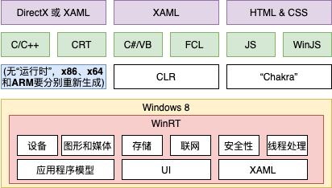

# 第25章 与 WinRT 组件互操作

> 本章整理《CLR via C#》第4版时代的 WinRT 问答。WinRT 的类型系统、CLR/FCL 投射及 RCW/CCW 解释以当时的 .NET Framework 模型为主；现代 .NET 的变化另标。作者稿待指定独立审核，不能把作者核验或机械覆盖率当作通过。

- [章节路线与版本](#c25-overview)
- [读懂图25-1与术语](#c25-diagram)
- [CLR投射与类型规则](#c25-types)
- [包装器和二进制边界](#c25-rcw)
- [框架投射工具箱](#c25-framework)
- [从应用文件读文本](#c25-read-file)
- [普通.NET操作何时才跨边界](#c25-ordinary-dotnet)
- [GC与WinRT资源生命周期](#c25-resource-life)
- [异步WinRT操作如何接入await](#c25-async)
- [流与缓冲区的适配边界](#c25-buffers)
- [进程、CLR、非托管与WinRT资源](#c25-resources)
- [重要纠错对照](#c25-corrections)
- [来源与核验限制](#c25-source-notes)
- [用C#定义组件](#c25-authoring)

<a id="c25-overview"></a>
## 章节路线与版本

最初的问题是“解析本章各节，让笔记可以独立学习”，随后又追问图25-1里各个名词的含义。本章先建立跨语言调用系统能力的地图，再解释碰到真实 WinRT 边界时，类型、异步、资源分别怎样处理。字符串、LINQ 等普通 .NET 操作则留在它们自己的实现中。

原书有三个主节，其中框架投射包含三个子节；聊天把六个主题排成25.1—25.6，主题可以保留，编号须恢复：

| 原书节 | 大白话及学习目的 |
| --- | --- |
| 25.1 CLR投射与WinRT组件类型系统规则 | WinRT有自己的类型规则，CLR怎样使它呈现为C#程序员熟悉的类型、接口和方法。 |
| 25.2 框架投射 | FCL提供显式适配工具，处理隐式类型投射难以解决的异步、流和缓冲区。 |
| 25.2.1 从.NET代码调用异步WinRT API | 将 `IAsyncAction`、`IAsyncOperation<T>` 等操作接入 `await`，处理成功、取消、错误及进度。 |
| 25.2.2 WinRT流和.NET流互操作 | 将 `IRandomAccessStream` 等接口与 `System.IO.Stream` 适配，让文件、网络、压缩、XML等既有代码协作。 |
| 25.2.3 在CLR和WinRT之间传输数据块 | 在 `IBuffer`、`byte[]` 和 `MemoryStream` 之间传递字节，分清共享缓冲区与实际复制。 |
| 25.3 用C#定义WinRT组件 | 把C#实现按WinRT公开类型规则导出，让原生C++、JavaScript等使用。 |

主线是“识别类型 → 找到适配工具 → 处理三个互操作场景 → 反向导出组件”。先理解语言、WinRT、操作系统三层，再记住RCW/CCW两个调用方向，再看类型如何投射，最后处理具体约束，会比一次记住所有术语容易。

本章的Windows Store、Chakra、Windows 8/8.1 SDK路径与WinMDExp属于历史背景。**从.NET 5开始，CoreCLR移除了直接消费WinMD的内建支持**；现代Windows开发使用C#/WinRT等投射工具，Windows App SDK/WinUI 3属于后续应用技术。现代支持并非只换几个API名称，不能把旧Framework的隐式投射和当前工具链视为相同实现，也不能用本机现代SDK失败倒判历史代码。见[官方变更说明](https://learn.microsoft.com/en-us/dotnet/core/compatibility/interop/5.0/built-in-support-for-winrt-removed)。

<a id="c25-diagram"></a>
## 读懂图25-1与术语



这张历史图讲的是：Windows提供拍照、文件存储、联网、播放音乐、绘图等能力，WinRT将相应能力组织成组件，多种语言通过各自的语言投射来使用。把它看成“三层夹心饼干”：

```text
┌─────────────────────────────────────────────┐
│  上层：各种编程语言                           │
│  C/C++    C#/VB    JavaScript                │
│  (原生)   (CLR)    (Chakra虚拟机)             │
├─────────────────────────────────────────────┤
│  中间层：WinRT组件                            │
│  存储 / 联网 / 图形 / 媒体 / 安全 / 线程       │
├─────────────────────────────────────────────┤
│  底层：Windows操作系统                        │
└─────────────────────────────────────────────┘
```

图的上端是不同的UI搭配：C/C++可用DirectX或XAML；C#/VB一侧使用XAML；JavaScript一侧使用HTML与CSS。DirectX提供图形、媒体等底层接口；XAML是描述界面对象和布局的标记语言及相应UI框架；HTML描述网页式界面结构，CSS描述样式。这里是在说明Windows 8应用的技术组合，不是在规定所有年代所有应用只能这样做UI。

第二、三行区分语言、类库与执行环境：

- **C/C++、CRT**：原生编译后的机器码直接执行，CRT是C/C++运行库，提供内存分配、字符串、数学等支撑。图中的“无运行时”指没有CLR或Chakra那样的托管/脚本虚拟机，不能读成“C++没有任何运行库”。原生应用通常为x86、x64、ARM分别生成代码。
- **C#/VB、FCL、CLR**：C#与Visual Basic是语言；FCL是.NET Framework类库，例如 `System.IO`、`System.Collections.Generic`、`System.Threading.Tasks`。通常先编译为IL，再由CLR的JIT为主机CPU生成机器码。CLR像“管家”，管理执行、托管内存、异常等；“编译一次”是在说明IL的可移植性，不保证带平台依赖的任意程序无需适配。
- **JS、WinJS、Chakra**：JS是JavaScript；WinJS是当时供JavaScript Windows应用使用的库；Chakra是微软的JavaScript执行引擎，可与Chrome的V8作类比。程序携带源码，由引擎解析和执行，并通过相应语言投射访问WinRT。

底部Windows 8框内的WinRT行包括**设备、图形和媒体、存储、联网、安全性、线程处理**；再下一行还有**应用程序模型、UI、XAML**。设备对应硬件访问，图形媒体对应显示和音视频，存储对应文件等，联网对应通信，安全性对应系统安全能力，线程处理对应系统执行支持。应用程序模型组织应用启动、生命周期和相关系统协作；UI是用户界面服务，XAML是其中的重要界面框架。原回答没有逐一说明CRT、WinJS和底部三项，这些是为了回答“图中所有名词”所需的短补充。

**WinRT（Windows Runtime）**可以先想成Windows系统能力的“积木”和跨语言组件模型。名称里虽有Runtime，它并不是CLR式的通用托管内存/JIT执行引擎。Windows自带的WinRT范围比FCL小；原书借此区别操作系统能力与字符串处理、LINQ等语言/框架服务。第三方也能定义自己的WinRT组件，不能进一步推成“WinRT只能是Windows自带系统对象”。

**COM（Component Object Model）**是微软1993年推出的组件技术。它用接口约定跨模块调用，常见底层调用经虚函数表（vtable），对象生命周期使用引用计数。WinRT沿用COM基础并加入更统一的类型系统、元数据和语言投射，减少应用开发者直接处理这些细节的负担。自动互操作并没有取消资源所有权和正确关闭的责任。

<a id="c25-types"></a>
## CLR投射与类型规则

### 元数据是组件的说明书

`.winmd`（Windows Metadata）是WinRT组件的“说明书”：采用ECMA-335元数据格式，描述有哪些类型、方法及参数。传统COM常用类型库 `.tlb`；WinMD能提供更适合语言投射的类型信息，CLR也已有读取.NET元数据的基础。**格式相近不等于任意.NET程序集天然就是合法WinRT组件**，还必须满足WinRT类型规则。

原书的操作系统元数据在 `%WinDir%\System32\WinMetadata` 中，文件如 `Windows.Storage.winmd`、`Windows.Networking.winmd`；编译开发时引用SDK的 `Windows.winmd`。书中的Windows 8.1示例路径为 `%ProgramFiles(x86)%\Windows Kits\8.1\References\CommonConfiguration\Neutral\Windows.winmd`。这些是历史路径，不能假定所有机器一样。本次只读检查发现本机SDK注册路径在D盘，已有 `D:\Windows Kits\10\UnionMetadata\10.0.26100.0\Windows.winmd`；C盘两个默认目录缺失不说明整个工具链不可用。

### 隐式投射使类型更熟悉

**投射/投影（projection）**是把一个类型系统中的类型与操作映射为另一侧的表达。CLR隐式投射通过解释、重写相关元数据实现；FCL框架投射则由代码调用扩展API进行适配。可以把投射理解为“让对方的类型看起来像自己这边的类型”，但要继续核对它究竟是类型映射还是对象/调用适配。

| WinRT类型系统特性 | .NET Framework侧表现与条件 |
| --- | --- |
| WinRT类没有共同的CLR式基类 | 通过CLR使用时表现为.NET对象，可调用 `ToString`、`Equals`、`GetHashCode`、`GetType`；不能据此断言所有对象操作都没有类型/资源限制。 |
| Boolean、整数、浮点、Char16、String、Void等核心类型 | 有相应CLR表达；WinRT不支持有符号8位整数，整数并不是任意CLR整型都可公开。 |
| 结构仅公开合法字段，不公开普通构造器/辅助方法 | 字段可为核心类型、枚举或其他合法结构。部分系统结构投射成具有.NET构造器、属性和方法的结构，例如 `Point`、`Rect`、`Size`、`TimeSpan`。 |
| `IReference<T>` 表达可空值类型 | 映射为 `System.Nullable<T>`，例如 `int?`。 |
| 枚举以Int32/UInt32为基础 | `int`用于离散值，`uint`用于可组合的标志值；导出时分别遵守相应Flags规则。 |

问答中把 `Windows.Foundation.Point` 写成 `System.Drawing.Point` 是真实错误。Framework提供的是**同名的 `Windows.Foundation.Point`**，定义在 `System.Runtime.WindowsRuntime.dll`，其X/Y是 `Double`；`System.Drawing.Point`的整型坐标不是这里的目标。另一些映射会改名，如 `Windows.Foundation.TimeSpan` → `System.TimeSpan`、 `DateTime` → `DateTimeOffset`、 `Uri` → `System.Uri`、 `IClosable` → `IDisposable`。集合中 `IVector<T>` → `IList<T>`。见[Framework映射表](https://learn.microsoft.com/en-us/windows/uwp/winrt-components/net-framework-mappings-of-windows-runtime-types)。

`IAsyncOperation<T>`则**仍是WinRT异步接口**，它没有被CLR隐式改名成 `Task<T>`。能够直接 `await` 是因为FCL提供 `GetAwaiter` 扩展；显式调用 `AsTask` 得到Task适配。这两者属于下面的框架投射。

<a id="c25-rcw"></a>
## 包装器和二进制边界

**RCW（Runtime Callable Wrapper，运行时可调用包装器）**让CLR代码使用COM/WinRT对象。对常见的原生WinRT实现，C#拿到一个托管包装器引用，包装器持有接口指针并完成跨边界调用。它像“同声传译”：WinRT对象是说COM接口语言的“外国人”，C#代码使用.NET表达，RCW把调用和返回结果连接起来。

**CCW（COM Callable Wrapper，COM可调用包装器）**负责另一方向：COM/WinRT使用一个托管对象时，通过CCW访问它，CCW内部保持对托管对象的引用。方向口诀是“CLR用COM → RCW，COM用CLR → CCW”；R指Runtime，C指COM。把CLR集合或委托传给真实WinRT ABI，可能用到CCW。

这些描述是普通跨ABI场景，**不保证每次C#的 `new`、每个别名或每次传参都新建一个包装器**。对象身份和包装器可复用。WinRT也可以由C#实现：原书25.3明确说明，托管代码调用同一CLR中的托管WinRT实现时，CLR可把它当普通托管调用，不创建RCW/CCW。因此“所有WinRT对象永远都在本机堆，任何调用都有两个壳”并不成立。

**ABI（Application Binary Interface，应用二进制接口）**是机器码层面的调用约定。典型WinRT COM接口通过vtable调用，ABI方法返回HRESULT，逻辑返回值通过输出参数传回；语言投射使C#看到较自然的签名。**HRESULT**是带状态语义的32位值，已知失败码可转为对应.NET异常，其他失败仍能通过异常的 `HResult` 表达。**封送桩（marshaling stub）**负责跨边界参数转换、数据传递和错误处理；“封送”不保证所有参数一律复制，也不保证所有参数一律共享。

例如，底层WinRT `OpenAsync` 的接口返回异步操作；成功HRESULT只说明启动调用成功，后续I/O也可能失败。它不是ABI直接返回一个 `Task<Stream>`。Task和.NET Stream是在更高层通过相应扩展方法接入的。这一区别会影响理解下面的文件例及异步资源关闭。

<a id="c25-framework"></a>
## 框架投射工具箱

CLR无法仅靠隐式类型映射消除两套编程模型的差异时，FCL提供显式扩展方法，像一个“工具箱”：

- `System.WindowsRuntimeSystemExtensions`：为四类WinRT异步接口提供 `GetAwaiter`、`AsTask`，接入Task、取消和进度。
- `System.IO.WindowsRuntimeStorageExtensions`：以.NET流方式打开实现 `IStorageFile`、`IStorageFolder` 的文件/文件夹对象。
- `System.IO.WindowsRuntimeStreamExtensions`：在 `IRandomAccessStream`、`IInputStream`、`IOutputStream` 与 `Stream` 之间创建适配器。
- `System.Runtime.InteropServices.WindowsRuntime.WindowsRuntimeBufferExtensions`：在 `IBuffer`、字节数组、内存流之间包装或复制数据块。

流是一串可读写的字节及其访问接口，缓冲区是一块保存字节的数据区。把WinRT流适配为.NET流，可以让需要 `Stream` 的现有文件、网络、压缩或解析代码继续工作；反过来，也可以将合适的.NET流适配给WinRT API。缓冲区适配中 `AsBuffer` 可包装已有数组而共享数据， `ToArray` 会复制；不能只用“高效转换”概括成每种方法都零复制。

<a id="c25-read-file"></a>
## 从应用文件读文本

原例的目的，是把StorageFile、语言投射、Task、流适配串成一条调用链。以下保持原 `ms-appdata:///local/test.txt` 场景，修正了方法返回类型的注释；它是**供相应Windows应用/权限环境调用的成员方法片段**，不是可在任意控制台原样运行的独立程序。文件不存在等错误会按API异步契约传播。本次未读取用户的该文件。

```csharp
using System;
using System.IO;
using System.Threading.Tasks;
using Windows.Storage;

public async Task<string> ReadFileAsync()
{
    // Windows自带StorageFile是WinRT对象；Framework按其投射提供访问。
    StorageFile file = await StorageFile.GetFileFromApplicationUriAsync(
        new Uri("ms-appdata:///local/test.txt"));

    // 此FCL扩展本身就返回Task<Stream>，不是返回IAsyncOperation<Stream>。
    Stream stream = await file.OpenStreamForReadAsync();

    // 返回的是.NET流适配器，StreamReader在该适配器上读取文本。
    using (StreamReader reader = new StreamReader(stream))
    {
        return await reader.ReadToEndAsync();
    }
}
```

第一步，获取文件的WinRT API返回 `IAsyncOperation<StorageFile>`，await通过扩展awaiter等它完成。绝对 `System.Uri` 在需要时按WinRT Uri映射/封送，启动调用与异步完成错误都要区分。第二步， `OpenStreamForReadAsync` 是FCL扩展，自己的公开返回类型就是 `Task<Stream>`，内部打开并适配WinRT流。第三步， `StreamReader` 在普通.NET流接口上读文本，using结束时处置reader及其拥有的stream。并不是从这一行开始每次读字符都重新建RCW/CCW。

本机既有Framework受控元数据核验按真实方法名确认上述Task签名；早一版探针误用 `GetMethods()[0]` 选中了 `CreateSafeFileHandle`，其原始SafeFileHandle输出仍保存在证据中，不作为本方法返回类型证据。另一个受控三字节适配器证实普通 `AsStream` 结果不是COM对象；因此不要见到“来自WinRT的Stream”便对它调用 `Marshal.ReleaseComObject`。

<a id="c25-authoring"></a>
## 用C#定义组件

消费组件与导出组件是两个方向。普通.NET类库可使用丰富CLR类型系统；一旦要把公共表面作为WinRT组件提供给其他语言，就须遵守它们共同能表达的类型规则。内部/private实现仍可以使用普通托管技术，规则不能泛化成“C#代码内部也不能用Task、List或泛型”。

### 公共表面的主要限制

1. WinMD文件名必须匹配公共类型的根命名空间，或它的子命名空间。例如 `Wintellect.WindowsStore.winmd` 可含 `Wintellect.WindowsStore` 及其子命名空间中的类型。旧托管导出规则要求程序集名不以Windows开头，系统的Windows根命名空间不能用于用户组件；类型名不能与命名空间相同。**仅大小写不同的命名空间不允许**，这里按组件命名/查找约定处理，纸书不是在说Windows区分大小写。
2. 书中普通C#公共组件类要求sealed、非泛型、从Object派生，只实现可导出的WinRT接口，不能公开字段。WinRT类型系统本身存在继承，例如系统XAML类型；不能把此C#导出限制推广为所有WinRT类型没有继承。
3. 公共方法、属性、事件/委托的参数和返回类型必须是WinRT兼容类型或支持的.NET映射类型。静态方法/属性/事件、out参数、可空属性都可按规则导出。
4. 枚举基础类型限于int或uint；int离散枚举不加Flags，uint标志枚举应加Flags。
5. 公共结构只含合法公共字段，可包含核心数据类型、String、枚举、其他结构；不公开普通构造器或辅助方法。
6. 用户定义的公共接口可含方法、属性、事件，但不能声明为自定义泛型接口。这里不能误读为WinRT完全没有泛型接口， `IAsyncOperation<T>` 等是系统定义的参数化接口。
7. 数组必须是一维零基；普通数组参数明确标 `[ReadOnlyArray]` 或 `[WriteOnlyArray]`，不同时输入输出。PassArray读取输入，FillArray填充调用者提供长度的输出数组，ReturnArray以返回值输出新数组；不应依赖输入元素在FillArray里有意义。ref参数不被这种ABI支持，out可用。
8. 方法可重载，但同参数个数的重载须有唯一 `[DefaultOverload]` 供JavaScript选择；同个数构造器另受限制，不能以DefaultOverload解决。方法不公开操作符重载或默认参数值。
9. `[Version(n)]` 标记类/新增成员版本，使导出工具为新成员生成独立底层接口，遵守COM接口发布后不可随意改变的约定。

原书 `WinRTClass` 模板把这些规则放到一处：静态方法/属性；返回String且有两个out参数的方法； `int?` 属性；事件；三个不同方向的数组方法；默认重载；异步方法；Version(2)新增方法。自动事件与手工事件遵守WinRT的事件注册令牌机制，手工版本使用 `EventRegistrationTokenTable<T>` 管理委托；不是普通委托属性的Completed/Progress。该模板的内部异步方法使用Task，外部返回四种WinRT异步接口之一，经 `AsyncInfo.Run` 或 `AsAsyncOperation` 适配。**有结果无进度**通常返回 `IAsyncOperation<T>`；无结果或有进度时使用相应其他接口，不是所有公共异步方法都只能返回同一种接口。

### 工具阶段和适合的场景

历史Visual Studio“Windows运行时组件”项目使用C#编译器的 `/target:winmdobj` 生成WinMDObj，再由 `WinMDExp.exe` 核公共元数据、映射类型并生成WinMD；Exporter会改变元数据而非任意重写IL。ILDasm的 `/project` 可以显示.NET投射后的元数据。检查可能发生在不同阶段，不能统称“编译器一开始就不让过”。本次已有最小Task公共签名探针实际先生成WinMDObj成功，随后Exporter以WME1039拒绝；普通类库编译成功当然不代表可导出为WinRT。合法最小组件也完成了有限导出，未注册/激活运行。见[导出错误条件](https://learn.microsoft.com/en-us/windows/uwp/winrt-components/diagnosing-windows-runtime-component-error-conditions)。

书中强调的应用场景是：Windows Store应用用HTML/CSS做UI、JavaScript连接UI与C#组件实现的业务逻辑，或借用FCL功能，例如WCF。若双方本来都运行在CLR上，普通.NET类库通常更直接，WinRT较窄的类型系统反而增加限制。若原生C++选型是为了性能/内存，让它使用托管组件会加载CLR并承担JIT/GC等成本；这只是取舍，**不意味着原生C++永远不会调用C#组件**。原书还举了Bing Maps用原生C++/DirectX做UI、C#做业务逻辑的历史例子。

同一CLR中用托管代码测试托管WinRT组件可能走优化的普通调用路径，性能、null字符串和数组可见修改等表现未必等于JavaScript/原生调用经过ABI的结果。验证组件时应核真正使用者的调用条件；此处没有把现代C#/WinRT作者工具链作为书中WinMDExp的同版本复现。

<a id="c25-ordinary-dotnet"></a>
## 普通.NET操作何时才跨边界

追问是：“CLR为什么要和WinRT转化对象？C#所有数据结构最终都变成WinRT对象吗？”答案是：**普通.NET本地操作不需要这样做；实际与WinRT组件的类型/ABI边界交互时，才需要相应投射、包装或封送。**“两个世界”是理解边界的类比，不是进程中的两个绝对隔离区域；前面的托管组件优化路径仍是例外。

CLR侧可以使用 `List<int>`、 `Dictionary<string,T>`、普通class、delegate和Task，引用对象的托管存储由GC管理。Windows侧的典型系统WinRT类型有 `Windows.Storage.StorageFile`、 `Windows.UI.Xaml.Controls.Button` 和 `Windows.Networking.Sockets` 下的类型；它们对外遵守WinRT组件协议。但不是所有叫 `Windows.*` 的.NET类型都代表一次ABI调用，第三方WinRT组件也可以有自己的命名空间。

原小图的分叉仍可这样读，修掉了把命名空间当判断条件的说法：

```text
你的C#代码
    │
    ├── 只做普通.NET本地操作 ──→ 不自动转化为WinRT对象
    │
    └── 实际调用WinRT组件的ABI ─→ 按需要包装、投射、封送
```

### 三种典型边界场景

第一种是从C#获取/调用WinRT对象。原局部片段如下， `uri` 是由调用者提供的适用绝对URI，文件环境与前例相同：

```csharp
var file = await StorageFile.GetFileFromApplicationUriAsync(uri);
```

典型原生StorageFile在CLR侧经RCW使用；跨边界结果用投射类型呈现。RCW不可达后，运行时最终会清理它所持有的COM引用，但这不表示“方法返回时立即Release”或“任何外部资源在当次GC中准时关闭”。

第二种是参数和返回类型要能被两侧表达。原对照表包含八个不同点，须区分ABI表示、隐式映射和异步适配：

| WinRT侧 | .NET侧 | 翻译发生在哪里 |
| --- | --- | --- |
| ABI的 `HSTRING` | `System.String` | 语言投射/封送把字符串表示接起来；是否复制取决于方向及实现，不由这张表一概决定。 |
| ABI的 `IInspectable*` | 可作为.NET对象使用的投射对象 | COM接口指针与.NET对象引用不是相同内存布局；需要适当包装/投射，不能当成简单的指针强制转换。 |
| `IVector<T>` | `IList<T>` | 集合接口的CLR投射。 |
| `IMap<K,V>` | `IDictionary<K,V>` | 字典接口的CLR投射。 |
| `IAsyncOperation<T>` | 可经 `AsTask` 适配为 `Task<T>` | Framework扩展适配；接口本身仍然存在，也可直接由扩展awaiter等待。 |
| `IReference<T>` | `Nullable<T>` | 适用值类型的可空投射。 |
| `Windows.Foundation.Uri` | `System.Uri` | URI类型映射/封送；WinRT要求适用的绝对URI。 |
| `HResult` / ABI失败HRESULT | `System.Exception`及具体异常 | 状态与异常投射；失败码保留在异常HResult中，不能将每个成功状态也说成异常。 |

字符串是很直观的例子：WinRT ABI使用HSTRING，CLR使用System.String，跨边界时要转换/适配表示，返回时再接回.NET字符串。普通C#字符串处理不需要因此全变成WinRT对象。

第三种是把托管对象交给WinRT供它调用。原写法只是示意，不存在书中固定叫 `RegisterCallback` 的API，也不保证任意对象均符合它的参数接口：

```csharp
// 伪代码：myDotNetObject必须符合真实API要求的可公开接口。
someWinRTApi.RegisterCallback(myDotNetObject);
```

真正通过COM/WinRT访问这个对象时，CCW使外部代码能够调用它，同时保持必要托管引用。“永远不会变成WinRT对象”更准确地说是：托管List、Person的原存储不会自动搬成系统对象；若后来按合法接口交给WinRT，仍可能公开相应的COM/WinRT视图。

### 保留原来的两组具体代码

第一组只进行普通本地操作，保原List的1、2、3，张三/25岁，以及Where再Select的顺序。 `Person` 没在来源中定义；以下前提是它只有普通托管构造/自动属性，没有自行调用WinRT。正文不能替一个未知构造器保证任何实现都不触碰WinRT。

```csharp
var list = new List<int> { 1, 2, 3 };
var dict = new Dictionary<string, int>();
var person = new Person { Name = "张三", Age = 25 };
var result = list.Where(x => x > 1).Select(x => x * 2).ToList();
```

先筛出2、3，再乘2，result为 `[4, 6]`。在上述前提下，重复执行一百万次也不会因为CLR的投射功能自动访问WinRT。此处“一百万次”说明触发条件，未进行这种无意义的大量分配实测。PDF提取把字符串显示成“ 张三 ”；本人核原PDF第11页，实际字符串没有内部空白，保原 `"张三"`，不是另造输入不同的新例。

第二组访问文档库，场景和前例的应用本地文件不同，分别保留。它依赖相应Windows库权限、应用环境；本次没有枚举用户文档：

```csharp
var folder = KnownFolders.DocumentsLibrary; // Windows系统WinRT对象
var files = await folder.GetFilesAsync();   // WinRT异步操作，扩展awaiter接入await
// GetFilesAsync的操作结果是文件列表；IVectorView<StorageFile>
// 在Framework侧映射为IReadOnlyList<StorageFile>。
```

原注释“IVector投射成IReadOnlyList”混了两组映射： `IVector<T>` 对应 `IList<T>`， `IVectorView<T>` 才对应 `IReadOnlyList<T>`。两段代码在PDF中连成一个完整候选，实际合入以上两处完整原场景，不能把整个PDF候选仅并入其中一段。

### 为什么要由投射做这些工作

多语言调用同一组件要接起四类差异：内存/生命周期协议，字符串/对象等类型表示，HRESULT与异常，WinRT异步操作与.NET Task。C++代码可自行或通过RAII/智能包装管理资源，C#托管存储由GC管理，COM外部接口引用则有AddRef/Release协议。若没有投射/适配，调用者就得自己处理HSTRING、引用计数、错误码和异步桥接；Framework让正常使用更接近调用一个熟悉类库。

原另一幅较完整ASCII图保留这个调用路线，异步箭头改为显式适配：

```text
┌─────────────────────────────────────────────┐
│ 你的C#代码                                  │
│ var list = new List<int>();  ← 普通.NET操作  │
│ var file = await StorageFile... ← WinRT调用  │
└──────────────────────┬──────────────────────┘
                       │
              ═════════╪═════════ ABI边界
                       │
┌──────────────────────▼──────────────────────┐
│ 投射/互操作按需要执行：                      │
│ • 使用RCW/CCW包装器                          │
│ • string ↔ HSTRING等表示适配                 │
│ • 失败HRESULT → .NET异常                    │
│ • IAsyncOperation → awaiter/AsTask适配       │
└──────────────────────┬──────────────────────┘
                       │
┌──────────────────────▼──────────────────────┐
│ WinRT组件                                   │
│ Windows.Storage.* / Windows.UI.Xaml.*       │
│ Windows.Networking.* / 第三方组件命名空间   │
└─────────────────────────────────────────────┘
```

“出国办签证”的类比仍有用：普通.NET对象在本地完成工作时不需要出国；需要跨组件协议时才办相应手续。手续可能复用，而且没有把其原托管存储改变成另一块对象。现代C#/WinRT把这一目的继续实现于独立投射工具中；具体内建支持从.NET **5**起移除，不是来源写的.NET 6。无需把这种演变概括成“现代C#编译器完全不知道任何Windows细节”。

<a id="c25-resource-life"></a>
## GC与WinRT资源生命周期

用户结合第21章追问“WinRT对象是不是托管堆对象”。对**原生实现、经Framework RCW使用的WinRT对象**，必须分两层看；托管实现走同CLR普通调用时，不能套用所有对象都在原生堆的图。

| 对象 | 存储和生命周期 |
| --- | --- |
| CLR侧的RCW托管包装器 | 托管对象参与GC可达性跟踪，包装器及相关运行时结构持有底层接口引用。 |
| 包装器所引用的原生WinRT/COM实现 | 本机存储不由托管GC直接扫描回收；外部接口引用依COM AddRef/Release协议，最终销毁仍受实现与其他引用影响。 |

保留原“代码 → 壳 → 底层对象”的图，只收窄错误的绝对条件：

```text
┌───────────────────────────────────────────────┐
│ C#代码                                        │
│ var file = await                              │
│ StorageFile.GetFileFromApplicationUriAsync(uri)│
└──────────────────────┬────────────────────────┘
                       │ 典型原生系统组件
┌──────────────────────▼────────────────────────┐
│ CLR侧RCW托管包装器                             │
│ • 托管存储受GC管理                             │
│ • 持有底层COM接口引用，运行时负责互操作清理     │
└──────────────────────┬────────────────────────┘
                       │ 接口调用 / AddRef / Release
┌──────────────────────▼────────────────────────┐
│ 原生WinRT/COM组件实现                          │
│ • 本机存储不是GC直接回收的托管对象存储         │
│ • COM接口引用计数及组件自身资源协议            │
└───────────────────────────────────────────────┘
```

### 接上第21章的GC概念

第21章用类型对象指针和同步块索引讲对象开销，用根、标记、压缩和代讲GC。这是特定CLR实现的学习模型；字段布局不是C#语言统一保证。GC从运行时报告的活动根（含局部/寄存器引用、静态字段和相关句柄等）跟踪可达对象，回收不再需要的托管存储。压缩时移动合适的存活对象并更新引用，**并非每次回收所有区域都必须移动**。普通小对象通常从Gen0开始，经历相应代的回收并存活可被提升；大对象、固定对象和具体收集策略另有条件，不能画成任何对象在任意两次GC后一律0→1→2。

普通C#引用赋值 `b = a` 并不会使GC成为“对RCW每个变量做AddRef”的引用计数器。RCW的内部互操作计数，与包装器持有的COM接口引用计数，是不同协议；也都不能由有几个C#别名算出。RCW可能缓存多个接口，清理时释放其拥有的引用，不是保证恰好只调用一次Release，把所有对象都减成零。[RCW契约说明](https://learn.microsoft.com/en-us/dotnet/standard/native-interop/runtime-callable-wrapper)明确运行时在包装器上进行GC，并在不再需要时释放底层引用。

如果FileStream、网络连接或COM包装器还持有外部资源，只回收托管字节不是完整资源管理。第21章因此讨论Dispose、终结器及SafeHandle。**RCW自动清理不应直接等同于用户写的C#析构器/ `Finalize` 方法**。本机两环境对 `System.__ComObject` 的有限元数据探针未发现它声明自己的Finalize；这只是元数据观察，不能据此说CLR不清理COM引用。引用释放仍由相应运行时的互操作生命周期实现负责。

普通带终结器的托管对象被判为垃圾后，要保留到终结路径执行；完成终结且不再可达以后，内存才可回收，因此存活期可能延长。该时间不由程序精确决定，也不只是“Gen0撑满”才有GC。与RCW有关的正确共同点是**自动清理不提供业务所需的及时关闭保证**，而不是断言它们都执行同一个C#Finalize。原聊天把第21章“使用终结器释放本地资源”标为21.4也不准确：本地书中相关段属于21.3“使用需要特殊清理的类型”，另有“手动监视和控制对象生存期”主题。参见[第21章候选](第21章-托管堆和垃圾回收.md)，本章不据此代替该章独立审阅。

### using关闭资源，不等于强释放包装器

循环反复打开流而不及时关闭，可能使句柄、网络连接或GPU等有限资源长时间被占用。对你拥有且契约允许关闭的流，应使用using/Dispose。保留原正确与不推荐写法的对比，修正注释中的Release等号：

```csharp
// 推荐：这个调用者拥有返回的.NET Stream，及时按其契约关闭。
using (var stream = await file.OpenStreamForReadAsync())
{
    // 使用stream
}
// 正常离开或异常展开时调用stream.Dispose()。
// 此处是.NET流适配器的关闭协议，不等同于Marshal.ReleaseComObject。

// 不推荐：打开资源后没有安排明确关闭。
var stream = await file.OpenStreamForReadAsync();
// 不能把赋null或等待GC当作在指定时间关闭文件的安排。
```

这是两个替代场景的片段，不应把同名局部当作一个方法中连续重复声明。WinRT `IClosable.Close` 投射为 `IDisposable.Dispose`，是对象定义的资源关闭协议；IUnknown.Release释放一个COM接口引用，RCW内部计数又是另一层。关闭资源后，托管包装器或适配器还可以作为对象存在；另一方面，Release一个引用也不保证其他使用者的引用已经归零。

原例接着写了以下一行。保留为明确反例，**不要执行在这个普通流适配器上**：

```csharp
// 反例：OpenStreamForReadAsync得到的普通.NET Stream并不是RCW。
Marshal.ReleaseComObject(stream);
```

既有有限探针对普通MemoryStream和IBuffer的AsStream适配器分别确认 `Marshal.IsComObject` 为false，调用ReleaseComObject得到ArgumentException；不能把这些具体结果泛化为所有名叫Stream的对象。若确有普通COM互操作，ReleaseComObject减的是RCW内部计数，计数归零才断开它所持有的底层引用。共享RCW被强释放，会让其他持有者失效；并发调用时还可能访问冲突或损坏内存。这是静态/API风险核验，本任务没有故意运行这样的破坏例。参见[ReleaseComObject合同](https://learn.microsoft.com/en-us/dotnet/api/system.runtime.interopservices.marshal.releasecomobject?view=netframework-4.8.1)。

### 两章的联系应这样理解

原并排生命周期图保留托管内存与外部引用两条路径，删去把RCW全部画成普通Finalize的错误等号：

```text
第21章托管对象                         第25章典型原生互操作
──────────────────────────────────────────────────────────
托管对象存储                           RCW的托管存储
  ↓ GC跟踪可达性                        ↓ GC跟踪可达性
  ↓ 合适时回收                          ↓ 运行时互操作清理
  ↓ 若类型有终结器：                    ↓ 释放包装器拥有的COM引用
  ↓ 先运行终结路径，再可能回收           ↓ 底层还可能有其他持有者
                                       ↓ 最后引用释放/组件生命周期结束
                                       ↓ 原生实现完成相应销毁
```

它们是概念上的关联章节，21和25并不是数字相邻两章。 `file = null` 只改变一个变量；若尚有其他根，RCW仍可达，即使没有其他根也不保证立即收集，更不保证外部资源已立即关闭。资源耗尽的风险因此确实存在。显式关闭安排、GC可达性、终结器兜底和COM所有权各负责自己的部分；只有在拥有资源且协议允许时才调用Dispose，不能见到外部资源便随意关闭他人共享对象。

<a id="c25-async"></a>
## 异步WinRT操作如何接入await

这轮追问对应原书25.2.1：“返回的不是Task，为什么能await？”先纠正一个前提：**C#的await识别可等待模式，不只识别Task**。合适的实例/扩展 `GetAwaiter` 返回具有 `IsCompleted`、 `GetResult` 及完成通知接口的awaiter，就可接入await。已有两个环境的有限补充探针等待一个非Task自定义对象，均返回7；这不是WinRT本身的复现，而是反证“await只认Task”的语言误解。见[await规范的可等待模式](https://learn.microsoft.com/en-us/dotnet/csharp/language-reference/language-specification/expressions#1299-await-expressions)。

### 四种操作及共同状态

WinRT异步调用先返回一个表示“将来会结束的操作”的对象。四类接口配合 `IAsyncInfo` 提供Id、Status、ErrorCode、Cancel、Close等通用信息/控制：

| WinRT异步接口 | 含义 | 适配后的.NET表达 |
| --- | --- | --- |
| `IAsyncAction` | 无结果值的异步操作 | `Task`。 |
| `IAsyncActionWithProgress<TProgress>` | 无结果值，可报告进度 | `Task`，另接 `IProgress<TProgress>`。 |
| `IAsyncOperation<TResult>` | 有结果值 | `Task<TResult>`。 |
| `IAsyncOperationWithProgress<TResult,TProgress>` | 有结果值，可报告进度 | `Task<TResult>`，另接进度报告。 |

Action的GetResults没有结果值，Operation的GetResults返回TResult。 `Started` 表示未结束；最终通常是 `Completed`、 `Canceled`、 `Error`。 `Completed`/ `Progress` 是**委托属性**，不是可随意多播订阅的C#event。带Progress接口允许在执行期间报告类型匹配的进度，并不保证固定周期或每个操作都支持进度。

书中以GUI响应说明异步API的设计：同步I/O可能阻塞不确定时间，UI无法处理触摸、鼠标、手写笔等输入；当时WinRT把I/O及可能较长的工作以异步方式公开，书中使用“超过50毫秒”的设计尺度。这解释为何需要等待操作，而不是让UI线程在同步调用里停住；异步不意味着每次调用必创建一个新线程。

音乐库的具体原例保持 `Song.mp3`：

```csharp
// WinRT调用返回异步操作接口，不是Task<StorageFile>。
IAsyncOperation<StorageFile> asyncOp =
    KnownFolders.MusicLibrary.GetFileAsync("Song.mp3");
```

这是一个局部调用示例，依赖音乐库访问权限、应用环境及文件存在；本次没有访问用户音乐库。它与文档库列表、应用本地test.txt是三个不同场景。

### 手工回调：看清完成、取消和错误

下面保留原 `WinRTAsyncIntro` 与 `OpCompleted` 两个成员、三种状态分支及Close。为使处理结果时异常也有清理安排，整理时把Close放进finally；**这是清理安排的补充**，不是改变原先“通过回调获取结果”的教学目的。

```csharp
public void WinRTAsyncIntro()
{
    IAsyncOperation<StorageFile> asyncOp =
        KnownFolders.MusicLibrary.GetFileAsync("Song.mp3");
    asyncOp.Completed = OpCompleted;
    // 如需之后取消，要在拥有者中保留asyncOp并按合同调用Cancel。
}

private void OpCompleted(IAsyncOperation<StorageFile> asyncOp, AsyncStatus status)
{
    try
    {
        switch (status)
        {
            case AsyncStatus.Completed:
                StorageFile file = asyncOp.GetResults();
                // 处理文件
                break;
            case AsyncStatus.Canceled:
                // 处理取消
                break;
            case AsyncStatus.Error:
                Exception exception = asyncOp.ErrorCode;
                // 处理错误
                break;
        }
    }
    finally
    {
        asyncOp.Close();
    }
}
```

操作启动后给Completed赋委托，操作结束时回调收到原操作和状态。先结束、后赋Completed的竞态由接口实现处理；甚至可能在setter尚未返回前，在同一线程同步回调，不能总称“安排到另一个后台线程”。原书也提醒回调可能在GUI或线程池线程执行，代码不能依赖一律在GUI线程。 `status` 参数直接提供当前完成原因，可据它分支； `GetResults` 与 `ErrorCode` 的有效使用仍服从操作状态合同。[Completed属性合同](https://learn.microsoft.com/en-us/uwp/api/windows.foundation.iasyncoperation-1.completed?view=winrt-26100)规定不能重复设置，并明确先完成后赋值的同步回调可能。

手工写法串联多个操作会造成回调嵌套，状态与错误要显式分支，且拥有者须安排操作对象关闭。普通using依赖对象可处置接口/模式和合适时机；不能笼统说“手工异步永远不能用using”，也不能在操作仍运行时为方便而提前Close。

### AsTask与扩展awaiter

以下是原问答列出的API签名，属于**声明摘要，省略类体和方法实现**：

```csharp
public static Task AsTask(this IAsyncAction source);
public static Task<TResult> AsTask<TResult>(
    this IAsyncOperation<TResult> source);
public static Task AsTask(this IAsyncAction source,
    CancellationToken cancellationToken);
public static Task<TResult> AsTask<TResult, TProgress>(
    this IAsyncOperationWithProgress<TResult, TProgress> source,
    CancellationToken cancellationToken,
    IProgress<TProgress> progress);
```

它们位于Framework的 `System.WindowsRuntimeSystemExtensions`。Task在.NET侧代表等待与结果状态；可比喻为“收据/适配器”，让调用者继续用熟悉的异常、取消和进度模型。典型桥接把操作成功接到Task成功、取消接到Task取消、错误接到Task失败。Completed通过委托属性接入，不能写成订阅一个任意多播事件。

原awaiter代码保留为**等价机制示意**：

```csharp
public static TaskAwaiter<T> GetAwaiter<T>(this IAsyncOperation<T> source)
{
    return source.AsTask().GetAwaiter();
}
```

编译器找到这个扩展awaiter后等待的是适当的TaskAwaiter。这里不是声称已取得每个Framework版本的完整私有源码，也不是把WinRT接口从类型系统里抹去。原书使用TaskCompletionSource和Completed回调讲桥接思路；具体实现还可有“已有状态/已关联Task”的快捷路径。本机既有Framework `AsyncInfo.Run` 自身操作返回7的有限记录中，AsTask返回的**就是其内部原Task**，不是每次都另new一个TaskCompletionSource；完成后Status仍为Completed，显式Close后再读Status才出现ObjectDisposedException。

保留原 `GetSongAsync`，它本身是返回Task的.NET成员，里面等待WinRT操作：

```csharp
public async Task<StorageFile> GetSongAsync()
{
    StorageFile file = await KnownFolders.MusicLibrary
        .GetFileAsync("Song.mp3");
    return file;
}
```

过程是：GetFileAsync取得WinRT操作 → 找扩展GetAwaiter → 检查完成状态 → 未完成才登记续执行并挂起**当前异步方法**，把控制交还调用者 → 结束后GetResult给出StorageFile或抛出取消/错误 → 方法继续。若已完成，可以直接同步继续，不一定挂起。await不以阻塞线程来等结果，Task也不等于固定的“执行线程”。源码读起来与 `HttpClient.GetAsync` 类似，不表示权限、对象关闭或底层调度合同完全相同。

保留原左右对照图，修正了“GetAwaiter自己总挂起”和“另一个线程”的绝对说法：

```text
你的C#代码                           Framework侧适配路线
─────────────────────────────────────────────────────────
var file = await                     IAsyncOperation<StorageFile> op =
  KnownFolders.MusicLibrary             KnownFolders.MusicLibrary
  .GetFileAsync("Song.mp3");  ───→       .GetFileAsync("Song.mp3");
                                     Task<StorageFile> task = op.AsTask();
                                     awaiter = task.GetAwaiter();
                                     未完成：注册续执行，方法挂起
                                     已完成：可同步取得结果
                                     操作结束：完成Task状态
                                     await取结果，方法继续
```

TaskAwaiter在通常的await场景可使用所捕获的SynchronizationContext恢复到相应上下文；GUI上下文能帮助回到UI线程，见第28章。并非每个调用点都有GUI上下文，或所有await都无条件恢复同一线程。

### 取消和进度：必须保留同一个取消源

这组原例假设 `XxxAsync` 返回 `IAsyncOperationWithProgress<IBuffer,uint>`， `WinRTType`、 `SomeOtherException` 和省略号都是教学占位。聊天把书中的字段 `m_cts` 搬进方法体，却在另一个Cancel方法引用它。**若没有其他同名字段，Cancel里的名字找不到**；若外面恰有同名字段，则局部变量遮蔽字段，Cancel可能取消另一实例。不能对未知上下文一律说同一种编译错误。

下面恢复原书的字段意图；它是带占位的类结构示意，不是完整可编译程序：

```csharp
internal sealed class MyClass
{
    private CancellationTokenSource m_cts = new CancellationTokenSource();

    public async void MappingWinRTAsyncToDotNet(WinRTType someWinRTObj)
    {
        try
        {
            IBuffer result = await someWinRTObj.XxxAsync(...)
                .AsTask(m_cts.Token, new Progress<uint>(ProgressReport));
            // 成功完成
        }
        catch (OperationCanceledException)
        {
            // 处理取消
        }
        catch (SomeOtherException)
        {
            // 处理该具体错误
        }
    }

    private void ProgressReport(uint progress)
    {
        // 若构造Progress时捕获了适用GUI上下文，在其中更新UI。
    }

    public void Cancel() { m_cts.Cancel(); }
}
```

已有两个环境只编译了隔离后的“方法local、另方法Cancel、无field”骨架，均得到CS0103；没有把省略号和占位类型的不可编译性算作原书错误。CTS在这里代表一个取消生命周期；取消是协作请求，并非强行杀线程。正常生产生命周期还要安排取消源等对象的处置，不能反复无条件重用已取消的同一CTS。

原书简化AsTask逻辑中的 `ct.Register(() => asyncOp.Cancel())` 将令牌取消传给WinRT；Progress委托属性接到 `progress.Report(p)`；Completed依据状态设置TaskCompletionSource的结果、取消或异常。实际库还须处理空进度对象、登记的释放、已经完成状态等边界，简化教学代码不应作为生产实现逐字抄用。 `Progress<T>` 捕获的是构造时的适用上下文；没有该上下文不保证UI线程。无需取消/进度时直接await，需要这些功能时选相应AsTask重载。

### 避免混用完成通知；清理责任仍看协议

原来两种写法的对比有用，保留音乐库输入：

```csharp
// 通常选一种完成路径：通过Framework扩展await操作。
StorageFile file = await KnownFolders.MusicLibrary.GetFileAsync("Song.mp3");

// 反例：同一WinRT操作先占用Completed，又交给await适配。
var op = KnownFolders.MusicLibrary.GetFileAsync("Song.mp3");
op.Completed = (o, s) => { /* 手工完成处理 */ };
StorageFile file = await op; // 适配还可能需要Completed，存在冲突风险。
```

这是两个替代片段；不要在同一局部作用域连续重复声明file。WinRT Completed只允许一次设置，适配器也可能要使用它，因而不应混用手工回调与默认await。已有另一份私有、已完成、task-aware的 `AsyncInfo.Run` 补充操作先设Completed后AsTask，得到8、回调计数1且返回原Task；**这个实现的快捷路径不发生冲突，不反证原音乐库操作的风险**，更不意味着所有实现都一定立即失败。

原答“await/AsTask帮你管理一切”“Task被GC前所有WinRT资源都不释放”都过强。适配Task与WinRT操作对象、它的结果对象各有生命周期；完成、Close、Dispose、释放COM引用是不同动作。上面返回7的实际记录已经说明完成不等于自动Close，也不能一律把资源生存期等同于Task可达性。采用框架等待路径时按其具体合同安排所有权，不在未完成操作上随意Close，也不以“直接await过了”推定StorageFile打开的流、结果缓冲区或其他资源全部已关闭。手工拥有操作对象的回调代码则明确安排Close。框架投射减少重复桥接工作，仍有类型、线程、资源和错误边界，不能称为任意两套类型系统之间的“无损、无边界翻译”。

<a id="c25-buffers"></a>
## 流与缓冲区的适配边界

这部分回应最初章节概览中的25.2.2与25.2.3，并连接已经讲过的文件例。 `IRandomAccessStream` 支持随机访问， `IInputStream` 用于输入， `IOutputStream` 用于输出；Framework通过 `AsStream`、 `AsStreamForRead`、 `AsStreamForWrite` 提供Stream视图，反向有 `AsInputStream`、 `AsOutputStream`。这是适配，不是普通的C#强制类型转换；实现可以缓冲小块I/O以减少跨边界调用。读取、写入、所有权和关闭仍须看实际适配器合同。

`IBuffer` 用 `Capacity` 表示最大字节容量， `Length` 表示当前有效字节数；它不是.NET byte[]本身。使用 `WindowsRuntimeBufferExtensions` 后：

- 数组的 `AsBuffer` 可以包装同一数组及选定的offset/length/capacity，而不用复制其内容。 `ArraySegment<byte>` 表示数组的一段，可以用其Array、Offset和Count选择相应的数组包装重载；这里并未声称有接受ArraySegment的同名直接扩展。
- 合适的 `MemoryStream` 可以用 `GetWindowsRuntimeBuffer` 包装其公开底层缓冲区；流是否公开缓冲区、位置与长度等条件仍要遵守。
- `IBuffer.AsStream` 创建.NET流视图； `ToArray` 则分配数组并复制字节。不能把所有转换都称为共享或零复制。

原概览强调尽量减少不必要复制、提高文件/网络/压缩/数据处理性能。它保的是这个目的，不能外推成任何API都能共享同一个底层地址。已有受控3字节数据 `[1,2,3]` 的Framework探针取得AsBuffer视图，把原数组第一字节改为9，视图/AsStream都读到9；它验证这个包装场景的共享，未证明所有流/缓冲区实现的全部性能或内存行为。原书的位图像素、加密或套接字使用背景是该技术的用途，不代表本任务已调用这些设备/API。

<a id="c25-resources"></a>
## 进程、CLR、非托管与WinRT资源

最后的追问是：“GC章所说的非托管资源，是不是全指WinRT？WinRT资源、进程资源和CLR资源怎样理解？”**非托管资源远不止WinRT**。同时，这几个词从不同视角描述同一个系统，不能画成适用于所有实现的严格包含集合。

### 进程是系统执行与资源使用的容器

Windows进程拥有自己的虚拟地址空间、对系统对象的句柄、安全上下文、PID，以及至少一个初始执行线程。虚拟地址空间是进程可使用的地址集合，并非同样多的物理RAM；大小取决于体系结构、操作系统和程序标志。32位Windows总地址空间4GB也不表示用户进程总能用足4GB，默认用户/系统划分与特殊配置不同。[进程概念](https://learn.microsoft.com/en-us/windows/win32/procthread/about-processes-and-threads)和[虚拟地址空间说明](https://learn.microsoft.com/en-us/windows/win32/memory/virtual-address-space)支持这些区别。

句柄表记录进程持有的内核对象句柄，例如文件、事件、互斥体、注册表键。PID是标识符，不能把“拥有PID”说成一块GC堆对象。进程退出时，操作系统回收它的地址空间及拥有的句柄等；外部文件内容、共享内核对象、另一进程或数据库服务不会因此一律被物理销毁。

CLR是加载到进程中的运行时，可把它想成“寄居的客人”。Framework有托管堆和AppDomain等组织机制；进程是操作系统的容器，AppDomain是Framework内部的逻辑隔离容器，不是额外独立的操作系统进程。现代.NET的AppDomain支持与Framework不同，此处只借它解释历史视角，细节见第22章。

### CLR运行时资源不全等于GC堆字节

“托管对象存储”包括普通class实例、托管数组、托管字符串、装箱值类型的对象存储，GC管理其可达性和回收，使用者无需手动释放这块托管字节。但“CLR资源”若按运行时实现讲，还包含JIT生成代码、元数据、内部本机结构等，不能全部画进GC堆。

托管对象可以同时拥有外部资源：FileStream的对象存储受GC管理，所封装的文件句柄另有关闭协议；SqlConnection对象与数据库连接/连接池同样是两个层次。GC看不懂任意IntPtr后面代表什么，要由相应所有者和包装器的资源协议释放。SafeHandle等类型可以提供可靠兜底；**不是每个实现IDisposable的类都必须再写一个自己的终结器**。

### 保留五类不同的非托管场景

| 原来源类别 | 具体例子与清理边界 |
| --- | --- |
| Win32资源/图形资源 | 文件句柄、窗口句柄HWND、GDI/GDI+画笔画刷、套接字；按创建API对应的关闭/销毁函数或拥有它的托管包装器处理，不能都用同一个Release。 |
| COM/WinRT对象 | 典型原生WinRT组件，以及传统Excel、Word自动化对象；实际COM引用由包装器/COM协议管理，资源关闭、应用退出与释放接口引用仍是不同动作。 |
| P/Invoke调用申请的资源 | 通过 `[DllImport]` 调原生DLL申请的资源；返回的句柄/内存须按真实API所有权和配对函数释放，P/Invoke本身不自动替你定义资源生命周期。 |
| 非托管内存 | `Marshal.AllocHGlobal` 分配的内存须由所有者配对 `Marshal.FreeHGlobal` 等正确释放；IntPtr只是地址值。 |
| 原生数据库连接 | 通过原生API建立的连接，有该API规定的关闭合同；进程退出与数据库持久数据/服务结束并非同一事。 |

第一类中的HWND、GDI+、Socket采用各自的资源协议；只有真正COM接口才谈它的Release。第21章的具体FileStream、Mutex等已说明“本机资源”不是WinRT的专称；WinRT被第25章单独讲，是因为它的组件类型与语言投射要专门衔接。

以下原五个场景全部保留，**是独立示意行，未执行**；原test.txt/Create会创建或覆盖文件，image.png、connStr、uri又依赖外部环境，不能把这段当作已经安全运行的完整程序：

```csharp
FileStream fs = new FileStream("test.txt", FileMode.Create); // 打开文件句柄
SqlConnection conn = new SqlConnection(connStr); // 构造连接对象；Open才建立/获取连接
Bitmap bmp = new Bitmap("image.png"); // System.Drawing场景的图像及GDI+资源
IntPtr ptr = Marshal.AllocHGlobal(1024); // 分配1024字节本机内存

StorageFile file = await StorageFile.GetFileFromApplicationUriAsync(uri);
// 这是Windows系统WinRT API；适用Windows应用/桌面条件见相应API，非仅UWP专有。
```

若在自己的有效环境实际使用，应给fs、conn、bmp等安排Dispose，给ptr配对FreeHGlobal；资源取得失败时只能清理确实取得的部分。构造SqlConnection不等于已经打开数据库连接，Dispose也可能按池化策略归还连接而非物理终止服务器连接。StorageFile自身与由它打开的流也分清，不能将任何对象都套一条统一Close/Release调用。

### WinRT描述公开协议，不能锁死实现材料

Windows提供大量原生WinRT组件，典型RCW/原生两层模型很有用；但WinRT也允许自定义C#组件、其他厂商组件、跨进程组件。其实现及资源可能在托管存储、本机存储、内核或其他进程，**“所有WinRT都是操作系统本机堆资源”不是类型系统规则**。StorageFile、DatagramSocket等是具体WinRT例子，使用时按各自契约及时关闭需关闭的资源。

原四类总结表保留全部管理者/例子，修正范围：

| 概念 | 管理视角与生命周期 | 原来的例子 |
| --- | --- | --- |
| 进程资源 | 操作系统管理进程地址空间、句柄和执行实体；退出回收该进程拥有的部分，外部共享对象仍可能存活。 | 虚拟地址空间、PID、句柄表、初始线程。 |
| CLR资源/托管存储 | GC管理托管对象字节；广义运行时资源还包含另有管理方式的JIT/元数据/本机结构。 | class实例、数组、字符串、装箱值。 |
| 非托管资源 | 相对于GC直接回收而言，需要资源所有者按API关闭/释放；包装器、SafeHandle/终结兜底可间接清理。 | 文件句柄、套接字、GDI+对象、非托管内存、原生数据库连接。 |
| WinRT组件/资源 | 对外的组件协议；原生实现常用COM引用计数和RCW，托管实现另有路径；需关闭的资源按相应Close/Dispose合同。 | StorageFile、DatagramSocket等。 |

两幅原关系图保留“进程内运行时/托管包装器/外部引用”的解释角度，但不再把非托管资源嵌在“全部CLR托管资源”框内：

```text
┌────────────────────────────────────────────────────────┐
│ 进程视角：地址空间、线程、句柄表、加载的代码              │
│                                                        │
│ ┌────────────────────┐  ┌────────────────────────────┐ │
│ │ GC管理的托管存储   │  │ 本机存储/运行时内部结构    │ │
│ │ class/数组/字符串  │  │ JIT代码、元数据、HGlobal等 │ │
│ │ RCW托管包装器      │  │ 原生COM/WinRT实现可在此   │ │
│ └─────────┬──────────┘  └────────────────────────────┘ │
│           │ 包装器可以持有接口/句柄/地址                 │
└───────────┼────────────────────────────────────────────┘
            ↓
   内核对象、共享对象、其他进程/外部服务及其资源
   WinRT是这些实现可公开的一种组件协议；也可以由C#实现。
```

```text
操作系统启动进程
    │
    ├── 建立虚拟地址空间、句柄表、PID、初始线程
    │
    └── CLR被加载到进程里
            │
            ├── 托管堆：托管对象字节由GC跟踪
            │       └── 某些对象拥有外部资源
            │               ├── 文件/套接字：关闭其拥有的资源
            │               └── 典型原生WinRT：经RCW持有COM接口引用
            │
            └── 其他运行时/本机结构、原生分配
                    └── 对应实现/所有者负责，不能全交给GC
```

“谁管理生命周期”是有效追问，但要问两遍：**对象的存储由谁回收？它持有的资源/引用由谁、按何种合同清理？**操作系统负责进程层，GC负责托管字节，资源拥有者负责Dispose/Close或对应原生函数，COM协议负责接口引用。它们可以协作，不能仅按一个标签判定所有部分。

原最后答与上一轮发生真实矛盾：它称“必须ReleaseComObject/FinalReleaseComObject，否则GC不能清理COM引用”。Framework RCW本来有自动清理，无需把强释放变成所有WinRT使用的必备步骤。FinalReleaseComObject把RCW内部计数置零，其风险并不因名字带Final就消失；操作对象仍可能被别人使用、底层可能还被其他持有者引用。自动清理的时机不确定，因此**及时关闭需关闭的资源**仍是正确建议；它与“必须强行断开RCW”不是同一个建议。

<a id="c25-corrections"></a>
## 重要纠错对照

下表针对缓存问答的真实断言。原书的正确历史解释、后来版本的变化、为理解而增加的背景，不混称为原书错误。Q指 `C25-D01-Qxxx`，A-B编号沿用冻结来源；涉及同一主张的其他原块、PDF并集和精确处置见细账。

| 编号 | 原断言/出处 | 修正与性质 | 正文落点 |
| --- | --- | --- | --- |
| F25-001 | Q1 A-B001及Q2 A-B072：六个平级节，编号25.1—25.6。 | 真实目录是25.1、25.2及其三个子节、25.3；保全部六主题。章节定位错误。 | [路线](#c25-overview) |
| F25-002 | Q1 A-B010：Windows系统区分大小写。 | 同版纸书571页明确“不区分”；摘录与聊天漏“不”字，命名约定不允许仅大小写不同。转录错误，不归纸书技术错。 | [类型/命名](#c25-types) |
| F25-003 | Q2 A-B037/B065、Q4 A-B003、Q6 A-B030等：所有WinRT对象都是原生系统对象、C#总拿RCW/每次都造壳。 | 典型原生边界可以用两层模型；WinRT可自定义/托管实现，同CLR托管调用可不走RCW/CCW，包装器可按身份复用。范围过宽，原书25.3已有重要提示。 | [包装器](#c25-rcw)、[资源](#c25-resources) |
| F25-004 | Q1 A-B024：公共异步方法必须返回IAsyncOperation。 | 公开Task不符合历史WinRT导出规则；依无/有结果与进度，选四种接口之一，内部仍可用Task。公开接口类型范围不全。 | [作者组件](#c25-authoring) |
| F25-005 | Q1 A-B035：所有硬规则都由编译器“不让过”。 | WinMDObj生成与Exporter检查分阶段；已有Task公共签名先编译成功、随后WME1039拒绝的有限证据。工具阶段错误。 | [导出](#c25-authoring) |
| F25-006 | Q2 A-B012/B064：C/C++没有运行时。 | 图中同时有CRT；“无运行时”是无CLR/脚本VM语境，不是无任何运行库。教学概括须补语境。 | [图25-1](#c25-diagram) |
| F25-007 | Q2 A-B048/B058/B069、Q3 A-B025等：IAsyncOperation在C#里就是Task，ABI OpenAsync给出Task/Stream。 | WinRT接口、HRESULT/输出参数、扩展awaiter、AsTask、流适配是不同层；异步接口没有隐式变成Task。模型混淆。 | [类型](#c25-types)、[异步](#c25-async) |
| F25-008 | Q2 A-B050：Point映射成System.Drawing.Point。 | Framework对应同名Windows.Foundation.Point，定义于System.Runtime.WindowsRuntime.dll，X为Double。类型映射错误。 | [类型](#c25-types) |
| F25-009 | Q2 A-B074/B078：OpenStreamForReadAsync返回IAsyncOperation，由CLR变成Task。 | 这个FCL扩展自身返回Task&lt;Stream&gt;；获取StorageFile的WinRT操作另有接口。API返回类型错误。 | [文件例](#c25-read-file) |
| F25-010 | Q3 A-B059/B061：从.NET6起移除内建支持、编译器完全不知WinRT细节。 | 内建直接消费WinMD从.NET5起移除；现代用独立投射，不把编译器/生成工具混成无条件断言。版本错误及概括过宽。 | [版本](#c25-overview) |
| F25-011 | Q3 A-B014/B037：只有主动调用Windows.*才跨WinRT边界。 | 识别真实组件/接口协议；第三方可用其他命名空间，同名空间也不能单独证明实际边界。触发条件错误；普通本地代码主旨仍保。 | [边界](#c25-ordinary-dotnet) |
| F25-012 | Q3 A-B034：IVector映射成IReadOnlyList，GetFilesAsync的接口变成Task。 | IVector→IList，IVectorView→IReadOnlyList；异步通过awaiter适配。原文档库场景不删。 | [两组代码](#c25-ordinary-dotnet) |
| F25-013 | Q4 A-B009：新对象一律Gen0，活过两轮依次1、2。 | 普通小对象的相应代回收模型；大对象、固定对象与具体收集策略另有条件，不能按任意两次GC计数。缺前提的教学简化。 | [GC联系](#c25-resource-life) |
| F25-014 | Q4 A-B018：.NET侧每个RCW引用都有引用计数。 | 普通C#别名由GC跟踪；RCW互操作计数、COM接口引用计数分别理解，不能按变量数推AddRef。生命周期模型错误。 | [GC联系](#c25-resource-life) |
| F25-015 | Q4 A-B019/B026/B036/B039/B040：RCW的普通Finalize必承担Release；相关节是21.4。 | 运行时互操作自动清理不等于用户C#析构器；元数据未声明Finalize不反证清理。一般终结与资源说明在21.3相关子节，21/25也不是数字相邻两章。机制/归属错误。 | [两条路径](#c25-resource-life) |
| F25-016 | Q4 A-B030/B032：using让RCW直接Release，随后对stream ReleaseComObject。 | 流适配器Dispose、IClosable.Close与IUnknown.Release/RCW内部计数分开；普通.NET stream不是有效COM参数。保关闭对比与错误一行反例。 | [using](#c25-resource-life) |
| F25-017 | Q5 A-B002：await语法只认Task。 | await按可等待模式工作；既有双环境自定义非Task对象返回7。语言规则错误。 | [异步入口](#c25-async) |
| F25-018 | Q5 A-B022/B041/B047：Completed/Progress是事件。 | 它们是委托属性，Completed不能重复设置；不能按多播event任意叠加订阅。API模型错误。 | [四接口](#c25-async) |
| F25-019 | Q5 A-B032/B044：awaiter总挂起方法，WinRT固定在别的线程找文件。 | 未完成才挂起，已完成可同步继续；Task不等于固定线程，完成委托甚至可在setter内同步执行。缺完成/调度前提。 | [执行过程](#c25-async) |
| F25-020 | Q5 A-B038：CTS在方法local，Cancel另方法用它，称原书完整例。 | 恢复书中field；无field时隔离骨架CS0103，有同名field时另有遮蔽问题。书例转写错误；占位类型/省略号不判成书错。 | [取消进度](#c25-async) |
| F25-021 | Q5 A-B048/B050/B051：AsTask管理一切且自动Close，Task被GC前所有资源都存活，混用必然失败。 | 实际私有task-aware路径可返回原Task且完成后未Close；完成、关闭与对象可达性分开。避免混用的单Completed主旨保，不外推每个实现必同结果。 | [清理与混用](#c25-async) |
| F25-022 | Q5 A-B059：两套类型系统间无损翻译，让另一边不存在。 | 投射缓解编程差异，仍有公开类型、线程、所有权和错误边界。教学类比过度泛化。 | [异步边界](#c25-async) |
| F25-023 | Q6 A-B002/B005/B016/B058/B060/B062：进程⊃非托管⊇WinRT且CLR资源全等于托管资源。 | 分开系统容器、GC存储、运行时内部结构与WinRT公开协议；原生/托管/进程外实现不能一刀画成硬集合。分类模型错误。 | [资源分类](#c25-resources) |
| F25-024 | Q6 A-B026/B038/B041：任何外部资源都只有程序员手动释放，所有Dispose类型再写Finalize。 | 包装器/运行时可自动或兜底清理；及时清理仍按所有权/合同安排，先考虑SafeHandle，不必每个包装类自己终结。泛化过宽。 | [资源协议](#c25-resources) |
| F25-025 | Q6 A-B054/B055：GC不清COM引用，必须Release/FinalRelease。 | Framework RCW有自动清理；强断开共享包装器反而危险。及时Close/Dispose与强释放引用不是同一规则。与前答冲突的真实错误。 | [COM清理](#c25-resources) |
| F25-026 | Q6 A-B037：WinRT资源是UWP/Win8应用特有。 | 原书已同时讨论Windows Store和桌面应用；具体可用性按API、权限与环境。类型/应用范围过窄。原五场景保，SqlConnection未Open的说明为必要补充。 | [五场景](#c25-resources) |
| F25-027 | Q6 A-B010：进程独立虚拟地址空间为4GB或更大。 | 可用用户地址范围与架构/OS/配置有关，32位Windows总4GB不等用户总可用4GB；不改系统配置。缺前提的教学简化。 | [进程](#c25-resources) |

<a id="c25-source-notes"></a>
## 来源与核验限制

本章完整性范围为冻结 `C25-D01` 的6轮用户/正式答/思考区、29页PDF文字并集、所有差异、23个HTML代码容器、7表34个数据行，以及一个跨第11—12页的完整PDF代码候选。该候选对应普通List/张三/25岁/LINQ及文档库两个完整原块，精确并入两组场景；其他差异主要为编号、排版、加粗标记和引用标题串，不造不同程序。绿色“谢谢谢谢”小图是装饰，排除技术清单。原始引用标题/可取得链接随冻结底稿保全，未缓存URL不虚构，也不宣称那些外文已全部阅读。

原书主线来自[本地只读ch25快照](../GitHub原文快照/CLR_via_CSharp-main/chapters/ch25_WinRTComponents.md)，并用同版纸页核了命名漏字、异步/取消源、流/缓冲区以及托管组件优化提示。第21章只读本章实际依赖的相关段；本章没有重写整书，也没有据作者材料自标全30章原书对应性充分。

已有有限证据原样复用：11次编译尝试（7成、2预期CTS作用域负例、2初参考依赖失败）、4次有限运行均exit0、2次WinMDExp导出（合法成功，Task公共签名拒绝），6份不同源码。Framework4.8安装环境与.NET10.0.12/Roslyn10.0.401均如实区分；它们不是Windows8/Framework4.5的同版本复现。首轮缺System.Runtime、次轮引用OS分拆WinMD导致的失败，及反射首方法误选SafeFileHandle的历史保留，不倒改成原书失败或从始至终正确。两份modern RSP各167引用的旧作者完整核读保真复用，新作者核其文件SHA、未冒本人逐行复读全部引用路径。

本次接管没有新增编译/程序运行、没有重跑未改实证，没有访问原例音乐库/文档库/test.txt/image.png/数据库/GUI/GPU，没有安装工具或注册/激活导出组件，也没有故意强释放共享COM对象制造访问冲突。所有代码按完整程序、成员/局部片段、声明摘要、伪代码、ASCII图和反例分别解释。来源代码的目的与参数保全不等于每个环境场景已运行。

完整细账、原块/围栏/表/原书映射、实际诊断与读者归属见[作者核验包](整理记录/核验与验收/第25章-作者核验.md)。正文内容与机械位置检查仍须指定独立审核。
