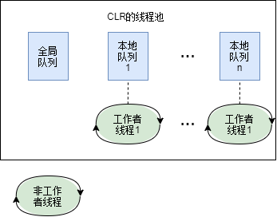

# 第27章　计算限制的异步操作

本章先说明为什么复用线程，再从 `QueueUserWorkItem`、执行上下文和协作式取消，走到任务、数据并行、定时器及池的管理。十八轮问答又补上了闭包共享、物理线程数据槽、AsyncLocal、await 状态机和第26章的栈/堆联系。这些补充与第四版的历史主线分开说明。

目录：[九节主线](#c27-overview) · [线程槽](#c27-tls) · [同一调用方两次派发](#c27-parent-snapshot) · [AsyncLocal](#c27-asynclocal) · [取消](#c27-cancellation) · [Task](#c27-tasks) · [排队与数据共享](#c27-sharing) · [堆/栈](#c27-heap-stack) · [闭包与state](#c27-state-transfer) · [上下文回传](#c27-context-return) · [四种机制完整例](#c27-four-contexts) · [上下文名词](#c27-context-map) · [跨await存活](#c27-state-machine) · [状态机与调度](#c27-state-and-schedule) · [栈帧恢复](#c27-stack-frames) · [await/Wait](#c27-await-wait) · [第26章联系](#c27-thread-bridge) · [数据路线](#c27-data-bridge) · [纠错](#c27-corrections)

不同片段里重复出现的 `Program`、`Main`、`BadExample` 是独立例子，不能直接拼为一个程序。API签名、布局图、教学伪码、完整类和原输出分别标明；表达式体/字符串插值使用C#6，`async Task Main` 使用C#7.1，`using var` 使用C#8，异步方法本身从C#5/.NET Framework4.5时代已进入本书讨论。AsyncLocal是Framework4.6+以及现代.NET的补充，不是第四版已经使用的那个API。

实测版本说明：本稿“Frame4.8／Framework4.8”的实测用语沿用旧日志的helper标签，表示那些日志记录的Framework4.x行为观察；旧40次编译／34次运行未留同期Release身份记录，精确历史产品版本或补丁身份未确认，不能据当前环境补称每次已核4.8.1。2026年10月8日当前只读采集的Release533509按官方表识别为Framework4.8.1，另见[共享版本裁决](整理记录/核验与验收/共享-Framework实际版本与旧标签独立裁决.md)。这是当前安装槽的身份，不代表已复现书时代所有旧版本。旧源码、命令、raw输出及原日志标签保持，本次说明没有重编或重跑。

<a id="c27-overview"></a>
## 九节主线：从线程复用到数据并行

本地原书第27章和同版PDF的本章目录均只有九个主节。原回答把“缓存行与伪共享”编号成27.10，又称十节是链接全文骨架，属错误归属；该知识仍保留在下面的补充段。原思考区当时未成功读取链接，不构成其余细节的原书出处。

### 27.1 CLR线程池基础

创建和销毁线程要消耗资源，可运行线程过多也可能增加切换及缓存代价。CLR线程池复用工作线程，根据工作进展、阻塞和负载等启发信息调整数量。第四版描述每CLR一个池、同CLR的AppDomain共享；多CLR进程的历史情形不能简单换成“每个任意运行时共享全系统一个池”。现代通常只有一个受支持的运行时实例，AppDomain隔离机制也与历史Framework不同。

“初始化时没有工作线程、空闲后可能退出”是在说明按需管理，不是调用任一API时都必立即新建线程，亦不保证任意时刻线程数为0。工作项最终由某个池线程执行；方法返回后，线程可能继续取工作或等待，不能把其物理线程身份当成一个请求/Task的身份。

### 27.2 简单计算限制操作

历史两个重载的签名如下（API声明示意）：

<a id="c27-q01-a014"></a>
<!-- C27-D01-Q001-A-B014 -->
```csharp
static Boolean QueueUserWorkItem(WaitCallback callBack);
static Boolean QueueUserWorkItem(WaitCallback callBack, Object state);
```

把回调及可选state排队后，调用方可继续执行；它没有为这项计算返回可等待的Task，`Boolean`表示排队结果。无state重载传给回调的是null。回调方法要匹配 `void WaitCallback(object state)`。同一个符合签名的方法组也能用于 `TimerCallback` 或 `ParameterizedThreadStart`，这不意味着三个不同的委托类型能任意互相赋值。

未处理的普通池回调异常按默认策略可能终止进程，Framework历史宿主策略另分；任务基础设施捕获其代表操作的异常是另一机制。原Windows Store限制是当年特定API配置，不是现代所有Windows应用都没有ThreadPool。

### 27.3 执行上下文

Framework的执行上下文携带逻辑调用数据以及相关安全/宿主状态；受支持的派发点通常会捕获并应用调用方的上下文。现代.NET主要通过ExecutionContext中的AsyncLocal值映射等携带环境信息，SynchronizationContext不随现代EC一起流动。其开销依实现和数据而定，不能说每次都深拷贝全部对象图。

原抑制/恢复片段保留：

<a id="c27-q01-a029"></a>
<!-- C27-D01-Q001-A-B029 -->
```csharp
ExecutionContext.SuppressFlow();   // 阻止流动
// ... 派发工作 ...
ExecutionContext.RestoreFlow();    // 恢复流动
```

应把抑制限定在同步派发范围，并确保恢复，例如用 `using (ExecutionContext.SuppressFlow()) { /* 排队 */ }`，在退出using后才等待；不要把该作用域跨越可能换线程的await。原书Name/Jeffrey例使用LogicalSetData，正常派发能读到Jeffrey，抑制派发不取得这份逻辑值。抑制不表示主动清空ThreadStatic/命名数据槽。

原书27.3、印刷615页脚注确称“捕获要对所有逻辑项序列化和反序列化”。普通同AppDomain队列捕获的Framework实现经LogicalCallContext.Clone保存普通项的referent，并非这个序列化流程。可序列化要求仍与历史API文档及Remoting传输合同有关；跨域/远程传输与普通同域派发要分开。受控marked可序列化Box例中捕获及回调取得同对象，GetObjectData次数为0。这里修正的是实际书句的范围。[Framework实现](https://raw.githubusercontent.com/microsoft/referencesource/main/mscorlib/system/runtime/remoting/callcontext.cs)、[ExecutionContext差异](https://learn.microsoft.com/en-us/dotnet/api/system.threading.executioncontext?view=net-10.0)

### 27.4 协作式取消和超时

发起方持CancellationTokenSource，工作方拿CancellationToken，按合同检查或传入支持取消的API；Cancel是请求，不能强杀任意已运行代码。原Count片段保留为调用示意，Count要由工作代码实现：

<a id="c27-q01-a033"></a>
<!-- C27-D01-Q001-A-B033 -->
```csharp
var cts = new CancellationTokenSource();
ThreadPool.QueueUserWorkItem(o => Count(cts.Token, 1000));
// 在长时间运行的操作内部定时检查：
//   if (token.IsCancellationRequested) return;
cts.Cancel();  // 外部触发取消
```

### 27.5 任务及七个小节

任务表示操作的完成、结果及异常，不等于一条线程。委托型任务可排队计算；async操作的Task、TaskCompletionSource、FromResult等也可表示完成，没有“每个Task必新建一个线程或async状态机”的要求。原三种入口保：

<a id="c27-q01-a041"></a>
<!-- C27-D01-Q001-A-B041 -->
```csharp
ThreadPool.QueueUserWorkItem(ComputeBoundOp, 5);  // 旧方式
new Task(ComputeBoundOp, 5).Start();              // 委托型Task方式，默认调度条件见后文
Task.Run(() => ComputeBoundOp(5));                // 常用排队方式；Run使用Default/DenyChildAttach
```

27.5.1讲等待/结果及异常；27.5.2讲任务取消；27.5.3讲完成后的延续；27.5.4讲附加子任务；27.5.5讲Task状态和按需的补充数据；27.5.6用TaskFactory集中配置创建/续接选项；27.5.7用TaskScheduler决定委托型任务怎样调度，UI也可由当前SynchronizationContext构造调度器。TaskFactory的StartNew/ContinueWhenAll/Any是实例方法，Task.Run则是Task上的静态便捷入口。

默认 `new Task(...).Start()` 使用当前调度器；Task.Run使用默认调度器、DenyChildAttach，异步委托重载还解开内层Task。三段可表达类似工作，默认行为并不逐项等价。

### 27.6 Parallel.For、ForEach、Invoke

For划分索引范围，ForEach处理数据序列，Invoke执行一组Action；这些同步入口在返回前等待自身工作结束，异常可聚合，原取消选项与工作共享状态仍需设计。操作可能由调用线程参与，也可受指定scheduler限制；不是每次迭代必对应一条新线程。`MaxDegreeOfParallelism=-1` 对历史同步For/ForEach表示不设此显式上限，并非固定CPU数；现代ForEachAsync另有-1含义。[ParallelOptions](https://learn.microsoft.com/en-us/dotnet/api/system.threading.tasks.paralleloptions.maxdegreeofparallelism?view=net-10.0)

### 27.7 PLINQ

原查询保持筛偶数、平方及ToList的用途，source是已定义数据序列的占位：

<a id="c27-q01-a055"></a>
<!-- C27-D01-Q001-A-B055 -->
```csharp
var result = source.AsParallel()
                   .Where(x => x % 2 == 0)
                   .Select(x => x * x)
                   .ToList();
```

PLINQ负责分区、派发和合并，但并行不保证总更快，也不默认保持普通LINQ的输入顺序；需要顺序时按其运算符合同指定AsOrdered。委托中的副作用和共享可变状态仍要同步。若使用Int32，平方还要考虑输入范围及溢出规则。

### 27.8 定时计算限制操作

`System.Threading.Timer` 用dueTime指定首次到期，用period指定周期，在池线程调用 `void TimerCallback(object state)`。它与UI定时器不同。回调可能重叠，方法耗时长于周期或排队积压时尤其如此；需要顺序执行，可按原书思路用一次触发/完成后Change重新安排，而非假定周期自动等待上次结束。保持需要的timer引用并管理寿命；Dispose()后已排队回调仍可能执行，等待完成的重载另有合同。原单一监控线程及具体全局排队链是历史实现说明。[Timer合同](https://learn.microsoft.com/en-us/dotnet/api/system.threading.timer?view=net-10.0)

### 27.9 池如何管理线程

27.9.1讲Get/SetMaxThreads、Get/SetMinThreads及GetAvailableThreads：限制全池会影响共同使用者，不能把设置最大值当每任务的并行度或响应速度保证。原“约1000线程、32位2GB、64位8TB”等属于当时Windows/CLR的资源说明，不能当现在的固定值或建议大量建线程。27.9.2讲默认调度器的全局队列、本地deque及工作窃取；FIFO取项不保证开始/完成顺序。

原图表达这套结构（只读辅助快照图，属当年实现示意，右端工作者标签仍为1）：



现代.NET的object QueueUserWorkItem重载仍强制全局排队，泛型重载另可preferLocal；默认TaskScheduler的LongRunning分支可建专用后台线程，普通分支用池内部入口。不能把原“只有一个全局锁”或 `Task→Task.Run→QueueUserWorkItem` 当所有实现的固定调用链。[指定实现](https://raw.githubusercontent.com/dotnet/runtime/v10.0.0/src/libraries/System.Private.CoreLib/src/System/Threading/ThreadPoolWorkQueue.cs)

### 补充：缓存行与伪共享

不同核心反复写不同变量，若它们落在同一缓存行，一致性协议仍可能造成缓存行争用，影响伸缩性。可把写入热点按线程分开、用局部累加后合并，必要时按实际布局/平台考虑padding。缓存行大小、对象对齐和收益依硬件/算法而变；不能只加几个空字段就保证更快。这是原问答的性能补充，仍有用，只是它不是本章27.10。[Microsoft原理说明](https://learn.microsoft.com/en-us/archive/msdn-magazine/2008/october/net-matters-false-sharing)

原学习次序保留：先理解复用及Queue入口，再理解取消和Task，做数据并行，最后结合执行上下文与队列调度排查问题；伪共享放在实际性能证据之后学习。

<a id="c27-tls"></a>
## 物理线程的槽为什么会残留

问答中的外包员工/办公桌抽屉类比说明：工作项结束，员工还在；贴着UserId标签的抽屉不会因换了一张工单而自动清空。思考区又用椅子与钥匙来说明同样的身份区别：后来坐上同一把椅子的人可能遇到前人留下的东西。关键是物理线程复用，不是所有任务都必被分配给同一线程。 T另有独立命名情境：槽名UserID，线程池里有Thread A和Thread B；任务1在Thread A把该槽写成Task1_User，任务结束而A的槽值仍在。假定任务2又被分给同一Thread A，它会读到Task1_User而产生串台；这里保原名、值、两个线程与同A假设，不把它换成下述UserId/张三程序，也不保证实际池必这样调度。

原张三示例完整保，Sleep500只制造间隔，不能作为完成确认；这段ReadKey需交互控制台：

<a id="c27-q02-a012"></a>
<!-- C27-D01-Q002-A-B012 -->
```csharp
using System;
using System.Threading;

public class ThreadSlotProblem
{
    // 在进程中创建一个全局命名的槽（相当于给所有员工的抽屉都贴了个叫"UserId"的标签）
    private static LocalDataStoreSlot _slot = Thread.AllocateNamedDataSlot("UserId");

    public static void Main()
    {
        // ====== 任务1 ======
        ThreadPool.QueueUserWorkItem(_ =>
        {
            // 员工（线程）把"张三"放进自己的抽屉
            Thread.SetData(_slot, "张三");
            Console.WriteLine($"[任务1] 线程 {Thread.CurrentThread.ManagedThreadId} 写入：张三");
            // 任务1结束，员工回到待命池，但抽屉里的"张三"没扔掉！
        });

        Thread.Sleep(500); // 演示间隔，不能确认任务1完成

        // ====== 任务2 ======
        ThreadPool.QueueUserWorkItem(_ =>
        {
            // 员工从自己抽屉里拿数据
            var data = Thread.GetData(_slot);
            Console.WriteLine($"[任务2] 线程 {Thread.CurrentThread.ManagedThreadId} 读到：{data}");
            // 如果任务2恰好分配到了和任务1同一个线程，就会打印出"张三"（串台了！）
        });

        Console.ReadKey();
    }
}
```

下面是原记录的可能输出，只有两项实际落同一物理线程且前项已写入时才成立；线程4是示意编号：

<a id="c27-q02-a014"></a>
<!-- C27-D01-Q002-A-B014 -->
```text
[任务1] 线程 4 写入：张三
[任务2] 线程 4 读到：张三   <-- 任务2根本没写过数据，却读到了任务1的垃圾！
```

思考区另给MySlot/任务1字符串和TestSlot/Hello from Task1两个不同例子，均保其输入。它们同样需要可靠完成通知及实际线程条件：

<a id="c27-q02-t029"></a>
<!-- C27-D01-Q002-T-B029 -->
```csharp
using System;
using System.Threading;

public class Program
{
    private static LocalDataStoreSlot _slot = Thread.AllocateNamedDataSlot("MySlot");

    public static void Main()
    {
        // 任务1：设置槽数据
        ThreadPool.QueueUserWorkItem(state =>
        {
            Thread.SetData(_slot, "数据来自任务1");
            Console.WriteLine($"[任务1] 线程 {Thread.CurrentThread.ManagedThreadId} 写入: 数据来自任务1");
            // 模拟做一些事，然后结束。注意：没有清理数据！
        });

        Thread.Sleep(500); // 确保任务1完成，线程回到池子里

        // 任务2：读取槽数据（可能被分配到同一个线程）
        ThreadPool.QueueUserWorkItem(state =>
        {
            var data = Thread.GetData(_slot);
            Console.WriteLine($"[任务2] 线程 {Thread.CurrentThread.ManagedThreadId} 读到: {data ?? "(空)"}");
            // 如果任务2被分配到了和任务1相同的线程，就会读到"数据来自任务1"
        });

        Console.ReadLine();
    }
}
```

<a id="c27-q02-t063"></a>
<!-- C27-D01-Q002-T-B063 -->
```csharp
var slot = Thread.AllocateNamedDataSlot("TestSlot");
// 任务1
ThreadPool.QueueUserWorkItem(_ => {
    Thread.SetData(slot, "Hello from Task 1");
    // 故意不清理
});
// 任务2
ThreadPool.QueueUserWorkItem(_ => {
    var val = Thread.GetData(slot);
    Console.WriteLine(val); // 可能是 "Hello from Task 1"
});
```

ThreadStatic也按物理线程分槽；ThreadLocal<T>提供类型安全的每线程值/工厂。它们可用于明确的线程缓存等用途，但不能用来追踪会换线程的逻辑请求。槽里保存引用时，引用值分槽不表示所指对象必各自独立；多个槽仍可指同一个对象。

### 工单类比要区分SetData和LogicalSetData

工单能随操作流动的比喻适用于逻辑调用数据。Framework普通string调用SetData走illogical分支，不会被普通派发捕获；实现ILogicalThreadAffinative的对象可经SetData走logical。原T举的LogicalCallContext本身是容器，实现ISerializable和ICloneable，不实现这个marker接口，不能拿它当marked数据示例。GetData会查这两类数据，不能把该API一概当纯ThreadStatic，也不能说任意SetData值必随EC流。下面将原OrderId程序精确改为Logical方法，原键和值及两个回调都保：

<a id="c27-q02-a021"></a>
<!-- C27-D01-Q002-A-B021 -->
```csharp
using System;
using System.Runtime.Remoting.Messaging; // CallContext 所在命名空间
using System.Threading;

public class CallContextSolution
{
    public static void Main()
    {
        // 主线程在工单上写上数据
        CallContext.LogicalSetData("OrderId", "订单-888");

        // ====== 任务1 ======
        ThreadPool.QueueUserWorkItem(_ =>
        {
            // 从工单（执行上下文）上读数据，能读到，因为这是复印过来的
            var data = CallContext.LogicalGetData("OrderId");
            Console.WriteLine($"[任务1] 读到工单数据：{data}");

            // 在工单上修改数据
            CallContext.LogicalSetData("OrderId", "任务1已处理");
            Console.WriteLine("[任务1] 在工单上改了数据，任务结束。");
            // 回调恢复上下文；不是清空此物理线程的所有TLS
        });

        Thread.Sleep(500);

        // ====== 任务2 ======
        ThreadPool.QueueUserWorkItem(_ =>
        {
            var data = CallContext.LogicalGetData("OrderId");
            Console.WriteLine($"[任务2] 读到工单数据：{data ?? "空（没有残留！）"}");
        });

        Thread.Sleep(500);
        
        // 主线程的工单也没被改过
        Console.WriteLine($"主线程的 OrderId：{CallContext.LogicalGetData("OrderId")}");
    }
}
```

原输出在这里原样列为错误对照：任务1称读订单888、任务2称空。

<a id="c27-q02-a023"></a>
<!-- C27-D01-Q002-A-B023 -->
```text
[任务1] 读到工单数据：订单-888
[任务1] 在工单上改了数据，任务结束。
[任务2] 读到工单数据：空（没有残留！）  <-- 干净利落，没有串台
主线程的 OrderId：订单-888             <-- 主线程的数据也没被任务1误改
```

原SetData字符串版实际两个队列回调均不能通过其EC读取这份普通值。改Logical版后，每次从未改的调用方捕获，两个回调都读订单-888；任务1重新设自己槽位，不改调用方的键值。不能说第二个为空才叫没有残留。等待应使用CountdownEvent等完成通知；完成恢复上下文也不表示销毁对象图或清空物理TLS。

思考区的MyContext/主线程的数据、key/main→changed例按同一条件修订，保持它们不同的键和值：

<a id="c27-q02-t032"></a>
<!-- C27-D01-Q002-T-B032 -->
```csharp
using System;
using System.Runtime.Remoting.Messaging; // CallContext 在这个命名空间
using System.Threading;

public class Program
{
    public static void Main()
    {
        // 在主线程设置 CallContext
        CallContext.LogicalSetData("MyContext", "主线程的数据");

        ThreadPool.QueueUserWorkItem(state =>
        {
            // 这里能读到吗？如果执行上下文流动了，能读到父上下文的数据
            var data = CallContext.LogicalGetData("MyContext");
            Console.WriteLine($"线程池线程读到 CallContext: {data}");
            
            // 修改它
            CallContext.LogicalSetData("MyContext", "线程池线程修改了数据");
            Console.WriteLine("线程池线程修改了 CallContext");
        });

        Thread.Sleep(500);

        // 回到主线程，看看主线程的 CallContext 有没有被改？
        var mainData = CallContext.LogicalGetData("MyContext");
        Console.WriteLine($"主线程的 CallContext: {mainData}"); 
        // 不会被改，因为流动时是复制的（或者说是逻辑上下文隔离的）
    }
}
```

<a id="c27-q02-t065"></a>
<!-- C27-D01-Q002-T-B065 -->
```csharp
CallContext.LogicalSetData("key", "main");
ThreadPool.QueueUserWorkItem(_ => {
    // 能拿到，因为是主线程流动过来的（复制了一份）
    var val = CallContext.LogicalGetData("key"); 
    CallContext.LogicalSetData("key", "changed"); // 改的是复制的那份
});
// 主线程的 key 不变
```

<a id="c27-q02-a025"></a>
<!-- C27-D01-Q002-A-B025 -->
| 存储方式 | 数据存在哪 | 线程复用时的表现 |
| --- | --- | --- |
| **线程槽**​ (`Thread.SetData`) / `[ThreadStatic]` | 物理线程的抽屉（TLS） | 同一线程复用且未清理时可能残留；不保证调度到同一线程 |
| 逻辑CallContext（Logical方法/适用marked值） | 逻辑工单（Execution Context） | 随受支持派发流动并恢复作用域；槽替换隔离不等referent深拷贝或立即销毁 |

现代环境数据可使用AsyncLocal；原小例保留张三输入，其static/实例持有位置由所在程序定义：

<a id="c27-q02-a030"></a>
<!-- C27-D01-Q002-A-B030 -->
```csharp
// 现代写法
AsyncLocal<string> _user = new AsyncLocal<string>();

_user.Value = "张三";          // 主线程设置
await Task.Run(() => 
{
    Console.WriteLine(_user.Value); // 异步流中会流动过去，不会串台
});
```

受控的两个同线程池回调中，命名槽仍读张三，ThreadStatic仍读小明，第二项的AsyncLocal恢复调用方父值。这说明三者不同，不证明默认池每次都复用这一线程。原书27.3并没有被原回答引用的“用了线程池绝对禁止Named槽”句；风险说明属问答补充。

<a id="c27-parent-snapshot"></a>
## 同一调用方两次派发：为什么都取得原值

用户进一步追问“第一个能读、第二个不能读”。原第二次回答修正了第二项为空的结论，但其程序仍用普通字符串SetData，API没有改，因而修正尚不完整。

逻辑数据的路线示意仍保。所谓副本首先是槽映射/环境作用域，普通引用值不因此自动深拷贝：

<a id="c27-q03-a010"></a>
<!-- C27-D01-Q003-A-B010 -->
```text
调用方线程的 ExecutionContext → 复制一份 → 交给线程池线程
```

将这个完整UserId例的Get/Set改为Logical方法：

<a id="c27-q03-a013"></a>
<!-- C27-D01-Q003-A-B013 -->
```csharp
using System;
using System.Runtime.Remoting.Messaging;
using System.Threading;
using System.Threading.Tasks;

class Program
{
    static void Main()
    {
        // 主线程在 CallContext 里放数据
        CallContext.LogicalSetData("UserId", "主线程-小明");

        Console.WriteLine($"主线程开始，UserId={CallContext.LogicalGetData("UserId")}");

        // ====== 任务1：从主线程派发 ======
        ThreadPool.QueueUserWorkItem(_ =>
        {
            // 能读到，因为主线程的 ExecutionContext 被复印过来了
            Console.WriteLine($"[任务1] 读到 UserId={CallContext.LogicalGetData("UserId")}");
            
            // 修改自己的副本
            CallContext.LogicalSetData("UserId", "任务1-改成了小红");
            Console.WriteLine($"[任务1] 改成了 小红，任务1结束");
        });

        Thread.Sleep(500); // 演示间隔，不能确认任务1完成

        // ====== 任务2：仍然从主线程派发 ======
        ThreadPool.QueueUserWorkItem(_ =>
        {
            // 也能读到"主线程-小明"！因为这次是从主线程重新复印的
            // 不会受到任务1修改的影响
            Console.WriteLine($"[任务2] 读到 UserId={CallContext.LogicalGetData("UserId")}");
        });

        Thread.Sleep(500);

        // 主线程自己的也没变
        Console.WriteLine($"主线程结束，UserId={CallContext.LogicalGetData("UserId")}");
    }
}
```

下面是原声称的输出。它在改为Logical且两回调均完成的条件下可描述键值结果；实际线程/打印穿插不固定，不能冒原SetData代码已经产生了这个结果：

<a id="c27-q03-a015"></a>
<!-- C27-D01-Q003-A-B015 -->
```text
主线程开始，UserId=主线程-小明
[任务1] 读到 UserId=主线程-小明
[任务1] 改成了 小红，任务1结束
[任务2] 读到 UserId=主线程-小明    ← 没有串台！读到的是主线程的原始数据
主线程结束，UserId=主线程-小明     ← 主线程也没被任务1污染
```

任务1把自己槽换成任务1-改成了小红；任务2仍由调用方捕获主线程-小明；调用方结束也保主线程-小明。两次捕获时调用方若自己改过值，第二次则捕获新的值。普通同步方法直接设置当前槽与启动一个带恢复作用域的async操作也不是同一层隔离。

相对地，原ThreadStatic的任务1-小明例保：

<a id="c27-q03-a019"></a>
<!-- C27-D01-Q003-A-B019 -->
```csharp
class BadExample
{
    [ThreadStatic]
    public static string UserId;

    static void Main()
    {
        // ====== 任务1 ======
        ThreadPool.QueueUserWorkItem(_ =>
        {
            UserId = "任务1-小明";
            Console.WriteLine($"[任务1] UserId={UserId}");
            // 任务1结束，但 UserId 留在了物理线程的 TLS 里！
        });

        Thread.Sleep(500);

        // ====== 任务2 ======
        ThreadPool.QueueUserWorkItem(_ =>
        {
            // 如果任务2恰好分配到了和任务1同一个物理线程
            // 就能读到"任务1-小明"！
            Console.WriteLine($"[任务2] UserId={UserId ?? "空"}");
        });

        Console.ReadKey();
    }
}
```

<a id="c27-q03-a021"></a>
<!-- C27-D01-Q003-A-B021 -->
```text
[任务1] UserId=任务1-小明
[任务2] UserId=任务1-小明   ← 串台了！任务2根本没赋值，却读到了任务1的数据
```

<a id="c27-q03-a024"></a>
<!-- C27-D01-Q003-A-B024 -->
|  | 数据存在哪 | 任务1改了数据 | 任务2能读到吗 |
| --- | --- | --- | --- |
| **ThreadStatic / NamedDataSlot**​ | 物理线程的 TLS | 改了物理线程上的值 | ✅ 可能读到（如果分配到同一个线程） |
| 逻辑CallContext（适用值/派发点） | ExecutionContext 副本 | 只改了自己的副本 | 不因前项槽替换而读到新值；可读调用方原值，共享referent另分 |

### 思考区两个独立变体及一个非法等待形状

Order888程序在思考区仍是普通SetData，按明确意图修为Logical；其原“任务2为空”的一行单独保为错误输出：

<a id="c27-q03-t004"></a>
<!-- C27-D01-Q003-T-B004 -->
```csharp
public static void Main()
{
    // 主线程在工单上写上数据
    CallContext.LogicalSetData("OrderId", "订单-888");

    // ====== 任务1 ======
    ThreadPool.QueueUserWorkItem(_ =>
    {
        var data = CallContext.LogicalGetData("OrderId");
        Console.WriteLine($"[任务1] 读到工单数据：{data}");
        CallContext.LogicalSetData("OrderId", "任务1已处理");
        Console.WriteLine("[任务1] 在工单上改了数据，任务结束。");
    });

    Thread.Sleep(500);

    // ====== 任务2 ======
    ThreadPool.QueueUserWorkItem(_ =>
    {
        var data = CallContext.LogicalGetData("OrderId");
        Console.WriteLine($"[任务2] 读到工单数据：{data ?? "空（没有残留！）"}");
    });

    Thread.Sleep(500);
    
    Console.WriteLine($"主线程的 OrderId：{CallContext.LogicalGetData("OrderId")}");
}
```

<a id="c27-q03-t012"></a>
<!-- C27-D01-Q003-T-B012 -->
```text
[任务2] 读到工单数据：空（没有残留！）
```

另一个Test槽例把Queue的Boolean返回值调用Wait，确实不能编译。以下作为原非法形状保留，不当作可运行等待程序；CS1061指出bool没有Wait：

<a id="c27-q03-t050"></a>
<!-- C27-D01-Q003-T-B050 -->
```csharp
// 用 NamedDataSlot
var slot = Thread.AllocateNamedDataSlot("Test");

ThreadPool.QueueUserWorkItem(_ =>
{
    Thread.SetData(slot, "任务1的数据");
    // 模拟工作
}).Wait(); // 等它执行完

// 再次 QueueUserWorkItem，希望分配到同一个线程
ThreadPool.QueueUserWorkItem(_ =>
{
    var data = Thread.GetData(slot);
    // 如果分配到同一个线程，data 就是"任务1的数据"（串台）
});
```

应在回调结束时发自己的完成信号，例如 `using var done = new ManualResetEventSlim(); ThreadPool.QueueUserWorkItem(_ => { /* 原写槽工作 */ done.Set(); }); done.Wait();`，或选择返回Task的入口。完成通知只保证前项结束，并不能要求后一项取同一池线程。命名槽的名称是公共查找标识，每物理线程的槽值仍各自独立，不是所有线程看到同一个值。

Key/主线程数据→任务1修改的变体同样改Logical方法：

<a id="c27-q03-t055"></a>
<!-- C27-D01-Q003-T-B055 -->
```csharp
CallContext.LogicalSetData("Key", "主线程数据");

// 第一次派发
ThreadPool.QueueUserWorkItem(_ =>
{
    Console.WriteLine(CallContext.LogicalGetData("Key")); // "主线程数据"
    CallContext.LogicalSetData("Key", "任务1修改的");
    // 本回调的上下文作用域结束；共享referent仍可能存活
});

// 第二次派发（仍然从主线程派发）
ThreadPool.QueueUserWorkItem(_ =>
{
    Console.WriteLine(CallContext.LogicalGetData("Key")); // 仍然是"主线程数据"，因为从主线程 flow 过来的
});
```

受控Frame夹具以CountdownEvent等到两项完成后分别读取原OrderId/UserId，普通SetData字符串两项为null，Logical两项均为原调用方值。marked可序列化对象则经SetData流动，但改同一对象字段能影响父方；这正是“槽替换”与“对象修改”的区别。稍后的AsyncLocal实例继续保这个边界。

<a id="c27-asynclocal"></a>
## AsyncLocal：沿逻辑调用链保存环境值

用户要求展开AsyncLocal。先看原最小async片段：局部userId在后面仍可用，靠语言保持方法的状态，不是它自动变成了AsyncLocal：

<a id="c27-q04-a007"></a>
<!-- C27-D01-Q004-A-B007 -->
```csharp
static async Task Main()
{
    // 线程 A
    var userId = "小明";
    
    await DoStep1();  // 在这里，线程 A 可能被释放回线程池
    
    // 这里的代码，可能在【线程 C】上继续执行！
    Console.WriteLine(userId); 
}
```

await可能在不同物理线程上继续，也可能同步完成或由指定上下文继续。它不承诺从池中“随便抓一条新线程”。下面的ThreadStatic小明例完整保：

<a id="c27-q04-a011"></a>
<!-- C27-D01-Q004-A-B011 -->
```csharp
class BadExample
{
    [ThreadStatic]
    public static string UserId;

    static async Task Main()
    {
        UserId = "小明";  // 存在 线程A 的 TLS 里
        
        Console.WriteLine($"await前，线程={Thread.CurrentThread.ManagedThreadId}，UserId={UserId}");
        
        await Task.Delay(100);  // 异步等待，线程A 被释放
        
        // 恢复执行时，可能在 线程B 上
        Console.WriteLine($"await后，线程={Thread.CurrentThread.ManagedThreadId}，UserId={UserId ?? "空"}");
    }
}
```

原这条输出只说明进入未设置该槽的另一个线程时会读空，不能说每一次await都必换线程/必清空原槽：

<a id="c27-q04-a013"></a>
<!-- C27-D01-Q004-A-B013 -->
```text
await前，线程=1，UserId=小明
await后，线程=4，UserId=空   ← 线程4的 TLS 里根本没有 UserId！
```

### 小明穿过两个步骤的完整例

AsyncLocal<T>.Value是当前逻辑执行环境中的值；通常用一个static实例标识这个槽，每个控制流仍有其关联值。static槽实例不意味着所有请求用同一个当前字符串。

<a id="c27-q04-a019"></a>
<!-- C27-D01-Q004-A-B019 -->
```csharp
using System;
using System.Threading;
using System.Threading.Tasks;

class GoodExample
{
    // 声明一个 AsyncLocal 变量（通常是 static 的，作为全局上下文容器）
    static AsyncLocal<string> _userId = new AsyncLocal<string>();

    static async Task Main()
    {
        _userId.Value = "小明";  // 主线程设置
        
        Console.WriteLine($"[Main前] 线程={Thread.CurrentThread.ManagedThreadId}, UserId={_userId.Value}");
        
        await DoStep1();  // 异步调用
        
        Console.WriteLine($"[Main后] 线程={Thread.CurrentThread.ManagedThreadId}, UserId={_userId.Value}");
    }

    static async Task DoStep1()
    {
        Console.WriteLine($"[DoStep1] 线程={Thread.CurrentThread.ManagedThreadId}, UserId={_userId.Value}");
        await Task.Delay(100);  // 异步等待，可能发生线程切换
        Console.WriteLine($"[DoStep1-续] 线程={Thread.CurrentThread.ManagedThreadId}, UserId={_userId.Value}");
        
        await DoStep2();
    }

    static async Task DoStep2()
    {
        Console.WriteLine($"[DoStep2] 线程={Thread.CurrentThread.ManagedThreadId}, UserId={_userId.Value}");
        await Task.Delay(50);
        Console.WriteLine($"[DoStep2-续] 线程={Thread.CurrentThread.ManagedThreadId}, UserId={_userId.Value}");
    }
}
```

DoStep1的100ms、DoStep2的50ms及原输出位置保留。线程编号和是否换线程是可能观察，不能固定成1→4→6：

<a id="c27-q04-a021"></a>
<!-- C27-D01-Q004-A-B021 -->
```text
[Main前] 线程=1, UserId=小明
[DoStep1] 线程=1, UserId=小明
[DoStep1-续] 线程=4, UserId=小明   ← 线程变了，但数据还在！
[DoStep2] 线程=4, UserId=小明
[DoStep2-续] 线程=6, UserId=小明   ← 又换线程了，数据依然在！
[Main后] 线程=6, UserId=小明
```

<a id="c27-q04-a029"></a>
<!-- C27-D01-Q004-A-B029 -->
| 特性 | CallContext (老) | AsyncLocal<T> (新) |
| --- | --- | --- |
| 类型安全 | object与名称键；需区分Logical方法/marked值 | ✅ 泛型 `<T>`，编译期检查 |
| 适用场景 | Framework逻辑方法也可在受支持的async/await控制流中使用 | ✅ 同步 + `async`/`await` 异步流 |
| API 易用性 | 正确选择LogicalGet/Set及键，普通SetData字符串不自动flow | ✅ `.Value` 属性，直观 |
| .NET 版本 | .NET Framework遗留API；现代.NET没有这一CallContext API | .NET Framework4.6+、Core与现代.NET；可用于同步派发及异步控制流 |

原回答说“AsyncLocal解决CallContext时代还没有的async/await”，又说“原书当时没有async/await”，两处都过宽。第四版已经有第28章C#异步函数与状态机；Framework逻辑CallContext能流过await，现代平台移除此API与它在历史平台“不可靠”不是一回事。AsyncLocal提供类型安全的现代环境槽，不是因为LogicalSetData只能用于同步。

### 父子槽替换不会自动回传

原父任务-原始值、子任务-修改了的字符串例保：

<a id="c27-q04-a032"></a>
<!-- C27-D01-Q004-A-B032 -->
```csharp
static AsyncLocal<string> _ctx = new AsyncLocal<string>();

static async Task Main()
{
    _ctx.Value = "父任务-原始值";
    
    Console.WriteLine($"父任务开始：{_ctx.Value}");
    
    await Task.Run(() =>
    {
        // 子任务能读到父任务的值（因为是复印过来的）
        Console.WriteLine($"子任务读入：{_ctx.Value}");
        
        // 子任务修改自己的副本
        _ctx.Value = "子任务-修改了";
        Console.WriteLine($"子任务修改后：{_ctx.Value}");
    });
    
    // 父任务的值不受影响
    Console.WriteLine($"父任务结束：{_ctx.Value}");
}
```

<a id="c27-q04-a034"></a>
<!-- C27-D01-Q004-A-B034 -->
```text
父任务开始：父任务-原始值
子任务读入：父任务-原始值
子任务修改后：子任务-修改了
父任务结束：父任务-原始值   ← 没被污染！
```

子在受支持派发/async作用域中把自己的槽换成新字符串，父继续时恢复自己原来的关联值。这是本例的隔离；普通同步方法直接在当前作用域赋Value，可以影响当前调用方，不能说每调用任何方法都产生一层全新副本。

槽里若存Box/List等可变对象，父子初始可能指同一个referent；修改该对象字段可互相看见，换子槽为一个新对象又是另一行为。受控Box例中，子把共同Box.Value改为9，随后给子槽换Box88；父仍持原Box，读到9。需要共享修改时仍应设计同步，而不是指望AsyncLocal深拷贝图。

原所谓 `AsyncLocalValueChangedHandler` 并非这个构造器的正式委托类型；实际参数是 `Action<AsyncLocalValueChangedArgs<T>>`。通知区分显式设Value与执行上下文变化，不能自动把子槽写回父槽。回调若主动写别的共享对象，是你额外编写的共享状态策略。[API](https://learn.microsoft.com/en-us/dotnet/api/system.threading.asynclocal-1?view=net-10.0)

### TraceId用途

原Guid与logger片段仍保：

<a id="c27-q04-a040"></a>
<!-- C27-D01-Q004-A-B040 -->
```csharp
// 在 Web API 的中间件里，给每个请求分配一个唯一的 TraceId
static AsyncLocal<string> _traceId = new AsyncLocal<string>();

// 中间件
_traceId.Value = Guid.NewGuid().ToString();

// 然后在整个请求处理链路中（不管经过多少层 service、repository、await 调用）
// 任何地方打日志都可以带上这个 TraceId
logger.Log($"[{_traceId.Value}] 用户登录成功");
```

入口设置关联ID后，业务、存储和日志层可沿受支持控制流读取它，减少显式逐层参数；实际middleware要按自身调用作用域安排恢复/清理。Guid每次生成不同，不以一条示意输出代表真实固定请求ID。AsyncLocal是环境数据工具，返回业务计算结果仍应使用明确的返回合同。

<a id="c27-cancellation"></a>
## 协作式取消：发请求、检查、清理、确认结束

下载大文件的类比保：强制中断可能把文件留半成品，协作方案由工作代码在检查点停下并清理。取消信号不会自动关闭所有文件、释放所有内存或解除任意锁；using/finally和业务恢复逻辑要由程序实现。Thread.Abort属于Framework历史机制，现代.NET不支持以它实现这套取消。

<a id="c27-q05-a004"></a>
<!-- C27-D01-Q005-A-B004 -->
| 做法 | 说明 | 后果 |
| --- | --- | --- |
| **强制杀线程**（非协作） | 直接 `Thread.Abort()` 把下载线程干掉 | Framework历史强制中断风险：操作可能留半成品；清理是否完成不能保证。现代.NET不支持该Abort合同 |
| **发信号让它自己停**（协作式） | 调用方请求停止；工作代码检查、执行必要using/finally/业务清理并退出 | 允许按合同安排结束/恢复；信号本身不自动完成所有清理 |

两个角色的原图保持，CancellationTokenSource是引用类型，CancellationToken是可复制的值类型：

<a id="c27-q05-a011"></a>
<!-- C27-D01-Q005-A-B011 -->
```text
CancellationTokenSource（遥控器）        CancellationToken（票据）
┌───────────────────────┐            ┌───────────────────────┐
│  持有取消状态           │   ──产生──→  │  只读地查看取消状态     │
│  .Cancel() 发信号      │            │  传给工作线程看         │
│  引用类型，一个         │            │  值类型，可以复制多份    │
└───────────────────────┘            └───────────────────────┘
```

Token能查询、注册及传递取消相关能力，但没有Cancel方法；Source掌握发请求的入口。Token复制仍指向同一取消状态，不是复制出独立Source，也不是不可跨线程的本地变量。

### 手动取消：20项、每项500ms、3秒发请求

原完整程序和这些参数保留：

<a id="c27-q05-a018"></a>
<!-- C27-D01-Q005-A-B018 -->
```csharp
using System;
using System.Threading;
using System.Threading.Tasks;

class Program
{
    static void Main()
    {
        // 1. 创建"遥控器"
        var cts = new CancellationTokenSource();
        
        // 2. 启动一个耗时任务，把"票据"传进去
        Task.Run(() => DoWork(cts.Token));
        
        // 3. 主线程等3秒，然后发取消信号
        Thread.Sleep(3000);
        Console.WriteLine("主线程：发取消信号！");
        cts.Cancel();
        
        Console.ReadKey();
    }
    
    static void DoWork(CancellationToken token)
    {
        Console.WriteLine("工作线程：开始干活");
        
        for (int i = 0; i < 20; i++)
        {
            // ★ 关键：每次循环都检查有没有收到取消信号
            if (token.IsCancellationRequested)
            {
                Console.WriteLine("工作线程：收到取消信号，优雅退出");
                return;  // 主动退出，清理资源
            }
            
            Console.WriteLine($"工作线程：正在处理第 {i} 项...");
            Thread.Sleep(500); // 模拟耗时操作
        }
        
        Console.WriteLine("工作线程：正常完成");
    }
}
```

原记录如下，为一种可能时间线。发请求时已完成几项取决于调度/耗时，不保证恰0—5；ReadKey是交互等待，也不等价于观察工作Task：

<a id="c27-q05-a020"></a>
<!-- C27-D01-Q005-A-B020 -->
```text
工作线程：开始干活
工作线程：正在处理第 0 项...
工作线程：正在处理第 1 项...
工作线程：正在处理第 2 项...
工作线程：正在处理第 3 项...
工作线程：正在处理第 4 项...
工作线程：正在处理第 5 项...
主线程：发取消信号！
工作线程：收到取消信号，优雅退出
```

if-return让该委托正常返回；若由Task代表，状态通常为RanToCompletion。要向调用方确认“因取消结束”，需指定结果合同或恰当取消异常，不能仅凭日志推Task.Canceled。

### 自动超时：仍须工作方配合

原3秒构造器、20项循环与500ms保：

<a id="c27-q05-a024"></a>
<!-- C27-D01-Q005-A-B024 -->
```csharp
static void Main()
{
    // 创建 CTS，并设置 3 秒后自动取消
    using var cts = new CancellationTokenSource(TimeSpan.FromSeconds(3));
    
    Task.Run(() => DoWork(cts.Token));
    
    Console.ReadKey();
}

static void DoWork(CancellationToken token)
{
    for (int i = 0; i < 20; i++)
    {
        if (token.IsCancellationRequested)
        {
            Console.WriteLine("超时了，自动取消！");
            return;
        }
        
        Console.WriteLine($"处理第 {i} 项...");
        Thread.Sleep(500);
    }
}
```

<a id="c27-q05-a026"></a>
<!-- C27-D01-Q005-A-B026 -->
```text
处理第 0 项...
处理第 1 项...
处理第 2 项...
处理第 3 项...
处理第 4 项...
处理第 5 项...
超时了，自动取消！
```

Source安排到期请求不表示强制结束线程，也不保证回调/工作在精确3秒时点完成。如果提前按键退出using，工作还可能没结束；要安全使用这段模式，应先保存token、持有工作Task、确认它结束后再Dispose Source，避免尚未开始的lambda读取已经释放的cts.Token。原示意没有这个完成管理，不能把“using”单独当完整工作生命周期。

### 抛取消异常与关联令牌

原ThrowIfCancellationRequested完整片段保作前提缺口对照：

<a id="c27-q05-a030"></a>
<!-- C27-D01-Q005-A-B030 -->
```csharp
static void DoWork(CancellationToken token)
{
    for (int i = 0; i < 20; i++)
    {
        // 如果收到取消信号，直接抛 OperationCanceledException
        token.ThrowIfCancellationRequested();
        
        Console.WriteLine($"处理第 {i} 项...");
        Thread.Sleep(500);
    }
}

static async Task Main()
{
    using var cts = new CancellationTokenSource(3000);
    
    try
    {
        await Task.Run(() => DoWork(cts.Token));
    }
    catch (OperationCanceledException)
    {
        Console.WriteLine("捕获到取消异常，任务被取消了");
    }
}
```

<a id="c27-q05-a032"></a>
<!-- C27-D01-Q005-A-B032 -->
| 方式 | 适合场景 |
| --- | --- |
| `if (token.IsCancellationRequested) return;` | 工作代码按业务协议正常返回；Task仍可正常完成，调用方用返回值/状态合同区分 |
| `token.ThrowIfCancellationRequested()` | 响应请求并携带token；delegateTask还须关联同token才能按其取消规则分类，async方法builder另分 |

这段 `Task.Run(() => DoWork(cts.Token))` 没有把token关联给delegateTask；取消请求后DoWork抛OCE可令它Faulted，虽然await仍可捕获OperationCanceledException。修正调用是 `Task.Run(() => DoWork(token), token)`，并在工作代码用同token响应。只传Task.Run的token不会自动让已经运行的委托抛异常或停止。[取消合同](https://learn.microsoft.com/en-us/dotnet/standard/parallel-programming/task-cancellation)

受控已运行委托例中，忽略请求或if-return均正常完成；匹配且已请求的OCE令delegateTask Canceled/Exception null；未关联或携带另一token的OCE令它Faulted。开始前已有请求可使委托根本不执行。async Task方法的builder将其抛出的OCE表示为Canceled另有规则，不能把delegateTask条件原样套给所有async方法/Task.Run异步重载。

### 注册回调：2秒后请求、每400ms打印

原清理消息程序及输出保：

<a id="c27-q05-a036"></a>
<!-- C27-D01-Q005-A-B036 -->
```csharp
static void Main()
{
    var cts = new CancellationTokenSource();
    
    // 注册一个回调：当取消信号发出时，自动执行
    cts.Token.Register(() =>
    {
        Console.WriteLine("★ 取消回调：正在关闭文件、释放资源...");
    });
    
    Task.Run(() => DoWork(cts.Token));
    
    Thread.Sleep(2000);
    cts.Cancel();
    
    Console.ReadKey();
}

static void DoWork(CancellationToken token)
{
    while (!token.IsCancellationRequested)
    {
        Console.WriteLine("工作中...");
        Thread.Sleep(400);
    }
    Console.WriteLine("工作线程退出");
}
```

<a id="c27-q05-a038"></a>
<!-- C27-D01-Q005-A-B038 -->
```text
工作中...
工作中...
工作中...
工作中...
工作中...
★ 取消回调：正在关闭文件、释放资源...
工作线程退出
```

这里回调只是打印，没有真正打开/关闭文件。Cancel通常同步运行已注册回调，默认false聚合回调异常，true遇首异常停止剩余；默认无同步上下文时在取消调用线程执行，选择useSynchronizationContext时可经捕获上下文Send，不能说永远在工作线程。它不等待任意工作循环退出，工作结束还要另行确认。

本书印刷617页把入口写成CTS.Register是一个真实API笔误，紧随处及例子又正确使用Token.Register。需要写 `cts.Token.Register(...)`。已取消后注册也可立即在注册调用中执行；记录和资源寿命要按这一时机设计。[Cancel](https://learn.microsoft.com/en-us/dotnet/api/system.threading.cancellationtokensource.cancel?view=net-10.0)

### 文件搜索原例：void不能await

原完整C盘/`*.txt`/5秒/按Enter例以反例保留。此SearchFiles返回void，编译CS4008；没有真正注册Ctrl+C，其注释和ReadLine行为也不同。本稿没有运行C盘递归扫描：

<a id="c27-q05-a041"></a>
<!-- C27-D01-Q005-A-B041 -->
```csharp
using System;
using System.IO;
using System.Threading;
using System.Threading.Tasks;

class Program
{
    static async Task Main()
    {
        using var cts = new CancellationTokenSource();
        
        // 注册 Ctrl+C 或超时来触发取消
        cts.CancelAfter(5000); // 5秒超时
        
        Console.WriteLine("开始搜索，按 Enter 可提前取消...");
        
        // 另起一个线程监听用户输入
        Task.Run(() =>
        {
            Console.ReadLine();
            Console.WriteLine("用户请求取消");
            cts.Cancel();
        });
        
        try
        {
            await SearchFiles(@"C:\", "*.txt", cts.Token);
        }
        catch (OperationCanceledException)
        {
            Console.WriteLine("搜索被取消了");
        }
    }
    
    static void SearchFiles(string root, string pattern, CancellationToken token)
    {
        foreach (var file in Directory.EnumerateFiles(root, pattern, SearchOption.AllDirectories))
        {
            // 每次处理前检查取消
            token.ThrowIfCancellationRequested();
            
            Console.WriteLine($"找到：{file}");
            Thread.Sleep(100); // 模拟处理文件
        }
    }
}
```

保留同步SearchFiles方法时，可让修正调用明确排队并等待：`await Task.Run(() => SearchFiles(root, "*.txt", token), token);`，其中root由调用方指定。教学执行应使用自建小目录，不能把这样适配后的输入冒为原C盘逐字实测。循环每处理前检查token，但Directory.EnumerateFiles本身的枚举/访问也可能耗时或抛访问异常；取消是检查点响应，不是5秒硬截止。

ReadLine监听Task若无人输入会继续等待，搜索结束后Source释放，后来输入还可能调用已释放Source。实际输入处理应跟整个程序寿命配套、取消订阅/等待相关操作；不能丢一个不观察的输入Task就称完整取消方案。

思考区还有Count1000、显式Cancel、3000ms构造器、打印取消消息四个独立片段，分别保留为调用示意：

<a id="c27-q05-t005"></a>
<!-- C27-D01-Q005-T-B005 -->
```csharp
var cts = new CancellationTokenSource();
ThreadPool.QueueUserWorkItem(o => Count(cts.Token, 1000));
// 在长时间运行的操作内部定时检查：
//   if (token.IsCancellationRequested) return;
cts.Cancel();  // 外部触发取消
```

<a id="c27-q05-t026"></a>
<!-- C27-D01-Q005-T-B026 -->
```csharp
var cts = new CancellationTokenSource();
cts.Token.IsCancellationRequested
cts.Cancel()
```

<a id="c27-q05-t028"></a>
<!-- C27-D01-Q005-T-B028 -->
```csharp
var cts = new CancellationTokenSource(3000); // 3秒后自动取消
```

<a id="c27-q05-t030"></a>
<!-- C27-D01-Q005-T-B030 -->
```csharp
cts.Token.Register(() => Console.WriteLine("取消了"));
```

取消清理与Task完成、超时请求与等待超时是不同事；Dispose Source不是发取消请求，发请求也不代表所有下游都已退出。

<a id="c27-tasks"></a>
## Task：完成、结果、调度、附加子任务和延续

QueueUserWorkItem没有为当前回调内建返回Task/结果的接口，原入口再次保：

<a id="c27-q06-a004"></a>
<!-- C27-D01-Q006-A-B004 -->
```csharp
ThreadPool.QueueUserWorkItem(ComputeBoundOp, 5);
```

构造Task与Start分开允许延后调度，Task.Run提供默认排队入口；原三个写法保其委托型工作用途：

<a id="c27-q06-a012"></a>
<!-- C27-D01-Q006-A-B012 -->
```csharp
// 方式1：最原始——构造 Task + 手动 Start
new Task(ComputeBoundOp, 5).Start();

// 方式2：Task.Run（.NET 4.5+ 推荐，默认使用Default/DenyChildAttach，非逐项等同方式1）
Task.Run(() => ComputeBoundOp(5));

// 对照：老的 QueueUserWorkItem（没有 Task 时的写法）
ThreadPool.QueueUserWorkItem(ComputeBoundOp, 5);
```

Task.Run不是任意环境下和new+Start逐项等价。Start无参数用TaskScheduler.Current，Run用Default/DenyChildAttach，Func<Task>重载返回展开后的代理；StartNew(async lambda)则通常返回嵌套Task，要按合同Unwrap或分别await。TaskCompletionSource/FromResult/async返回任务不需要你给一个公开Action构造器，也不都执行计算工作。

### 创建标志

下面是原枚举的历史六标志示意，注释精准修订；实际代码使用系统现成枚举：

<a id="c27-q06-a019"></a>
<!-- C27-D01-Q006-A-B019 -->
```csharp
[Flags]
public enum TaskCreationOptions
{
    None = 0x0000,               // 默认
    PreferFairness = 0x0001, // 向调度器提出公平性建议，不保证FIFO开始或完成
    LongRunning = 0x0002, // 长耗时粗粒度工作的hint；默认实现可用专用线程，非任意scheduler保证
    AttachedToParent = 0x0004, // 有可附加的当前父任务且其不Deny时建立附加关系
    DenyChildAttach = 0x0008, // 拒绝子附加；子作为detached运行，不因该标志抛异常
    HideScheduler = 0x0010 // 任务内Current表现为Default；显式传入scheduler仍可用
}
```

<a id="c27-q06-a021"></a>
<!-- C27-D01-Q006-A-B021 -->
| 标志 | 场景 |
| --- | --- |
| `LongRunning` | 给scheduler的长耗时hint；指定默认实现可用专用后台线程，非任意scheduler保证 |
| `AttachedToParent` | 当前有可附父且父不Deny时附加，父完成要等它；取消是否传播另分 |

PreferFairness不保证FIFO执行顺序；LongRunning也不是“所有Async任务要新线程”。DenyChildAttach使子脱离附加关系，不抛一个创建异常；HideScheduler让内部Current表现默认，但显式指定自定义scheduler仍可以。原书TaskCreation备注本来正确说detached，TaskContinuation备注却说抛InvalidOperation，两处需分开归因。

### 等待及结果：Int32的范围也要保持

原Sum(1亿)输入不删：

<a id="c27-q06-a024"></a>
<!-- C27-D01-Q006-A-B024 -->
```csharp
// 创建一个计算 Sum(1亿) 的任务，标记为 LongRunning
Task<int> t = new Task<int>(n => Sum((int)n), 100000000, TaskCreationOptions.LongRunning);
t.Start();

// 等待任务完成
t.Wait();

// 获取结果（Result 属性内部会自动调用 Wait）
Console.WriteLine("The Sum is: " + t.Result);
```

这里Sum需要适当定义。第四版原Sum用checked Int32，给1e9本来就是OverflowException演示，不应改成“小输入正常结果”抹去其异常用途；对这个1e8输入同样很快越界。若使用本轮后面未checked的Int32累加，数值可能溢出回绕，也不是数学总和。需要完整数学结果时应明确改用足够宽的返回/累计类型并保原参数目的。

未完成Task的Wait/Result可同步等待，已完成则直接读取/抛适当异常；等待还可能尝试inline，取决于scheduler与任务是否已运行。原书印刷621页对此先分支本来正确，快照漏句的反向说法不能归给原书。Wait有timeout/token重载，WaitAny返回完成索引/超时-1，WaitAll的超时重载返回是否全完成；等待token与操作token的作用分开。

Faulted Task.Exception为AggregateException，未Faulted时可null。Wait/Result包装异常，await/GetAwaiter.GetResult按其规则重新抛某个保存异常；GetResult仍可同步阻塞，不能当作另一种不阻塞await。源码同步等待与异常分类详见后面的对照。

### 委托型任务怎样响应取消

原old if-return、新ThrowIf片段用途保：

<a id="c27-q06-a036"></a>
<!-- C27-D01-Q006-A-B036 -->
```csharp
// ThreadPool 方式：检查 IsCancellationRequested 属性，自己 return
void OldWay(object state)
{
    var token = (CancellationToken)state;
    for (int i = 0; i < 1000; i++)
    {
        if (token.IsCancellationRequested)
            return;  // 自己退出
        // ... do work
    }
}

// Task 方式：调用 ThrowIfCancellationRequested 抛异常
void NewWay(CancellationToken token)
{
    for (int i = 0; i < 1000; i++)
    {
        token.ThrowIfCancellationRequested();  // 抛出 OperationCanceledException
        // ... do work
    }
}
```

Queue回调可以检查后return，但它没有Task状态可报告；它也可按自己的回调结果协议响应。Task工作代码Throw时须与关联token及请求条件配合，不是任意OCE都自动成Canceled。原“Task.Run内部收到取消便自动抛”说法应更正为排队前取消或委托主动响应；既已运行仍由代码决定结束。

### 三个附加子任务的简单片段

原10000/20000/30000的三个结果槽及Array.ForEach续接保。这里需独立定义Sum(int)，n范围下正常结果分别50005000、200010000、450015000：

<a id="c27-q06-a043"></a>
<!-- C27-D01-Q006-A-B043 -->
```csharp
Task<int[]> parent = new Task<int[]>(() =>
{
    var results = new int[3];
    
    // 创建并启动 3 个子任务，都用 AttachedToParent 标志
    new Task(() => results[0] = Sum(10000), TaskCreationOptions.AttachedToParent).Start();
    new Task(() => results[1] = Sum(20000), TaskCreationOptions.AttachedToParent).Start();
    new Task(() => results[2] = Sum(30000), TaskCreationOptions.AttachedToParent).Start();
    
    return results;
});

// 当父任务和所有子任务都完成时，延续任务才会执行
var cwt = parent.ContinueWith(parentTask => 
    Array.ForEach(parentTask.Result, Console.WriteLine));

parent.Start();  // 启动父任务，父任务会再去启动子任务
```

父是new Task且未Deny，子用AttachedToParent，因而父真正完成要等所有附加子完成。默认嵌套newTask不附；Task.Run父默认Deny，不能仅因嵌套语法就附。附加影响完成和未观察子Faulted异常的汇合，并不是强制把所有子状态原样复制成父状态。

### 完成后续接

原带token None与100000的片段仍保；它依赖Sum定义和溢出规则，不能直接承诺Int32数学总和：

<a id="c27-q06-a052"></a>
<!-- C27-D01-Q006-A-B052 -->
```csharp
Task<int> t = Task.Run(() => Sum(CancellationToken.None, 100000));

// 延续任务：t 完成后自动执行
Task cwt = t.ContinueWith(task => 
    Console.WriteLine("The sum is: " + task.Result));
```

默认ContinueWith在前置任一终态后都可运行，因此task.Result在前置Faulted/Canceled时仍会抛；续接本身的Task也应按需要等待/观察异常，不能因为常被忽略引用就保证无需管理。条件续接未满足时，该续接Task可处Canceled。

原续接枚举的Only组合本来正确；只修Deny、Hide和同步执行注释，不把正确条件组合反标错误：

<a id="c27-q06-a055"></a>
<!-- C27-D01-Q006-A-B055 -->
```csharp
[Flags]
public enum TaskContinuationOptions
{
    None = 0x0000,
    PreferFairness = 0x0001, // 向调度器提出公平性建议，不保证FIFO开始或完成
    LongRunning = 0x0002, // 长耗时粗粒度工作的hint；默认实现可用专用线程，非任意scheduler保证
    AttachedToParent = 0x0004, // 有可附加的当前父任务且其不Deny时建立附加关系
    DenyChildAttach = 0x0008, // 拒绝子附加；子作为detached运行，不因该标志抛异常
    HideScheduler = 0x0010, // 任务内Current表现为Default；显式传入scheduler仍可用
    LazyCancellation = 0x0020, // 延迟该续接任务的取消完成至前置任务完成，按指定令牌/条件使用
    ExecuteSynchronously = 0x80000, // 请求同步执行延续；取决于调度器/完成时机，不保证原worker
    
    // 以下三个是条件标志
    NotOnRanToCompletion = 0x10000,  // 任务正常完成时，不执行延续
    NotOnFaulted = 0x20000,          // 任务出错时，不执行延续
    NotOnCanceled = 0x40000,         // 任务取消时，不执行延续
    
    // 便利组合
    OnlyOnCanceled = NotOnRanToCompletion | NotOnFaulted,  // 仅当任务被取消时才执行
    OnlyOnFaulted = NotOnRanToCompletion | NotOnCanceled,  // 仅当任务出错时才执行
    OnlyOnRanToCompletion = NotOnFaulted | NotOnCanceled,  // 仅当任务正常完成时才执行
}
```

OnlyOnCanceled = NotOnRanToCompletion|NotOnFaulted，OnlyOnFaulted = NotOnRanToCompletion|NotOnCanceled，OnlyOnRanToCompletion = NotOnFaulted|NotOnCanceled，即0x60000。快照该行组合抄错，PDF印刷624页与本轮原问答的组合正确。

ExecuteSynchronously是同步执行的请求，scheduler可能拒绝inline；前置已完成时可能在调用ContinueWith的线程执行，未完成时可由完成它的线程等执行，不保证原来执行工作委托的worker。本次已完成前置的受控例就在caller执行。LazyCancellation使续接任务的取消完成等待前置完成，不表示工作永不可取消。

原三个条件续接修正关联ct这个缺口，保100000输入及三个不同用途：

<a id="c27-q06-a057"></a>
<!-- C27-D01-Q006-A-B057 -->
```csharp
Task<int> t = Task.Run(() => Sum(ct, 100000), ct);

// 任务取消时才执行的延续
Task cwt = t.ContinueWith(task => 
    Console.WriteLine("Sum was cancelled"), 
    TaskContinuationOptions.OnlyOnCanceled);

// 任务出错时才执行的延续
Task cwt2 = t.ContinueWith(task => 
    Console.WriteLine("Sum threw an exception: " + task.Exception), 
    TaskContinuationOptions.OnlyOnFaulted);

// 任务正常完成时才执行的延续
Task cwt3 = t.ContinueWith(task => 
    Console.WriteLine("Sum is: " + task.Result), 
    TaskContinuationOptions.OnlyOnRanToCompletion);
```

### 原完整父子取消程序及其缺口

以下原2秒超时/LongRunning父、三个Attached子与Int32 Sum完整保，作为需要准确状态处理的原版本：

<a id="c27-q06-a060"></a>
<!-- C27-D01-Q006-A-B060 -->
```csharp
using System;
using System.Threading;
using System.Threading.Tasks;

class Program
{
    static void Main()
    {
        var cts = new CancellationTokenSource();
        cts.CancelAfter(2000);  // 2秒后自动取消
        
        // 1. 创建父任务，它会 fork 出子任务
        Task<int[]> parent = new Task<int[]>(() =>
        {
            Console.WriteLine($"父任务: 线程 {Thread.CurrentThread.ManagedThreadId}");
            var results = new int[3];
            
            // 2. 创建3个附加到父任务的子任务
            new Task(() => 
            {
                results[0] = Sum(cts.Token, 10000);
            }, TaskCreationOptions.AttachedToParent).Start();
            
            new Task(() => 
            {
                results[1] = Sum(cts.Token, 20000);
            }, TaskCreationOptions.AttachedToParent).Start();
            
            new Task(() => 
            {
                results[2] = Sum(cts.Token, 30000);
            }, TaskCreationOptions.AttachedToParent).Start();
            
            return results;
        }, TaskCreationOptions.LongRunning);
        
        // 3. 父任务 + 所有子任务完成后，执行延续任务
        parent.ContinueWith(t =>
        {
            if (t.Status == TaskStatus.RanToCompletion)
                Array.ForEach(t.Result, r => Console.WriteLine($"结果: {r}"));
            else if (t.Status == TaskStatus.Canceled)
                Console.WriteLine("任务被取消");
        });
        
        // 4. 启动
        parent.Start();
        
        Console.WriteLine("主线程继续干别的...");
        Console.ReadKey();
    }
    
    static int Sum(CancellationToken token, int n)
    {
        int sum = 0;
        for (int i = 1; i <= n; i++)
        {
            token.ThrowIfCancellationRequested();
            sum += i;
        }
        return sum;
    }
}
```

本次将ReadKey换成真正等待续接后，三个小输入在超时前完成，取得上述三个和；这不是“2秒到时一定会取消”的证明。原子Task构造没有关联ct，若运行中Sum用cts.Token抛OCE，会成为child Faulted并影响parent Faulted；父的续接只检查正常/Canceled而不处理Faulted，因而漏掉这个路径。

即便给child匹配token，child Canceled也不表示已运行父自动Canceled。受控四种条件在Frame4.8/现代10一致：未绑定child OCE使父/子Faulted；绑定child但父不响应，则childCanceled/parent正常；父子关联同token而父忽略请求也仍正常；父自己用匹配OCE确认取消才Canceled。底层完成阶段只收集适用的子Faulted异常，并分别判断父自身request+ack。[具体实现](https://raw.githubusercontent.com/dotnet/runtime/v10.0.0/src/libraries/System.Private.CoreLib/src/System/Threading/Tasks/Task.cs)

完整取消图可用明确等待子任务的组合结果/异常来表示整体完成，或为父子分别关联token并设计各自响应；只给所有Task传同token不足以保证整个图已成功计算。使用已取消token的newTask还可能在Start时失败，创建/启动一体的StartNew有不同处理，不能用“加参数”掩去该生命周期。

<a id="c27-q06-a067"></a>
<!-- C27-D01-Q006-A-B067 -->
| 维度 | ThreadPool.QueueUserWorkItem | Task |
| --- | --- | --- |
| 返回值 | ❌ 无 | ✅ `Task<TResult>.Result` |
| 等待完成 | ❌ 无内建机制 | ✅ `Wait()` / `await` |
| 取消 | 检查 `IsCancellationRequested` 自己 return | delegateTask关联/请求/匹配OCE条件；return正常，async builder另分 |
| 异常处理 | 普通未处理回调异常按默认策略可终止进程 | 捕获所代表操作的异常；async void逸出及未观察策略须另分 |
| 子任务 | ❌ 不支持 | 附加要满足可附父/非Deny；可用组合Task表达其它关系 |
| 任务延续 | ❌ 手动编码 | ✅ `ContinueWith` + `TaskContinuationOptions` |
| 调度控制 | 可选择现有Queue重载/EC等，但不返回当前工作Task | 创建/续接选项与显式TaskScheduler，hint不是任意强制调度 |

Task的Created/WaitingToRun/Running及等待附加子、三终态是可查询的生命周期描述，不要求每个Task都经过所有状态或由你调用Start；前置等待、I/O promise和已完成任务的路径不同。原书Exception的Aggregate说明位于Faulted语境，不能误读成所有状态都非null。

未观察Task异常与未处理普通回调异常不同。Framework4默认历史升级策略与4.5以后默认不终止的改变分开；GC/终结器事件也不是每次调用GC立即必发生。应观察需要的操作及续接失败，await/WhenAll也能参与这一过程。[历史策略](https://devblogs.microsoft.com/dotnet/task-exception-handling-in-net-4-5/)

<a id="c27-sharing"></a>
## Queue、Task和委托捕获：哪些状态共享

用户把派发前、工作中、完成后以及“回到主线程”连在一起追问。先保持三个不同问题：谁执行工作、哪些变量/对象是同一份、调用方什么时候继续。后台线程不会变成主线程，原时间图仍保其角色：

<a id="c27-q07-a005"></a>
<!-- C27-D01-Q007-A-B005 -->
```text
主线程                         线程池线程
  │                               │
  ├── QueueUserWorkItem ──────────→│
  │                               ├── 执行任务
  │  ← 主线程立刻继续往下跑         │
  │     （不等它）                  ├── 执行完，线程回到池中待命
  │                               │    （不会"回到主线程"）
  │                               │
```

Queue排队后调用方继续，回调结束不自动投递到某个主线程。Task也不自带“自动返主线程”；await在需要登记延续时，按awaiter合同选择捕获的SC/非默认scheduler等，UI的上下文通常把继续代码安排回UI线程。控制台一般SC null，但同步完成、inline或自定义scheduler均可改变实际线程条件。

### 同一counter与同一实例字段

原三项各100000次++例作为竞态示例保，不作精确结果保证：

<a id="c27-q07-a016"></a>
<!-- C27-D01-Q007-A-B016 -->
```csharp
static void Main()
{
    int counter = 0;  // 主线程的局部变量
    
    // 启动3个线程池任务，都捕获了同一个 counter
    for (int i = 0; i < 3; i++)
    {
        ThreadPool.QueueUserWorkItem(_ =>
        {
            // 这个 lambda 捕获了外部的 counter
            for (int j = 0; j < 100000; j++)
            {
                counter++;  // 三个线程都在修改同一个 counter！
            }
        });
    }
    
    Thread.Sleep(3000);
    Console.WriteLine(counter);  // 结果是多少？不确定！
}
```

counter是同一捕获变量，++是读改写复合操作；并发交错可丢更新，结果也可能碰巧达到300000。Sleep3000不能证明三项均结束。要可靠观察完整计数，需要所有工作完成通知，再使用一致的同步更新合同。 捕获时的“提升”不等于把int装箱成object：常规隐藏类中的字段仍是int，各lambda访问同一捕获变量；给object state传一个int产生的装箱副本是另一种操作。

原隐藏类是编译降低的结构示意，`<>`名称不是可直接粘贴的合法C#类名；它表达同一字段身份：

<a id="c27-q07-a019"></a>
<!-- C27-D01-Q007-A-B019 -->
```text
// 编译器生成的伪代码
class <>c__DisplayClass0_0
{
    public int counter;  // 在堆上！
}

// Main 方法
var closure = new <>c__DisplayClass0_0();
closure.counter = 0;

// 三个 lambda 都引用 closure.counter —— 同一个堆上的变量！
// 三个线程同时 ++ 它，没有锁，结果就是不确定的
```

编译器重写捕获变量的存储，不是在运行时先把同一个栈位置复制成三份。两个lambda捕获同一变量可访问同一存储；只有读取或正确同步也可安全使用，并非“捕获本身必竞态”。原同MyService实例的_total+=1/2例保持：

<a id="c27-q07-a022"></a>
<!-- C27-D01-Q007-A-B022 -->
```csharp
class MyService
{
    private int _total = 0;  // 成员变量
    
    public void Run()
    {
        // 两个线程池线程都访问 this._total
        ThreadPool.QueueUserWorkItem(_ => Add(1));
        ThreadPool.QueueUserWorkItem(_ => Add(2));
    }
    
    void Add(int value)
    {
        _total += value;  // 两个线程操作同一个对象的同一个字段
    }
}
```

这里共享是因为两个回调实际用同一个this，不是任意两个MyService实例的字段都相同。对未发布给其它线程的对象字段，也不能只因通常位于托管对象中就判不安全。

### for变量与每轮localCopy

原两个独立写法保。每轮localCopy是新的变量；直接捕获for的i是同一变量，0/1/2/3等观察依时间而定，3 3 3是可能输出，非保证。C#5起foreach迭代变量每轮新建是另一语言规则：

<a id="c27-q07-a025"></a>
<!-- C27-D01-Q007-A-B025 -->
```csharp
for (int i = 0; i < 3; i++)
{
    int localCopy = i;  // 每次循环创建一个新的局部变量
    ThreadPool.QueueUserWorkItem(_ =>
    {
        Console.WriteLine(localCopy);  // 每个线程捕获的是不同的 localCopy
    });
}
```

<a id="c27-q07-a027"></a>
<!-- C27-D01-Q007-A-B027 -->
```csharp
for (int i = 0; i < 3; i++)
{
    ThreadPool.QueueUserWorkItem(_ =>
    {
        Console.WriteLine(i);  // 危险！捕获的是同一个 i！
    });
}
// 可能输出：3 3 3（因为 i 是同一个变量，循环结束时 i=3）
```

### state=42的派发步骤

原完整小程序保：

<a id="c27-q07-a030"></a>
<!-- C27-D01-Q007-A-B030 -->
```csharp
static void Main()
{
    int data = 42;  // ① 主线程的局部变量
    
    ThreadPool.QueueUserWorkItem(state =>
    {
        int value = (int)state;  // ④ 线程池线程拿到数据
        Console.WriteLine(value); // ⑤ 执行
    }, data);                     // ② 数据作为参数传入
    
    Console.WriteLine("Main continues"); // ③ 主线程立刻继续
}
```

<a id="c27-q07-a032"></a>
<!-- C27-D01-Q007-A-B032 -->
| 步骤 | 发生了什么 | 线程 |
| --- | --- | --- |
| ① | 调用方求值data=42；局部可能在寄存器/栈，位置不决定是否共享 | 主线程 |
| ② | `data` 被装箱为 `object`，作为 `state` 参数传入 | 主线程 |
| ②.5 | 此安全派发捕获当前EC语义，现代可复用不可变表示；不是深拷贝所有referent | 主线程 |
| ③ | `QueueUserWorkItem` 立即返回，主线程继续 | 主线程 |
| ④ | 工作线程取得state，回调中的cast将装箱Int32取为值副本 | 线程池线程 |
| ④.5 | 在适用EC中执行回调；逻辑环境与物理TLS另分 | 线程池线程 |
| ⑤ | 执行回调 | 线程池线程 |

原三个角色图按逻辑数据路线读，state对象不要求与真实队列/栈结构有这个物理布局：

<a id="c27-q07-a034"></a>
<!-- C27-D01-Q007-A-B034 -->
```text
主线程                   线程池队列                线程池线程
  │                         │                        │
  ├─ data (int, 栈上)       │                        │
  ├─ 装箱为 object ─────────→│  state = (object)42   │
  │                         │                        │
  │                  ExecutionContext ───────────────→│ 恢复上下文
  │                  (复印的副本)                      │
```

object重载的Int32会装箱，回调的(int)state取得副本；引用类型参数复制引用，多个值可指同一个对象。现代泛型入口 `QueueUserWorkItem<TState>(Action<TState>, TState, bool)` 可避免本例的object装箱；Task构造器/StartNew也有state重载，Queue也可用捕获lambda。两个API不各自垄断一种传值方式。

### Task算Compute(42)=84

原片段完整保：

<a id="c27-q07-a039"></a>
<!-- C27-D01-Q007-A-B039 -->
```csharp
static async Task Main()
{
    int data = 42;  // ① 主线程局部变量
    
    Task<int> task = Task.Run(() => 
    {
        return Compute(data);  // ② 闭包捕获 data
    });
    
    int result = await task;   // ③ 等待（不阻塞主线程！）
    Console.WriteLine(result); // ④ "回来"了
}

static int Compute(int x) => x * 2;
```

<a id="c27-q07-a041"></a>
<!-- C27-D01-Q007-A-B041 -->
| 步骤 | 发生了什么 | 线程 |
| --- | --- | --- |
| ① | 定义供捕获的data变量；编译器可直接安排在其载体字段 | 主线程 |
| ② | 编译期降低捕获；运行时创建所需载体，并非当场把原栈位置搬家 | 主线程 |
| ②.5 | 默认Task调度到池；指定实现可使用UnsafeQueueUserWorkItemInternal，Task自身已捕获EC | 主线程 |
| ②.7 | Task捕获EC环境；await的SC/TaskScheduler选择是另一步 | 主线程 |
| ③ | 若未完成，async方法登记延续并返回Task；编译器生成入口仍会等async Main整体完成 | 主线程 |
| ③.5 | 计算结果经Task<TResult>的结果合同保存 | 线程池线程 |
| ③.7 | Task处RanToCompletion（Completed不是TaskStatus枚举名）并触发适用延续 | 线程池线程 |
| ④ | SC/非默认TaskScheduler在await登记时选择，不在完成时才捕获 | 取决于 SynchronizationContext |
| ④.5 | 在 UI 程序中：回到 UI 线程执行 `Console.WriteLine(result)` | UI 线程 |
| ④.5 | 一般控制台无SC目标；可inline或按awaiter/scheduler安排，不必抓新线程 | 线程池线程 |

下面Console和UI两个原完整方法各保。原PDF EX001把这两个HTML围栏与其输出合在一起，属于同条件同例布局；未另创造一个执行程序：

<a id="c27-q07-a043"></a>
<!-- C27-D01-Q007-A-B043 -->
```csharp
// 控制台程序
static async Task Main()
{
    Console.WriteLine($"Before await: {Thread.CurrentThread.ManagedThreadId}");
    await Task.Delay(1000);
    Console.WriteLine($"After await: {Thread.CurrentThread.ManagedThreadId}");
}
// 输出可能是：
// Before await: 1
// After await: 4    ← 不是原来的线程！
```

<a id="c27-q07-a044"></a>
<!-- C27-D01-Q007-A-B044 -->
```csharp
// WPF/WinForms 程序
private async void Button_Click(object sender, EventArgs e)
{
    Console.WriteLine($"Before await: {Thread.CurrentThread.ManagedThreadId}");
    await Task.Delay(1000);
    Console.WriteLine($"After await: {Thread.CurrentThread.ManagedThreadId}");
}
// 输出可能是：
// Before await: 1   (UI 线程)
// After await: 1    ← 自动回到了 UI 线程！
```

<a id="c27-q07-a048"></a>
<!-- C27-D01-Q007-A-B048 -->
| 维度 | QueueUserWorkItem | Task |
| --- | --- | --- |
| **数据传递**​ | object/generic state或捕获lambda | 闭包或构造器/StartNew显式state；Run支持委托 |
| **返回值**​ | ❌ 无 | ✅ `Task<T>.Result` |
| **等待**​ | ❌ 无内建等待（要自己用 ManualResetEvent 等） | ✅ `Wait()` / `await` |
| **异常处理**​ | 未处理异常 → 进程崩溃 | 异常被捕获到 `Task.Exception` |
| **回到原上下文**​ | ❌ 不支持 | 默认await在适用上下文登记后继续，不保证原物理线程 |
| **取消**​ | 手动检查 CancellationToken | 任务状态/排队前取消与委托主动响应，非强制终止 |
| **延续**​ | 手动在回调末尾写 | `ContinueWith` / `await` |
| **底层**​ | 直接丢进线程池队列 | Task是操作抽象；仅async方法需要编译状态机，默认委托任务用池/可指定scheduler |

### 执行环境图与完整共享计数

下面原环境图以Framework旧组件说明逻辑关系；它不是所有现代EC的真实字段布局，也不表示Task.Run把UI SynchronizationContext原样安装到工作线程。现代EC与SC分开，Task.Run工作默认SC null/DefaultScheduler，回调结束恢复环境不清全部物理TLS：

<a id="c27-q07-a050"></a>
<!-- C27-D01-Q007-A-B050 -->
```text
┌─────────────────────────────────────┐
                    │         主线程                       │
                    │  ┌───────────────────────────────┐  │
                    │  │    ExecutionContext           │  │
                    │  │  ┌─────────────────────────┐  │  │
                    │  │  │ SecurityContext          │  │  │
                    │  │  │ CallContext (Logical...) │  │  │
                    │  │  │ SynchronizationContext   │  │  │
                    │  │  └─────────────────────────┘  │  │
                    │  └───────────────────────────────┘  │
                    └──────────────┬──────────────────────┘
                                   │
                          QueueUserWorkItem / Task.Run
                                   │
                                   ▼
                    ┌──────────────────────────────────────┐
                    │        线程池队列                     │
                    │   ┌──────────────────────────────┐   │
                    │   │  WorkItem                    │   │
                    │   │  ├── Callback                │   │
                    │   │  ├── State                   │   │
                    │   │  └── ExecutionContext (COPY) │◄──┼── 复印！
                    │   └──────────────────────────────┘   │
                    └──────────────┬───────────────────────┘
                                   │
                                   ▼
                    ┌──────────────────────────────────────┐
                    │      线程池线程                       │
                    │  安装(恢复) ExecutionContext          │
                    │  执行 Callback(state)                │
                    │  执行完毕，销毁 Context 副本          │
                    │  线程回到池中                         │
                    └──────────────────────────────────────┘
```

原localValue10、Queue加10、Task加10并返回20的完整例，补真实Queue完成等待，保两种传值与所有原日志位置：

<a id="c27-q07-a055"></a>
<!-- C27-D01-Q007-A-B055 -->
```csharp
using System;
using System.Threading;
using System.Threading.Tasks;

class Program
{
    // 成员变量 —— 所有线程共享
    static int _sharedCounter = 0;
    
    static async Task Main()
    {
        Console.WriteLine($"[Main] 线程ID={Thread.CurrentThread.ManagedThreadId}");
        
        int localValue = 10;  // 局部变量
        
        // ===== 方式1：QueueUserWorkItem =====
        var queueDone = new TaskCompletionSource<bool>();
        ThreadPool.QueueUserWorkItem(state =>
        {
            int value = (int)state;  // 从参数拿数据
            Console.WriteLine($"[QUEUE] 线程ID={Thread.CurrentThread.ManagedThreadId}, value={value}");
            Interlocked.Add(ref _sharedCounter, value); // 操作共享变量，需要原子操作
            queueDone.SetResult(true);
        }, localValue);
        
        // ===== 方式2：Task（闭包方式） =====
        Task<int> task = Task.Run(() =>
        {
            // 闭包捕获了 localValue
            Console.WriteLine($"[TASK] 线程ID={Thread.CurrentThread.ManagedThreadId}, localValue={localValue}");
            Interlocked.Add(ref _sharedCounter, localValue);
            return localValue * 2;
        });
        
        // ===== 方式3：Task（await，展示"回来"） =====
        int result = await task;
        Console.WriteLine($"[AWAIT后] 线程ID={Thread.CurrentThread.ManagedThreadId}, result={result}");
        
        await queueDone.Task; // 确认Queue回调真正完成
        Console.WriteLine($"最终 _sharedCounter = {_sharedCounter}"); // 应该是 20
    }
}
```

这两个工作结束后_sharedCounter为20，返回值为20；仅使用Sleep500不保证该观察。变量捕获从编译降低后就是同一存储，不是data原栈值失效后你才得到另一个外部副本。static字段属于类型的静态存储合同，不能说它实际嵌在那个反射Type托管对象里。

原输出作为编号/穿插的可能示意保留；更正后的完成等待使最终计数的前提明确：

<a id="c27-q07-a057"></a>
<!-- C27-D01-Q007-A-B057 -->
```text
[Main] 线程ID=1
[QUEUE] 线程ID=4, value=10
[TASK] 线程ID=5, localValue=10
[AWAIT后] 线程ID=5, result=20
最终 _sharedCounter = 20
```

<a id="c27-q07-a065"></a>
<!-- C27-D01-Q007-A-B065 -->
| 你的困惑 | 一句话答案 |
| --- | --- |
| QueueUserWorkItem 和 Task 的区别 | Task提供完成/结果/异常；默认委托工作可用池，await的继续调度与EC另分 |
| 闭包变量是否共享 | 同一捕获变量是同一存储；并发复合写要同步 |
| 成员变量是否共享 | 实际同一实例/静态存储可共享，是否安全取决于发布及读写合同 |
| 执行前数据怎么传 | 两类入口均可闭包；Queue/Task适用重载也可显式state |
| 执行中线程怎么调度 | 默认池/指定scheduler/可inline；等待方法与await悬挂行为不同 |
| 执行完怎么"回来" | 继续代码按所用await/SC/scheduler或手写回调安排，不是worker变回主线程 |
| ExecutionContext 的作用 | 携带适用环境值并恢复作用域，不是所有状态深拷贝、全TLS清空 |

思考区另一个三次counter++小例只演示同一捕获变量，仍是竞态，不根据三个打印推出某个固定累计序列：

<a id="c27-q07-t044"></a>
<!-- C27-D01-Q007-T-B044 -->
```csharp
int counter = 0;  // 局部变量

for (int i = 0; i < 3; i++)
{
    ThreadPool.QueueUserWorkItem(_ => 
    {
        counter++;  // 捕获了 counter
        Console.WriteLine(counter);
    });
}
```

<a id="c27-heap-stack"></a>
## 共享对象空间与每线程栈：别用位置代替共享条件

同一运行时的线程能够通过引用访问同一托管对象空间，各自有自己的执行栈；在本书Windows语境还要区分用户态与内核态栈。但“一CLR恰一个物理GC堆”不是铁律，ServerGC可以有多个堆，各堆对象还能互相引用并统一回收。原“多个堆根本无法判断回收”解释错误。[GC说明](https://learn.microsoft.com/en-us/dotnet/standard/garbage-collection/workstation-server-gc)

原仓库图保留其对象可以由不同线程创建/通过引用访问的意图，标题的“一个”要理解为逻辑对象空间，不能当物理heap数量：

<a id="c27-q08-a011"></a>
<!-- C27-D01-Q008-A-B011 -->
```text
┌────────────────────────────────────────────────────┐
│              托管堆（一个 CLR 只有一个）              │
│                                                    │
│  ┌────────┐  ┌────────┐  ┌────────┐  ┌────────┐   │
│  │ ObjectA│  │ ObjectB│  │ ObjectC│  │ ObjectD│   │
│  │(线程1 │  │(线程2 │  │(线程1 │  │(线程3 │   │
│  │ new的) │  │ new的) │  │ new的) │  │ new的) │   │
│  └────────┘  └────────┘  └────────┘  └────────┘   │
│                                                    │
│  GC 统一管：哪些对象没人引用了 → 回收                │
└────────────────────────────────────────────────────┘
```

分配上下文可让线程在已有的分配区间推进指针，补充分配区间等路径另有同步；并非每个new都竞争一个全堆CAS，也不能由这点保证任意多线程分配都“几乎没有锁竞争”。GC、分配大小、模式和资源边界会影响具体路径。通常的栈/寄存器/JIT优化不改变程序关于引用与变量身份的可观察语义。

### 同一svc与私有工作台

原MyService字段例保，只有实际得到同一svc引用的线程才在访问同一Counter：

<a id="c27-q08-a019"></a>
<!-- C27-D01-Q008-A-B019 -->
```csharp
class MyService
{
    public int Counter = 0;  // 成员变量
}

var svc = new MyService();  // svc 在托管堆上
svc.Counter = 1;            // Counter 也在托管堆上
```

两个线程的原工作台图表达独立执行路径，不是线程栈构成进程内部安全隔离；用安全C#范围、引用生命周期和发布合同来判断访问，不能用“别人根本看不见地址”作为通用证明：

<a id="c27-q08-a028"></a>
<!-- C27-D01-Q008-A-B028 -->
```text
线程1 的栈                          线程2 的栈
┌───────────────────┐              ┌───────────────────┐
│ Main()            │              │ Worker()          │
│ ├── args          │              │ ├── state          │
│ ├── localVar = 10 │              │ ├── temp = 20      │
│ └── return addr   │              │ └── return addr    │
│ Worker()          │              │ AnotherMethod()    │
│ ├── state         │              │ ├── x = 5           │
│ └── return addr   │              │ └── return addr    │
└───────────────────┘              └───────────────────┘
        ↑                                    ↑
   线程1 独有的                        线程2 独有的
   别人看不见                           别人看不见
```

原MethodA例中，lambda能在词法范围内使用x，编译器因此捕获；这不意味着其先“出了作用域”才被找回来：

<a id="c27-q08-a030"></a>
<!-- C27-D01-Q008-A-B030 -->
```csharp
void MethodA()
{
    int x = 10;        // x 在 MethodA 的栈帧里
    ThreadPool.QueueUserWorkItem(_ =>
    {
        int y = 20;    // y 在 线程池线程的栈帧里
        Console.WriteLine(x); // x 被捕获 → 编译器把它搬到堆上了（闭包）
    });
}
```

<a id="c27-q08-a035"></a>
<!-- C27-D01-Q008-A-B035 -->
| 变量声明位置 | 值类型（struct/int等） | 引用类型（class/object） |
| --- | --- | --- |
| **方法内部的局部变量**​ | 未跨操作共享的普通值局部；可寄存器/栈/优化位置，引用字段须另分 | 局部保存引用；所指对象是否共享看实际引用发布 |
| **类的成员变量**​ | 实例字段属于那个实例；相同实例且并发写需相应同步 | 字段存引用；多个实例也可指同referent，非所有实例字段天然同一份 |
| **闭包捕获的变量**​ | 同一捕获变量共用存储；只读/同步使用可安全 | 引用变量共用存储与所指对象共享是两层 |
| **[ThreadStatic] 标记的**​ | ✅ 在每个线程的 TLS 里，不共享 | 每线程独槽值，多个槽仍可存同一个对象引用 |

### static、实例、捕获和workerLocal的原程序

原注释中的“local++不能访问”应改正：它在词法范围内，若使用就会成为捕获；无需手工先搬到堆。这段示意仍需完成管理，不能只因Main已排队就保证后台两项一定运行后退出：

<a id="c27-q08-a037"></a>
<!-- C27-D01-Q008-A-B037 -->
```csharp
class Program
{
    static int _staticField = 0;      // ① 类型的静态存储；不是反射Type对象内的字段
    int _instanceField = 0;           // ② 在堆上（实例对象里），所有线程共享
    
    static void Main()
    {
        int local = 42;               // ③ 在 Main 线程的栈上，私有
        var obj = new Program();      // ④ obj 引用在栈上，Program 实例在堆上
        
        ThreadPool.QueueUserWorkItem(_ =>
        {
            int workerLocal = 100;    // ⑤ 在线程池线程的栈上，私有
            
            _staticField++;           // ⑥ 操作堆上的共享数据
            obj._instanceField++;     // ⑦ 操作堆上的共享数据
            
            // local++;               // ⑧ 在词法范围内，启用这一行就会捕获同一local
        });
        
        // 捕获 local → 编译器生成隐藏类，把 local 搬到堆上
        ThreadPool.QueueUserWorkItem(_ =>
        {
            Console.WriteLine(local); // ⑨ local 现在在堆上，是共享的
        });
    }
}
```

原全景图是概念图，Program类型对象内的_staticField框及“被捕获后失效”不可当实际地址布局；静态存储、实例字段、捕获变量载体与每线程工作局部的身份分别保：

<a id="c27-q08-a039"></a>
<!-- C27-D01-Q008-A-B039 -->
```text
┌─────────────────────────────────────────────────────────────┐
│                     托管堆（共享）                           │
│                                                           │
│  ┌──────────────────┐    ┌──────────────────────────────┐  │
│  │ Program 类型对象  │    │ 闭包隐藏类实例                 │  │
│  │ ┌──────────────┐ │    │ ┌──────────────────────────┐ │  │
│  │ │_staticField=1│ │    │ │ local = 42               │ │  │ ← 被捕获后搬到堆上
│  │ └──────────────┘ │    │ └──────────────────────────┘ │  │
│  └──────────────────┘    └──────────────────────────────┘  │
│                                                           │
│  ┌──────────────────┐                                     │
│  │ Program 实例      │                                     │
│  │ ┌──────────────┐ │                                     │
│  │ │_instanceField│ │                                     │
│  │ │      =1      │ │                                     │
│  │ └──────────────┘ │                                     │
│  └──────────────────┘                                     │
└─────────────────────────────────────────────────────────────┘

主线程栈（私有）              线程池线程A栈（私有）      线程池线程B栈（私有）
┌──────────────────┐        ┌──────────────────┐      ┌──────────────────┐
│ local = 42       │  ───→  │                  │      │                  │
│ (被捕获后失效)    │        │ workerLocal = 100│      │ (lambda捕获了     │
│ obj → 堆地址     │        │                  │      │  堆上的闭包对象)  │
└──────────────────┘        └──────────────────┘      └──────────────────┘
```

<a id="c27-q08-a041"></a>
<!-- C27-D01-Q008-A-B041 -->
| 问题 | 答案 |
| --- | --- |
| 同一个 CLR 多线程用同一个托管堆吗？ | 共享逻辑对象空间；ServerGC可有多个物理堆且跨堆引用合法 |
| 每个线程有自己的栈吗？ | 每线程独立执行栈；Windows用户/内核栈另分，大小依创建/平台 |
| 局部变量线程安全吗？ | 局部身份、所指对象、是否捕获/发布及并发访问共同决定，不由栈/堆位置单独判 |
| 成员变量线程安全吗？ | 同一实例字段并发复合写需同步；未共享/只读等条件不能直接判不安全 |
| 多线程 `new` 对象会冲突吗？ | 运行时保证合法分配的正确性；分配上下文优化不等任何负载无锁/无竞争保证 |

栈上的引用副本也能指向共享对象，堆上的对象也能尚未发布；跨await需要的数据可由状态机载体保存。这比单独问“数据在哪”更能解释共享和安全性。

<a id="c27-state-transfer"></a>
## 同一捕获变量可共同改；显式state按值与referent分层

原混合100个Task及100个Queue的counter++完整例，保持数量和200目标，用来说明未同步复合写的风险：

<a id="c27-q09-a008"></a>
<!-- C27-D01-Q009-A-B008 -->
```csharp
static void Main()
{
    int counter = 0;  // 局部变量，看起来在栈上
    
    // 用 Task 捕获
    for (int i = 0; i < 100; i++)
    {
        Task.Run(() => counter++);  // 捕获了 counter
    }
    
    // 用 QueueUserWorkItem 捕获
    for (int i = 0; i < 100; i++)
    {
        ThreadPool.QueueUserWorkItem(_ => counter++);  // 也捕获了同一个 counter
    }
    
    Thread.Sleep(2000);
    Console.WriteLine($"counter = {counter}");  // 预期 200，实际远小于 200
}
```

下面原记录“143/167/128，反正不是200”保为错误示意。并发丢更新是可能，不是结果永远不等200；Sleep2000也没确认所有项完成：

<a id="c27-q09-a010"></a>
<!-- C27-D01-Q009-A-B010 -->
```text
counter = 143   // 或者 167、128... 反正不是 200
```

原隐藏类说明同变量身份（布局伪码，不是合法原样C#类名）：

<a id="c27-q09-a013"></a>
<!-- C27-D01-Q009-A-B013 -->
```text
// 编译器生成的隐藏类
class <>c__DisplayClass0_0
{
    public int counter;  // 在堆上！
}

// Main 方法
var hidden = new <>c__DisplayClass0_0();
hidden.counter = 0;

// Task.Run 和 QueueUserWorkItem 的 lambda 都引用 hidden.counter
// 它们是同一个堆对象的同一个字段！
```

思考区localValue版以相同100+100讨论独立输入名称，保其完整循环；末注“不论调度都远小于200”应更正为可能丢更新：

<a id="c27-q09-t035"></a>
<!-- C27-D01-Q009-T-B035 -->
```csharp
// 情况：同一个方法里，QueueUserWorkItem 和 Task 都捕获 localValue
int localValue = 0;
// 启动 100 个 Task
for(int i=0; i<100; i++) {
    Task.Run(() => localValue++);
}
// 启动 100 个 Queue
for(int i=0; i<100; i++) {
    ThreadPool.QueueUserWorkItem(_ => localValue++);
}
// 等它们全跑完，localValue 应该是多少？可能丢更新，也可能恰200；还需确认全部完成，两者捕获的是同一localValue。
```

### Int32值副本与Holder引用

原state传value10的片段本来正确：回调v++变11，不改变外部value10；两个打印先后未保证：

<a id="c27-q09-a019"></a>
<!-- C27-D01-Q009-A-B019 -->
```csharp
int value = 10;  // 栈上

ThreadPool.QueueUserWorkItem(state =>
{
    int v = (int)state;  // 拆箱，v 是栈上的新变量（副本）
    v++;                 // 改的是自己的副本
    Console.WriteLine(v); // 输出 11
}, value);               // value 被装箱，传的是装箱对象的引用

Console.WriteLine(value); // 输出 10 —— 外面的 value 没变！
```

下面Holder例原漏了state参数，实际回调得到null，不能输出声称的11。补传holder并按完成通知后观察；(Holder)state是引用转换，不是值类型拆箱：

<a id="c27-q09-a025"></a>
<!-- C27-D01-Q009-A-B025 -->
```csharp
var holder = new Holder { Value = 10 };  // 引用类型，在堆上

ThreadPool.QueueUserWorkItem(state =>
{
    var h = (Holder)state;  // 引用转换，拿到传入的同一对象
    h.Value++;              // 改的是堆上的对象
}, holder);

Thread.Sleep(500);
Console.WriteLine(holder.Value); // 回调确实完成后为11；Sleep本身不保证完成
```

<a id="c27-q09-a026"></a>
<!-- C27-D01-Q009-A-B026 -->
```csharp
class Holder { public int Value; }  // 引用类型
```

只睡500ms仍不保证已改，运行可靠版本需等自己的完成信号。多个线程可能操作同对象，并发写的同步合同另决定安全性。

原共享比较表每一维保，数组是引用类型，普通struct浅复制可仍包含同一个对象引用；ref struct不可作为这个object state装箱：

<a id="c27-q09-a029"></a>
<!-- C27-D01-Q009-A-B029 -->
| 传参方式 | 数据类型 | 是否共享 | 原因 |
| --- | --- | --- | --- |
| **闭包捕获**（lambda 直接用外部变量） | 值类型 `int` | ✅ **共享**​ | 编译器把变量提升到堆上的隐藏类字段 |
| **闭包捕获**​ | 引用类型 `class` | ✅ **共享**​ | 同一捕获引用变量的存储，所指对象是否同一需看值 |
| **state 参数**​ | 值类型 `int` | ❌ **不共享**​ | 本例Int32装箱/取值后v为副本，不要求具体栈位置 |
| **state 参数**​ | 引用类型 `class` | ✅ **共享**​ | 传的是堆对象的引用 |
| **state 参数**​ | 数组是引用类型；普通struct可含引用；ref struct不能box成此object state | ✅ **共享**​ | Array复制引用；普通含引用struct复制外层值但referent可共享；ref struct不适用本object示例 |

### 思考区x和StrongBox的两个缺口

原x=10程序也漏了state，因此(int)o对null会失败；修正为显式传x，外部x仍10：

<a id="c27-q09-t038"></a>
<!-- C27-D01-Q009-T-B038 -->
```csharp
int x = 10;
ThreadPool.QueueUserWorkItem(o => {
    int val = (int)o; // 拆箱，栈上有了新副本
    val++;
}, x);
// x 还是 10，因为改的是拆箱后的副本
```

StrongBox<int>片段原把wrapper强转成未定义Holder、同时没传state。作为原非法形状保留；即便另定义Holder，它也不是StrongBox对象的正确类型：

<a id="c27-q09-t040"></a>
<!-- C27-D01-Q009-T-B040 -->
```csharp
var wrapper = new StrongBox<int>(10); // 或者自己写一个 class Holder { public int Value; }
ThreadPool.QueueUserWorkItem(o => {
    var h = (Holder)o;
    h.Value++; // 改的是堆上的对象，共享！
});
```

使用StrongBox应传wrapper并转回StrongBox<int>；若选择自定义Holder则创建/传/转都用Holder。受控变体明确传int10、Holder10、StrongBox10，并捕获漏state造成的NullReference；同一普通struct值复制后的Number仍10，但它含的Holder引用可共同改变。不能把三种形状混成一种“都拆箱”的例子。

### 两种闭包入口与三个同步方案

原比较片段保；Task.Run自身不因默认排队就捕获UI SC为worker，也不要求都生成async状态机。功能与额外记录可能有成本，不能由API名给出所有场景的固定速度排序：

<a id="c27-q09-a032"></a>
<!-- C27-D01-Q009-A-B032 -->
```csharp
// 方式1：QueueUserWorkItem + 闭包
int x = 0;
ThreadPool.QueueUserWorkItem(_ => x++);
// 纯粹就是：把隐藏类引用丢进线程池队列

// 方式2：Task + 闭包
int x = 0;
Task.Run(() => x++);
// 做了更多事：创建 Task 对象、捕获 ExecutionContext、
// 设置 TaskScheduler、可能捕获 SynchronizationContext...
```

计数可用Interlocked。原例中“ref int必须在堆”注释不成立：Interlocked可以操作合法可访问的未捕获局部；这里被捕获是Parallel回调使用同counter的语言降低：

<a id="c27-q09-a038"></a>
<!-- C27-D01-Q009-A-B038 -->
```csharp
int counter = 0;
// Interlocked可作用合法ref int，包括未捕获局部；本例因回调捕获共用存储
// 捕获来自lambda语义，不是Interlocked的堆位置要求

Parallel.For(0, 200, _ => Interlocked.Increment(ref counter));
Console.WriteLine(counter); // 200，精确
```

Parallel.For同步返回前此循环完成，200个原子增量因此可得200；这与原裸派发+Sleep的观察不同。原lock及ConcurrentBag两段也保，但要观察结果仍需等工作完成；只有一个回调内部锁不自动替你等待，也不能和其它未用同一锁的writer拼接成同步协议：

<a id="c27-q09-a040"></a>
<!-- C27-D01-Q009-A-B040 -->
```csharp
var locker = new object();
int counter = 0;

Task.Run(() =>
{
    lock (locker) { counter++; }
});
```

<a id="c27-q09-a042"></a>
<!-- C27-D01-Q009-A-B042 -->
```csharp
using System.Collections.Concurrent;

var counter = new ConcurrentBag<int>();
Task.Run(() => counter.Add(1));
```

<a id="c27-q09-a046"></a>
<!-- C27-D01-Q009-A-B046 -->
| 问题 | 答案 |
| --- | --- |
| 能不能共享修改？ | 可以，同一捕获变量是同存储；是否并发竞态看访问方式 |
| QueueUserWorkItem 和 Task 改的是同一个吗？ | ✅ **是同一个**，如果它们捕获的是同一个作用域的同一个变量 |
| 这样改安全吗？ | 并发++不原子；使用一致的lock/Interlocked等及完成通知 |
| QueueUserWorkItem 的 state 参数也是共享的吗？ | Int32值副本与引用/含引用struct分层；ref struct不适用box |
| 闭包和 state 参数哪个更好？ | 两入口均可闭包/适用state重载；显式state可限制意外捕获，完成/结果合同另选择 |

使用await Task完成、自己的事件/CountdownEvent或其它明确完成协议后再看结果。若只需一次结果，Task<T>有现成合同，但Queue也可以用自建完成协议，不能说它逻辑上“必须不能等待/绝无返回方式”。

<a id="c27-context-return"></a>
## 跨await保留调用方环境值，不是自动把子槽写回

用户问命名槽、CallContext和LogicalCallContext能否“传回主线程”。需要分开：恢复调用方原有环境值、取得一个工作结果、以及让子替换父的环境槽。逻辑继续执行也不保证原物理线程。

### Named槽与普通SetData

原MyData方法修正不存在的NamedDataSlot类型名为LocalDataStoreSlot，保持主线程的数据和Delay100输入：

<a id="c27-q10-a008"></a>
<!-- C27-D01-Q010-A-B008 -->
```csharp
static LocalDataStoreSlot _slot = Thread.AllocateNamedDataSlot("MyData");

static async Task Test()
{
    Thread.SetData(_slot, "主线程的数据");
    Console.WriteLine($"await前，线程={Thread.CurrentThread.ManagedThreadId}");
    
    await Task.Delay(100);  // 可能发生线程切换
    
    Console.WriteLine($"await后，线程={Thread.CurrentThread.ManagedThreadId}");
    var data = Thread.GetData(_slot);
    Console.WriteLine($"读到数据：{data ?? "null（丢失了！）"}");
}
```

命名槽不携带逻辑操作数据到别的物理线程；原槽没有因此被清空。若继续仍在同线程，仍可看到该线程当前槽值；换线程则看那一线程的槽，不能把“不能可靠作为逻辑请求上下文”改成语言上完全不可调用。

原普通string key/hello片段保，用来说明它不靠派发EC流到工作方；若是marked对象的SetData分支则另有逻辑行为：

<a id="c27-q10-a013"></a>
<!-- C27-D01-Q010-A-B013 -->
```csharp
CallContext.SetData("key", "hello");

await Task.Run(() => 
{
    var v = CallContext.GetData("key");  
    // 子任务里能拿到吗？要看具体情况
});
```

### Framework逻辑CallContext能够流过await

原DoSomething/world、Task.Run、Main.Wait程序保。它是Framework示例，需要System/Threading/Tasks/Diagnostics等所在程序上下文；Debug.WriteLine还取决于DEBUG与监听器，不能用空控制台输出判没有flow：

<a id="c27-q10-a021"></a>
<!-- C27-D01-Q010-A-B021 -->
```csharp
static async Task DoSomething()
{
    CallContext.LogicalSetData("hello", "world");
    
    await Task.Run(() => 
        Debug.WriteLine($"Task.Run 中: {CallContext.LogicalGetData("hello")}"));  // 输出 "world"
    
    Debug.WriteLine($"await后: {CallContext.LogicalGetData("hello")}");  // 输出 "world"
}

static void Main()
{
    DoSomething().Wait();
    Debug.WriteLine($"Main中: {CallContext.LogicalGetData("hello")}");  // 输出 ""（空）
}
```

<a id="c27-q10-a023"></a>
<!-- C27-D01-Q010-A-B023 -->
```text
Task.Run 中: world
await后: world
Main中: （空）
```

DoSomething自己的逻辑槽设world后，下游Task.Run与该方法继续均取得world；调用方Main的槽没有因这一替换而得到world。原实验说明正常作用域语义，并不支持开头“逻辑CallContext跨Framework await不可靠”的概括。现代Core/5+没有这一CallContext API，遗留Framework的能力与API移除分开。

### Value1/Value2两个异步分支

原官方例的精简版本保持两个Value及Delay100：

<a id="c27-q10-a034"></a>
<!-- C27-D01-Q010-A-B034 -->
```csharp
static AsyncLocal<string> _asyncLocalString = new AsyncLocal<string>();

static async Task AsyncMethodA()
{
    _asyncLocalString.Value = "Value 1";
    var t1 = AsyncMethodB("Value 1");
    
    _asyncLocalString.Value = "Value 2";
    var t2 = AsyncMethodB("Value 2");
    
    await t1; await t2;
}

static async Task AsyncMethodB(string expectedValue)
{
    Console.WriteLine($"进入时: 期望 {expectedValue}, 实际 {_asyncLocalString.Value}");
    await Task.Delay(100);
    Console.WriteLine($"退出时: 期望 {expectedValue}, 实际 {_asyncLocalString.Value}");
}
```

原这组输出保为可能先后。两分支退出次序不是API保证，重点是每分支自己的槽值仍匹配：

<a id="c27-q10-a036"></a>
<!-- C27-D01-Q010-A-B036 -->
```text
进入时: 期望 Value 1, 实际 Value 1
进入时: 期望 Value 2, 实际 Value 2
退出时: 期望 Value 2, 实际 Value 2
退出时: 期望 Value 1, 实际 Value 1
```

<a id="c27-q10-a042"></a>
<!-- C27-D01-Q010-A-B042 -->
| 机制 | 跨 await 流动 | 跨线程 | 回到原上下文 | 现代 .NET 可用性 |
| --- | --- | --- | --- | --- |
| **Named Data Slot**​ (`Thread.SetData`) | 不随逻辑控制流；同物理线程可能仍取得当前槽 | ❌ 不能 | 这是物理槽查找，不负责调度继续代码 | Framework及本次现代10均可用，勿当逻辑请求载体 |
| **CallContext.SetData/GetData**​ | 普通string分支不被派发捕获；marked分支另分 | 按值是否ILogicalThreadAffinative/所用方法区分 | 不负责回原线程；Framework运行环境作用域另分 | .NET Framework 可用 |
| **CallContext.LogicalSetData**​ | ✅ 能（随 ExecutionContext） | ✅ 能 | 恢复当前逻辑环境值，槽替换不自动回写调用方 | .NET Framework 可用，.NET Core 不支持 |
| **AsyncLocal<T>**​ | ✅ 能 | ✅ 能 | 相同：环境关联值与继续调度不同，不保证回原thread | ✅ **.NET Framework 4.6+ 和 .NET Core/5+ 全平台推荐**​ |

### Guid TraceId穿过Validate/Process/Save

保完整入口、Validate50ms、Process中的Task.Run、Save50ms及Log方法：

<a id="c27-q10-a044"></a>
<!-- C27-D01-Q010-A-B044 -->
```csharp
// 现代 .NET 的正确写法
static AsyncLocal<string> _traceId = new AsyncLocal<string>();

static async Task HandleRequest()
{
    _traceId.Value = Guid.NewGuid().ToString();  // 设置 traceId
    Log("请求开始");
    
    await Validate();   // 自动带着 traceId 流动
    await Process();    // 自动带着 traceId 流动
    await Save();       // 自动带着 traceId 流动
    
    Log("请求结束");  // 回到原上下文，traceId 还在
}

static async Task Validate()
{
    Log("验证中...");  // 能读到 _traceId
    await Task.Delay(50);
    Log("验证完成");   // await 后还能读到 _traceId
}

static async Task Process()
{
    Log("处理中...");
    await Task.Run(() => Log("在Task.Run里也能读到 traceId"));  // 跨线程也能读到！
    Log("处理完成");
}

static async Task Save()
{
    Log("保存中...");
    await Task.Delay(50);
    Log("保存完成");
}

static void Log(string message)
{
    Console.WriteLine($"[{_traceId.Value}] {message}");
}
```

下面原abc-123输出是请求标识的示意；实际Guid不是这个固定字符串。不同请求或作用域的设置/恢复也不能由这一单请求例子推成自动全局隔离：

<a id="c27-q10-a046"></a>
<!-- C27-D01-Q010-A-B046 -->
```text
[abc-123] 请求开始
[abc-123] 验证中...
[abc-123] 验证完成
[abc-123] 处理中...
[abc-123] 在Task.Run里也能读到 traceId
[abc-123] 处理完成
[abc-123] 保存中...
[abc-123] 保存完成
[abc-123] 请求结束
```

### 子改槽与结果返回

原“主线程设置”→“子线程修改”小例保，子修改的是关联值替换；父仍恢复自己值：

<a id="c27-q10-a051"></a>
<!-- C27-D01-Q010-A-B051 -->
```csharp
static AsyncLocal<string> _data = new AsyncLocal<string>();

static async Task Main()
{
    _data.Value = "主线程设置";
    
    await Task.Run(() =>
    {
        // 子线程能读到父线程设置的值（流动下来的）
        Console.WriteLine(_data.Value);  // "主线程设置"
        
        _data.Value = "子线程修改";
        // 子线程修改的是自己的副本
    });
    
    // 主线程读到的还是原来的值（copy-on-write 语义）
    Console.WriteLine(_data.Value);  // "主线程设置"（没被污染）
}
```

要取得原“子任务的结果”字符串，应明确返回，不要期待子设AsyncLocal自动成为父结果：

<a id="c27-q10-a055"></a>
<!-- C27-D01-Q010-A-B055 -->
```csharp
static async Task Main()
{
    var result = await Task.Run(() => 
    {
        // 子任务的计算结果
        return "子任务的结果";
    });
    
    // 通过返回值"传回"主线程
    Console.WriteLine(result);  // "子任务的结果"
}
```

<a id="c27-q10-a057"></a>
<!-- C27-D01-Q010-A-B057 -->
| 你的疑问 | 答案 |
| --- | --- |
| Named Data Slot 能跨 await 传递吗？ | 不flow逻辑槽，但原物理槽值仍存在；实际读取由当前物理thread决定 |
| CallContext.SetData 能跨 await 吗？ | 普通string不flow；marked SetData分支不能一概当纯TLS |
| CallContext.LogicalSetData 能跨 await 吗？ | Frame受支持控制流能flow；modern API缺失不是Frame可靠性错误 |
| AsyncLocal<T> 能跨 await 吗？ | ✅ **能**，且是现代 .NET 的推荐方案 |
| 子任务修改的数据能"传回"主线程吗？ | 子槽替换不自动回传；共享可变referent改动可能可见，工作结果宜有明确Task<T>合同 |

AsyncLocal适合环境数据，不是“唯一官方支持的所有跨await数据载体”。普通参数、对象引用、Task<T>结果、Activity/文化等也各有适用合同。是否需要同步取决于实际共享可变对象与访问协议，不能仅凭槽API断言安全。

<a id="c27-four-contexts"></a>
## 四种机制的完整对照：原输出的线程条件也要成立

原测试提纲中的四步仍保技术验证目的：

<a id="c27-q11-a004"></a>
<!-- C27-D01-Q011-A-B004 -->
```text
// 我们要验证的事情：
// 1. 主线程设置数据
// 2. await 一个 Task（可能发生线程切换）
// 3. Task 内部读取和修改数据
// 4. await 返回后，主线程再次读取数据
```

### 1. Named槽完整程序

保MySlot、主线程的数据、Task修改了及Task.Run读写：

<a id="c27-q11-a006"></a>
<!-- C27-D01-Q011-A-B006 -->
```csharp
using System;
using System.Threading;
using System.Threading.Tasks;

class Test_NamedDataSlot
{
    // 在进程中注册一个全局命名的槽
    static readonly LocalDataStoreSlot _slot = Thread.AllocateNamedDataSlot("MySlot");

    static async Task Main()
    {
        Console.WriteLine($"[Main-前] 线程={Thread.CurrentThread.ManagedThreadId}");

        // ① 主线程往槽里放数据
        Thread.SetData(_slot, "主线程的数据");
        Console.WriteLine($"[Main-前] 读到: {Thread.GetData(_slot)}");

        // ② 启动一个异步任务
        await Task.Run(() =>
        {
            Console.WriteLine($"[Task内] 线程={Thread.CurrentThread.ManagedThreadId}");
            var data = Thread.GetData(_slot);
            Console.WriteLine($"[Task内] 读到: {data ?? "null（丢了！）"}");

            // 尝试写入
            Thread.SetData(_slot, "Task修改了");
            Console.WriteLine($"[Task内] 修改后: {Thread.GetData(_slot)}");
        });

        // ③ await 回来后，主线程再读
        Console.WriteLine($"[Main-后] 线程={Thread.CurrentThread.ManagedThreadId}");
        Console.WriteLine($"[Main-后] 读到: {Thread.GetData(_slot) ?? "null"}");
    }
}
```

原输出有内部矛盾：它写Task内thread4设“Task修改了”，Main后也写thread4却读null。原时间线反而正确说明同一thread4会读到其刚写值，两处必须区分：

<a id="c27-q11-a008"></a>
<!-- C27-D01-Q011-A-B008 -->
```text
[Main-前] 线程=1
[Main-前] 读到: 主线程的数据
[Task内] 线程=4
[Task内] 读到: null（丢了！）
[Task内] 修改后: Task修改了
[Main-后] 线程=4
[Main-后] 读到: null
```

<a id="c27-q11-a010"></a>
<!-- C27-D01-Q011-A-B010 -->
```text
时间线：
线程1: SetData → 数据存在线程1的TLS里 → await（线程1被释放）
线程4: GetData → 线程4的TLS里什么都没有 → 读到null
线程4: SetData → 写在线程4的TLS里
线程4: Main-后 → 还是在线程4上 → 读到的是Task自己写的
```

若继续执行落在已写的同一物理线程，读取它的Task修改了；若是原thread1，仍可能读原数据；若是另一未设置槽的线程，可null。线程是否被复用、await同步与否不是这个例子所能固定。Named API现代仍存在，不因await而自动清槽。

### 2. 普通CallContext字符串

原完整string key程序补所需using后在Frame运行，保持原操作本身：

<a id="c27-q11-a014"></a>
<!-- C27-D01-Q011-A-B014 -->
```csharp
using System;
using System.Threading;
using System.Threading.Tasks;
using System.Runtime.Remoting.Messaging;

class Test_CallContextSetData
{
    static async Task Main()
    {
        Console.WriteLine($"[Main-前] 线程={Thread.CurrentThread.ManagedThreadId}");

        // ① 主线程设置
        CallContext.SetData("key", "主线程的数据");
        Console.WriteLine($"[Main-前] 读到: {CallContext.GetData("key")}");

        // ② 异步任务
        await Task.Run(() =>
        {
            Console.WriteLine($"[Task内] 线程={Thread.CurrentThread.ManagedThreadId}");
            Console.WriteLine($"[Task内] 读到: {CallContext.GetData("key") ?? "null"}");
        });

        // ③ 回来后
        Console.WriteLine($"[Main-后] 读到: {CallContext.GetData("key") ?? "null"}");
    }
}
```

原这条声称Main后保原值的输出，不能据此假定已回thread1：

<a id="c27-q11-a016"></a>
<!-- C27-D01-Q011-A-B016 -->
```text
[Main-前] 线程=1
[Main-前] 读到: 主线程的数据
[Task内] 线程=4
[Task内] 读到: null
[Main-后] 读到: 主线程的数据
```

在本次Frame受控观察，Task内null，Main后也null；原程序根本没打印Main后thread，不能替日志造一个编号。普通SetData值未被派发捕获，而Frame async builder/执行环境的恢复与纯ThreadStatic也不是完全同一个存储机制；已完成await在调用线程继续等情况仍需分别看。不能从一个可能结果断言所有await后都必空或必原值。

### 3. LogicalSetData的Trace例

保Trace-001、Trace-002-MODIFIED、DoWork及Delay100：

<a id="c27-q11-a025"></a>
<!-- C27-D01-Q011-A-B025 -->
```csharp
using System;
using System.Threading;
using System.Threading.Tasks;
using System.Runtime.Remoting.Messaging;

class Test_LogicalCallContext
{
    static async Task Main()
    {
        Console.WriteLine($"[Main] 线程={Thread.CurrentThread.ManagedThreadId}");

        // ① 主线程 LogicalSetData
        CallContext.LogicalSetData("traceId", "Trace-001");
        Console.WriteLine($"[Main-前] traceId={CallContext.LogicalGetData("traceId")}");

        // ② 调用异步方法
        await DoWork();

        // ④ 回来后
        Console.WriteLine($"[Main-后] traceId={CallContext.LogicalGetData("traceId")}");
    }

    static async Task DoWork()
    {
        Console.WriteLine($"  [DoWork-前] 线程={Thread.CurrentThread.ManagedThreadId}");
        Console.WriteLine($"  [DoWork-前] traceId={CallContext.LogicalGetData("traceId")}");

        // ③ 在子方法中修改
        CallContext.LogicalSetData("traceId", "Trace-002-MODIFIED");
        Console.WriteLine($"  [DoWork-修改后] traceId={CallContext.LogicalGetData("traceId")}");

        await Task.Delay(100);  // 模拟异步操作

        Console.WriteLine($"  [DoWork-await后] 线程={Thread.CurrentThread.ManagedThreadId}");
        Console.WriteLine($"  [DoWork-await后] traceId={CallContext.LogicalGetData("traceId")}");
    }
}
```

<a id="c27-q11-a027"></a>
<!-- C27-D01-Q011-A-B027 -->
```text
[Main] 线程=1
[Main-前] traceId=Trace-001
  [DoWork-前] 线程=1
  [DoWork-前] traceId=Trace-001
  [DoWork-修改后] traceId=Trace-002-MODIFIED
  [DoWork-await后] 线程=4
  [DoWork-await后] traceId=Trace-002-MODIFIED
[Main-后] traceId=Trace-001    ← 注意！Main 里还是原来的值
```

<a id="c27-q11-a029"></a>
<!-- C27-D01-Q011-A-B029 -->
| 位置 | traceId 的值 | 原因 |
| --- | --- | --- |
| Main-前 | Trace-001 | 主线程设置的 |
| DoWork-前 | Trace-001 | 进入相应Framework async作用域，后续恢复不把子槽替换写回Main |
| DoWork-修改后 | Trace-002-MODIFIED | DoWork 修改的是**自己的副本**​ |
| DoWork-await后 | Trace-002-MODIFIED | 副本跟着 ExecutionContext 流动，跨线程依然保持 |
| **Main-后**​ | **Trace-001**​ | **Main 的副本没被修改！**​ |

原表把子值写短成Trace-002，实际代码/日志完整带-MODIFIED，已准确同步。原copy示意仍保为槽关联说明，不是所有referent序列化后重建：

<a id="c27-q11-a031"></a>
<!-- C27-D01-Q011-A-B031 -->
```text
Main 的 ExecutionContext
└── LogicalCallContext
    └── traceId = "Trace-001"
         │
         │  DoWork() 被调用时
         ▼
    复印一份给 DoWork
    （此时两份指向同一个字符串 "Trace-001"）
         │
         │  DoWork 调用 LogicalSetData
         ▼
    DoWork 的副本创建新的字符串 "Trace-002"
    Main 的副本不受影响！
```

### 4. AsyncLocal的完整Task-A/Task-B/NestedMethod程序

保Trace-001、Value-A/B、Task.WhenAll及每分支的嵌套Task.Run：

<a id="c27-q11-a035"></a>
<!-- C27-D01-Q011-A-B035 -->
```csharp
using System;
using System.Threading;
using System.Threading.Tasks;

class Test_AsyncLocal
{
    // 声明一个 AsyncLocal 变量
    static readonly AsyncLocal<string> _traceId = new AsyncLocal<string>();

    static async Task Main()
    {
        Console.WriteLine($"[Main] 线程={Thread.CurrentThread.ManagedThreadId}");

        // ① 主线程设置
        _traceId.Value = "Trace-001";
        Console.WriteLine($"[Main-前] traceId={_traceId.Value}");

        // ② 并发启动两个任务
        var t1 = DoWork("Task-A", "Value-A");
        var t2 = DoWork("Task-B", "Value-B");

        await Task.WhenAll(t1, t2);

        // ④ 回来后
        Console.WriteLine($"[Main-后] traceId={_traceId.Value}");
    }

    static async Task DoWork(string name, string value)
    {
        Console.WriteLine($"  [{name}-前] 线程={Thread.CurrentThread.ManagedThreadId}, traceId={_traceId.Value}");

        // ③ 设置自己的值
        _traceId.Value = value;
        Console.WriteLine($"  [{name}-设置后] traceId={_traceId.Value}");

        await Task.Delay(100);  // 异步等待，可能发生线程切换

        Console.WriteLine($"  [{name}-await后] 线程={Thread.CurrentThread.ManagedThreadId}, traceId={_traceId.Value}");

        // 嵌套调用另一个方法
        await NestedMethod(name);
    }

    static async Task NestedMethod(string name)
    {
        Console.WriteLine($"  [{name}-Nested] 线程={Thread.CurrentThread.ManagedThreadId}, traceId={_traceId.Value}");
        await Task.Run(() =>
        {
            // 即使在 Task.Run 里，也能读到！
            Console.WriteLine($"  [{name}-Task.Run内] 线程={Thread.CurrentThread.ManagedThreadId}, traceId={_traceId.Value}");
        });
    }
}
```

原整体输出以及四个单点观察各有教学用途，保持它们作为值关系/可能穿插，线程号不要求逐字匹配：

<a id="c27-q11-a037"></a>
<!-- C27-D01-Q011-A-B037 -->
```text
[Main] 线程=1
[Main-前] traceId=Trace-001
  [Task-A-前] 线程=1, traceId=Trace-001
  [Task-A-设置后] traceId=Value-A
  [Task-B-前] 线程=1, traceId=Trace-001
  [Task-B-设置后] traceId=Value-B
  [Task-A-await后] 线程=4, traceId=Value-A
  [Task-A-Nested] 线程=4, traceId=Value-A
  [Task-A-Task.Run内] 线程=5, traceId=Value-A
  [Task-B-await后] 线程=6, traceId=Value-B
  [Task-B-Nested] 线程=6, traceId=Value-B
  [Task-B-Task.Run内] 线程=7, traceId=Value-B
[Main-后] traceId=Trace-001
```

<a id="c27-q11-a040"></a>
<!-- C27-D01-Q011-A-B040 -->
```text
[Task-A-await后] 线程=4, traceId=Value-A
```

<a id="c27-q11-a043"></a>
<!-- C27-D01-Q011-A-B043 -->
```text
[Task-A-设置后] traceId=Value-A
[Task-B-设置后] traceId=Value-B
```

<a id="c27-q11-a046"></a>
<!-- C27-D01-Q011-A-B046 -->
```text
[Task-A-Nested] traceId=Value-A
[Task-A-Task.Run内] 线程=5, traceId=Value-A
```

<a id="c27-q11-a049"></a>
<!-- C27-D01-Q011-A-B049 -->
```text
[Main-后] traceId=Trace-001
```

原完整程序在Frame4.8与现代10都观察到各分支值保留且Main继续为Trace-001。不能把这个结果解释为每个async调用都必须深拷贝一份EC，或AsyncLocal值必存于LogicalCallContext字段；Frame AsyncLocal也经EC的独立值映射，现代EC还可复用不可变表示。

原大树保为旧解释的概念对照。Security/Host/LC是Framework语境的相关组件，而AsyncLocal→LC、SC随着Task.Run进入worker及子设Value就new LC这些箭头不能当现代真实布局：

<a id="c27-q11-a053"></a>
<!-- C27-D01-Q011-A-B053 -->
```text
┌─────────────────────────────────────────────────────────────────┐
│                        主线程 (Thread 1)                        │
│                                                                 │
│  ExecutionContext (EC)                                          │
│  ├── SecurityContext                                            │
│  ├── SynchronizationContext                                     │
│  └── LogicalCallContext                                         │
│      └── AsyncLocal<T> 的值存储在 LogicalCallContext 中         │
│                                                                 │
│  _traceId.Value = "Trace-001"                                   │
└──────────────────────────┬──────────────────────────────────────┘
                           │
                    await / Task.Run
                           │
                           ▼
┌─────────────────────────────────────────────────────────────────┐
│                    线程池线程 (Thread 4)                         │
│                                                                 │
│  ExecutionContext (EC) — 从 Thread 1 复印而来                    │
│  ├── SecurityContext (拷贝)                                     │
│  ├── SynchronizationContext (拷贝)                              │
│  └── LogicalCallContext (拷贝)                                  │
│      └── 指向同一个 AsyncLocal 值 "Trace-001"                   │
│                                                                 │
│  _traceId.Value 能读到 "Trace-001"                              │
│                                                                 │
│  当执行 _traceId.Value = "Value-A" 时：                          │
│  → 触发 Copy-on-Write                                           │
│  → 创建新的 LogicalCallContext                                  │
│  → 新 LC 里存 "Value-A"                                        │
│  → Thread 1 的 EC 不受影响                                      │
└─────────────────────────────────────────────────────────────────┘
```

<a id="c27-q11-a055"></a>
<!-- C27-D01-Q011-A-B055 -->
| 概念 | 解释 |
| --- | --- |
| **ExecutionContext**​ | 逻辑执行环境；Frame旧组件与modern AsyncLocal映射/独立SC分层 |
| **流动（Flow）**​ | 受支持异步点捕获/恢复适用环境；已完成await不必悬挂 |
| **复印（Copy）**​ | 环境快照/表示可复用，普通referent不自动深拷贝；不是EC值类型拷贝 |
| **写时复制（Copy-on-Write）**​ | 关联值替换的作用域隔离；具体实现可使用不可变映射或copy-on-write，不保证所有内部对象全新 |

### 恢复环境与业务结果是两条路线

原A→子B→父A示意只针对在各自作用域替换字符串：

<a id="c27-q11-a060"></a>
<!-- C27-D01-Q011-A-B060 -->
```text
Main 的 _traceId = "A"
  │
  └── await Task.Run → 复印 EC → 子任务 _traceId = "A"
                          │
                          子任务修改 _traceId = "B"
                          （只改了自己的副本）
  │
Main 的 _traceId 仍然是 "A"
```

原结果返回和单写者captured片段保；await结束后这一写已经完成，单例不需要额外lock才能读取。这里没真正使用out；async方法不能把普通out参数作为跨await结果合同，多个写者或提前读取又需另行同步：

<a id="c27-q11-a063"></a>
<!-- C27-D01-Q011-A-B063 -->
```csharp
static async Task Main()
{
    // 方式1：通过返回值传回（正确做法）
    string result = await Task.Run(() =>
    {
        // 子任务的计算结果
        return "子任务算出的结果";
    });
    Console.WriteLine(result);  // "子任务算出的结果"
    
    // 方式2：同一捕获变量、一个写者，await确认写完；不是async out参数示例
    string captured = null;
    await Task.Run(() => { captured = "结果"; });
    Console.WriteLine(captured);
}
```

<a id="c27-q11-a066"></a>
<!-- C27-D01-Q011-A-B066 -->
| 场景 | 适合用 AsyncLocal | 原因 |
| --- | --- | --- |
| 日志 TraceId | ✅ | 从入口一路传到所有下游方法，不需要传回来 |
| 用户身份信息 | ✅ | 从认证中间件一路传到业务逻辑层 |
| 租户信息 | ✅ | 多租户系统中标识当前请求属于哪个租户 |
| 计算结果返回 | ❌ | 用 Task<T> 返回值 |
| 子任务通知父任务"我完成了" | ❌ | 用 TaskCompletionSource 或 Task 本身 |

<a id="c27-q11-a068"></a>
<!-- C27-D01-Q011-A-B068 -->
| 机制 | 跨 await | 跨线程 | 子改父可见 | .NET 版本 | 推荐度 |
| --- | --- | --- | --- | --- | --- |
| **Named Data Slot**​ | ❌ | ❌ | N/A | Framework/本次modern10也可用 | 需要物理线程状态时适用，不能作会换thread的逻辑上下文 |
| **CallContext.SetData**​ | 普通string不flow；marked分支另分 | 按SetData值的分支区分 | N/A | Framework | 遗留Frame；不以一般TLS简称掩去illogical环境恢复 |
| **CallContext.LogicalSetData**​ | ✅ | ✅ | 字符串槽替换不回传；mutable referent可能共享 | Framework only | ⚠️ 遗留代码用 |
| **AsyncLocal<T>**​ | ✅ | ✅ | 同样区分槽替换与修改所指对象 | Framework 4.6+ / Core / 5+ | ✅✅✅ 强烈推荐 |
| **Task<T> 返回值**​ | ✅ | ✅ | 取结果明确；可变返回对象之后仍需共享访问合同 | 全平台 | ✅✅✅ 传结果用这个 |

日志TraceId、身份/租户关联值、结果和完成通知用途分别保。身份字符串不是系统自动授权凭证；AsyncLocal的“local”保证关联值作用域，不能读成容器内对象永不共享或任意程序绝不串台。

<a id="c27-context-map"></a>
## ExecutionContext、SynchronizationContext与线程相关名词

原家谱图及思考区另一简图均保为Framework历史/逻辑关系对照；其中把AsyncLocal直接置于LC、把所有SC随EC复制的简化要按后面的版本列修正，图不是CLR/TEB内存结构图：

<a id="c27-q12-a004"></a>
<!-- C27-D01-Q012-A-B004 -->
```text
┌─────────────────────────────────────────────────────────────────────┐
│                    .NET 线程相关概念家族                             │
├─────────────────────────────────────────────────────────────────────┤
│                                                                     │
│  📦 ExecutionContext（执行上下文 —— 总背包）                        │
│  ├── 🔐 SecurityContext（安全上下文：我是谁、有什么权限）             │
│  ├── 📢 SynchronizationContext（同步上下文：代码该在哪个线程执行）    │
│  ├── 📋 LogicalCallContext（逻辑调用上下文：能跨线程流动的环境数据）  │
│  │   └── 🆕 AsyncLocal<T> 的值就存在这里                            │
│  └── 🏠 HostExecutionContext（宿主上下文：ASP.NET/IIS等宿主环境）     │
│                                                                     │
│  🔒 Thread Local Storage / 线程本地存储（另一套体系，不随EC流动）     │
│  ├── [ThreadStatic] 特性                                            │
│  ├── Named Data Slot (Thread.AllocateNamedDataSlot)                 │
│  └── ThreadLocal<T> 类                                              │
│                                                                     │
│  📞 CallContext（旧版API —— 混合了上面两套的东西，已过时）           │
│  ├── .SetData / .GetData      → 本质是 TLS，不流动                   │
│  └── .LogicalSetData / .LogicalGetData → 本质是 LogicalCallContext   │
│                                                                     │
│  🎯 Task / TaskScheduler（任务抽象 / 调度器）                        │
│                                                                     │
└─────────────────────────────────────────────────────────────────────┘
```

<a id="c27-q12-t040"></a>
<!-- C27-D01-Q012-T-B040 -->
```text
ExecutionContext（执行上下文 - 总容器）
├── SecurityContext（安全上下文）
├── SynchronizationContext（同步上下文）
├── LogicalCallContext（逻辑调用上下文）
│   └── AsyncLocal<T> 的值存在这里
└── 其他（HostExecutionContext等）

Thread Local Storage（线程本地存储 - 另一套体系）
├── [ThreadStatic]
├── Named Data Slot (Thread.AllocateNamedDataSlot)
└── ThreadLocal<T>

CallContext（旧版API，混合了上面两套的东西）
├── SetData/GetData → 本质是TLS
└── LogicalSetData/LogicalGetData → 本质是LogicalCallContext
```

ExecutionContext管理逻辑执行环境，允许在适用异步点捕获与恢复。工牌挂绳/背包比喻表示关联信息会影响执行，但不表示所有卡都必须物理复制，也不保证任何不捕获环境的unsafe API仍取得调用方值。

<a id="c27-q12-a014"></a>
<!-- C27-D01-Q012-A-B014 -->
| 组件 | 作用 |
| --- | --- |
| SecurityContext | Framework的CAS/Windows安全上下文等历史组件；modern不具有同一CAS合同 |
| SynchronizationContext | 回调投递/并发模型抽象；modern独立于EC，Task await按需选择 |
| LogicalCallContext | Frame逻辑调用数据；AsyncLocal另经EC值映射，不能把二者当同一字段 |
| HostExecutionContext | Framework宿主执行环境机制；不直接等同现代ASP.NET Core请求上下文 |

### 同步上下文与调度器

SynchronizationContext提供Post/Send等安排回调的模型。UI“邮局/地址/信箱”比喻保：UI的实现知道怎样投递消息到相应事件循环；抽象本身不要求恰一固定线程。旧ASP.NET上下文恢复/串行化请求相关环境，不保证回最初请求的物理线程；控制台及ASP.NET Core默认一般null，也可以主动安装自定义上下文。

<a id="c27-q12-a018"></a>
<!-- C27-D01-Q012-A-B018 -->
| 环境 | SynchronizationContext 实现 | 行为 |
| --- | --- | --- |
| 控制台程序 | `null`（默认） | 默认一般null，没有此SC线程目标；完成/inline/非默认scheduler另分 |
| WinForms | `WindowsFormsSynchronizationContext` | 代码 post 回 UI 线程的消息循环 |
| WPF | `DispatcherSynchronizationContext` | 代码 post 回 Dispatcher 队列 |
| ASP.NET (旧) | `AspNetSynchronizationContext` | 恢复适用请求执行环境/并发约束，不保证原物理线程 |

原WPF事件仍保，在默认capture及有效Dispatcher上下文/消息循环下可更新UI：

<a id="c27-q12-a020"></a>
<!-- C27-D01-Q012-A-B020 -->
```csharp
// WPF 程序
private async void Button_Click(object sender, RoutedEventArgs e)
{
    // 此处 SynchronizationContext.Current 是 DispatcherSynchronizationContext
    await Task.Delay(1000);  // await 捕获了 SynchronizationContext
    // await 后，通过 DispatcherSynchronizationContext.Post() 把代码送回 UI 线程
    textBox.Text = "Done";  // 所以在 UI 线程上，可以安全操作控件
}
```

TaskScheduler主要安排可调度的委托型Task；默认实现用池（LongRunning分支另分），自定义scheduler可选择不同线程/inline规则。FromCurrentSynchronizationContext把当前SC包装为TaskScheduler，需有适用的当前SC：

<a id="c27-q12-a066"></a>
<!-- C27-D01-Q012-A-B066 -->
| TaskScheduler 实现 | 行为 |
| --- | --- |
| `TaskScheduler.Default` | 线程池调度器（大多数情况） |
| `TaskScheduler.FromCurrentSynchronizationContext()` | 在当前 SynchronizationContext 上执行（常用于 UI 更新） |

<a id="c27-q12-a067"></a>
<!-- C27-D01-Q012-A-B067 -->
```csharp
// 指定 Task 在 UI 线程上执行
Task.Factory.StartNew(
    () => textBox.Text = "Done",
    CancellationToken.None,
    TaskCreationOptions.None,
    TaskScheduler.FromCurrentSynchronizationContext());
```

<a id="c27-q12-a070"></a>
<!-- C27-D01-Q012-A-B070 -->
|  | ExecutionContext | SynchronizationContext |
| --- | --- | --- |
| **是什么**​ | 环境数据的**容器**​ | Post/Send等回调执行/并发模型；不等同每次必原thread |
| **装什么**​ | 适用版本的环境状态：modern以AsyncLocal等为主，Frame旧组件另分 | 只关心"代码该去哪个线程执行" |
| **流动**​ | 自动随 await/线程池流动 | modern不随EC流；await另选SC/TaskScheduler；Frame可按具体捕获选项区分 |
| **类比**​ | 你的**背包**（装着各种东西） | 背包里的**地图**（告诉你该去哪） |

### SecurityContext与身份

Framework安全上下文含相关CAS/Windows模拟信息。现代.NET移除CAS并非以ASP.NET Core的AuthenticationState重新实现同一机制；应用身份关联、Windows impersonation和执行权限是不同合同。可见环境值不自动授予访问任意文件的权限，抑制/恢复还受适用API与宿主要求约束。

### CallContext的两个分支

下面保留原key/value签名及注释，作为来源错误推理的对照：SetData下“纯TLS、不随EC、await后丢失”三条未限定value的注释不作为正确结论。value由程序定义，ordinary与marked分支的正确规则见紧随其后的表。

<a id="c27-q12-a040"></a>
<!-- C27-D01-Q012-A-B040 -->
```csharp
// 方法1：SetData / GetData
CallContext.SetData("key", value);
var v = CallContext.GetData("key");
// 底层：Thread Local Storage
// 行为：数据绑死在当前物理线程上，不随 ExecutionContext 流动
// 结果：await 后丢失

// 方法2：LogicalSetData / LogicalGetData
CallContext.LogicalSetData("key", value);
var v = CallContext.LogicalGetData("key");
// 底层：LogicalCallContext
// 行为：数据存在 ExecutionContext 里，随 ExecutionContext 流动
// 结果：await 后能读到
```

<a id="c27-q12-a072"></a>
<!-- C27-D01-Q012-A-B072 -->
|  | CallContext.SetData | CallContext.LogicalSetData |
| --- | --- | --- |
| **底层**​ | Frame illogical普通值/ILogicalThreadAffinative逻辑分支 | LogicalCallContext |
| **跨线程**​ | 普通string不被派发捕获；marked值可逻辑flow | ✅ 能 |
| **跨 await**​ | 不把普通string当可靠逻辑载体，Frame恢复行为亦非等同原生TLS | ✅ 能 |
| **.NET Core**​ | ❌ 不存在 | ❌ 不存在（被 AsyncLocal 取代） |

LogicalCallContext是Framework承载历史逻辑调用项的类型，不是static API CallContext的同义名；现代API不保留这一Remoting体系。接力棒比喻保：状态与逻辑控制流关联，不绑任一物理线程；如果棒里指一个可变对象，大家可能握同一个对象，而非各自克隆材料。

### 三种物理线程本地工具

原ThreadStatic Counter0、命名MySlot、ThreadLocal<int>工厂分别保：

<a id="c27-q12-a046"></a>
<!-- C27-D01-Q012-A-B046 -->
```csharp
[ThreadStatic]
public static int Counter = 0;
// 每个线程有自己独立的 Counter 副本
// 线程1改了，线程2看不到
```

<a id="c27-q12-a048"></a>
<!-- C27-D01-Q012-A-B048 -->
```csharp
static LocalDataStoreSlot _slot = Thread.AllocateNamedDataSlot("MySlot");
Thread.SetData(_slot, value);   // 存到当前线程的 TLS
var v = Thread.GetData(_slot);  // 从当前线程的 TLS 取
```

<a id="c27-q12-a050"></a>
<!-- C27-D01-Q012-A-B050 -->
```csharp
static ThreadLocal<int> _tl = new ThreadLocal<int>(() => 0);
_tl.Value = 42;  // 当前线程的值是 42，其他线程是 0
```

ThreadStatic field必须static；initializer只在执行类型初始化的线程运行，本例0恰是默认值，不应借它推其它非零初始化每thread都会执行。ThreadLocal工厂按各线程首次取值提供相应值，Dispose及trackAllValues等按实际使用管理。Thread.AllocateNamedDataSlot返回LocalDataStoreSlot；名称用于查找槽，值仍按物理线程分。类型安全与对象共享不是同一维度。[ThreadStatic](https://learn.microsoft.com/en-us/dotnet/api/system.threadstaticattribute?view=net-10.0)

<a id="c27-q12-a074"></a>
<!-- C27-D01-Q012-A-B074 -->
|  | [ThreadStatic] | AsyncLocal<T> |
| --- | --- | --- |
| **绑定对象**​ | 物理线程 | 逻辑调用链（ExecutionContext） |
| **await 后**​ | 不flow；同thread仍可读其槽，换thread读另一槽 | ✅ 保持 |
| **线程池复用**​ | ❌ 可能串台 | 适用flow/作用域恢复，不深拷贝referent；仍可被错误共享或泄漏 |
| **Copy-on-Write**​ | N/A | ✅ 有 |
| **适用**​ | 明确按物理thread隔离的状态；不作跨thread逻辑请求载体 | 沿适用逻辑控制流的环境值，同步派发也可用 |

<a id="c27-q12-a076"></a>
<!-- C27-D01-Q012-A-B076 -->
|  | Named Data Slot | AsyncLocal<T> |
| --- | --- | --- |
| **API**​ | `Thread.SetData/GetData` | `AsyncLocal<T>.Value` |
| **类型安全**​ | LocalDataStoreSlot/object值；名称只查找，值按thread分 | ✅ 泛型 |
| **跨线程**​ | ❌ | ✅ |
| **跨 await**​ | ❌ | ✅ |
| **现状**​ | modern仍可用且本次10已编跑；按需要的物理thread合同选择 | ✅ 现代标准 |

### 版本时间线保其学习用途，修已确认边界

原历史树保，并更正Task.AsyncState早于4.6；CallContext具体两API首次小版本不凭这张教学树推断，本书对应时代两种已可用：

<a id="c27-q12-a078"></a>
<!-- C27-D01-Q012-A-B078 -->
```text
.NET Framework 1.0/1.1
├── ThreadStatic（线程静态）
├── Named Data Slot（命名数据槽）
└── CallContext.SetData/GetData（调用上下文，走TLS）

.NET Framework 2.0
├── ExecutionContext（执行上下文总容器）
├── SecurityContext（安全上下文）
├── SynchronizationContext（同步上下文）
├── Logical调用数据API（本书时代已可用；非仅同步、非依据简图证明首次发布版）
└── HostExecutionContext（宿主上下文）

.NET Framework 4.0
├── Task / Task<T>（TPL 任务并行库）
├── TaskScheduler（任务调度器）
└── CancellationToken（协作式取消）

.NET Framework 4.5
├── async / await 关键字
├── ExecutionContext 流动增强（适配 async/await）
└── CallContext 的 copy-on-write 语义完善

.NET Framework 4.6
├── AsyncLocal<T>（正式引入，LogicalCallContext 的现代替代品）
└── AsyncLocal补充；Task.AsyncState在Framework4.0已存在

.NET Core 1.0+
├── ❌ 移除 CallContext 整个类
├── ❌ 移除 LogicalCallContext 公开类
├── ❌ 移除 CAS (Code Access Security)
├── ✅ 保留 ExecutionContext（简化版）
├── ✅ 保留 AsyncLocal<T>
├── ✅ 保留 SynchronizationContext
└── ✅ 保留 ThreadLocal<T>

.NET 5/6/7/8/9+
└── 统一平台，ExecutionContext 内部实现进一步优化
```

Framework4.0带Task/TPL/CancellationToken，C#5/.NET4.5带本书讨论的async/await；Framework4.6新增AsyncLocal并不意味着Task.AsyncState也是此时才有。AsyncState是创建Task时传入的state对象/未传时null，与AsyncLocal或状态机的所有局部变量不同。

ManagedThreadId是托管线程标识，与Windows native线程ID不是同一属性，编号也不保证主线程总为1。本次现代程序日志主调用线程为2完全正常。Ambient data指隐式可取得的环境关联值，不是存于任意堆对象就自动成为环境数据。

<a id="c27-q12-a080"></a>
<!-- C27-D01-Q012-A-B080 -->
| 概念 | 全称/英文 | 跨线程 | 跨 await | Copy-on-Write | .NET Core | 推荐度 |
| --- | --- | --- | --- | --- | --- | --- |
| **ExecutionContext**​ | Execution Context | ✅ | ✅ | N/A（容器） | ✅ | ✅ 理解原理用 |
| **SynchronizationContext**​ | Synchronization Context | 回调目标/并发模型，不是一般数据复制 | Task await在适用capture条件使用 | N/A | ✅ | ✅ 理解 await 用 |
| **SecurityContext**​ | Security Context | Frame安全/模拟设置依具体合同 | 同左，非AuthState替代原CAS | N/A | modern无同一CAS/Remoting合同 | 📖 了解即可 |
| **LogicalCallContext**​ | Logical Call Context | ✅ | ✅ | Frame环境作用域/Clone条件；referent可能共享 | ❌ 移除 | ❌ 已过时 |
| **CallContext**​ | Call Context | ⚠️ 看方法 | ⚠️ 看方法 | ⚠️ 看方法 | ❌ 移除 | ❌ 已过时 |
| **Named Data Slot**​ | Named Data Slot | 物理槽不flow，API仍可用 | 同thread可见当前槽，非跨thread逻辑值 | N/A | ✅ 但过时 | 按物理thread状态需要选择 |
| **[ThreadStatic]**​ | Thread Static | ❌ | 物理槽不flow，未必清空/必换thread | N/A | ✅ | 物理thread状态适用；非一概禁止 |
| **ThreadLocal<T>**​ | Thread Local | ❌ | 同左，不作为跨thread逻辑环境 | N/A | ✅ | 按需要物理thread值选择 |
| **AsyncLocal<T>**​ | Async Local | ✅ | ✅ | 槽替换作用域；普通referent不深拷贝 | ✅ | 环境数据适用，不自动保证可变对象安全 |
| **Task**​ | Task | N/A | N/A | N/A | ✅ | ✅✅✅ 基础 |
| **TaskScheduler**​ | Task Scheduler | N/A | N/A | N/A | ✅ | ✅ 需要时了解 |

<a id="c27-q12-a082"></a>
<!-- C27-D01-Q012-A-B082 -->
| 概念 | 一句话 |
| --- | --- |
| **ExecutionContext**​ | 线程的"环境背包"，装着各种上下文，随代码流动而复印传递 |
| **SynchronizationContext**​ | 回调投递/执行模型，UI上下文有亲缘性；抽象不保证一个thread |
| **SecurityContext**​ | "我是谁、有什么权限"的身份凭证 |
| **LogicalCallContext**​ | 能跨线程流动的隐式参数容器（.NET Framework 遗产） |
| **CallContext**​ | Frame旧API有普通值/marked及Logical分支；不是所有Frame方法均已标Obsolete |
| **Named Data Slot**​ | 物理thread命名槽，不flow逻辑值，但槽值不自动消失 |
| **[ThreadStatic]**​ | 给每个线程一个独立的静态变量副本，不跨线程 |
| **ThreadLocal<T>**​ | [ThreadStatic] 的类型安全现代版 |
| **AsyncLocal<T>**​ | 逻辑控制流环境槽，替换隔离与referent共享分开 |
| **Task**​ | 对异步操作的抽象（不是线程！） |
| **TaskScheduler**​ | 决定 Task 在哪个线程上执行的调度器 |

选择时先判断是物理线程缓存、逻辑环境关联值，还是需要返回的业务结果；再选择ThreadLocal/AsyncLocal/明确参数与Task<T>等合同。理解SC与scheduler解决“怎样继续”，理解变量/对象身份与完成协议解决“读取的是什么、何时有效”。

<a id="c27-state-machine"></a>
## await后仍能使用需要的变量：保存状态，不保存整条原栈

用户问“回到主线程时数据还在吗”。在有效词法范围与程序合同下，之后还需使用的局部/参数值会被保持；成员值也可通过所需引用访问，但其它代码仍可能改同一对象字段。保持访问不表示所有数据被冻结成原值，亦不保证回同一物理线程。

原a10/bhello、Delay1000例保：

<a id="c27-q13-a007"></a>
<!-- C27-D01-Q013-A-B007 -->
```csharp
static async Task Example()
{
    int a = 10;           // 局部变量
    string b = "hello";  // 局部变量
    
    await Task.Delay(1000);  // ← 在这里"断开"
    
    Console.WriteLine(a);    // ← 恢复后，a 还在吗？
    Console.WriteLine(b);    // ← b 还在吗？
}
```

### 原状态机类是教学伪码，不能当完整真实编译输出

下面保原类/字段/MoveNext形状，作为需要补足的示意。源码自身已叫伪代码；此类未实现SetStateMachine、class形态不能这样ref this，且挂起时没保存awaiter、恢复后没GetResult。不是可原样编译运行的完整转换：

<a id="c27-q13-a009"></a>
<!-- C27-D01-Q013-A-B009 -->
```text
// 编译器自动生成的状态机类
class Example_StateMachine : IAsyncStateMachine
{
    // 你的局部变量，全部变成了这个类的【字段】（在堆上！）
    public int a;
    public string b;
    
    // 其他必要字段
    public AsyncTaskMethodBuilder builder;
    public int state;  // -1 = 刚开始, 0 = 停在第一个 await, ...
    
    public void MoveNext()
    {
        try
        {
            if (state != 0)
            {
                // === 对应你方法的前半段 ===
                a = 10;
                b = "hello";
                
                // 开始 await
                var awaiter = Task.Delay(1000).GetAwaiter();
                if (!awaiter.IsCompleted)
                {
                    state = 0;  // 标记：我停在第0个 await 处
                    // 注册回调：Task 完成后调用 MoveNext
                    builder.AwaitUnsafeOnCompleted(ref awaiter, ref this);
                    return;     // ← 方法返回，原线程解放！
                }
            }
            
            // === 对应你方法的后半段（await 恢复后从这里继续）===
            // a 和 b 从哪里来？从这个类的字段里来！
            Console.WriteLine(a);
            Console.WriteLine(b);
            
            builder.SetResult();
        }
        catch (Exception ex) { builder.SetException(ex); }
    }
}
```

<a id="c27-q13-a011"></a>
<!-- C27-D01-Q013-A-B011 -->
| 你的代码 | 编译器实际做的 |
| --- | --- |
| 本例跨await仍需用到的a=10 | 需要保持值；本次Roslyn优化产物有a字段，非任意局部必在某固定位置 |
| `await Task.Delay(1000);` | 未完成才保存awaiter/状态、登记继续并返回；已完成直接GetResult |
| `Console.WriteLine(a);` | 继续方法通过所保持状态取值；不能把未完整的class伪码当真实生成程序 |

C#编译器降低async控制流并生成状态机/启动代码，builder和运行时库负责按需要保持挂起后的载体、捕获/恢复环境、安排继续。优化构建通常使用状态机struct；首次需要异步完成时由库使所需状态在原调用返回后仍存活，现代实现可把struct放在Task状态机box字段。Debug形态和不同builder可以不同。

只在挂起前使用的局部不一定提升；本次BeforeOnly例无beforeOnly字段，却有后面要读的参数p/awaiter。Example实际有state/builder/a/b/awaiter，恢复打印10/hello。字段名及具体载体是指定编译器实现观察，不是C#要求全部变量成为public字段的合同。[编译器与库的关系](https://devblogs.microsoft.com/dotnet/how-async-await-really-works/)

### Tom/42及this._field

原Tom/42的局部例保：

<a id="c27-q13-a015"></a>
<!-- C27-D01-Q013-A-B015 -->
```csharp
static async Task Test()
{
    int localVar = 42;
    string name = "Tom";
    
    await Task.Delay(100);
    
    // localVar 和 name 都在，因为编译器把它们存进了状态机（堆上）
    Console.WriteLine($"{name}: {localVar}");
}
```

原MyClass._field42例保，this引用保持对相应对象的访问；如果别的操作同时修改同对象_field，读值不必仍42：

<a id="c27-q13-a018"></a>
<!-- C27-D01-Q013-A-B018 -->
```csharp
class MyClass
{
    private int _field = 0;  // 成员变量
    
    public async Task Test()
    {
        _field = 42;
        await Task.Delay(100);
        Console.WriteLine(_field);  // 42，当然还在
    }
}
```

AsyncLocal关联值由执行环境机制保持，不等于编译器给每个AsyncLocal.Value都建立一个普通局部字段；它与局部变量/实例引用是不同保存关系。

### 原调用链与“栈不在了”

这个Main/MethodA/Test链是逻辑调用关系示意：

<a id="c27-q13-a025"></a>
<!-- C27-D01-Q013-A-B025 -->
```text
Main()
  └── MethodA()
        └── Test()   ← async 方法在这里暂停了
```

未完成await使当前MoveNext调用返回。同步调用帧按普通返回过程结束，外层如果也await未完成操作也可以返回；线程的整个栈空间不会清空/释放，某个同步入口或事件循环仍可在栈上。状态编号是继续执行的程序位置标识，不是把CPU返回地址逐字复制进一个Int32。

### UI与Console两个原片段

UI例默认捕获适用的UI上下文后继续，可用保持的a；Console例也保a，但一般没有该UI目标：

<a id="c27-q13-a033"></a>
<!-- C27-D01-Q013-A-B033 -->
```csharp
private async void Button_Click(object sender, EventArgs e)
{
    int a = 10;
    await Task.Delay(1000);
    // 这里"回到了 UI 线程"
    textBox.Text = a.ToString();  // a 还在，而且在 UI 线程上
}
```

<a id="c27-q13-a038"></a>
<!-- C27-D01-Q013-A-B038 -->
```csharp
static async Task Main()
{
    int a = 10;
    await Task.Delay(1000);
    Console.WriteLine(a);  // a 还在，但可能在另一个线程池线程上
}
```

局部存活和继续位置由不同机制协作；同一个async操作可在其它线程访问其载体，不是线程切换使保存的数据自动丢失。完成后对象什么时候回收仍取决于剩余引用和GC，不是Task一完成所有字段对象立即消失。

### 100MiB数组与跨await所需引用

保100*1024*1024、bytes[0]=42、Delay5000及两个读取，不以它新增内存负载实测：

<a id="c27-q13-a043"></a>
<!-- C27-D01-Q013-A-B043 -->
```csharp
static async Task Test()
{
    var bytes = new byte[100 * 1024 * 1024];  // 分配 100MB 的数组
    bytes[0] = 42;
    
    Console.WriteLine($"await前，bytes[0]={bytes[0]}");
    await Task.Delay(5000);  // 暂停 5 秒
    Console.WriteLine($"await后，bytes[0]={bytes[0]}");
}
```

数组对象原本就是托管对象；引用变量与数组存储是两层。跨未完成await之后还要读bytes，程序必须保持可用引用，不能让它因当前帧返回就成为无法访问的数据。但这并不证明全部局部变量都必提升/在堆上，也不能用一张5秒内存曲线证明具体JIT字段布局。原反事实假设说明若未保持跨挂起所需引用，就不能继续访问；合法async会保持所需引用，GC依根与时机，不由一次返回保证立即回收。

<a id="c27-q13-a048"></a>
<!-- C27-D01-Q013-A-B048 -->
| 情况 | 原因 |
| --- | --- |
| 某个对象已不可达 | 按实际剩余引用与GC时机判；仍需合法访问的数据会保持可达 |
| 变量被覆盖了 | 你自己在代码里重新赋值了 |
| 方法执行完了 | 完成不保证所有对象立即无引用/回收；Task结果或其它对象可继续持有 |
| 用了 ThreadStatic / NamedDataSlot | 物理线程槽不flow逻辑值；原槽值不一定清空，当前读取取决于thread |

不用担心合法程序后来仍需用的局部凭空消失；同时不能以这点忽略共享字段被更改、资源已由另处Dispose、或业务自己重新赋值等不同情况。

<a id="c27-state-and-schedule"></a>
## 状态机负责保状态，SC/awaiter负责继续的安排

原RPG存档/退出/读档类比保其位置、血量、装备、任务进度的记忆用途。await实际不把这些数据写到磁盘、不关闭进程清空内存，也不执行一般序列化/反序列化；只是生成的控制流与库让所需状态在原调用返回后仍可继续。

原整体过程图按未完成await条件读：

<a id="c27-q14-a011"></a>
<!-- C27-D01-Q014-A-B011 -->
```text
你的 async 方法
│
├── 执行到 await → 【存档】把局部变量、执行到哪一行 存到堆上的状态机对象
│                  【退出】方法返回，原线程解放（栈帧销毁）
│
│              （Task 在后台执行，可能需要几毫秒到几秒）
│
├── Task 完成 → 【读档】从堆上的状态机对象恢复所有局部变量
│               【继续】从 await 下一行开始执行
```

### DownloadAndSave：3次重试及两个await

原retryCount3、url https://...、DownloadAsync、SaveAsync流程保，方法由所在应用定义；占位URL没有发生网络实测：

<a id="c27-q14-a014"></a>
<!-- C27-D01-Q014-A-B014 -->
```csharp
static async Task DownloadAndSave()
{
    int retryCount = 3;          // 局部变量
    string url = "https://...";  // 局部变量
    
    for (int i = 0; i < retryCount; i++)
    {
        var data = await DownloadAsync(url);  // ← 在这里暂停
        
        if (data != null)
        {
            await SaveAsync(data);            // ← 可能还有第二个 await
            return;
        }
    }
}
```

async I/O不因此保证“下载占一条池线程全程干活”，需要另看实际API。CPU计算可明确排队到池，I/O等待可由操作系统完成机制通知；两类工作不能混成Task一定正在后台线程上循环执行。

下面仍保原长伪码作不完整转换对照：恢复分支没有保存/取回download awaiter/GetResult，state=2无相应恢复case，重试循环递增也没有落实；它没有完整实现原三次下载/保存算法。class ref this及ref临时GetAwaiter亦非可直接编译形状：

<a id="c27-q14-a016"></a>
<!-- C27-D01-Q014-A-B016 -->
```text
// 编译器生成的伪代码（你永远不需要手写这个）
class DownloadAndSave_StateMachine : IAsyncStateMachine
{
    // ===== 你的局部变量，全部变成了这个类的字段 =====
    public int retryCount;      // 原来是局部变量，现在是字段（在堆上）
    public string url;          // 同上
    public int i;               // for 循环的计数器也是
    public byte[] data;         // 也是
    
    // ===== 状态机自身的控制字段 =====
    public int state;           // -1=刚开始, 0=停在第一个await, 1=停在第二个await
    public AsyncTaskMethodBuilder builder;  // 用来构建返回的 Task
    
    // ===== 核心方法：每次恢复时调用 =====
    public void MoveNext()
    {
        try
        {
            switch (state)
            {
                case -1:  // 第一次进入
                    retryCount = 3;
                    url = "https://...";
                    i = 0;
                    goto case 0;
                    
                case 0:   // 对应第一个 await（DownloadAsync）
                    if (i < retryCount)
                    {
                        var downloadTask = DownloadAsync(url);
                        if (!downloadTask.IsCompleted)
                        {
                            state = 1;  // 标记：下次从 case 1 继续
                            // 注册回调：下载完成后调用 MoveNext
                            builder.AwaitUnsafeOnCompleted(ref downloadTask.GetAwaiter(), ref this);
                            return;     // ← 方法返回！栈帧销毁！
                        }
                        data = downloadTask.Result;
                    }
                    goto case 1;
                    
                case 1:   // 对应第二个 await（SaveAsync）或后续逻辑
                    if (data != null)
                    {
                        var saveTask = SaveAsync(data);
                        if (!saveTask.IsCompleted)
                        {
                            state = 2;
                            builder.AwaitUnsafeOnCompleted(ref saveTask.GetAwaiter(), ref this);
                            return;
                        }
                    }
                    break;
            }
            builder.SetResult();  // 方法正常完成
        }
        catch (Exception ex)
        {
            builder.SetException(ex);  // 异常也被捕获，放进 Task
        }
    }
}
```

<a id="c27-q14-a018"></a>
<!-- C27-D01-Q014-A-B018 -->
| 你的代码 | 编译器做的事 |
| --- | --- |
| `int retryCount = 3;` | 编译降低后将需要跨继续调用的状态安排为载体字段/适当存储，非所有局部固定提升 |
| `await DownloadAsync(url);` | 取得awaiter；已完成直接GetResult，未完成保存awaiter/位置并登记继续 |
| 方法暂停 | 未完成await导致本次MoveNext返回；其它调用者/线程栈仍可存在 |
| 方法恢复 | awaiter/builder/调度与环境恢复协作调用新的MoveNext，取回awaiter.GetResult |
| 恢复后变量还在 | 保所需值及引用；共享对象字段仍可能被别的代码改动 |

较精确的教学路线是：首次执行初始化retryCount/url/i；每次下载前得到awaiter，若未完成保存它并返回；在对应恢复点取GetResult到data；data不空才取得SaveAsync的awaiter，未完成同样保存；保存恢复时GetResult后返回成功，否则按原for语义递增i再试。异常进入builder的失败合同。这里描述算法，而非假装原缺分支的伪码已经逐字实现了它。

### UI为什么有线程亲缘性

原异常消息保为WPF等框架可能给出的示意，不是所有WinForms TextBox赋值在任意设置下都必抛：

<a id="c27-q14-a024"></a>
<!-- C27-D01-Q014-A-B024 -->
```text
InvalidOperationException: 调用线程无法访问此对象，因为另一个线程拥有它。
```

控件的UI访问合同及WPF检查/WinForms检查设置有区别，不是C#语法要求任意对象只有创建线程能用。原“开始下载/完成”事件方法仍保：

<a id="c27-q14-a027"></a>
<!-- C27-D01-Q014-A-B027 -->
```csharp
private async void Button_Click(object sender, EventArgs e)
{
    // 这里在 UI 线程上
    textBox.Text = "开始下载...";
    
    var data = await DownloadAsync("https://...");  // 下载在后台线程执行
    
    textBox.Text = "完成！";  // ← 这里还在 UI 线程吗？
}
```

UI的SynchronizationContext通常通过消息循环安排继续；WinForms.Post用BeginInvoke式异步投递，Control.Invoke更接近同步调用，不能把两者混称为一个调度时机。

<a id="c27-q14-a033"></a>
<!-- C27-D01-Q014-A-B033 -->
| 环境 | 当前邮局（SynchronizationContext） | 投递方式 |
| --- | --- | --- |
| 控制台 | `null`（没有邮局） | 默认一般null，无该SC强制线程目标；同步/inline或scheduler另分 |
| WinForms | `WindowsFormsSynchronizationContext` | Post经Control.BeginInvoke式投递到适用UI消息循环 |
| WPF | `DispatcherSynchronizationContext` | 通过 `Dispatcher.BeginInvoke` 把代码塞进 UI 线程的消息循环 |
| ASP.NET Core | `null`（没有邮局） | 默认一般无SC目标；不代表永不安装自定义SC |

原普通快递/VIP专送、UI地址/信箱类比保；它表达目标约束，并不保证每一个await后都换快递员或发生Post：

<a id="c27-q14-a035"></a>
<!-- C27-D01-Q014-A-B035 -->
```text
普通快递（控制台程序）：
  你写了一段代码 → 随便扔给一个快递员（线程池线程）→ 送到目的地
  （没有"必须送到哪个门"的限制）

VIP 专送（WPF/WinForms）：
  你写了一段代码 → 必须送到"UI 线程"这个特定地址
  邮局（SynchronizationContext）知道 UI 线程的地址
  → 邮局把代码打包，放进 UI 线程的信箱
  → UI 线程有空时拆信执行
```

原捕获UI邮局的Download方法继续片段，修源码中“在线程池线程上下载”这一保证为取决于该API：

<a id="c27-q14-a038"></a>
<!-- C27-D01-Q014-A-B038 -->
```csharp
private async void Button_Click(object sender, EventArgs e)
{
    // ① 此时 SynchronizationContext.Current 是 WPF 的 DispatcherSynchronizationContext
    //   await 捕获了这个邮局
    
    var data = await DownloadAsync("https://...");
    // ② DownloadAsync具体I/O/计算实现另看，不保证占池线程下载
    // ③ 下载完成，await 拿到捕获的邮局
    // ④ 邮局把 "await 后面的代码" 投递回 UI 线程
    
    textBox.Text = data;  // ⑤ 这段代码在 UI 线程上执行，安全！
}
```

Console方法与原可能1→4输出保；原线程号是示意，没有SC也可有非默认scheduler或已完成await：

<a id="c27-q14-a042"></a>
<!-- C27-D01-Q014-A-B042 -->
```csharp
static async Task Main()
{
    Console.WriteLine($"Main开始，线程={Thread.CurrentThread.ManagedThreadId}");
    
    await Task.Delay(1000);
    
    Console.WriteLine($"Main结束，线程={Thread.CurrentThread.ManagedThreadId}");
}
```

<a id="c27-q14-a044"></a>
<!-- C27-D01-Q014-A-B044 -->
```text
Main开始，线程=1
Main结束，线程=4
```

### ConfigureAwait(false)不是强制换到后台线程

原HeavyComputation被Task.Run排队，false只表示这一次Task await不要求回捕获SC/TaskScheduler。完整事件片段保持其用途，修“强制不回”的注释：

<a id="c27-q14-a049"></a>
<!-- C27-D01-Q014-A-B049 -->
```csharp
private async void Button_Click(object sender, EventArgs e)
{
    // 在 UI 线程上
    var data = await DownloadAsync("https://...");  // 下载完，默认会回 UI 线程
    
    // Task.Run排队计算；false不要求继续回捕获上下文，但不保证换线程
    await Task.Run(() => 
    {
        HeavyComputation(data);  // CPU 密集，不应该占 UI 线程
    }).ConfigureAwait(false);    // ← ConfigureAwait(false) 的意思：
                                 //    "我不需要回原来的线程，随便哪个线程都行"
    
    // 这里可能在线程池线程上
    // 如果后面要操作 UI 控件，就不能用 ConfigureAwait(false)
}
```

若Task已经完成，false仍可以同步继续在当前UI线程；若未完成，继续也由实际完成/awaiter安排。false不压ExecutionContext/AsyncLocal的正常流动。后面如要安全更新UI，按控件合同显式投递/保持需要的UI capture，而不是靠try-catch“试试看”证明线程条件。[ConfigureAwait范围](https://devblogs.microsoft.com/dotnet/configureawait-faq/)

原合成流程图保存其协作意图；“无邮局就抓一个池线程”不是所有awaiter的固定实现，也不表示直到Task完成才去捕获SC：

<a id="c27-q14-a053"></a>
<!-- C27-D01-Q014-A-B053 -->
```text
Task 完成
    │
    ▼
① 从堆上取出状态机对象（里面有所有局部变量的值）
    │
    ▼
② 检查有没有捕获的 SynchronizationContext
    │
    ├── 有邮局（UI 程序）：
    │     邮局把 "MoveNext()" 投递到 UI 线程
    │     UI 线程执行 MoveNext → 从状态机恢复变量 → 继续执行
    │
    └── 没邮局（控制台程序）：
          直接从线程池拿一个线程执行 MoveNext
          → 从状态机恢复变量 → 继续执行
```

<a id="c27-q14-a055"></a>
<!-- C27-D01-Q014-A-B055 -->
| 你关心的问题 | 谁来保证 | 机制 |
| --- | --- | --- |
| 局部变量还在吗？ | 状态机（编译器生成） | 需要的局部/参数/引用状态由生成代码与builder载体保持 |
| 回到哪个线程？ | awaiter/适用SC或TaskScheduler等 | 未完成时按合同登记继续；已完成可直接继续 |
| 两者有关系吗？ | 职责不同但协作 | 保持状态与调度目标分层，不据此判断任意共享读写安全 |

### 原完整Form1类的三个step

原Form、TextBox/Button、1500ms与500ms、step/log及MessageBox均保，属于WinForms应用中的类，要有相应STA入口和有效消息循环。后段故意尝试后台直接写控件不属于推荐访问协议：

<a id="c27-q14-a057"></a>
<!-- C27-D01-Q014-A-B057 -->
```csharp
using System;
using System.Threading;
using System.Threading.Tasks;
using System.Windows.Forms;

public class Form1 : Form
{
    private TextBox textBox = new TextBox();
    private Button button = new Button { Text = "点击", Top = 30 };
    
    public Form1()
    {
        Controls.Add(textBox);
        Controls.Add(button);
        button.Click += Button_Click;
    }
    
    private async void Button_Click(object sender, EventArgs e)
    {
        // ===== 验证1：局部变量是否还在 =====
        int step = 0;  // 局部变量
        string log = ""; // 局部变量
        
        step = 1;
        log = $"步骤{step}，线程={Thread.CurrentThread.ManagedThreadId}\n";
        textBox.Text = log;
        
        // ===== 验证2：await 后回到哪个线程 =====
        await Task.Delay(1500);  // 模拟异步操作
        
        step = 2;
        log += $"步骤{step}，线程={Thread.CurrentThread.ManagedThreadId}\n";
        textBox.Text = log;  // 能操作 textBox，说明回到了 UI 线程
        
        // ===== 验证3：ConfigureAwait(false) 后不回 UI 线程 =====
        await Task.Delay(500).ConfigureAwait(false);
        
        step = 3;
        log += $"步骤{step}，线程={Thread.CurrentThread.ManagedThreadId}\n";
        
        // 注意：这里不能直接 textBox.Text = log 了！
        // 因为 ConfigureAwait(false) 后，可能不在 UI 线程
        // 但我们还是试试看：
        try
        {
            textBox.Text = log;  // 可能抛异常！
        }
        catch (InvalidOperationException ex)
        {
            // 果然不在 UI 线程
            MessageBox.Show($"不在 UI 线程了！{ex.Message}");
        }
    }
}
```

默认UI capture下step1/2可在UI更新；false后step3不保证总离开UI，也不保证必抛那个异常。WinForms未启用非法跨线程检查不代表访问就合法；线程ID/亲缘性检查比用有无异常反推线程更准确。实际安全版本将更新投递到UI后再执行，原异常捕获想法只是用于说明这个缺口，没有在本稿打开真实窗口验证。

<a id="c27-q14-a067"></a>
<!-- C27-D01-Q014-A-B067 -->
| 概念 | 一句话 |
| --- | --- |
| **状态机**​ | 编译降低+builder保持所需状态，支持按awaiter合同继续；不是磁盘存档 |
| **SynchronizationContext**​ | 回调执行/并发模型，UI实现知道其事件循环；并非抽象必须恰一thread |
| **两者的关系**​ | 状态保持与继续目标职责不同且协作；完成与共享访问合同仍需明确 |

<a id="c27-stack-frames"></a>
## 栈帧返回之后怎样继续执行

读纸书折角与书架上的书签类比保：普通调用可保留当前调用链等待；未完成await的这一调用返回，生成载体记录继续位置，后来调用MoveNext。再次拿书只是新调用/继续执行的比喻，不是序列化、重启进程或把整个线程栈清空。

<a id="c27-q15-a006"></a>
<!-- C27-D01-Q015-A-B006 -->
```text
你打开书，从第1页开始读
→ 读到第10页，发现需要查一个资料
→ 你**折了个角**（记住页码），放下书去查资料
→ 查完回来，从折角处继续读
```

<a id="c27-q15-a010"></a>
<!-- C27-D01-Q015-A-B010 -->
```text
你打开书，从第1页开始读
→ 读到第50页，发现需要等一个快递（await）
→ 你在第50页夹了一个书签（状态机保存了：读到了第50页、所有笔记内容）
→ 你合上书，把书放回书架（方法返回，栈帧销毁）
→ 你去做别的事（线程去干别的了）

... 几天后，快递到了 ...

→ 你从书架上拿起书，翻到书签的位置（MoveNext 被调用）
→ 你继续从第50页往后读
```

<a id="c27-q15-a012"></a>
<!-- C27-D01-Q015-A-B012 -->
|  | 同步（折角） | async/await（书签） |
| --- | --- | --- |
| 书在你手上吗？ | ✅ 一直在 | 未完成await时这次调用返回；线程/其它栈帧未整体释放 |
| 你怎么记得读到哪了？ | 折角（栈帧里的返回地址） | 状态机的逻辑继续位置与所需状态，不是CPU返回地址逐字替换 |
| 回来时是同一个人吗？ | ✅ 同一个你 | 新的MoveNext调用，可在同thread或合同允许的其它thread |

### 普通Main/Foo/Bar链

原a1/b2/x10/y20方法片段保为调用概念，位置可能因JIT内联/寄存器等优化不同：

<a id="c27-q15-a019"></a>
<!-- C27-D01-Q015-A-B019 -->
```csharp
void Main()
{
    int a = 1;
    Foo();          // ← 调用 Foo 时，CLR 把返回地址（Main 的下一行）压栈
    int b = 2;      // ← Foo 返回后，从这里继续执行
}

void Foo()
{
    int x = 10;
    Bar();          // ← 调用 Bar 时，又压一层栈帧
}

void Bar()
{
    int y = 20;
}                   // ← Bar 返回，Bar 的栈帧弹出
                    // ← Foo 返回，Foo 的栈帧弹出
                    // ← Main 返回，Main 的栈帧弹出
```

<a id="c27-q15-a021"></a>
<!-- C27-D01-Q015-A-B021 -->
```text
[Bar 的栈帧]     ← 栈顶（当前执行）
[Foo 的栈帧]
[Main 的栈帧]    ← 栈底
```

返回从逻辑上结束该调用帧，并使用普通调用约定回到调用者，不要求把占过的每个栈字节清零。线程可用栈空间由线程寿命管理，不能把某方法返回与线程栈释放混成一事。

### 三个async方法的逻辑依赖

保Main/Foo/Bar、a1/x10/z30及Delay1000程序：

<a id="c27-q15-a023"></a>
<!-- C27-D01-Q015-A-B023 -->
```csharp
async Task Main()
{
    int a = 1;
    await Foo();      // ← 在这里暂停
    int b = 2;        // ← 恢复后执行
}

async Task Foo()
{
    int x = 10;
    await Bar();      // ← 在这里暂停
    int y = 20;       // ← 恢复后执行
}

async Task Bar()
{
    int z = 30;
    await Task.Delay(1000);  // ← 在这里暂停
}
```

原时间线完整保为需要更正的示意：它把“整个调用栈清空/线程1是池线程”、多个状态合成一个对象、Bar恢复执行y20这些说法写在一起；Bar实际没有y20，y20只在Foo：

<a id="c27-q15-a025"></a>
<!-- C27-D01-Q015-A-B025 -->
```text
时间线：
━━━━━━━━━━━━━━━━━━━━━━━━━━━━━━━━━━━━━━━━━━━━━━━━━━━

① Bar() 的栈帧被创建
② Bar() 执行到 await Task.Delay(1000)
③ Task.Delay 返回的 Task 还没完成
④ Bar() 的 awaiter 注册了一个回调："Task 完成后调用我的 MoveNext"
⑤ Bar() 的栈帧被弹出（销毁！）
⑥ Foo() 的栈帧被弹出（因为 Foo 也在等 Bar）
⑦ Main() 的栈帧被弹出（因为 Main 也在等 Foo）
⑧ Main 方法返回，整个调用栈清空！
━━━━━━━━━━━━━━━━━━━━━━━━━━━━━━━━━━━━━━━━━━━━━━━━━━━

此时：
- 线程池线程 1（原来执行 Main 的线程）完全自由了，可以去做别的事
- 堆上有一个状态机对象，里面存着：
  - Bar 的局部变量（z = 30）
  - Foo 的局部变量（x = 10）
  - Main 的局部变量（a = 1）
  - 每个状态机的 state 字段（记住了各自执行到哪了）
━━━━━━━━━━━━━━━━━━━━━━━━━━━━━━━━━━━━━━━━━━━━━━━━━━━

1 秒后，Task.Delay 完成：

⑨ CLR 从线程池拿一个线程（可能是线程 4）
⑩ 线程 4 调用 Bar 状态机的 MoveNext()
⑪ MoveNext 根据 state 知道 Bar 该从 await 后面继续执行
⑫ MoveNext 执行 int y = 20; 然后返回
⑬ Bar 的 Task 完成，触发 Foo 状态机的 MoveNext()
⑭ Foo 继续执行 int y = 20;
⑮ Foo 完成，触发 Main 状态机的 MoveNext()
⑯ Main 继续执行 int b = 2;
━━━━━━━━━━━━━━━━━━━━━━━━━━━━━━━━━━━━━━━━━━━━━━━━━━━
```

正确条件是：Bar等待未完成Delay时本次MoveNext返回，Foo/Main若各自等待未完成的返回Task，也结束各自这一调用；每个async方法保持其所需状态，只有后来还要使用的变量才需跨挂起保存。同步入口/外层调用帧可能仍等整个操作。Delay完成按awaiter安排调用Bar的MoveNext，Bar完成其Task后使Foo的依赖可以继续，最后Main可以继续；不要求三者都各取新线程或原完整栈消失。

原“暂停前/恢复后”两幅简栈图仍保为概念对比，实际before也可能在MoveNext/启动框架内，并非必是源码方法名：

<a id="c27-q15-a028"></a>
<!-- C27-D01-Q015-A-B028 -->
```text
[Bar 的栈帧]     ← 当前
[Foo 的栈帧]
[Main 的栈帧]
```

<a id="c27-q15-a030"></a>
<!-- C27-D01-Q015-A-B030 -->
```text
[Bar 的 MoveNext 的栈帧]     ← 当前
[（可能还有 SynchronizationContext 的回调栈帧）]
```

### StackTrace原完整实验

保PrintStackTrace、Environment.CurrentManagedThreadId、Foo Delay500及GetFrames打印方式：

<a id="c27-q15-a035"></a>
<!-- C27-D01-Q015-A-B035 -->
```csharp
using System;
using System.Diagnostics;
using System.Threading.Tasks;

class Program
{
    static async Task Main()
    {
        Console.WriteLine($"[Main] 开始，线程={Environment.CurrentManagedThreadId}");
        PrintStackTrace();  // 看看当前调用栈
        
        await Foo();
        
        Console.WriteLine($"[Main] 结束，线程={Environment.CurrentManagedThreadId}");
    }
    
    static async Task Foo()
    {
        Console.WriteLine($"[Foo] 开始，线程={Environment.CurrentManagedThreadId}");
        PrintStackTrace();
        
        await Task.Delay(500);
        
        Console.WriteLine($"[Foo] Delay 后，线程={Environment.CurrentManagedThreadId}");
        PrintStackTrace();
    }
    
    static void PrintStackTrace()
    {
        // 打印当前调用栈
        var stackTrace = new System.Diagnostics.StackTrace(true);
        Console.WriteLine("  调用栈：");
        for (int i = 0; i < stackTrace.FrameCount; i++)
        {
            var frame = stackTrace.GetFrame(i);
            Console.WriteLine($"    {frame.GetMethod().Name} @ {frame.GetFileName()}:{frame.GetFileLineNumber()}");
        }
        Console.WriteLine();
    }
}
```

下面原输出只是一组假想形状。源代码Main结束没有调用PrintStackTrace，因而不能说原程序已经打印该结束处栈；文件行号还需要相应符号，不能在无PDB产物里编造Program.cs:28：

<a id="c27-q15-a037"></a>
<!-- C27-D01-Q015-A-B037 -->
```text
[Main] 开始，线程=1
  调用栈：
    PrintStackTrace @ Program.cs:28
    Main @ Program.cs:12

[Foo] 开始，线程=1
  调用栈：
    PrintStackTrace @ Program.cs:28
    Foo @ Program.cs:22
    Main @ Program.cs:14

[Foo] Delay 后，线程=4
  调用栈：
    PrintStackTrace @ Program.cs:28
    MoveNext @    ← 注意！不是 Foo，是 MoveNext！
    (还有一大堆 Task 内部回调)

[Main] 结束，线程=4
  调用栈：
    PrintStackTrace @ Program.cs:28
    MoveNext @    ← 又是 MoveNext
    (Task 回调)
```

<a id="c27-q15-a039"></a>
<!-- C27-D01-Q015-A-B039 -->
| 时刻 | 调用栈顶部 | 说明 |
| --- | --- | --- |
| Main 开始时 | 可有Main生成状态机MoveNext/Start/入口等帧 | 源码级逻辑名与原始物理帧不必同一 |
| Foo 开始时 | Foo/状态机/调用框架及Main相关帧，依编译/JIT显示 | before本来就可在Foo的MoveNext内 |
| **Delay 后**​ | **`MoveNext`**​ | **原来的 Foo 栈帧不见了！**​ |
| Main 结束时 | 原程序仅打印结束消息，没在此再打印栈 | 不能借原假想输出造一条实测结束栈 |

本次.NET10未带PDB，before/after原始GetFrames都有MoveNext，文件为空/行0，after包含执行上下文/Task/Timer回调链；Main结束只打印消息。它说明逻辑async调用与实际调用栈展示不同，不证明所有运行时/JIT永远输出同样帧。

### 状态编号不是把机器返回地址丢掉

原短switch伪码保持其分支意图，单靠它还没有展示awaiter登记/恢复与完成合同：

<a id="c27-q15-a044"></a>
<!-- C27-D01-Q015-A-B044 -->
```text
// 伪代码
public void MoveNext()
{
    switch (state)
    {
        case -1:
            // 对应 Foo 方法的前半段
            // 这里相当于原来的 Foo 方法体
            state = 0;
            return;
            
        case 0:
            // 对应 Foo 方法 await 之后的代码
            // 这里相当于原来的 Foo 方法体的后半段
            // 不需要返回地址，因为 MoveNext 就是直接执行到这里
            break;
    }
}
```

MoveNext是普通方法调用，仍有自己的调用/返回；第一次未完成await也是按正常返回使用原调用的返回路径。后来state令生成控制流选到继续分支，不需要再次恢复已结束的那一个旧帧，但不是从此“没有返回地址”或CLR对方法状态作通用序列化。

<a id="c27-q15-a047"></a>
<!-- C27-D01-Q015-A-B047 -->
| 你的困惑 | 答案 |
| --- | --- |
| 栈帧被销毁了，怎么还能执行？ | 生成状态保持所需值/逻辑位置；后来新的MoveNext调用有新的执行帧 |
| 原来的方法去哪了？ | 源码async方法保入口/返回Task的启动代码，方法逻辑被降低到状态机；不是原方法彻底不存在 |
| 变量怎么还在？ | 所需状态按编译降低/builder载体保持，不保证全局部必heap |
| 调用栈为什么变了？ | 实际启动/继续调用路径不同；JIT/PDB和展示方式影响帧名，逻辑调用可仍被追踪 |

“序列化到堆/反序列化继续”的源总结应理解为错误类比，而非实际运行步骤；保存控制状态和对象引用并不执行第24章序列化协议。

<a id="c27-await-wait"></a>
## await与Wait：方法挂起、同步等待和依赖环

奶茶店排队/拿号类比保：同步等待占住调用线程，标准Task await在操作尚未完成时让这次async调用返回、之后再继续。若Task已经完成，await不用悬挂，Wait也可直接返回；不以比喻推出所有等待都先创建内核Event或固定ThreadState。

### 原2秒工作分别用Wait与await

同步Main、Task.Run、Sleep2000及日志保：

<a id="c27-q16-a012"></a>
<!-- C27-D01-Q016-A-B012 -->
```csharp
static void Main()
{
    Console.WriteLine($"Main 线程: {Thread.CurrentThread.ManagedThreadId}");
    
    Task task = Task.Run(() =>
    {
        Thread.Sleep(2000);  // 模拟耗时操作
        Console.WriteLine($"Task 完成，线程: {Thread.CurrentThread.ManagedThreadId}");
    });
    
    task.Wait();  // ← 阻塞当前线程，死等！
    
    Console.WriteLine("Wait 之后");
}
```

<a id="c27-q16-a014"></a>
<!-- C27-D01-Q016-A-B014 -->
```text
Main 线程调用 task.Wait()
    │
    ├── Main 线程被阻塞（挂起）
    │     线程状态变为 WaitSleepJoin
    │     CPU 时间片不再分配给它
    │     但它仍然占着这个线程的资源（栈、TLS 等）
    │
    ├── Task 在线程池线程上执行（2秒）
    │
    ├── Task 完成，设置事件信号
    │
    └── Main 线程被唤醒，从 Wait() 返回，继续执行
```

前置未完成时Wait可能尝试inline/等待、spin再阻塞等，具体随任务与实现。上述工作委托里的Thread.Sleep本身仍占那条worker的等待资源，不能说换await就消除了工作内的阻塞。

async Main版保其同一个2秒工作：

<a id="c27-q16-a017"></a>
<!-- C27-D01-Q016-A-B017 -->
```csharp
static async Task Main()
{
    Console.WriteLine($"Main 线程: {Thread.CurrentThread.ManagedThreadId}");
    
    Task task = Task.Run(() =>
    {
        Thread.Sleep(2000);
        Console.WriteLine($"Task 完成，线程: {Thread.CurrentThread.ManagedThreadId}");
    });
    
    await task;  // ← 不阻塞！注册回调，立即返回
    
    Console.WriteLine("Await 之后");
}
```

原流程图按“未完成”条件读。Console默认SC null，图末“经SC回原线程”不是本例必经步骤；C#7.1合成的实际进程入口也会同步等待async Main返回的Task，不是把原Main物理线程必释放成池worker：

<a id="c27-q16-a019"></a>
<!-- C27-D01-Q016-A-B019 -->
```text
Main 线程执行到 await task
    │
    ├── 检查 task 是否已完成？没有
    │
    ├── 捕获 SynchronizationContext（邮局）
    │
    ├── 给 task 注册一个回调："完成后调用我的 MoveNext"
    │
    ├── Main 方法返回！（栈帧销毁，状态机保存现场）
    │     Main 线程被释放，可以去执行其他代码
    │
    │         （2秒后 Task 完成）
    │
    ├── 线程池线程调用回调
    │
    └── 通过 SynchronizationContext 把 MoveNext 投递回原线程
        → 从 await 后面继续执行
```

<a id="c27-q16-a022"></a>
<!-- C27-D01-Q016-A-B022 -->
| 维度 | `.Wait()` / `.Result` | `await` |
| --- | --- | --- |
| **线程是否阻塞**​ | 未完成时同步等待，可能inline/spin/阻塞；已完成直接读取 | 标准Task await未完成时该async调用悬挂返回；已完成直接继续 |
| **底层机制**​ | 实现可inline/spin/按需同步等待，不一定每次内核Event | 状态机 + 回调 |
| **CPU 占用**​ | 阻塞时不执行该线程代码；inline/spin阶段仍可能用CPU | 悬挂时不因等待占当前执行线程，工作本身仍可能CPU/阻塞 |
| **死锁风险**​ | 依赖需要被阻塞的上下文/资源时可能死锁 | 仍可有循环await/资源依赖死锁 |
| **线程池线程浪费**​ | ✅ 浪费一个线程干等 | ❌ 不浪费 |
| **可取消**​ | Wait的timeout/token重载能结束等待，不必取消所等operation | 操作需自身支持token；await语法不自动取消任意操作 |
| **异常处理**​ | 异常被包装成 `AggregateException` | 直接抛出原始异常 |
| **UI 线程**​ | 可能阻塞UI；任务若依赖被堵UI继续还可能死锁 | 按有效UI capture继续，仍应避免依赖环/长同步工作 |

### 原所谓UI死锁例其实没有该UI依赖

保持原Task.Run(async()=>Delay1000/return42)、task.Wait及MessageBox方法，修其错误判断注释；这是UI阻塞风险示例，而非此条件下永不完成的证明：

<a id="c27-q16-a025"></a>
<!-- C27-D01-Q016-A-B025 -->
```csharp
// WPF / WinForms 程序
private void Button_Click(object sender, EventArgs e)
{
    Task task = Task.Run(async () =>
    {
        await Task.Delay(1000);
        return 42;
    });
    
    task.Wait();  // 阻塞UI等待；这个独立Task.Run的内部并不依赖UI继续
    
    MessageBox.Show("完成");
}
```

原时间线保为错误解释对照：步骤6“task完成前需通知UI报到”并不是这个Task的完成合同。

<a id="c27-q16-a027"></a>
<!-- C27-D01-Q016-A-B027 -->
```text
时间线：
━━━━━━━━━━━━━━━━━━━━━━━━━━━━━━━━━━━━━━━━━━━━━━━━━━━

① Button_Click 在 UI 线程上执行
② task.Wait() 被调用 → UI 线程被阻塞，死等 task 完成
③ Task.Run 的 lambda 在线程池线程上执行
④ lambda 里 await Task.Delay(1000) → 1秒后完成
⑤ lambda 返回 42，task 尝试完成
⑥ task 完成前需要把结果"通知"回调用方
⑦ 但 UI 线程正被 Wait() 阻塞着，无法处理任何消息
⑧ task 无法完成 → Wait() 永远等不到 → 死锁！
━━━━━━━━━━━━━━━━━━━━━━━━━━━━━━━━━━━━━━━━━━━━━━━━━━━
```

Task.Run委托通常在SC null/DefaultScheduler的worker执行，其Delay后的内部继续不需要堵住的UI线程。受控自造SC下，原Delay1000/42工作Wait在5秒上限内正常完成且无SC Post。它仍会卡UI约工作耗时，但不构成原声称的循环。

真正的典型环是UI直接调用需要在该UI上下文继续才能结束的async方法，然后UI同步Wait该未完成Task：UI等Task，Task的继续等UI处理投递。在受控Pump例中，捕获上下文的await先Post，未处理时有界Wait未完成；主动处理投递后完成。本稿没有运行无界死锁。

原改成await的事件保：

<a id="c27-q16-a030"></a>
<!-- C27-D01-Q016-A-B030 -->
```csharp
private async void Button_Click(object sender, EventArgs e)
{
    Task<int> task = Task.Run(async () =>
    {
        await Task.Delay(1000);
        return 42;
    });
    
    int result = await task;  // ← 不阻塞 UI 线程！
    
    MessageBox.Show($"完成: {result}");
}
```

<a id="c27-q16-a032"></a>
<!-- C27-D01-Q016-A-B032 -->
```text
① Button_Click 在 UI 线程上执行
② 执行到 await task → UI 线程被释放（Button_Click 方法返回）
③ UI 线程现在可以自由处理其他消息（界面不卡）
④ 1秒后 task 完成
⑤ task 通过 SynchronizationContext 把 MoveNext 投递回 UI 线程
⑥ UI 线程有空，执行 MoveNext → 从 await 后面继续
⑦ MessageBox.Show 正常弹出
```

UI在未完成await后可以处理消息，使此常见依赖得以继续；这不保证所有程序绝无死锁。两个Task相互await或持有资源形成环也可以永久互等，不要求任何线程被内核等待挂起。[异步依赖环](https://devblogs.microsoft.com/dotnet/are-deadlocks-still-possible-with-await/)

### Console入口和阻塞的合理边界

原DoWork/Delay1000、Wait及async Main两种写法保：

<a id="c27-q16-a034"></a>
<!-- C27-D01-Q016-A-B034 -->
```csharp
// 控制台程序
static void Main()
{
    DoWork().Wait();  // 不会死锁，但会阻塞 Main 线程
    Console.WriteLine("Done");
}

static async Task DoWork()
{
    await Task.Delay(1000);
    Console.WriteLine("Work done");
}
```

<a id="c27-q16-a037"></a>
<!-- C27-D01-Q016-A-B037 -->
```csharp
static async Task Main()
{
    await DoWork();  // Main 线程不阻塞，但 Main 方法返回了
    Console.WriteLine("Done");
}
```

默认Console无UI SC目标使这个独立Delay例不会形成那个UI环，不能推Console/ASP.NET Core永不死锁或永不受池耗尽影响。async Main由编译器生成实际入口来等Task；不用自己包MainAsync，程序也会保持到这一Task完成。

原老式MainAsync包装及7.1+入口各保，不把“Main不能async”用于所有语言版本：

<a id="c27-q16-a042"></a>
<!-- C27-D01-Q016-A-B042 -->
```csharp
static void Main(string[] args)
{
    // C#7.1前不能用async Task Main；本旧式入口同步等待
    MainAsync(args).Wait();
}

static async Task MainAsync(string[] args)
{
    await DoWork();
}
```

<a id="c27-q16-a044"></a>
<!-- C27-D01-Q016-A-B044 -->
```csharp
static async Task Main(string[] args)
{
    await DoWork();  // 直接用 await，不需要 Wait()
}
```

<a id="c27-q16-a046"></a>
<!-- C27-D01-Q016-A-B046 -->
| 场景 | 为什么 |
| --- | --- |
| UI 事件处理 | 等待长工作会阻塞UI；若工作继续依赖UI则可能环路 |
| ASP.NET (旧) 请求处理 | 旧请求SC/资源依赖可能造成同步等待环路，非任何任务必死锁 |
| ASP.NET Core 请求处理 | 一般无默认请求SC，仍会同步占线程并可能有其它依赖/饥饿 |
| 任何 async 方法内部 | 通常削弱异步伸缩性；是否必要由边界协议决定，非语言绝对禁止 |

需要与同步外部接口衔接、处理已完成Task或特定初始化边界等，也可能有合理同步等待；不能只允许Console Main这一种场景。设计时先明确完成依赖、线程亲缘性和资源寿命，尽量让可异步调用链保持异步。[async Main提案](https://raw.githubusercontent.com/dotnet/csharplang/main/proposals/csharp-7.1/async-main.md)

### Result和await的异常

原Task<int>的throw-only lambda不能这样推断泛型返回，已编译CS0266；下面精确补Func<int>类型，保出错了、Result、原catch及AggregateException结果：

<a id="c27-q16-a048"></a>
<!-- C27-D01-Q016-A-B048 -->
```csharp
static void Main()
{
    Task<int> task = Task.Run((Func<int>)(() =>
    {
        throw new InvalidOperationException("出错了");
    }));
    
    try
    {
        int result = task.Result;  // 等同于 task.Wait() + 取 Result
    }
    catch (Exception ex)
    {
        Console.WriteLine(ex.GetType().Name);  // AggregateException！
        // 不是 InvalidOperationException
    }
}
```

原await方法片段保，它可捕获所代表操作的InvalidOperationException：

<a id="c27-q16-a051"></a>
<!-- C27-D01-Q016-A-B051 -->
```csharp
static async Task Main()
{
    try
    {
        await Task.Run(() => throw new InvalidOperationException("出错了"));
    }
    catch (InvalidOperationException ex)
    {
        Console.WriteLine(ex.Message);  // 直接就是 InvalidOperationException
    }
}
```

Wait/Result对Task Faulted/取消有包装规则；GetAwaiter.GetResult/await按其路径重新抛保存异常。多Faulted组合的Task.Exception仍能包含完整集合，await不保证逐个抛全部异常，也不能说Flatten().InnerException就代表全部子问题。取消时GetResult可先重抛原OCE，无保存OCE才生成TaskCanceledException，本次匹配取消实测是原OCE。

<a id="c27-q16-a053"></a>
<!-- C27-D01-Q016-A-B053 -->
|  | `.Wait()` / `.Result` | `await` |
| --- | --- | --- |
| **本质**​ | 同步等待/读取结果；未完成时可能inline或阻塞 | 标准Task await按是否完成决定同步继续或登记后返回 |
| **线程**​ | 同步边界占调用线程的等待/执行资源 | 悬挂释放这次执行调用；后台工作仍有自身资源需求 |
| **死锁**​ | 依赖与资源协议决定风险 | 仍可能循环依赖，非绝对免死锁 |
| **异常**​ | 包装成 AggregateException | 重新抛适用的保存异常；组合Task的全部集合可另查 |
| **推荐**​ | ❌ 尽量避免 | ✅ 标准做法 |

<a id="c27-thread-bridge"></a>
## 第26章的线程资源怎样接上线程池

进程提供虚拟地址空间与资源集合，OS调度的是线程的执行；线程池复用线程，减少重复创建/销毁成本，Task与数据并行又提供更高层操作合同。原“线程很贵，所以复用”的串联意图保，不把它造为书中逐字的一句引语。

原四件套图及700/1240/350、4KB、1MB、12/24KB全部保为书年代的Windows说明；前一组是CPU上下文结构，不是整个thread kernel object都只有这些字节：

<a id="c27-q17-a011"></a>
<!-- C27-D01-Q017-A-B011 -->
```text
┌─────────────────────────────────────────────────────────┐
│ 每个线程的必备开销                                       │
├─────────────────────────────────────────────────────────┤
│                                                         │
│ 1. 线程内核对象 (thread kernel object)                  │
│    OS 为系统中创建的每个线程都分配并初始化这种数据结构    │
│    包含线程上下文(Context)——即 CPU 寄存器集合的内存块    │
│    x86: ~700 字节, x64: ~1240 字节, ARM: ~350 字节      │
│                                                         │
│ 2. 线程环境块 TEB (Thread Environment Block)            │
│    用户模式下分配，1 个内存页 (x86/x64 上是 4KB)         │
│    包含异常处理链、线程本地存储(TLS)数据等               │
│                                                         │
│ 3. 用户模式栈 (User-mode stack)  ←★★ 核心★★             │
│    存储局部变量和实参                                     │
│    还包含"方法返回时接着执行"的地址                       │
│    默认每个线程 1MB (Windows 预留地址空间，按需提交物理)  │
│                                                         │
│ 4. 内核模式栈 (Kernel-mode stack)  ←★★ 核心★★           │
│    用户代码调用 OS 内核函数时，参数从用户栈【复制】到这里  │
│    32位: 12KB, 64位: 24KB                               │
│                                                         │
└─────────────────────────────────────────────────────────┘
```

1MB指典型Windows链接器/EXE默认用户栈预留，不是每条线程即时占1MB物理RAM，也不是所有64位线程4MB的铁律。创建参数、平台/宿主与运行时会影响实际栈。内核栈用于内核执行，原“任何实参全部从用户栈复制到内核栈，之后应用绝不能改验证数据”的简化不能扩成指针所指buffer也全部深拷贝；Windows某些I/O路径可使用用户地址，驱动需处理访问时用户改变数据/权限的可能。[栈大小](https://learn.microsoft.com/en-us/windows/win32/procthread/thread-stack-size)、[buffer合同](https://learn.microsoft.com/en-us/windows-hardware/drivers/kernel/using-neither-buffered-nor-direct-i-o)

原约30ms上下文切换是历史近似，实际抢占、等待、优先级与quantum依系统设置/负载；同一thread继续调度无跨thread切换成本的意图正确。一个worker忙循环也不自动冻结整个多线程进程，其他可运行thread还可被调度。

<a id="c27-q17-a018"></a>
<!-- C27-D01-Q017-A-B018 -->
| 第26章的教诲 | 第27章的对策 |
| --- | --- |
| 创建/销毁线程**很贵**（要分配内核对象、TEB、1MB 用户栈、内核栈） | 复用已创建线程以减少重复分配/初始化，非每工作项重新提交整个1MB |
| 过多线程可能增加地址空间/提交/管理资源开销，须区分reserve与commit | 池启发式根据进展/阻塞/负载等调整；不保证单纯按CPU余量立即增减 |
| 上下文切换是净开销 | 在吞吐、响应和阻塞需求间设计，非线程数越少必性能越好 |
| 线程是 CPU 虚拟化单位 | 线程池在少量线程和充分利用多核之间动态平衡 |

### 从work item到worker的方法调用

原队列与线程集合图表达复用，框内固定尺寸/初始无线程作为历史/概念示意，不当现代查询值：

<a id="c27-q17-a023"></a>
<!-- C27-D01-Q017-A-B023 -->
```text
┌──────────────────────────────────────────────────────────┐
│  CLR 初始化时，线程池里【没有线程】                        │
│                                                        │
│  ┌──────────────────────────────────────────────────┐  │
│  │           工作项队列 (Work Item Queue)              │  │
│  │  ┌────────────────────────────────────────────┐   │  │
│  │  │  WorkItem1: ComputeBoundOp, state=5         │   │  │
│  │  │  WorkItem2: AnotherMethod, state=null       │   │  │
│  │  │  ...                                        │   │  │
│  │  └────────────────────────────────────────────┘   │  │
│  └──────────────────────────────────────────────────┘  │
│                                                        │
│  ┌──────────────────────────────────────────────────┐  │
│  │           线程池线程集合                            │  │
│  │  ┌────────────────────────────────────────────┐   │  │
│  │  │  Thread-A (用户栈1MB, 内核栈, TEB, 上下文)    │   │  │
│  │  │  Thread-B (用户栈1MB, 内核栈, TEB, 上下文)    │   │  │
│  │  │  ... (数量由 CLR 启发式调整)                  │   │  │
│  │  └────────────────────────────────────────────┘   │  │
│  └──────────────────────────────────────────────────┘  │
└──────────────────────────────────────────────────────────┘
```

<a id="c27-q17-a025"></a>
<!-- C27-D01-Q017-A-B025 -->
```csharp
ThreadPool.QueueUserWorkItem(ComputeBoundOp, 5);
```

工作项保存适当的回调/state/环境，最终在获安排的执行线程调用方法；没有空闲worker也可排队等待/由启发管理，不保证每次立刻创建一个新thread。方法调用用该thread的执行资源，返回后某些资源继续供它取下一个工作项使用，空闲thread也可退出。

原data42、Sleep1000、Main continues完整方法保。作为Console演示它需要自己的工作完成管理，否则主入口结束可以使后台worker尚未打印：

<a id="c27-q17-a041"></a>
<!-- C27-D01-Q017-A-B041 -->
```csharp
static void Main()
{
    int data = 42;  // 主线程用户栈上的局部变量
    
    ThreadPool.QueueUserWorkItem(ComputeBoundOp, data);
    // ① 主线程：把 data 装箱成 object，连同方法指针放入队列，立即返回
    // ② 主线程继续往下执行，它的用户栈上 data 还在（但 ComputeBoundOp 看不到）
    
    Console.WriteLine("Main continues");
}

static void ComputeBoundOp(object state)
{
    // ③ 池线程（比如 Thread-A）从队列拿到 WorkItem
    // ④ 池线程的用户栈上建立 ComputeBoundOp 的栈帧
    // ⑤ state 参数从队列里的 object 拆箱
    int value = (int)state;  // value 是池线程用户栈上的局部变量
    
    Thread.Sleep(1000);  // ⑥ 调用内核函数 → 参数复制到池线程的内核栈
                         //   池线程被 OS 挂起，不占 CPU
    
    Console.WriteLine(value);  // ⑦ 池线程被唤醒，继续执行
}  // ⑧ ComputeBoundOp 栈帧从池线程用户栈弹出
   // ⑨ Thread-A 回到池中待命，它的 1MB 用户栈、内核栈、TEB 全部保留
```

原用户栈/work item图是传值逻辑，Int32的object state装箱确是一份值，但“每个局部必在某固定栈地址”不是语义前提：

<a id="c27-q17-a043"></a>
<!-- C27-D01-Q017-A-B043 -->
```text
主线程用户栈                    池线程(Thread-A)用户栈
┌──────────────┐               ┌──────────────────┐
│ Main()       │               │ (空闲)            │
│ ├── data=42  │               │                   │
│ └── ret addr │               │                   │
└──────────────┘               └──────────────────┘
       │                                ↑
       │ ① 装箱 data                    │ ⑤ 拆箱后 value 在这里
       ▼                                │
   队列里的 WorkItem                     │
   ┌──────────────────────┐              │
   │ method = ComputeBoundOp│─────────────┘
   │ state = (object)42    │
   └──────────────────────┘
```

### Task并不改变void回调的返回类型

原对应关系片段保为一个返回类型错误的对照。若沿前例ComputeBoundOp返回void，Task.Run返回Task，不能赋给Task<int>/取int结果：

<a id="c27-q17-a047"></a>
<!-- C27-D01-Q017-A-B047 -->
```csharp
// 老方式
ThreadPool.QueueUserWorkItem(ComputeBoundOp, 5);
// 不知道何时完成、拿不到返回值

// 新方式（Task.Run 内部还是用线程池！）
Task<int> t = Task.Run(() => ComputeBoundOp(5));
int result = await t;  // 知道何时完成 + 拿到返回值
```

沿这项打印工作应写 `Task t = Task.Run(() => ComputeBoundOp(5)); await t;`；若要返回一个Int32，则定义返回Int32的计算方法，例如前面的Compute(x)=x*2再用Task<int>，别把Queue的void callback直接宣称能返回结果。原5输入的用途保，没有以新算法结果替代它的打印行为。

原层次图帮助理解封装边界，但其依赖不是“Parallel必内部调用Task.Run、Task又必调用Queue public API”的固定链；promise/I/O Task也可能没有一条后台计算thread：

<a id="c27-q17-a058"></a>
<!-- C27-D01-Q017-A-B058 -->
```text
┌─────────────────────────────────────────────────────┐
│  你的代码                                            │
├─────────────────────────────────────────────────────┤
│  Parallel.For / PLINQ                               │  ← 第27章 27.6/27.7
│  （数据并行的高级 API）                              │
├─────────────────────────────────────────────────────┤
│  Task / Task.Run                                    │  ← 第27章 27.5
│  （单个异步操作的抽象）                              │
├─────────────────────────────────────────────────────┤
│  ThreadPool.QueueUserWorkItem                       │  ← 第27章 27.2
│  （最原始的线程池入口）                              │
├─────────────────────────────────────────────────────┤
│  CLR Thread Pool                                    │  ← 第27章 27.1
│  （管理池线程的集合，启发式调整线程数）               │
├─────────────────────────────────────────────────────┤
│  OS Thread (内核对象 + TEB + 用户栈1MB + 内核栈)    │  ← 第26章
│  （Windows 线程，真正被 CPU 调度的单位）             │
├─────────────────────────────────────────────────────┤
│  Process (虚拟地址空间 + 资源集合)                   │  ← 第26章
│  （应用程序的资源容器，不调度）                      │
└─────────────────────────────────────────────────────┘
```

### 复用与共享能力不同

原三次工作时间线表达在同worker上不同方法调用可复用其资源，“清空”应理解前调用返回，不是整个栈字节被抹零：

<a id="c27-q17-a065"></a>
<!-- C27-D01-Q017-A-B065 -->
```text
时间线：
Thread-A 用户栈
┌────────────────────────────────────┐
│ ComputeBoundOp 的栈帧 (执行中)     │ ← WorkItem1
├────────────────────────────────────┤
│ (清空)                             │ ← WorkItem1 完成，线程回到池
├────────────────────────────────────┤
│ AnotherMethod 的栈帧 (执行中)      │ ← WorkItem2 进来，复用 Thread-A
├────────────────────────────────────┤
│ (清空)                             │ ← WorkItem2 完成
├────────────────────────────────────┤
│ YetAnother 的栈帧 (执行中)         │ ← WorkItem3 进来，还是复用 Thread-A
└────────────────────────────────────┘
```

原local/List小方法保，List若没发布给其它操作，并不会只因通常为托管对象就已经由所有thread共享：

<a id="c27-q17-a068"></a>
<!-- C27-D01-Q017-A-B068 -->
```csharp
static void ComputeBoundOp(object state)
{
    int local = (int)state;  // local 在池线程的用户栈上
    var list = new List<int>();  // list 引用在用户栈上，List对象通常为托管对象；是否共享取决于引用发布
    
    // 池线程执行期间：
    // - local 是线程私有的（在它的用户栈上）
    // - 本例未发布list给其它操作；有共享引用时才需相应访问协议
}
```

原1000个工作可能由8个池thread服务只是8核场景的假设，不能由数量证明切换次数必最低或固定。线程池复用物理资源不等于其ExecutionContext永久保持前请求的身份；线程槽可能残留、适用逻辑环境通常恢复，是两层状态。

原整章知识网保；其TEB/TLS/EC框是逻辑关联，托管Thread/EC对象与平台原生TEB不是一份保证字段布局：

<a id="c27-q17-a077"></a>
<!-- C27-D01-Q017-A-B077 -->
```text
应用程序
   │
   ├── 进程（资源容器，虚拟地址空间）
   │     │
   │     └── 线程（CPU 虚拟化单位）
   │           │
   │           ├── 内核对象（含上下文/寄存器）
   │           ├── TEB（4KB，TLS 等）
   │           ├── 用户栈（1MB，局部变量/参数/返回地址）  ← 方法调用链在这里
   │           └── 内核栈（12/24KB，调用 OS 内核函数时用）
   │
   └── CLR 线程池（管理一组池线程，启发式调整数量）
         │
         ├── QueueUserWorkItem → 派发到池线程 → 在池线程用户栈上建栈帧
         ├── Task/Task.Run → 同上，但加了状态机/返回值/延续
         └── Parallel/PLINQ → 同上，但处理数据并行
```

TEB属于本书Windows执行模型，托管ThreadStatic/Named槽的实现、GC分配上下文及现代EC引用存储不等于图中所有托管值都直接放在TEB内。上述关系接上第28章的I/O完成通知时，仍要区分执行线程、等待操作和保存状态。

<a id="c27-data-bridge"></a>
## 五条数据路线：传值、捕获、环境、结果、同步

用户要把数据传递与进程/线程/栈/堆一起理解。原先先列四条传递路线，又加入第五条显式同步，这里按各自用途保，不能只看存储位置决定共享安全。

### 1. 显式参数与state

原入口及Int32 42装箱/取值图保：

<a id="c27-q18-a008"></a>
<!-- C27-D01-Q018-A-B008 -->
```csharp
ThreadPool.QueueUserWorkItem(ComputeBoundOp, data);
//                                           ↑
//                                     data 怎么过去的？
```

<a id="c27-q18-a010"></a>
<!-- C27-D01-Q018-A-B010 -->
```text
主线程用户栈                    线程池队列                池线程用户栈
┌──────────────┐              ┌──────────────────┐    ┌──────────────┐
│ data = 42    │── 装箱 ──────→│ WorkItem:        │    │              │
│ (int, 4字节)  │  (object,     │  method = ...   │    │              │
│              │   在堆上)      │  state = box(42) │───→│ int value    │
└──────────────┘              └──────────────────┘    │   = (int)state│
                                                      └──────────────┘
```

object重载的值传递复制外层值，Int32取值后是副本；若值类型含引用，其referent仍可相同。引用类型经state保存/转换的是引用，不能叫“把引用类型拆箱”。Array是引用类型，ref struct不能装箱为该object state。generic state重载的存储路径另分。

### 2. 捕获同一变量

原data42与Compute片段保，Compute需要在所在程序中定义：

<a id="c27-q18-a018"></a>
<!-- C27-D01-Q018-A-B018 -->
```csharp
int data = 42;
Task.Run(() => Compute(data));  // lambda 捕获了 data
```

<a id="c27-q18-a020"></a>
<!-- C27-D01-Q018-A-B020 -->
```text
主线程用户栈                    堆上（闭包隐藏类）          池线程用户栈
┌──────────────┐              ┌──────────────────┐    ┌──────────────┐
│ data = 42    │── 编译期 ────→│ DisplayClass0_0  │    │              │
│ (栈上)        │   提升到     │ {                │    │              │
│              │   堆上       │   public int data │───→│ int value    │
└──────────────┘              │ }                │    │  = closure.  │
                              └──────────────────┘    │    data       │
                                                     └──────────────┘
```

生成代码使lambda能够访问捕获变量存储；不是调用Task.Run当场把先前所有栈值自动搬走，也不是捕获值类型就必装箱。若不同工作捕获同一存储且并发改，需要访问协议；若只读/未共同发布就不能直接判不安全。

### 3. 环境数据流动

原主线程/池线程EC对照图保为Framework旧环境关系，modern组件/SC的不同已说明。图中的COPY是环境关联语义，不是所有字段对象图deepcopy，也不保证安全身份/权限凭复制就可任意使用：

<a id="c27-q18-a030"></a>
<!-- C27-D01-Q018-A-B030 -->
```text
主线程                                         池线程
┌──────────────────────────────────┐         ┌──────────────────────────────────┐
│ ExecutionContext                  │         │ ExecutionContext (COPY)          │
│ ├── SecurityContext               │  复印   │ ├── SecurityContext (COPY)       │
│ ├── SynchronizationContext        │────────→│ ├── SynchronizationContext(COPY) │
│ └── LogicalCallContext            │         │ └── LogicalCallContext (COPY)    │
│     └── AsyncLocal<T> 的值        │         │     └── AsyncLocal<T> 的值       │
│                                   │         │                                   │
│ 用户栈: Main() 的局部变量          │         │ 用户栈: Task 回调的局部变量        │
│ 堆: 对象实例                      │         │ 堆: 同一个对象实例（共享）         │
└──────────────────────────────────┘         └──────────────────────────────────┘
```

TraceId/文化/适用身份关联等可以由运行时环境机制携带；原 `ThreadPool.UnsafeQueueWorkItem` 不是公开API的正式名字，指定实现使用UnsafeQueueUserWorkItemInternal且Task自身已捕获环境。unsafe入口不新capture，也不等于Task自己不应用EC。

### 4. 工作结果

原Compute返回例及Task结果图保为逻辑说明，Result是属性合同，不是你可以直接写的public字段，Completed也不是TaskStatus枚举值：

<a id="c27-q18-a038"></a>
<!-- C27-D01-Q018-A-B038 -->
```csharp
int result = await Task.Run(() => Compute());  // 结果怎么回来的？
```

<a id="c27-q18-a040"></a>
<!-- C27-D01-Q018-A-B040 -->
```text
池线程                                        主线程
┌──────────────────────────────────┐         ┌──────────────────────────────────┐
│ Task<int> 对象（在堆上）          │         │                                  │
│ ├── Result: int (初始 0)         │         │ await 拿到 Task 引用              │
│ ├── Status: Running/Completed    │         │ 暂停（状态机存档）                │
│ └── Continuation 回调            │         │                                  │
│                                   │         │                                  │
│ Compute() 在池线程用户栈执行       │         │ ... 1秒后 ...                    │
│ 返回值 42 写入 Task.Result        │──写入──→│ Task 完成，状态机恢复             │
│ Status 改为 Completed             │  触发   │ 从堆上的 Task.Result 读取值 42    │
│ 调用 Continuation → MoveNext      │  回调   │ 赋值给 result 局部变量            │
└──────────────────────────────────┘         └──────────────────────────────────┘
```

await成功完成时按结果合同取值，不必回原物理主thread。若返回对象引用，结果取得后对该可变对象的后续共享修改仍需协议，不能因Result只读属性就说整个结果图永久线程安全。

### 5. 显式同步与位置图

原总路线图保，值副本/共享referent及环境作用域要补在每条箭头的条件里：

<a id="c27-q18-a047"></a>
<!-- C27-D01-Q018-A-B047 -->
```text
数据产生的地方
                         │
         ┌───────────────┼───────────────┐
         ▼               ▼               ▼
    主线程用户栈      堆（共享）       ExecutionContext
    (局部变量)       (对象实例)        (环境数据)
         │               │               │
         │               │               │
         ▼               ▼               ▼
    ┌────────────────────────────────────────────┐
    │          数据传递到池线程的方式              │
    ├────────────────────────────────────────────┤
    │                                            │
    │ ① 参数传递（QueueUserWorkItem 的 state）    │
    │    值类型 → 装箱，池线程拆箱得副本（不共享）  │
    │    引用类型 → 池线程得引用副本（共享）        │
    │                                            │
    │ ② 闭包捕获（Task.Run 的 lambda）            │
    │    编译器把变量提升到堆上的隐藏类（共享）      │
    │                                            │
    │ ③ ExecutionContext 流动                    │
    │    CLR 自动复印 EC 到池线程（AsyncLocal 等） │
    │    Copy-on-Write 语义                       │
    │                                            │
    │ ④ Task 返回值                              │
    │    池线程写入 Task.Result，主线程读取        │
    │                                            │
    │ ⑤ 共享堆对象 + 同步原语                     │
    │    lock / Interlocked / 并发集合            │
    │                                            │
    └────────────────────────────────────────────┘
         │
         ▼
    池线程用户栈（执行回调，建立栈帧）
```

原四件套中的用户栈、内核调用、堆与TEB示意各自保。安全C#的未共同访问局部可以独立，但局部中引用到的对象、含引用struct不能由“栈”两个字推出全部内容线程安全；内核buffer的访问协议也不等任意数据全抄入栈：

<a id="c27-q18-a051"></a>
<!-- C27-D01-Q018-A-B051 -->
```text
主线程用户栈                    池线程用户栈
┌──────────────────┐          ┌──────────────────┐
│ Main()           │          │ ComputeBoundOp() │
│ ├── int a = 10   │──不共享──→│ ├── int a = 10   │  (副本，如果通过值传递)
│ └── ret addr     │          │ └── ret addr     │
└──────────────────┘          └──────────────────┘
```

<a id="c27-q18-a054"></a>
<!-- C27-D01-Q018-A-B054 -->
```text
池线程调用 OS 内核函数时：
用户栈 ──参数复制──→ 内核栈
（ComputeBoundOp）    （执行 File I/O 等）
```

<a id="c27-q18-a057"></a>
<!-- C27-D01-Q018-A-B057 -->
```text
托管堆（所有线程共享）
┌──────────────────────────────────────┐
│ 对象A（被主线程和池线程同时引用）       │
│ ├── field1: int                      │
│ └── field2: string                   │
└──────────────────────────────────────┘
   ↑                    ↑
   │                    │
主线程用户栈          池线程用户栈
(持有引用)           (持有引用副本)
```

<a id="c27-q18-a060"></a>
<!-- C27-D01-Q018-A-B060 -->
```text
主线程 TEB                      池线程 TEB
┌──────────────────┐           ┌──────────────────┐
│ TLS:                             │ TLS:
│  [ThreadStatic] 变量             │  [ThreadStatic] 变量
│  NamedDataSlot 数据              │  NamedDataSlot 数据
└──────────────────┘           └──────────────────┘
```

<a id="c27-q18-a063"></a>
<!-- C27-D01-Q018-A-B063 -->
```text
主线程 TEB                          池线程 TEB
┌──────────────────┐ 复印          ┌──────────────────┐
│ EC 引用 ───────────┼─────────────→│ EC 引用 ───────────│
└──────────────────┘               └──────────────────┘
         │                                    │
         ▼                                    ▼
    堆上的 ExecutionContext 对象         堆上的 EC 副本
```

### 原五种方式合成程序及修正

原SharedData/TRACE-001/localCounter0完整例先保为需要同步和完成管理的对照：Queue/Task两个Increment都是未同步++；只等Task没等Queue就读共享Count；后加的lock不覆盖前两个未用同锁writer。它不是正确并发方案：

<a id="c27-q18-a066"></a>
<!-- C27-D01-Q018-A-B066 -->
```csharp
using System;
using System.Threading;
using System.Threading.Tasks;

class Program
{
    // ② 堆上的共享对象
    static SharedData _shared = new SharedData();
    
    // ③ 静态 AsyncLocal（存在 ExecutionContext 里）
    static AsyncLocal<string> _traceId = new AsyncLocal<string>();
    
    static async Task Main()
    {
        // ① 主线程用户栈上的局部变量
        int localCounter = 0;
        
        // ③ 设置 ExecutionContext 数据
        _traceId.Value = "TRACE-001";
        
        Console.WriteLine($"[Main] 线程={Thread.CurrentThread.ManagedThreadId}");
        
        // ===== 方式A：QueueUserWorkItem + 参数传递 =====
        ThreadPool.QueueUserWorkItem(state =>
        {
            int value = (int)state;  // ① 值类型：拆箱得副本（不共享）
            Console.WriteLine($"[QUEUE] 线程={Thread.CurrentThread.ManagedThreadId}, value={value}");
            Console.WriteLine($"[QUEUE] traceId={_traceId.Value}");  // ③ EC 流动：能读到
            _shared.Increment();  // ② 共享堆对象：需要同步
        }, localCounter);
        
        // ===== 方式B：Task + 闭包捕获 =====
        Task<int> task = Task.Run(() =>
        {
            // ② 闭包捕获 localCounter → 提升到堆上的隐藏类（共享！）
            localCounter++;  // 修改的是堆上的副本
            Console.WriteLine($"[TASK] 线程={Thread.CurrentThread.ManagedThreadId}");
            Console.WriteLine($"[TASK] traceId={_traceId.Value}");  // ③ EC 流动：能读到
            _shared.Increment();
            return localCounter;  // ④ 通过 Task 返回值传递
        });
        
        // ===== 方式C：await 后拿返回值 =====
        int result = await task;  // ④ 从 Task.Result 读出
        Console.WriteLine($"[Main] 拿到结果: {result}");
        Console.WriteLine($"[Main] traceId 还在: {_traceId.Value}");  // ③ EC 不变
        Console.WriteLine($"[Main] 共享计数: {_shared.Count}");  // ② 共享数据
        
        // ⑤ 显式同步：用 lock 保护共享数据
        lock (_shared)
        {
            _shared.Count += 100;
        }
    }
}

class SharedData
{
    public int Count = 0;
    public void Increment()
    {
        // 实际应该用 Interlocked，这里简化为演示
        Count++;
    }
}
```

正确方案要使所有Count更新采用同一协议，并确认两工作均结束。下面保相同角色、输入、两个Increment/返回1、输出及额外加100用途，补Queue完成Task和所有writer的原子更新；这不是只把一个后置lock加在坏计数之上：

<a id="c27-data-bridge-fixed"></a>
```csharp
using System;
using System.Threading;
using System.Threading.Tasks;

class Program
{
    // ② 堆上的共享对象
    static SharedData _shared = new SharedData();
    
    // ③ 静态 AsyncLocal（存在 ExecutionContext 里）
    static AsyncLocal<string> _traceId = new AsyncLocal<string>();
    
    static async Task Main()
    {
        // ① 同一捕获变量，具体存储由编译降低安排
        int localCounter = 0;
        
        // ③ 设置 ExecutionContext 数据
        _traceId.Value = "TRACE-001";
        
        Console.WriteLine($"[Main] 线程={Thread.CurrentThread.ManagedThreadId}");
        
        // ===== 方式A：QueueUserWorkItem + 参数传递 =====
        var queueDone = new TaskCompletionSource<bool>();
        ThreadPool.QueueUserWorkItem(state =>
        {
            int value = (int)state;  // ① 值类型：拆箱得副本（不共享）
            Console.WriteLine($"[QUEUE] 线程={Thread.CurrentThread.ManagedThreadId}, value={value}");
            Console.WriteLine($"[QUEUE] traceId={_traceId.Value}");  // ③ EC 流动：能读到
            _shared.Increment();  // ② 使用统一更新协议
            queueDone.SetResult(true);
        }, localCounter);
        
        // ===== 方式B：Task + 闭包捕获 =====
        Task<int> task = Task.Run(() =>
        {
            // ② 闭包捕获 localCounter → 提升到堆上的隐藏类（共享！）
            localCounter++;  // 修改同一捕获变量，不是另一独立副本
            Console.WriteLine($"[TASK] 线程={Thread.CurrentThread.ManagedThreadId}");
            Console.WriteLine($"[TASK] traceId={_traceId.Value}");  // ③ EC 流动：能读到
            _shared.Increment();
            return localCounter;  // ④ 通过 Task 返回值传递
        });
        
        // ===== 方式C：await 后拿返回值 =====
        int result = await task;  // ④ 从Task结果合同取值
        await queueDone.Task; // 同时确认Queue回调结束
        Console.WriteLine($"[Main] 拿到结果: {result}");
        Console.WriteLine($"[Main] traceId 还在: {_traceId.Value}");  // ③ EC 不变
        Console.WriteLine($"[Main] 共享计数: {_shared.Count}");  // ② 共享数据
        
        // ⑤ 显式同步：全部Count更新使用同一原子操作协议
        Interlocked.Add(ref _shared.Count, 100); // 全部writer按同一原子更新合同
    }
}

class SharedData
{
    public int Count = 0;
    public void Increment()
    {
        // 原无同步++已精准改为原子更新
        Interlocked.Increment(ref Count);
    }
}
```

完成等待后result为1、两个增量Count为2；额外原子加100之后为102。localCounter是同一捕获变量而非“外部已经失效的新副本”。AsyncLocal string TRACE-001按适用flow读取，不替Count的共享修改提供同步。

原执行流图仍保逻辑路径；TASK worker中的MoveNext框是过宽的表示，普通同步lambda不因Task.Run就变成async状态机，Main的await继续才需要其状态机：

<a id="c27-q18-a068"></a>
<!-- C27-D01-Q018-A-B068 -->
```text
主线程 (Thread 1)
                ┌─────────────────────────────────────┐
                │ 用户栈:                             │
                │   localCounter = 0                  │
                │ EC:                                 │
                │   _traceId = "TRACE-001"            │
                │ 堆引用:                             │
                │   _shared → SharedData 对象         │
                └────────────────┬────────────────────┘
                                 │
                ┌────────────────┼────────────────┐
                ▼                ▼                ▼
         QueueUserWorkItem    Task.Run         await
                │                │                │
                │ ① 参数:         │ ② 闭包:          │ ③ EC 复印:
                │ box(0)         │ 隐藏类捕获        │ 主线程 EC
                │                │ localCounter     │
                ▼                ▼                ▼
        池线程 (Thread 4)   池线程 (Thread 5)   状态机恢复
        ┌─────────────────┐  ┌─────────────────┐  ┌─────────────────┐
        │ 用户栈:          │  │ 用户栈:          │  │ 用户栈:          │
        │  value = 0       │  │  (MoveNext)     │  │  result = 1     │
        │ EC 副本:         │  │  EC 副本:        │  │  EC:            │
        │  traceId="001"   │  │   traceId="001"  │  │   traceId="001" │
        │ 共享堆:          │  │  共享堆:         │  │  共享堆:         │
        │  _shared.Count++ │  │  _shared.Count++ │  │  _shared 引用    │
        └─────────────────┘  └─────────────────┘  └─────────────────┘
```

原决策树保为需加条件的概念选择，值类型的含引用内容、不可装箱ref struct、共享可变环境对象、完成观察均不能略掉：

<a id="c27-q18-a071"></a>
<!-- C27-D01-Q018-A-B071 -->
```text
你的数据需要怎么传递？
│
├── 一次性传入，不需要返回 → ① 参数传递（QueueUserWorkItem 的 state）
│     ├── 值类型 → 自动不共享 ✅ 安全
│     └── 引用类型 → 共享 ⚠️ 需要同步
│
├── 多个方法共享同一份数据 → ② 闭包捕获（Task / lambda）
│     └── 警惕：值类型也会被提升到堆上变成共享 ⚠️ 需要同步
│
├── 环境信息（TraceId/用户身份等）→ ③ AsyncLocal<T>（现代）
│     └── 自动跨 await 流动，Copy-on-Write ✅ 安全
│
├── 需要返回计算结果 → ④ Task<T>.Result / await
│     └── 通过堆上的 Task 对象中转 ✅ 安全
│
└── 多个线程同时修改同一份数据 → ⑤ 同步原语
      ├── 简单计数 → Interlocked
      ├── 代码块 → lock
      └── 复杂场景 → 并发集合（ConcurrentDictionary 等）
```

一次性输入可显式传值/引用；同一变量的共同更新需适当同步；环境关联值按作用域使用；工作结果/结束应有明确Task或其它完成协议。业务流程含多步一致性时，单个Interlocked或并发集合的方法安全不等整个流程原子。

原知识网及六种数据位置比较维度完整保；GC/JIT、载体及平台实际布局并不保证与图逐字段相同：

<a id="c27-q18-a074"></a>
<!-- C27-D01-Q018-A-B074 -->
```text
┌──────────────────────────────────────────────────────────────┐
│ 进程（资源容器）                                              │
│  └── 线程（CPU 调度单位）                                     │
│      ├── 用户栈 1MB: 局部变量、参数、返回地址                    │
│      ├── 内核栈: 调用 OS 内核函数时使用                         │
│      ├── TEB: TLS ([ThreadStatic], NamedDataSlot)            │
│      ├── ExecutionContext: 环境数据（可流动）                   │
│      └── 访问托管堆: 共享对象                                   │
│                                                              │
│  CLR 线程池（复用线程，摊薄创建/销毁/切换成本）                  │
│      │                                                       │
│      ├── QueueUserWorkItem → ① 参数传递（state）              │
│      ├── Task → ② 闭包捕获 + ④ 返回值                         │
│      └── Parallel/PLINQ → 批量 Task                          │
│                                                              │
│  ExecutionContext 流动: ③ AsyncLocal<T> 的底层机制            │
│      └── 数据从主线程自动复印到池线程，Copy-on-Write            │
└──────────────────────────────────────────────────────────────┘
```

<a id="c27-q18-a076"></a>
<!-- C27-D01-Q018-A-B076 -->
| 数据类型 | 存储位置 | 线程安全性 | 跨 await |
| --- | --- | --- | --- |
| 未被捕获的局部变量 | 普通执行局部可寄存器/栈等；跨挂起所需状态另保持 | 是否共同访问局部/referent决定，非位置铁律 | 需要跨await的局部可由状态机保持，非没有lambda捕获就必丢 |
| 闭包捕获的变量 | 堆（隐藏类） | 同一变量并发复合写需同步；只读/已完成协议等另分 | ✅ 能流动 |
| 成员变量 | 堆（对象实例） | 相同实例/共享referent与实际访问方式决定 | ✅ 能流动 |
| [ThreadStatic] / NamedDataSlot | 托管按物理thread的槽；不把所有值硬指为原生TEB字段 | 槽值按thread分，referent仍可共享 | 不flow逻辑操作，仍可读当前物理槽 |
| AsyncLocal<T> | EC的关联值映射；Frame与modern存储另分 | 槽替换隔离但referent可共享，需要自己的访问协议 | ✅ 能流动 |
| Task.Result | 堆（Task 对象） | 结果属性只读/完成合同安全，之后可变referent共享另分 | ✅ 能流动 |

这一组关系把第26章执行资源、第27章操作调度和数据身份连起来；第28章再分别说明I/O等待与语言await的协作。保持结果、环境、线程身份、资源寿命及同步协议的边界，才能理解“工作完了之后读到什么”。

<a id="c27-corrections"></a>
## 重要纠错与适用范围

| 编号 | 原说法/前提缺口 | 更正及边界 |
| --- | --- | --- |
| C27-F01 章节与原书引句 | 原Q1称完整十节含27.10；Q2T把线程槽禁令当书引句；Q4称书时无async/await | 原书九主节，缓存行/伪共享保为问答补充；本次同版中文27.3（MD97—152/P631—632）未见那条TLS引句，所称英文出处未取得，不作已核实书引，第四版28章已讨论async。 [正文](#c27-overview) |
| C27-F02 SetData与两个队列回调 | Q2/3普通string SetData声称flow，Q2原输出又称第二项空；Q2T误以LogicalCallContext为marker示例 | 普通string不被派发捕获；Logical方法/marked分支另分；两次从未改调用方捕获逻辑槽均见原值，子槽替换不回写父。 [正文](#c27-parent-snapshot) |
| C27-F03 物理线程槽与残留 | 把await换thread叫原槽丢失/线程复用自动全清，Q11同thread已写却输出null | 物理槽不flow且未自动全清；读取当前thread槽，同thread已写值/另一thread值分别；按物理thread缓存用途仍可使用。 [正文](#c27-tls) |
| C27-F04 AsyncLocal作用域与referent | 值变更handler自动回传子值、绝不共享/绝不串台、每层全深拷贝 | 实际Action<AsyncLocalValueChangedArgs<T>>只通知；关联值替换隔离，普通可变referent可共享，同步方法直接设当前值另分。 [正文](#c27-asynclocal) |
| C27-F05 取消请求及回调 | 传Task.Run token便强制已运行工作抛取消；信号自动清所有资源；原书CTS.Register笔误 | 操作主动响应并显式清理/确认结束；Source/Token分工、Token.Register，Cancel同步callback和非worker-join不同，Source Dispose不等Cancel。 [正文](#c27-cancellation) |
| C27-F06 任务及父子取消状态 | Q5未关联token的void委托OCE称Task取消；Q6父子图漏token/只处理Canceled | delegateTask关联/request/匹配OCE，return正常，async builder另分；Attached汇合完成/适用Faulted，child正常取消不自动令已运行父Canceled。 [正文](#c27-tasks) |
| C27-F07 Run/Start与调度选项 | Run逐项等new+Start、Task总传委托/总有线程或async状态机、Deny抛/Hide强制任意child/LongRunning硬保证 | 不同创建方式/Default与Current、Deny/unwrap分开；Deny使detached，Hide改ambientCurrent不禁显式scheduler，LongRunning/公平性为hint。 [正文](#c27-tasks) |
| C27-F08 Sum与数值范围 | 聊天Sum1e8/续接1e5没明确helper却作普通数学和；易把书1e9 checked反例当错误 | 保所有大输入与原用途；书checked故意Overflow，本例Int32/unchecked范围分别，三个30000以内原结果正常，不用改小输入掩去问题。 [正文](#c27-tasks) |
| C27-F09 条件续接及同步执行 | ExecuteSynchronously固定原worker，任意默认ContinueWith取Result总正常/续接不需观察；快照OnlyRan组合抄错 | 同步是请求/已完成可caller，前置任意终态默认可续而Result仍可抛；未满足条件续接取消；原问答/PDF正确Only组合保，非整枚举错。 [正文](#c27-tasks) |
| C27-F10 观察结果前确认完成 | 多个例用Sleep当join，Counter20/Holder11等直接保证 | 完成协议与更新协议分开；补QueueTCS/事件等并等所需工作，Sleep仅间隔，原可能输出不装真实全调度保证。 [正文](#c27-sharing) |
| C27-F11 共享与复合原子性 | 捕获/成员因在heap便全不安全；++计数反正不等200；Queue不能闭包/Task只能闭包 | 同变量/实际同实例及referent身份分层；++不原子但可能碰巧正确，适用两入口皆有闭包/显式state或完成协议。 [正文](#c27-state-transfer) |
| C27-F12 堆/栈与分配 | 多heap被说成无法GC，每new全堆CAS、几乎无竞争，static实嵌Type对象 | 共享逻辑对象空间/ServerGC多heap和跨引用，分配上下文/补充分配路径另分；局部/JIT位置与是否发布共享分开，静态存储非反射Type对象字段。 [正文](#c27-heap-stack) |
| C27-F13 state类型与缺参数 | Q7T把捕获int提升混称装箱；引用转换叫unbox，value Array/refstruct wrapper一行混型，Holder/intT漏state，StrongBox转未定义Holder；Interlocked必须heap | Int32取值副本、reference复制、含ref普通struct浅复制与不可box refstruct分别；明确传实际state/type，Interlocked可合法作用未捕获local。 [正文](#c27-state-transfer) |
| C27-F14 执行上下文与版本树 | 现代EC固定Security/SC/LC大树，AsyncLocal实存LC；ASP.NET Core AuthState代CAS、Task.AsyncState4.6新 | Frame旧组件与modern独立SC/EC关联值映射分层，Windows模拟/应用身份非CAS替代；AsyncState创建state合同在Frame4.0已有，小版本首次不凭简树断言。 [正文](#c27-context-map) |
| C27-F15 Frame逻辑调用与modern API | LogicalSetData跨Frame await不可靠/仅同步；Named API仅Frame且全Obsolete | Frame受支持控制流本来支持逻辑flow；modern Remoting API移除不倒判历史；Named现代仍可用，遗留不等所有API标Obsolete。 [正文](#c27-context-return) |
| C27-F16 继续的捕获/调度与UI检查 | SC到完成时才捕获，null总抓新poolthread，false强制离UI/压环境，跨UI赋值必抛 | 未完成Task await登记时选择适用SC/非默认scheduler；同步完成/inline等另分，false不要求捕获目标但不保换thread；UI亲缘性与具体检查分开。 [正文](#c27-state-and-schedule) |
| C27-F17 状态机及数据保持 | 两长教学示意略掉关键awaiter恢复与重试分支 | 编译降低+bcl builder载体协作，所需状态/引用与可变字段不同；Release struct/Debug等实现范围；保伪码标签并补恢复/GetResult/retry，不造原曾保证逐字可编。 [正文](#c27-state-machine) |
| C27-F18 存活与存档类比 | 把Task完成概括为状态机和字段对象不再被引用；await序列化堆/磁盘退出读档 | 数组与reference分层、需要的合法访问保持可达，回收依根/时机；状态保存非第24章序列化/磁盘持久化，原大小/用途静态保。 [正文](#c27-state-machine) |
| C27-F19 栈帧与StackTrace | 全调用栈清空/一对象含三方法状态、Bar恢复执行不存在y；返回地址不再存在，原before无MoveNext/Main后有打印栈 | 结束本次调用不释放全栈，分别保持所需状态/依赖；普通ret路径与逻辑state不同，具体JIT/PDB/显示范围；Main后原没PrintStackTrace。 [正文](#c27-stack-frames) |
| C27-F20 Wait与await的依赖 | 原独立Run+Delay42后UIWait称必永久死锁，await绝不死锁，Wait不可取消/只有Main可用，asyncMain物理thread全自由 | 原Run内部无UI完成依赖仅阻塞；真正capture继续被堵可成环，异步亦可循环；Wait有token/timeout，asyncMain合成入口等Task，合理同步边界依合同。 [正文](#c27-await-wait) |
| C27-F21 结果及异常合同 | 捕获OCE便一定Canceled，Flatten单Inner代表全异常；onlythrow赋Task<int>/void ComputeBoundOp赋Task<int> | Task状态/异常不同；Wait/Result包装、await/GetResult保存异常与完整集合分开，补明确Func<int>或正确Task/实际返回方法，不改原void用途。 [正文](#c27-await-wait) |
| C27-F22 确切API形状 | T bool Queue(...).Wait、NamedDataSlot类型、无User的UnsafeQueueWorkItem名称 | 非法形状保负例/静态对照；Queue返回Boolean不等Task、LocalDataStoreSlot准确，指定内部入口与公开API分别说明。 [正文](#c27-parent-snapshot) |
| C27-F23 原书历史线程资源与内核buffer | TEB与托管EC的具体存储混为一体、内核传参模型被扩成所有指向buffer必深复制；原已限定CPUcontext/用户栈reserve与约30ms的历史说明正确保 | 保书年代数及复用主线、reserve/commit/上下文结构/用户内核执行栈，平台与指向buffer合同分层；位置图不当实际布局。 [正文](#c27-thread-bridge) |
| C27-F24 合成程序及数据路线 | Q18两个无同步++/漏等Queue后读Count，后置lock保护全流程，原Taskworker的MoveNext/值型自动绝对安全/结果readonly全安全 | 同一更新协议且所有工作完成；修订版原子加/QueueTCS保输入用途，context替换/referent/普通lambda与async状态机、结果mutable另分。 [正文](#c27-data-bridge) |

正确的原句、合法反例和历史实现保在相应语境；补充的边界不意味着原句已经声称其反面。例如正确的OnlyOnRanToCompletion组合、ThreadStatic同线程可能残留、原checked Sum故意溢出、给定字符串的父子槽替换隔离等仍成立。快照抄录问题、真实书句问题、聊天错误与必要补充分别注明。

<a id="c27-source-notes"></a>
## 来源与进一步核查入口

本章保原18轮U/A/T与113页PDF的实质并集。PDF后段多表节实际留空/不完整，44张HTML表以其完整cells恢复，不能用“28张PDF表图看完”推全表已经存在于PDF。纯写作安排/引用标号不当独立技术，Q7T041整块只是六项生成提纲，另有真实T044程序及各技术正文。

原书对应九主节、本地辅助快照与必要同版PDF段实际核读；原来问答声称取不到页面的历史事实不抹去。现代规则按适用规范/API/指定实现/受控观察分层，不能由10版本差异倒判第四版Frame用途。[作者范围及实证](整理记录/核验与验收/第27章-作者核验.md)、[原书定位](整理记录/验证工作区/第27章/原书基准核读.md)、[实际一手入口](整理记录/验证工作区/第27章/一手核验记录.md)。本稿是作者候选，独立通过以指定审核的真实记录为准。

下列是原回答的参考条目元信息，不表示本作者已阅读所有第三方页面，也不以这些题名直接证明正文事实；原条目有URL时保，未保存URL时只保原题名。

- CLR via C# - Chapter 27 Compute-Bound Asynchronous Operations（原条目无已保存URL）
- 《CLR Via C#》读书笔记:27.计算限制的异步操作（原条目无已保存URL）
- CLR via C# - Chapter 27 Compute-Bound Asynchronous Operations（原条目无已保存URL）
- CLR via C# 笔记 -- 计算限制的异步操作(27)（原条目无已保存URL）
- .NET:CLR via C# Compute-Bound Asynchronous Operations（原条目无已保存URL）
- CLR via C#, 4th -- 【线程处理】 -- 第27章计算限制的异步操作（原条目无已保存URL）
- 第 27 章 计算限制的异步操作 · 语雀（原条目无已保存URL）
- RTM’d today: CLR via C#, Fourth Edition（原条目无已保存URL）
- CLR via C#, 4th -- 【线程处理】 -- 第27章计算限制的异步操作（原条目无已保存URL）
- CLR via C# - Chapter 27 Compute-Bound Asynchronous Operations（原条目无已保存URL）
- 《CLR via C#》之线程处理——线程池与任务 - CSDN（原条目无已保存URL）
- CLR via C# - Chapter 27 Compute-Bound Asynchronous Operations（原条目无已保存URL）
- 《CLR via C#》之线程处理——线程池与任务（原条目无已保存URL）
- [CLR via C#]26. 计算限制的异步操作（原条目无已保存URL）
- CLR via C# 笔记 -- 计算限制的异步操作(27)（原条目无已保存URL）
- CLR Via C# 读书笔记-第26、27章(线程基础、计算限制的异步操作) - CSDN（原条目无已保存URL）
- Cleaning up CallContext in TPL（原条目无已保存URL）
- 深入理解 .NET 上下文:执行、同步与编程模型的核心（原条目无已保存URL）
- Async LocalT 类（原条目无已保存URL）
- CallContext.LogicalSetData在异步调用中数据丢失? - CSDN（原条目无已保存URL）
- How do the semantics of AsyncLocal differ from the logical call context?（原条目无已保存URL）
- AsyncLocalT Class (System.Threading)（原条目无已保存URL）
- Implicit Async Context ("AsyncLocal")（原条目无已保存URL）
- AsyncLocalT Class (System.Threading)（原条目无已保存URL）
- .NET | 多线程下的调用上下文 : CallContext - 腾讯网（原条目无已保存URL）
- AsyncLocalT Class (System.Threading)（原条目无已保存URL）
- Call（原条目无已保存URL）
- 异步流编排生死线:Task_Async_Await 在可视化工作流中的7大注入风险与上下文零丢失方案(含Production级补丁) - CSDN（原条目无已保存URL）
- Async LocalT Class（原条目无已保存URL）
- Logical（原条目无已保存URL）
- Async LocalT Class（原条目无已保存URL）
- CLR via C# - Chapter 26 Thread Basics（原条目无已保存URL）
- CLR via C# - Chapter 27 Compute-Bound Asynchronous Operations（原条目无已保存URL）
- CLR Via C# 读书笔记-第26、27章(线程基础、计算限制的异步操作) - CSDN（原条目无已保存URL）
- 二十七、计算密集型异步操作(Compute-Bound Asynchronous Operations)（原条目无已保存URL）
- 《CLR VIR C#》笔记 (下)- 多线程（原条目无已保存URL）
- CLR via C# - Chapter 27 Compute-Bound Asynchronous Operations（原条目无已保存URL）
- 《CLR via C#》读书笔记 之 线程基础（原条目无已保存URL）
- CLR via C# 笔记 -- 计算限制的异步操作(27)（原条目无已保存URL）
- CLR C#--线程基础 - CSDN（原条目无已保存URL）
- 《CLR via C#》笔记:第5部分 线程处理(1)（原条目无已保存URL）
- CLR Inside Out（原条目无已保存URL）
- The Asynchronous Programming Models（原条目无已保存URL）
