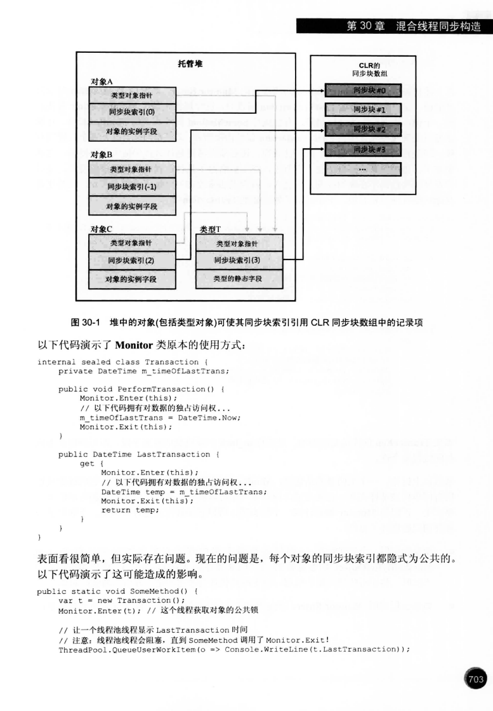

# 第30章　混合线程同步构造

第29章给出用户模式原子操作与内核等待基元；本章把它们组合成能保护状态、通知事件、限制配额或协调阶段的协议。先看两把教学混合锁，再看FCL的现成构造，随后理解安全发布、条件变量、异步同步与并发集合。各追问的不同代码、ASCII图、原输入与原输出在相应主题保留。

目录：[原书主线](#c30-overview) · [线程所有权与递归](#c30-owner) · [SimpleHybridLock边界](#c30-simple-boundaries) · [Slim事件与许可](#c30-slim) · [异步等许可](#c30-await-permit) · [Monitor与同步块](#c30-monitor) · [构造间的联系](#c30-compare) · [异步互斥](#c30-async-mutex) · [读写锁](#c30-rwl) · [OneManyLock](#c30-onemany) · [选型](#c30-selection) · [双检与发布](#c30-publication) · [条件变量](#c30-condition) · [异步读写与调度](#c30-async-many) · [并发集合](#c30-collections) · [TryDequeue竞争](#c30-trydequeue) · [纠错](#c30-corrections)。

原书基准为本地第四版同版中文PDF与[固定章节快照](https://github.com/fhlsteven/CLR_via_CSharp/blob/main/chapters/ch30_hybridThreadSyncConst.md)：30.1—30.7及30.3.1—30.3.7的结构保持。问答新增的下载、缓存、计数器、医院叫号等例子是解释补充。API契约、指定实现与有限实测分开使用；“教学模型”不当成所有CLR的真实对象布局。重复的Program/Main和成员片段分别属于独立示例，不能整章拼接编译。

版本说明：第四版讨论历史Framework；本次有限验证使用现有SDK10.0.401的Roslyn，目标为本机CLR4安装槽与.NET10.0.12。两批raw里的“Framework4.8”是helper标签，原样保留。事前工具实际看到Release533509/Version4.8.09221；随后另存2026-10-08 04:14:55Z的精确身份采集，按[官方识别表](https://learn.microsoft.com/en-us/dotnet/framework/migration-guide/how-to-determine-which-versions-are-installed)当前槽是Framework4.8.1。这个后存时刻不是实验执行时刻，也不能倒填其他章旧日志的精确历史补丁。`using var`需C#8，目标类型`new()`需C#9；`async Main`需C#7.1，async/await进入第四版的Framework4.5时代。交互、网络、数据库示意均按静态场景解释；运行过的范围在作者实证包中逐例说明。

<a id="c30-overview"></a>
## 原书主线：快路径、竞争路径与各自的语义

<a id="c30-overview-simple"></a>
### 30.1：用Int32与AutoResetEvent组成最小协议

无竞争时通过原子计数快速取得锁；竞争者登记后等待事件，避免一直占CPU。这个成本模型解释“混合”的动机，不是“所有竞争都先创建一个内核事件”的统一实现。SimpleHybridLock构造时就创建AutoResetEvent，Dispose负责关闭它；要在没有在途使用者时销毁。长期频繁调用的Enter/Leave快路径，是书例重点。

下面是原书完整教学类。注释中的“其他线程正在阻塞”应按“其他已登记竞争者”理解：m_waiters包括当前占有者与已登记进入者，不保证所有登记者都已执行到WaitOne。Set早于WaitOne也可以保存一次自动重置信号。

<a id="c30-book-simple"></a>
<!-- BOOK30-Simple MD 24—51 -->
```csharp
internal sealed class SimpleHybridLock : IDisposable {
    // Int32 由基元用户模式构造 (Interlocked 的方法)使用
    private Int32 m_waiters = 0;

    // AutoResetEvent 是基元内核模式构造
    private readonly AutoResetEvent m_waiterLock = new AutoResetEvent(false);

    public void Enter() {
        // 指出这个线程想要获得锁
        if (Interlocked.Increment(ref m_waiters) == 1)
            return; // 锁可自由使用，无竞争，直接返回
                    
        // 另一个线程拥有锁(发生竞争)，使这个线程等待
        m_waiterLock.WaitOne(); // 这里产生较大的性能影响
        // WaitOne 返回后，这个线程拿到锁了
    }

    public void Leave() {
        // 这个线程准备释放锁
        if (Interlocked.Decrement(ref m_waiters) == 0)
            return; // 没有其他线程正在等待，直接返回

        // 有其他线程正在阻塞，唤醒其中一个
        m_waiterLock.Set(); // 这里产生较大的性能影响
    }

    public void Dispose() { m_waiterLock.Dispose(); }
}
```

初始0，第一个Increment得到1便返回；第二个得到2，会执行WaitOne。占有者Leave后计数若变0，直接返回；仍有登记者则Set，让一个等待调用取得信号。其余等待者以后依次由新的占有者Leave推进。正确使用需要配对、无非法释放、无重入，以及生命周期和异常处理协议。

中文纸页698/MD54说后面会展示“AutoResetEventSlim”，但同章纸页701脚注明确没有此类：这是书内名称笔误。可用SemaphoreSlim(0,1)表达“最多存一份许可”的部分自动重置信号用途，语义仍不完全等于AutoResetEvent：满额时再次Release会抛SemaphoreFullException，而重复Set有其自身合并信号语义。

<a id="c30-overview-another"></a>
### 30.2：添加自旋、所有权和递归

AnotherHybridLock在登记阻塞前先用CompareExchange尝试获得快路径，SpinWait.SpinOnce给其他线程运行机会，再转入等待。4000是书作者随意选择的尝试次数，不是应在所有机器上照抄的最优时长；SpinWait会随策略yield/sleep，不能把每次SpinOnce都说成纯CPU忙循环。Mutex是历史内核构造，检查/等待会进入内核，其“拥有者及递归”与用户模式自旋是不同维度。

下面保留完整书类。新增字段并不把一个教学实现自动认证为适用于所有生产场景；超时、取消、销毁、错误调用及调度性能仍要分别设计。

<a id="c30-book-another"></a>
<!-- BOOK30-Another MD 73—134 -->
```csharp
internal sealed class AnotherHybridLock : IDisposable {
    // Int32 由基元用户模式构造 (Interlocked 的方法)使用
    private Int32 m_waiters = 0;

    // AutoResetEvent 是基元内核模式构造
    private AutoResetEvent m_waiterLock = new AutoResetEvent(false);

    // 这个字段控制自旋，希望能提升性能
    private Int32 m_spincount = 4000; // 随便选择的一个计数

    // 这些字段指出哪个线程拥有锁，以及拥有了它多少次
    private Int32 m_owningThreadId = 0, m_recursion = 0;

    public void Enter() {
        // 如果调用线程已经拥有锁，递增递归计数并返回
        Int32 threadId = Thread.CurrentThread.ManagedThreadId;
        if (threadId == m_owningThreadId) { m_recursion++; return; }

        // 调用线程不拥有锁，尝试获取它
        SpinWait spinwait = new SpinWait();
        for (Int32 spinCount = 0; spinCount < m_spincount; spinCount++) {
            // 如果锁可以自由使用了，这个线程就获得它；设置一些状态并返回
            if (Interlocked.CompareExchange(ref m_waiters, 1, 0) == 0) goto GotLock;

            // 黑科技：给其他线程运行的机会，希望锁会被释放
            spinwait.SpinOnce();
        }

        // 自旋结束，锁仍未获得，再试一次
        if (Interlocked.Increment(ref m_waiters) > 1) {
            // 仍然是竞态条件，这个线程必须阻塞
            m_waiterLock.WaitOne(); // 等待锁：性能有损失
            // 等这个线程醒来时，它拥有锁；设置一些状态并返回
        }

    GotLock:
        // 一个线程获得锁时，我们记录它的 ID，并
        // 指出线程拥有锁一次
        m_owningThreadId = threadId; m_recursion = 1;
    }

    public void Leave() {
        // 如果调用线程不拥有锁，表明存在 bug
        Int32 threadId = Thread.CurrentThread.ManagedThreadId;
        if (threadId != m_owningThreadId)
            throw new SynchronizationLockException("Lock not owned by calling thread");
        
        // 递减递归技术。如果这个线程仍然拥有锁，那么直接返回
        if (--m_recursion > 0) return;

        m_owningThreadId = 0; // 现在没有线程拥有锁
                              
        // 如果没有其他线程在等待，直接返回
        if (Interlocked.Decrement(ref m_waiters) == 0)
            return;

        // 有其他线程正在等待，唤醒其中 1 个
        m_waiterLock.Set(); // 这里有较大的性能损失
    }
    
    public void Dispose() { m_waiterLock.Dispose(); }
}
```

自身重入只递增m_recursion，不再次登记m_waiters；最后一次Leave才清除拥有者并释放竞争路径。多字段、分支与错误检查带来成本，实际性能取决于竞争、CPU数量、持有时间和实现。书中的单次旧基准表达这种取舍，不能从它推出永久固定排名。

<a id="c30-overview-fcl"></a>
### 30.3：现成构造先按用途区分

FCL把相似的快路径思想封装成不同协议：ManualResetEventSlim是手动广播式状态通知；SemaphoreSlim是许可计数；Monitor是线程所有权、递归与互斥；ReaderWriterLockSlim区分读者、写者和可升级读者；OneManyLock是作者的读写锁教学设计；CountdownEvent和Barrier协调完成与阶段。超时、协作式取消等公共接口应按各个重载读，取消令牌用于取消适用的等待，不是强制终止线程。

Slim类的基本事件/许可语义对应其老构造，接口并非完全相同：不是所有Wait都同一返回类型，不是两者都有WaitAsync，也不是首次竞争必创建WaitHandle。Framework参考源码中的同步慢路径可用Monitor等待，显式请求WaitHandle才会创建其兼容句柄。

<a id="c30-book-slimapi"></a>
<!-- BOOK30-SlimAPI MD 161—183 -->
```csharp
public class ManualResetEventSlim : IDisposable {
    public ManualResetEventSlim(Boolean initialState, Int32 spinCount);
    public void Dispose();
    public void Reset();
    public void Set();
    public Boolean Wait(Int32 millisecondsTimeout, CancellationToken cancellationToken);

    public Boolean IsSet { get; }
    public Int32 SpinCount { get; }
    public WaitHandle WaitHandle { get; }
}

public class SemaphoreSlim : IDisposable {
    public SemaphoreSlim(Int32 initialCount, Int32 maxCount);
    public void Dispose();
    public Int32 Release(Int32 releaseCount);
    public Boolean Wait(Int32 millisecondsTimeout, CancellationToken cancellationToken);

    // 该特殊的方法用于 async 和 await(参见第 28 章)
    public Task<Boolean> WaitAsync(Int32 millisecondsTimeout, CancellationToken cancellationToken);
    public Int32 CurrentCount { get; }
    public WaitHandle AvailableWaitHandle { get; }
}
```

<a id="c30-overview-monitor"></a>
### 30.3.2：Monitor模型与公开锁对象

Monitor关联的是传入对象的身份，检查拥有线程及递归层数。书把它画成对象中的索引指向同步块表，帮助理解可共享的状态。真实实现还包含薄锁、膨胀、身份散列与表项回收；同步块表不是简单的托管GC数组，“初始-1，每次Enter分配块，每次Exit归-1”不能当成所有实例的真实变化。

外部代码能取得同一个对象引用，就可能在其上使用Monitor；这与“同步块索引是一个公开属性”不同。下面保留全部七类原风险，并把过强表述限定到其条件。

<a id="c30-q01-a030"></a>
<!-- C30-D01-Q001-A-B030 -->
| 坑 | 说明 |
| --- | --- |
| **锁是隐式公共的**​ | 外部若能取得同一对象引用，便能在该对象上Enter，可能造成额外竞争或锁顺序死锁；同步块索引不是公开API。 |
| **永远用私有锁**​ | `private readonly object m_lock = new object();` |
| **不要传类型对象**​ | 避免把公开Type当业务锁；原书AppDomain中立加载与共享的讨论属于历史Framework条件，非所有版本所有Type都跨域共享。 |
| **不要传 String**​ | 避免把可共享或驻留字符串当锁；同值字符串不必同一对象，驻留/跨域共享按历史实现与具体身份分析。 |
| **不要传值类型**​ | 每次把值重新装箱会得到不同对象；C# lock直接接收int不合法。一次装箱后持续使用同一object可互斥，但通常用私有专用锁。 |
| **不要用 `[MethodImpl(Synchronized)]`**​ | 实例方法锁 `this`，静态方法锁类型对象，都是公共锁 |
| **警惕类型构造器**​ | 类型初始化有运行时协调；原书域中立加载是历史隔离条件。初始化死循环会阻塞依赖该初始化的线程，不保证一切AppDomain和无关代码都不可用。 |

私有readonly专用对象减少外部获取其引用的机会，readonly只稳定字段引用，不让受保护业务状态自动不可变。[MethodImpl(Synchronized)]的实例方法锁this、静态方法锁类型对象，增加隐式公开锁和锁顺序风险。公开锁上的两段独立lock可以正常串行执行，形成死锁还需要等待环路等条件。

原始lock片段：

<a id="c30-q01-a032"></a>
<!-- C30-D01-Q001-A-B032 -->
```csharp
lock (m_lock) {
    // 等价于 Monitor.Enter + try/finally + Monitor.Exit
}
```

书作者反感“状态中途异常后finally放锁”的不变量风险，也谈及当时JIT对含异常处理方法的内联限制。这是历史观点与事务设计问题。普通引用类型的现代C# lock本来就使用lockTaken和finally的降低方式；手写下列模式能防止尚未获得锁却Exit，不能回滚已经写坏的状态。用临时状态提交、回滚或明确的失败协议保护不变量，而非笼统禁止finally。

<a id="c30-q01-a037"></a>
<!-- C30-D01-Q001-A-B037 -->
```csharp
bool lockTaken = false;
try {
    Monitor.Enter(m_lock, ref lockTaken);
    // ... 操作状态
}
finally {
    if (lockTaken) Monitor.Exit(m_lock);
}
```

<a id="c30-overview-rwl"></a>
### 30.3.3—30.3.4：读写意图与压缩状态

读多写少是ReaderWriterLockSlim的典型候选：多读者并行，写者与读写独占；默认NoRecursion减少递归复杂性，但仍检查线程所有权。旧ReaderWriterLock的历史成本、递归和读者偏好是书选择Slim的原因，不能把单次性能说成永久保证。

书中OneManyLock把状态压入Int64：低4位状态，再依次20位RR（当前读者）、RW（等待读者）、WW（等待写者）。它用“Interlocked Anything”读取、计算、CAS和必要重试，避免多字段互相失配；一次成功CAS提交状态，不等于一次CAS尝试就能完成任意进入过程。位数、状态数、等待句柄与后续32位源码快照的版本差异在OneMany节分别保留。

<a id="c30-overview-phases"></a>
### 30.3.5—30.3.6：倒计数与阶段会合

CountdownEvent把“还剩N份工作”减到0后置为有信号，适用于等待全部完成，与Semaphore计数0时不可取得许可的方向相反。零后AddCount不能复活，TryAddCount返回false；Reset可以在没有在途使用者时设置下一轮计数，不能说零后永远不能修改。

Barrier用于各参加者完成本阶段后SignalAndWait，全部到齐才进入下一阶段；最后一位到达者执行可选post-phase action，再允许本阶段继续。原书以服务器GC多个线程分阶段工作作类比，不表示CLR实际用公开Barrier类型，也不表示每次GC必然压缩。Main返回仅在没有其他前台线程等条件下结束进程；async Main的合成入口会等待其Task，不能仅凭源码返回位置认定所有异步工作都已完成。

<a id="c30-overview-selection"></a>
### 30.3.7：协议正确之后再选成本

优先减少共享、用不可变快照、Interlocked/Volatile正确发布及异步I/O；Task本身不是互斥。必须等待时，进程内可选Monitor私有对象、Slim许可或读写锁；历史跨AppDomain及Windows跨进程协作要选适用的命名Mutex/Semaphore/EventWaitHandle并考虑权限与生命周期。短持锁时间、减少递归和避开锁内慢I/O常有帮助，但锁外读取仍需稳定快照或对象所有权；不是拿到一个可变引用就自动可在锁外任意使用。

<a id="c30-overview-publication"></a>
### 30.4：双检、类型初始化与Lazy

两次检查分别提供“已初始化后的无锁路径”和“进入互斥后再次确认”的作用。Java旧内存模型的半初始化发布故事必须与JDK5以后的volatile规则区分；当前.NET内存模型明确普通对象引用发布对可达实例初始化的排序，并有依赖读取的顺序，因此不能把所有没有volatile的.NET双检一律判错。

原回答的显式volatile/Volatile.Write示意保留如下。它展示一种有明确发布语义的方式，并不证明原书只写Volatile.Write的模式必错；具体模型、锁的acquire/release与所保护数据分开核。

<a id="c30-q01-a072"></a>
<!-- C30-D01-Q001-A-B072 -->
```csharp
private static volatile Singleton s_value;  // 或者用 Volatile.Write

public static Singleton GetSingleton() {
    if (s_value == null) {  // 第一次检查：无竞争时快速返回
        Monitor.Enter(s_lock);
        try {
            if (s_value == null) {  // 第二次检查：确保只构造一次
                Singleton temp = new Singleton();
                Volatile.Write(ref s_value, temp);  // 关键！保证构造器先执行完再发布引用
            }
        }
        finally { Monitor.Exit(s_lock); }
    }
    return s_value;
}
```

类型初始化可提供一次初始化协调，静态readonly字段与beforefieldinit会影响精确触发时机；Lazy<T>可选择ExecutionAndPublication、PublicationOnly或None，异常缓存行为也随构造方式/模式变化。CAS单例可以多个线程各构造候选，只发布一个；未发布对象由GC回收不等于自动清理其外部资源，构造副作用必须可接受。LazyInitializer则按具体重载决定锁、factory次数和初始化状态。

<a id="c30-overview-condition"></a>
### 30.5：等待谓词而非积攒通知

Monitor.Wait必须拥有同一个对象的锁，原子登记等待并释放它，返回前重新取得并恢复递归深度。Pulse把一个等候线程转成可重新竞争锁的状态，PulseAll处理全部等候者；通知不是持久的许可，先通知而没有等待者不会替将来的Wait存信号。while重新检查受同一锁保护的谓词，防止别的竞争者先改变条件；不是被通知就必有一份数据。

以下中文条件是教学伪码，展示消费者检查/等待/处理和生产者修改/通知的调用顺序，不是独立可编译程序。实际异常安全版在条件变量节给出。

<a id="c30-q01-a086"></a>
<!-- C30-D01-Q001-A-B086 -->
```text
// 消费者线程
Monitor.Enter(m_lock);
while (!条件满足) {
    Monitor.Wait(m_lock);  // 释放锁并阻塞，被唤醒后重新获取锁
}
// 条件满足，处理数据
Monitor.Exit(m_lock);

// 生产者线程
Monitor.Enter(m_lock);
// 改变状态，使条件可能满足
Monitor.Pulse(m_lock);  // 或 PulseAll
Monitor.Exit(m_lock);
```

“可以唤醒多个且不会出错”需要while与完整状态协议，不能把PulseAll本身当作正确性保证。

<a id="c30-overview-async"></a>
### 30.6：未完成Task保存逻辑等待

WaitAsync不足许可时返回未完成Task，await把后续逻辑注册在完成路径，当前调用可以返回；已经可用或任务已完成时可以同步继续。恢复可能经过原同步上下文、调度器或池，不保证同一物理线程或必新建线程。阻塞工作可能影响线程池启发式与伸缩性，但“10000请求必有9997物理线程、每线程立刻1MiB RAM”不是契约。

AsyncOneManyLock用短SpinLock保护状态、用TCS表达排队；它降低逻辑等待造成的线程阻塞，不保证CPU同步部分永远不会自旋或任何代码永不阻塞。原书的SetResult本来放在SpinLock外。ConcurrentExclusiveSchedulerPair控制提交到该对上的Task执行片段；整个await业务生命周期不因此被排他锁住。专利编号US7603502在本书用作历史署名，不作为本次全部法律状态已核的依据。

<a id="c30-overview-collections"></a>
### 30.7：线程安全集合与阻塞包装

四种并发集合解决FIFO、LIFO、键值表和无序本地袋。下表保留原比较的全部维度，但“Try返回false不等数据”不等于底层所有路径无锁；队列在指定现代实现有内部同步慢路径。

<a id="c30-q01-a097"></a>
<!-- C30-D01-Q001-A-B097 -->
| 类 | 底层机制 | 特点 |
| --- | --- | --- |
| `ConcurrentQueue<T>` | 原子槽/索引操作加指定实现的内部同步慢路径 | FIFO；TryDequeue不等未来元素，非所有路径无锁保证 |
| `ConcurrentStack<T>` | `Interlocked` | LIFO，无锁 |
| `ConcurrentDictionary<TKey,TValue>` | `Monitor` | 锁持有时间极短 |
| `ConcurrentBag<T>` | 每线程一个迷你集合 + `Interlocked`/`Monitor` | 线程本地缓存，可从别的线程"偷"元素 |

Queue/Stack/Bag枚举提供其合同所述快照；ConcurrentDictionary并发枚举安全但不是某一时刻的完整快照。线程安全方法并不把多次Count/Contains/读取/写入变成整体原子事务。BlockingCollection包装IProducerConsumerCollection，可有容量上限，满时Add等空间、空时Take等数据，CompleteAdding表示不再接受新元素而非丢弃已有数据；AddToAny/TakeFromAny可路由多个集合。书作者偏好不阻塞的任务模型是伸缩性建议；非阻塞队列本身还需要通知、结束与背压协议。

本章全部七个主节至此建立联系：基元组合、所有权成本、FCL协议、发布、谓词等待、异步队列、并发容器。第30章是本书末章，原回答“下一章应该讲异步模型”是会话尾语与错误章序预测，不作为学习内容。

<a id="c30-owner"></a>
## 线程ID和递归次数：分别识别拥有者与配平次数

<a id="c30-owner-detect"></a>
### A调用B：同线程重入为何需要识别

线程ID回答“现在来的是原拥有者吗”，递归数回答“拥有者还有几层Enter没有Leave”。两者不是一份全局竞争计数。下面A→B的源示意使用lock当变量名、不是可直接编译的C#；按两处都指向同一SimpleHybridLock理解，同线程在B再次进入会把自己阻塞，外层A再没有机会执行Leave。它不意味着一切没有线程ID的同步原语都必须有这种行为。

<a id="c30-q02-a005"></a>
<!-- C30-D01-Q002-A-B005 -->
```text
void A() {
    lock.Enter();
    B();           // 同一个线程再次 Enter
    lock.Leave();
}

void B() {
    lock.Enter();  // 如果没有线程ID记录，这里会阻塞自己 → 死锁
    lock.Leave();
}
```

AnotherHybridLock先认出是原线程，递增自身层数并返回：

<a id="c30-q02-a007"></a>
<!-- C30-D01-Q002-A-B007 -->
```text
if (m_owningThreadId == 当前线程ID) {
    // 是自己！这是递归进入，直接递增递归计数，立即返回
    m_recursionCount++;
    return;
}
// 不是自己，走原来的竞争逻辑...
```

线程所有权也用于拒绝非法Leave；Monitor等线程亲和构造必须由取得它的线程配对退出。事件和许可型Semaphore可以由另一线程通知/归还，不能把“任何线程可Release”一概叫bug。

<a id="c30-owner-count"></a>
### 计数到零才最终释放

首次得到锁设置拥有者并令层数1；再入令2；内层Leave令1，外层最后Leave令0才清除拥有者并走竞争释放。若第一次Leave就释放，外层余下代码失去保护；若配对少了一次，其他需要该锁的线程可能一直等。归零是最终释放资格，若没有已登记竞争者，最终Leave也不会调用Set，不保证每次归零都必唤醒一个实际睡眠线程。

原Enter/Leave伪码把两条职责同时展示：

<a id="c30-q02-a015"></a>
<!-- C30-D01-Q002-A-B015 -->
```text
Enter: 
    if (是自己) {
        m_recursionCount++;
        return;  // 快速路径，不碰内核
    }
    // 竞争路径...
    m_owningThreadId = 当前线程ID;
    m_recursionCount = 1;

Leave:
    if (m_owningThreadId != 当前线程ID) throw;  // 不是你的锁不能放
    m_recursionCount--;
    if (m_recursionCount == 0) {
        m_owningThreadId = 0;  // 清除所有权
        // 真正释放锁，唤醒等待者
    }
```

<a id="c30-q02-a019"></a>
<!-- C30-D01-Q002-A-B019 -->
| 字段 | 回答的问题 |
| --- | --- |
| `m_owningThreadId` | "当前锁被谁拿着？是不是我？" |
| `m_recursionCount` | "如果是我，我拿了几次？" |

只记拥有者不能自动配平多次重入；只记次数不能认出正在调用的是不是拥有者。监视器支持递归是Monitor的API语义，C#普通对象lock使用该语义；不是C#语言迫使所有新型锁都支持递归。

增加所有权、次数、自旋也增加字段和快路径逻辑。书作者用性能数据说明每个行为有成本，而不是断言每加一个字段在所有负载下都会慢。AnotherHybridLock能帮助理解同步块承担类似职责，但它并不就是CLR Monitor内部的完整实现。

<a id="c30-simple-boundaries"></a>
## SimpleHybridLock：重入自死锁和非法释放是两种问题

<a id="c30-simple-reentry"></a>
### 正确配对协议下的自死锁路径

Enter核心没有所有者判断：

<a id="c30-q03-a005"></a>
<!-- C30-D01-Q003-A-B005 -->
```csharp
public void Enter() {
    if (Interlocked.Increment(ref m_waiters) == 1) return; // 拿到锁
    m_waiterLock.WaitOne(); // 没拿到，阻塞
}
```

T1第一次取得锁后m_waiters为1；T1第二次增成2，再执行WaitOne。正常配对协议下，没有另一个拥有者能Leave，T1自身又睡在内层进入处，因此外层无法走到释放。恶意或错误的其他线程虽然可调用Leave打破等待，却已经违反协议，不能用它证明重入支持。

AnotherHybridLock的自身分支避免这次登记与等待，m_recursion加1便返回：

<a id="c30-q03-a014"></a>
<!-- C30-D01-Q003-A-B014 -->
```text
if (threadId == m_owningThreadId) { m_recursion++; return; }
```

<a id="c30-simple-foreign"></a>
### 错误线程Leave：计数失真但不一定Set

下面保留T1取得、T2从未取得却释放的具体场景，并纠正源注释：1减到0直接返回，根本没有Set。T1的业务仍在临界区，而后来的新Enter可从0增到1“取得”锁，破坏互斥。首批有限实测确实看到foreignLeave返回、计数0、事件仍无信号；它是自造错误调用输入的观察，不是合法所有权协议的一次性能测试。

<a id="c30-q03-a020"></a>
<!-- C30-D01-Q003-A-B020 -->
```text
// 线程 T1
lock.Enter();   // m_waiters = 1, T1 拿到锁

// 线程 T2（没调过 Enter）
lock.Leave();   // m_waiters 变成 0，Leave 直接返回，未调用 Set()
                // T2 相当于"偷放"了 T1 的锁！
```

另一教学类先做拥有者检查，不匹配便抛SynchronizationLockException：

<a id="c30-q03-a023"></a>
<!-- C30-D01-Q003-A-B023 -->
```csharp
public void Leave() {
    Int32 threadId = Thread.CurrentThread.ManagedThreadId;
    if (threadId != m_owningThreadId) 
        throw new SynchronizationLockException("Lock not owned by calling thread");
    // ...
}
```

同样，Monitor.Exit非拥有线程会抛；SemaphoreSlim不检查拥有线程是许可的设计，而非缺失Monitor功能。原回答英文引语本次没有取得英文原件；本次可核的同版中文MD62/纸页699实际说不记录成功取得者，并明确作者选择由自己的调用方保证正确使用。不能据二手英文字符串宣称英文全文已核。

<a id="c30-simple-cost"></a>
### 原数字和作者取舍保留各自出处

原问答给出8／211／415及1×／26×／52×；作为原问答不同来源数字保留，不能称它就是本次同版中文书的数字，更不能称本机新跑结果：

<a id="c30-q03-a033"></a>
<!-- C30-D01-Q003-A-B033 -->
| 锁实现 | 相对耗时 | 倍数 |
| --- | --- | --- |
| 无锁 | 8 | 1× |
| `SimpleHybridLock` | 211 | 26× |
| `AnotherHybridLock` | 415 | 52× |

本次同版中文MD139—145/纸页700给出六种递增基准，包括前章M、SpinLock和SimpleWaitLock，完整原输出如下：

<a id="c30-book-benchmark"></a>
<!-- BOOK30-Benchmark MD 140—145 -->
```text
Incrementing x: 8                           最快
Incrementing x in M: 69                     慢约 9 倍
Incrementing x in SpinLock: 164             慢约 21 倍
Incrementing x in SimpleHybridlock: 164     慢约 21 倍(类似于 SpinLock)
Incrementing x in AnotherHybridLock: 230    慢约 29 倍(因为所有权/递归)
Incrementing x in SimpleWaitLock: 8854      慢约 1107 倍
```

8／69／164／164／230／8854表达原测试输入、环境下的相对成本。各字段、判断、自旋可能改变无竞争快路径，功能与性能需要实际工作负载权衡；没有为这张旧表重新跑benchmark。SimpleHybridLock必须配对且不重入；AnotherHybridLock加了拥有者与递归仍是作者教学设计，不凭这两个补丁直接贴“生产级”认证。

<a id="c30-slim"></a>
## ManualResetEventSlim与SemaphoreSlim：开关和数量

<a id="c30-slim-race"></a>
### 手动重置事件：四辆赛车的起跑旗

ManualResetEventSlim(false)初始无信号，true初始有信号。Wait遇无信号便等待，已Set则通过；Set令当前及后续等待调用可通过，Reset恢复无信号，IsSet查询当前状态。它是广播式开关，放行资格同时成立不表示四辆车在CPU同一时刻执行，也没有每次等待消费一份许可。

保留原四车、捕获car、就绪/出发输出、ReadLine手工发令场景。原示意没有保存Task，可能Set后主方法返回并Dispose而赛车仍在使用事件；这里显式收集四Task并在释放资源前等它们完成。片段位于async方法，需System.Threading/Tasks与Collections.Generic。这个交互场景没有在本机运行或假造输出顺序。

<a id="c30-q04-a011"></a>
<!-- C30-D01-Q004-A-B011 -->
```csharp
using var startRaceFlag = new ManualResetEventSlim();  // 初始无信号

var cars = new List<Task>();
for (int i = 1; i <= 4; i++) {
    var car = i;
    cars.Add(Task.Run(() => {
        Console.WriteLine($"赛车 {car} 准备就绪");
        startRaceFlag.Wait();  // 所有车都在这里等
        Console.WriteLine($"赛车 {car} 出发！");
    }));
}

Console.ReadLine();
startRaceFlag.Set();  // 一声枪响，四辆车都获得放行资格
await Task.WhenAll(cars);  // 在 using 释放事件前确认四个使用者完成
```

只Set一次便持续开放，直到Reset；无须替每辆车单独Set。实际准备/出发打印顺序取决于调度，不能按编号保证。

<a id="c30-slim-device"></a>
### 设备每轮采集：Reset与在途访问

另一原场景是每轮新生产者ReadLine模拟设备数据，最后Set通知主循环；主循环Wait通过后打印该轮数据再Reset。忘Reset会让下一轮直接通过并读到旧值。以下仍是人工输入的无限教学循环，没有本机执行：生产者完成与下一轮Reset之间须无竞争访问，需另外设计退出、取消、异常与Dispose协议。这里保存该轮Task，并在Reset前确认其回调结束，避免把Set当成“整个生产者必已返回”。

<a id="c30-q04-a014"></a>
<!-- C30-D01-Q004-A-B014 -->
```csharp
var mres = new ManualResetEventSlim();  // 无信号
string deviceData = null;

while (true) {
    Console.WriteLine("主循环：等待设备数据...");
    Task producer = Task.Run(() => {
        deviceData = Console.ReadLine();  // 模拟设备采集
        mres.Set();  // 通知主线程：数据到了
    });
    
    mres.Wait();  // 阻塞，直到 Set()
    Console.WriteLine($"收到数据：{deviceData}");
    
    producer.GetAwaiter().GetResult(); // 确认本轮生产者结束；此同步循环本来就在阻塞等待
    mres.Reset();  // 无其它在途访问时重置，下一轮才会等待新数据
}
```

<a id="c30-slim-spin"></a>
### SpinCount描述策略，不等于必创建MRE

普通ManualResetEvent调用WaitOne要检查内核等待对象，已置位时也可能立即返回，不能说每次都必阻塞。Slim可先进行短暂自旋；原spinCount1000构造保留：

<a id="c30-q04-a018"></a>
<!-- C30-D01-Q004-A-B018 -->
```csharp
var mres = new ManualResetEventSlim(false, spinCount: 1000);
```

较大的SpinCount可能增加机会或CPU代价，真正等待行为随单核/多核、实现策略和已置位/取消/超时条件变化。Framework及指定现代源码中，MRES同步慢路径使用Monitor.Wait；并非“1000次后必创建一个ManualResetEvent”。请求WaitHandle才会创建兼容句柄。自旋期间也可能yield/sleep，“微秒内通常Set”是性能假设而非API保证。

<a id="c30-slim-count"></a>
### 许可计数：true、true、false、归还后true

SemaphoreSlim(initialCount,maxCount)给出初始许可和允许的最大计数。Wait/WaitAsync成功取得才消耗一份；Wait(0)尝试而不等未来许可；Release归还，可唤醒适用等待者。CurrentCount才是当前数值，AvailableWaitHandle返回WaitHandle，只通知当前是否有许可，等待它不会自动取得或减计数。

原初始2的连续步骤完整保留，首批有限验证在两个目标观察到true、true、false，Release一次后又true：

<a id="c30-q04-a032"></a>
<!-- C30-D01-Q004-A-B032 -->
```csharp
SemaphoreSlim ss = new SemaphoreSlim(2);  // 初始2个许可证

Console.WriteLine(ss.Wait(0));  // true  —— 拿到1个，还剩1个
Console.WriteLine(ss.Wait(0));  // true  —— 拿到1个，还剩0个
Console.WriteLine(ss.Wait(0));  // false —— 没了，拿不到（Wait(0)是不阻塞的尝试）

ss.Release();  // 还回去1个
Console.WriteLine(ss.Wait(0));  // true —— 又能拿到了
```

单参数new SemaphoreSlim(2)的最大计数是Int32.MaxValue，不是2；同理单参数3并不从构造器强制maxCount3。在所有等待/归还正确配对且没有额外Release时，原2／3配额用途仍成立。需要捕获多放错误，可显式new SemaphoreSlim(2,2)或(3,3)。本次实际验证单参数许可可以多放到2，而显式(1,1)额外Release会抛SemaphoreFullException；不能把原配对程序整体说成无效。

<a id="c30-slim-download"></a>
### 1000个下载任务只有三份业务许可

下例保留URL集合、LINQ异步委托、开始下载打印、DownloadFileAsync和WhenAll，DownloadFileAsync是需由业务提供的异步方法，没有运行真实下载。所有共享同一信号量、成功取得才进入try/finally并正常归还时，1000个URL最多三份受保护下载同时进行；其余逻辑操作等Task，不是997个专属物理线程。Select的枚举和每个async委托的同步前缀也执行在调用路径，不可忽略。

<a id="c30-q04-a034"></a>
<!-- C30-D01-Q004-A-B034 -->
```csharp
private static SemaphoreSlim _semaphore = new SemaphoreSlim(3);  // 最多3个并发

static async Task DownloadAllAsync(List<string> urls) {
    var tasks = urls.Select(async url => {
        await _semaphore.WaitAsync();  // 异步申请许可证，没有就异步等
        try {
            Console.WriteLine($"开始下载：{url}");
            await DownloadFileAsync(url);
        }
        finally {
            _semaphore.Release();  // 一定要在 finally 里释放！
        }
    });
    await Task.WhenAll(tasks);
}
```

把await WaitAsync放在try前，只有成功才进入finally归还；取消/异常未取得的路径不应Release。若改用带超时的Task<bool>重载，还须检查false，不能超时失败却继续下载再归还。finally保证此程序正常异常传播时归还，不保证进程崩溃等一切情况；没有归还会泄漏许可，达到耗尽后后续逻辑无法推进。

<a id="c30-slim-counter"></a>
### 一份许可跨await保护计数更新

SemaphoreSlim(1,1)可表达异步互斥，所有使用者须共同遵守同一许可协议；它没有Monitor的拥有线程或递归检查。下面_counter是包含该方法的类型所提供字段。若从0开始，1000次调用全部成功、全部完成且所有修改都经过这一许可，最终才是1000；未等待完成、取消或外部无保护写入不适用此结论。

<a id="c30-q04-a039"></a>
<!-- C30-D01-Q004-A-B039 -->
```csharp
private static SemaphoreSlim _mutex = new SemaphoreSlim(1, 1);

static async Task UpdateSharedCounterAsync() {
    await _mutex.WaitAsync();
    try {
        _counter++;
        await Task.Delay(1);
    }
    finally {
        _mutex.Release();
    }
}
```

<a id="c30-q04-a047"></a>
<!-- C30-D01-Q004-A-B047 -->
| 维度 | ManualResetEventSlim | SemaphoreSlim |
| --- | --- | --- |
| 语义 | **事件通知**（发生了没？） | **资源配额**（还能进几个？） |
| 计数 | 布尔状态（有信号/无信号） | 整数计数（N 个许可证） |
| `Set`/`Release` 效果 | 放行**所有**等待者 | Release()归还一份许可；适用等待者可取得。Release(n)可归还多份。 |
| 典型用途 | 线程启动信号、阶段完成通知 | 并发限流、连接池配额 |
| 等价老类 | `ManualResetEvent` | `Semaphore` |

ManualResetEventSlim管“发生了没”的开关；SemaphoreSlim管“还可进几份”的配额。基本事件/计数对应老类，接口、句柄创建方式、所有权及异步支持分别读：MRES没有WaitAsync，SemaphoreSlim有；新API并非对老API每个调用都无感兼容。理解这些协议后，再看Monitor承担的拥有者与递归职责。

<a id="c30-await-permit"></a>
## 为什么await WaitAsync：等待许可不等于占住线程

<a id="c30-await-permit-model"></a>
### 同步Wait与异步Task的具体差别

原下载场景在async方法中先取得许可，再异步I/O，最后归还。同步Wait在不足许可时占住调用线程；WaitAsync则让获取操作用Task表示，await未完成Task时保存逻辑状态并可返回调用方。不是async关键字自动把一切工作改成异步，也不是await每次都把当前线程交回池。

<a id="c30-q05-a005"></a>
<!-- C30-D01-Q005-A-B005 -->
| 比较项 | `Wait()` | `WaitAsync()` |
| --- | --- | --- |
| **获取不到许可证时**​ | **阻塞当前线程**（线程卡住，啥也干不了） | 返回一个未完成的 `Task`，**不阻塞线程**​ |
| **线程去哪了**​ | 卡在 `Wait()` 这一行，占着线程资源 | 未完成await让该方法返回调用方；调用线程随后由其环境继续工作，不保证原来就是池线程。 |
| **适合场景**​ | 同步代码、控制台 Demo | `async` 方法、高并发服务 |

<a id="c30-await-permit-block"></a>
### 1000个操作、三份许可：哪一步造成占线程

原反例下面的方法名是UpdateSharedCounterAsync，但业务是下载，url与_semaphore由外层提供，名字不影响所展示的步骤。保留同步Wait→下载await→finally Release的形状，它不是C#语法禁例，而是可能使调用路径阻塞的性能/依赖反例：

<a id="c30-q05-a008"></a>
<!-- C30-D01-Q005-A-B008 -->
```csharp
// ❌ 错误写法：在 async 方法里用同步 Wait()
static async Task UpdateSharedCounterAsync() {
    _semaphore.Wait();          // 阻塞当前线程！
    try {
        await DownloadFileAsync(url);  // 异步 I/O
    }
    finally {
        _semaphore.Release();
    }
}
```

若真的在大量池工作项中同时执行不足许可的Wait，它们会占线程资源、增加饥饿和上下文切换压力；池可能补线程，但补充量与时机受启发式及配置影响。1000逻辑操作减三份许可不能直接算成997个物理池线程：例如原DownloadAllAsync的Select在调用路径枚举，某个委托同步Wait就可把该枚举者卡住。UI或经典ASP.NET上下文中的依赖环路可导致死锁，需要“等待者占住了续体必须使用的上下文”等条件；普通同步Wait或Wait(0)不是在任意async方法里都语言禁止或必死锁。

<a id="c30-await-permit-resume"></a>
### 许可可用之后才进入业务

改成下面的异步获取保留三许可、下载、归还原意：

<a id="c30-q05-a018"></a>
<!-- C30-D01-Q005-A-B018 -->
```csharp
// ✅ 正确写法
await _semaphore.WaitAsync();   // 拿不到许可证时，不阻塞线程！
try {
    await DownloadFileAsync(url);
}
finally {
    _semaphore.Release();
}
```

剩余997份是逻辑等待资格，不各自要求一个阻塞的物理线程。持有者Release使适用等待Task满足；之后的执行由await捕获规则和实际调度环境决定，可以在合适的上下文/调度器、池或同步完成路径继续，不必新建线程，也不承诺一定回到原线程。并非全程序“零线程阻塞”：业务实现、同步前缀、同步上下文与别的锁仍可能等待。

<a id="c30-q05-a027"></a>
<!-- C30-D01-Q005-A-B027 -->
```csharp
await _semaphore.WaitAsync();
// ← 从这里往下，是"拿到许可证之后"才执行的代码
```

这个无超时的WaitAsync完成成功以后才可进入临界业务。若加超时Task<bool>或取消令牌，必须区分false／异常未取得与成功，只有成功取得才归还。用口语理解，未完成await是“把下一步登记，先返回调用方，满足条件后接着做”；同步Wait是“这一线程等到满足或等待结束才往下走”。

<a id="c30-await-permit-history"></a>
### 以前为什么直接Wait

发令旗Wait本来是同步等通知，Wait(0)是同步即时尝试，示意只在教API，无须强行加await：

<a id="c30-q05-a034"></a>
<!-- C30-D01-Q005-A-B034 -->
```csharp
// 例子1：ManualResetEventSlim
startRaceFlag.Wait();  // 没有 await

// 例子2：SemaphoreSlim 同步用法
Console.WriteLine(ss.Wait(0));  // 没有 await，而且 Wait(0) 是不阻塞的尝试
```

C#7.1前不能把进程入口声明成async Main；以后可以。这与是否需要等待所有工作完成分开。ManualResetEventSlim没有WaitAsync，SemaphoreSlim有，原回答“两种Slim都有WaitAsync”确实错误。使用异步等许可通常更适合高并发异步业务；同步片段只要等待成本及依赖允许，可以在async方法中使用短普通lock保护即时内存操作，且在离开锁后再await。[SemaphoreSlim契约](https://learn.microsoft.com/en-us/dotnet/api/system.threading.semaphoreslim)与[lock语法](https://learn.microsoft.com/en-us/dotnet/csharp/language-reference/statements/lock)分别决定等待方式和await的词法限制。

<a id="c30-monitor"></a>
## Monitor与同步块：对象身份、拥有者和教学图

<a id="c30-monitor-identity"></a>
### 静态Monitor把状态关联到哪个对象

自定义SimpleHybridLock用自己的字段存协议状态；Monitor是静态API，由传入对象的身份标识那一把互斥。普通new object不需要声明拥有者字段；运行时在对象头或关联结构管理这些信息。引用相同才是同一把锁，名称相同或业务值相同不充分。

<a id="c30-q06-a006"></a>
<!-- C30-D01-Q006-A-B006 -->
```csharp
var obj = new object();
Monitor.Enter(obj);  // 锁状态必须记录在 obj 身上
// 临界区
Monitor.Exit(obj);
```

以上是Enter/Exit顺序片段；实际异常安全结构要使取得后始终配对退出。状态“关联到obj”不是保证全部字段物理存放在obj的托管实例字段里。

<a id="c30-monitor-model"></a>
### 同步块表和对象头：保留原图并精分模型

下列原表图帮助理解“共享表项＋对象关联”，表项[0]、[1]、[2]空闲、[3]的不同位置全保。它是概念图：不能把每个普通对象初始-1及每次Enter新建表项当作真实CLR保证。

<a id="c30-q06-a011"></a>
<!-- C30-D01-Q006-A-B011 -->
```text
┌─────────────────────────────────────────┐
│           同步块数组 (Sync Block Table)       │
│  ┌──────────────────────────────────────┐  │
│  │ [0] 内核对象 | 线程ID | 递归计数 | 等待数 │  │
│  │ [1] 内核对象 | 线程ID | 递归计数 | 等待数 │  │
│  │ [2] (空闲)                                │  │
│  │ [3] 内核对象 | 线程ID | 递归计数 | 等待数 │  │
│  │ ...                                      │  │
│  └──────────────────────────────────────┘  │
└─────────────────────────────────────────┘
```

下一张原图里的“实际上在堆上的布局”“初始-1”和固定4字节的索引是需要纠正的模型部分；类型信息/对象头与实例字段的关系目的保，原图作对照：

<a id="c30-q06-a013"></a>
<!-- C30-D01-Q006-A-B013 -->
```text
object obj = new object();

实际上在堆上的布局是：
┌──────────────────────────┐
│ 类型对象指针 (Type Handle)  │ ← 4/8 字节
│ 同步块索引 (Sync Block Index)│ ← 4 字节，初始为 -1
│ 你的字段...                  │
└──────────────────────────┘
```

指定.NET10源码syncblk.h将ObjHeader放在对象前负偏移，头的位可存薄锁线程标识、递归层级、身份散列或同步块索引；多数未使用实例对应0，HOST_64BIT还包括对齐。Type Handle在此图里应读作简化的运行时类型信息，不能等同于托管System.Type对象的地址。SyncTableEntry和SyncBlock位于非GC内存，并用回指对象的弱指针参与回收；有表项不必已经有实际SyncBlock。源码反映指定实现，不冒所有旧Framework版本逐字一致。[v10固定原生源码](https://raw.githubusercontent.com/dotnet/runtime/v10.0.0/src/coreclr/vm/syncblk.h)。

同版原书纸页703的Object A索引0、Object C索引2、Type T索引3箭头表达关联模型，原图保如下。快照重绘30_1.png把Type T格误标“类型的实例字段”，纸书实际为“类型的静态字段”，不能拿重绘标签反判原书。



<a id="c30-monitor-steps"></a>
### 进入、递归、竞争与两次退出

第一次Enter取得obj：

<a id="c30-q06-a017"></a>
<!-- C30-D01-Q006-A-B017 -->
```csharp
var obj = new object();
Monitor.Enter(obj);
```

原推演假设选表项[3]，写T1／递归1／等待0。下面关联ASCII全保作书模型对照；真实实现可在薄锁头完成，不必发生-1→3和内核事件分配。

<a id="c30-q06-a023"></a>
<!-- C30-D01-Q006-A-B023 -->
```text
执行 Monitor.Enter(obj) 之后：

obj 在堆上：
┌──────────────────────────┐
│ 类型对象指针               │
│ 同步块索引 = 3  ←—————————┐   │
│                          │   │
└──────────────────────────┘   │
                               ▼
同步块数组：
┌─────────────────────────────────────────┐
│ [0] ...                                 │
│ [1] ...                                 │
│ [2] (空闲)                              │
│ [3] 内核对象 | 线程T1的ID | 递归=1 | 等待=0 │ ← obj 指向这里
│ ...                                     │
└─────────────────────────────────────────┘
```

T1再次Enter是递归：

<a id="c30-q06-a026"></a>
<!-- C30-D01-Q006-A-B026 -->
```csharp
Monitor.Enter(obj);  // 同一个线程，递归进入
```

锁原已取得，层数从1到2，T1不必等待自己；“同一拥有者＋层数”与AnotherHybridLock的两字段职责对应，不证明内部就是那份教学类。T2也Enter同一对象：

<a id="c30-q06-a034"></a>
<!-- C30-D01-Q006-A-B034 -->
```csharp
// 线程 T2 执行：
Monitor.Enter(obj);
```

若T1仍持有锁，T2不能取得；实现可以先尝试或自旋，必要时才登记并等待。模型把等候数记1，不表示所有API调用都直接WaitOne。T1第一次Exit把2减1，T2仍不能取得：

<a id="c30-q06-a041"></a>
<!-- C30-D01-Q006-A-B041 -->
```csharp
Monitor.Exit(obj);  // T1 第一次退出
```

T1第二次Exit释放最后一层：

<a id="c30-q06-a046"></a>
<!-- C30-D01-Q006-A-B046 -->
```csharp
Monitor.Exit(obj);  // T1 第二次退出（配平递归）
```

此后等待者可以继续竞争并取得，新的拥有者层数1；Monitor不承诺这次一定是某个叫T2的线程或严格FIFO。非拥有者Exit抛SynchronizationLockException。最终无人拥有锁并不使每次Exit都立刻清除关联表项；身份散列、Interop等数据可能继续需要它，回收由实际缓存/GC协议管理。

<a id="c30-monitor-demo"></a>
### Demo.MethodA递归调用MethodB

原完整类输出“进入MethodA→进入MethodB→离开MethodA”，MethodB的Exit只退出内层，MethodA最后再退出外层。两个Enter在各自try之前，成功进入后finally配对；代码目的与递归层次完整保留：

<a id="c30-q06-a057"></a>
<!-- C30-D01-Q006-A-B057 -->
```csharp
class Demo {
    private readonly object m_lock = new object();  // 私有锁，最佳实践
    
    public void MethodA() {
        Monitor.Enter(m_lock);
        try {
            Console.WriteLine("进入 MethodA");
            MethodB();  // 递归调用
            Console.WriteLine("离开 MethodA");
        }
        finally {
            Monitor.Exit(m_lock);
        }
    }
    
    public void MethodB() {
        Monitor.Enter(m_lock);  // 同一个线程递归进入
        try {
            Console.WriteLine("进入 MethodB");
            // 做一些事
        }
        finally {
            Monitor.Exit(m_lock);
        }
    }
}
```

原四步时序如下，其中T1和递归1→2→1→0正确；-1→3→-1及“归还同步块”继续只作需要修正的教学模型对照，不能当本次内存观测：

<a id="c30-q06-a059"></a>
<!-- C30-D01-Q006-A-B059 -->
```text
1. MethodA: Monitor.Enter(m_lock)
   → m_lock 的同步块索引: -1 → 3
   → 同步块[3]: 线程=T1, 递归=1

2. MethodA 调用 MethodB: Monitor.Enter(m_lock)
   → m_lock 的同步块索引: 3
   → 同步块[3]: 线程=T1, 递归=2  (识别为递归，立即返回)

3. MethodB 执行完: Monitor.Exit(m_lock)
   → 同步块[3]: 线程=T1, 递归=1  (递归>0，锁不释放)

4. 回到 MethodA: Monitor.Exit(m_lock)
   → 同步块[3]: 线程=0, 递归=0  (递归=0，真正释放锁)
   → m_lock 的同步块索引: 3 → -1  (归还同步块)
```

<a id="c30-q06-a062"></a>
<!-- C30-D01-Q006-A-B062 -->
| 设计点 | 好处 |
| --- | --- |
| **同步块数组全局共享**​ | 稀疏关联避免每个对象都完整嵌入锁结构；并非成千上万正在使用的对象任意共用一份独占状态。 |
| **对象只存一个 int 索引**​ | 实际对象头复用位存薄锁/散列/索引并受架构对齐影响；不保证每对象初值-1或总开销仅额外4字节。 |
| **动态关联**​ | 可延迟膨胀关联同步块，Exit不必立即归还；指定实现还有GC和稀疏数据回收条件。 |
| **同步块里存内核对象**​ | 真正发生竞争时，才创建内核事件（混合构造思想） |
| **存线程 ID + 递归计数**​ | 支持所有权校验和递归语义 |

表中保存“少常驻状态、动态关联、必要等待资源、拥有者/层数”的全部设计轴。不要从对象头图推断m_waiters就是Monitor唯一的内部计数。

<a id="c30-monitor-public"></a>
### this、驻留字符串、重新装箱与Type

锁this让可取得实例引用的调用者也能竞争此锁：

<a id="c30-q06-a066"></a>
<!-- C30-D01-Q006-A-B066 -->
```csharp
public void DoSomething() {
    lock (this) {  // 危险！
        // 临界区
    }
}
```

原两个lock(obj)示意保留如下，其中“死锁！”注释只能表示风险；仅按顺序执行两段独立lock会正常串行，不自动形成等待环路：

<a id="c30-q06-a068"></a>
<!-- C30-D01-Q006-A-B068 -->
```csharp
var obj = new MyClass();
// 你的代码：
lock (obj) { /* ... */ }

// 别人的代码（恶意或无意）：
lock (obj) { /* 可能与业务锁竞争；形成死锁还需等待环路等条件 */ }
```

用私有专用readonly引用并不把状态自动变安全，而是降低外部拿到同一锁引用的机会；须不把m_lock泄漏出去，各个读写也须遵守同一协议。

<a id="c30-q06-a071"></a>
<!-- C30-D01-Q006-A-B071 -->
```csharp
private readonly object m_lock = new object();

public void DoSomething() {
    lock (m_lock) {  // 外部访问不到 m_lock
        // 临界区
    }
}
```

原字符串例子：

<a id="c30-q06-a074"></a>
<!-- C30-D01-Q006-A-B074 -->
```csharp
lock ("myLock") {  // 极度危险！
    // 临界区
}
```

<a id="c30-q06-a076"></a>
<!-- C30-D01-Q006-A-B076 -->
```csharp
// 程序集 A 里
lock ("myLock") { /* ... */ }

// 程序集 B 里（完全不同的代码）
lock ("myLock") { /* ... */ }
```

若两处实际指向同一驻留字符串，就会竞争同一锁；全部同值字符串并不保证驻留或相同引用。程序集加载/字符串驻留可造成意外共享，所以不要用字符串值表达专用私有锁身份。

原值类型语言反例明确不能直接编译，保持其count++目的：

<a id="c30-q06-a079"></a>
<!-- C30-D01-Q006-A-B079 -->
```csharp
int count = 0;
lock (count) {  // 编译错误，但假设能锁
    count++;
}
```

把同一int每次传给Monitor.Enter会分别装箱，得两个不同对象；以下是静态错误使用示意，没有运行，也不声称每次Enter必分配同步块：

<a id="c30-q06-a081"></a>
<!-- C30-D01-Q006-A-B081 -->
```csharp
int x = 0;
Monitor.Enter(x);  // 装箱成对象 A；锁身份是此新对象
Monitor.Enter(x);  // 装箱成对象 B（不同于 A）；是另一锁身份
// 两把锁，互不干扰，锁完全没有意义！
```

如果先object boxed=x，再始终对同一boxed引用Enter/Exit，则可以有同一Monitor身份；这说明“装箱就必无效”过强，实际仍建议专用私有对象。Type公开可取得，原例保持：

<a id="c30-q06-a083"></a>
<!-- C30-D01-Q006-A-B083 -->
```csharp
lock (typeof(MyClass)) {  // 危险！
    // 临界区
}
```

不要用公开typeof作为私有业务锁。原书域中立加载共享Type的语境属历史Framework，不保证一切Type对象都跨AppDomain共享，也不保证第二域一次lock就必死锁。锁顺序与相关初始化依赖决定是否形成环路。

<a id="c30-monitor-locktaken"></a>
### 普通lock的降低与lockTaken的实际职责

原普通引用对象lock：

<a id="c30-q06-a086"></a>
<!-- C30-D01-Q006-A-B086 -->
```csharp
lock (m_lock) {
    // 临界区
}
```

原答案给的旧/简化降低式只展示Enter→try→finally Exit的顺序，保如下作历史形状；不能说现代编译器对任意lock精确生成它：

<a id="c30-q06-a088"></a>
<!-- C30-D01-Q006-A-B088 -->
```csharp
Monitor.Enter(m_lock);
try {
    // 临界区
}
finally {
    Monitor.Exit(m_lock);
}
```

现代普通引用降低会先求值并保存锁表达式一次，再用初始false的flag与Enter(ref flag)，只有取得后才Exit。原手写flag片段：

<a id="c30-q06-a090"></a>
<!-- C30-D01-Q006-A-B090 -->
```csharp
bool lockTaken = false;
try {
    Monitor.Enter(m_lock, ref lockTaken);
    // 临界区
}
finally {
    if (lockTaken) Monitor.Exit(m_lock);
}
```

取得前失败仍为false，finally不会错误退出未持有的锁；进入成功后业务异常则flag仍true，finally仍释放。此flag不修业务状态，也不把异常“隐藏”成成功。[官方降低方式](https://learn.microsoft.com/en-us/dotnet/csharp/language-reference/statements/lock)。.NET9/C#13开始静态已知System.Threading.Lock对象的lock会使用EnterScope，另与普通Monitor lowering区分。

原生命周期总图完整保留，它的拥有者/递归/竞争步骤仍有教学价值，但两个索引转换框作上述错误模型对照：

<a id="c30-q06-a093"></a>
<!-- C30-D01-Q006-A-B093 -->
```text
Monitor.Enter(obj)
                           │
                           ▼
         ┌─────────────────────────────────┐
         │   obj 的同步块索引: -1 → 3       │
         │   分配同步块[3]                   │
         │   写入: 内核对象, 线程ID, 递归=1   │
         └─────────────────────────────────┘
                           │
                           ▼
                    同一线程递归 Enter
         ┌─────────────────────────────────┐
         │   识别为递归 → 递归计数 +1         │
         │   不阻塞，立即返回                 │
         └─────────────────────────────────┘
                           │
                           ▼
                    其他线程 Enter
         ┌─────────────────────────────────┐
         │   线程ID不匹配 → 阻塞             │
         │   等待内核事件                     │
         │   等待线程数 +1                   │
         └─────────────────────────────────┘
                           │
                           ▼
                    Monitor.Exit(obj)
         ┌─────────────────────────────────┐
         │   递归计数 -1                     │
         │   递归==0 ? 唤醒等待线程 : 继续持有 │
         └─────────────────────────────────┘
                           │
                           ▼
                    所有 Exit 完成后
         ┌─────────────────────────────────┐
         │   obj 的同步块索引: 3 → -1        │
         │   同步块[3] 标记为空闲，可被复用    │
         └─────────────────────────────────┘
```

Monitor、ReaderWriterLockSlim、OneManyLock共享“正确维护协议状态”的设计思想，不等于后二者全部是Monitor同步块的直接封装；OneMany的关键操作正是自己的压位状态/CAS和等待句柄。

<a id="c30-compare"></a>
## Slim与Monitor的联系：同一成本思路，不同业务协议

<a id="c30-compare-semantics"></a>
### 事件、许可、互斥的比较

可以把它们比作同一棵树的不同果实：共同考虑快路径与等待成本，所保证的业务条件不同。下面原四维比较保，兼容句柄创建只按实现条件说：

<a id="c30-q07-a004"></a>
<!-- C30-D01-Q007-A-B004 -->
| 共同特征 | 说明 |
| --- | --- |
| **用户模式 + 内核模式混合**​ | 无竞争时走用户模式（快），有竞争时落入内核模式（省 CPU） |
| **按需创建内核对象**​ | 部分兼容等待句柄延迟创建；首次竞争不必创建AutoResetEvent，Slim同步慢路径可用Monitor等待。 |
| **自旋一小段时间**​ | 期待在极短的自旋内锁就被释放，避免内核模式切换 |
| **都是 FCL 提供的生产级实现**​ | 30.1/30.2 是你手搓的教学版，这两节是微软工程师写的正式版 |

<a id="c30-q07-a010"></a>
<!-- C30-D01-Q007-A-B010 -->
| 类 | 语义 | 典型场景 |
| --- | --- | --- |
| `ManualResetEventSlim` | **事件通知**（发生了没？） | 发令枪、阶段完成信号 |
| `SemaphoreSlim` | **资源配额**（还能进几个？） | 并发限流、连接池 |

MRES没有“取得者”及递归层数，重复Wait已Set的旗仍可通过；SemaphoreSlim只有许可数，任何合法业务路径可Release，非拥有线程校验。非递归在这些类型中指没有Monitor式自身重入识别，不是说一个调用者永远不能在许可足够时取得两份。Monitor有拥有者和层数，Exit必须由拥有者配平；普通对象lock与其契约对应。

原总ASCII比较保留，修正Slim典型调用WaitOne误名，状态存储注明模型范围：

<a id="c30-q07-a025"></a>
<!-- C30-D01-Q007-A-B025 -->
```text
ManualResetEventSlim / SemaphoreSlim          Monitor
                    ──────────────────────────────────────────   ──────────────
底层思想              混合构造（用户模式+内核模式）                混合构造（用户模式+内核模式）
同步状态存储          类自己内部维护字段                          对象头或关联同步块（按实现）
所有权记录            ❌ 不记录                                   ✅ 记录线程ID
递归支持              ❌ 不支持                                   ✅ 支持
谁可以释放            ❌ 任何线程都可以 Set/Release               ✅ 只有拿锁的线程可以 Exit
主要语义              事件通知 / 资源限流                         互斥锁
C# 语法糖            无                                            lock 关键字
典型使用             Wait / WaitAsync / Set / Release                     lock(obj) { ... }
```

<a id="c30-compare-cases"></a>
### 十个数据库许可和一个共享队列锁

数据库场景保留同一字段初始10、获取/执行/归还流程，ExecuteQuery是同步业务占位，没有访问数据库。原void QueryDatabase含await不能编译；这里窄改为async Task，成功取得后才进入finally，单参数最大计数含义与前三许可例同样分清：

<a id="c30-q07-a029"></a>
<!-- C30-D01-Q007-A-B029 -->
```csharp
private static SemaphoreSlim _dbConnectionPool = new SemaphoreSlim(10);

async Task QueryDatabase() {
    await _dbConnectionPool.WaitAsync();
    try {
        // 配对协议下最多10份业务同时进入；逻辑操作不等专属物理线程
        ExecuteQuery();
    }
    finally {
        _dbConnectionPool.Release();
    }
}
```

此配额只统计持有同一许可协议的业务数量，不强制记录执行线程。共享Queue<int>的场景不同：检查Count并Dequeue必须作为同一锁内复合操作；空时返回-1是这个int场景的约定，若-1也可能是合法数据，调用接口须另区分。

<a id="c30-q07-a032"></a>
<!-- C30-D01-Q007-A-B032 -->
```csharp
private readonly object _queueLock = new object();
private Queue<int> _queue = new Queue<int>();

void Enqueue(int item) {
    lock (_queueLock) {
        _queue.Enqueue(item);  // 必须互斥，否则队列内部数据结构会损坏
    }
}

int Dequeue() {
    lock (_queueLock) {
        return _queue.Count > 0 ? _queue.Dequeue() : -1;
    }
}
```

这些不调用彼此的短方法不需要递归作为正确性的先决条件。Monitor恰好允许嵌套取得，不等于任何共享队列都“必须递归”。若改不同私有锁分别保护同一队列，就失去这一整体协议。

<a id="c30-compare-compose"></a>
### 章节阶梯和DataProcessor的三层控制

原ASCII阶梯中的类与各用途保，纠正把并发集合放30.3.5+、把读写锁必说成Monitor包装的表述：

<a id="c30-q07-a036"></a>
<!-- C30-D01-Q007-A-B036 -->
```text
30.3.1  ManualResetEventSlim, SemaphoreSlim
        ↓ 最基础的混合构造：事件通知 + 资源限流
        ↓ 不记录所有权，不支持递归，语义最简单
        
30.3.2  Monitor（lock 关键字）
        ↓ 最常用的混合构造：互斥锁
        ↓ 记录所有权 + 递归，语义最严谨
        ↓ C# 语言级别支持
        
30.3.3  ReaderWriterLockSlim
        ↓ 读者/写者协议：读多写少场景，不等内部直接包装Monitor
        
30.3.4  OneManyLock
        ↓ 作者手搓的高性能 reader-writer 锁
        
30.3.5/30.3.6 CountdownEvent / Barrier；30.7 并发集合
        ↓ 各种特殊用途的混合构造
```

完整DataProcessor保启动旗、并发3、私有字典锁、key/processed-key值、DoActualWorkAsync和Start。一份调用先同步_startSignal.Wait，再异步等许可，短lock写字典，再异步工作，finally归还。这是在async方法里合法使用同步Wait/短lock的原综合示例，但启动旗未Set时会在第一个await前同步阻塞调用方，并非一个全程无阻塞方案。DoActualWorkAsync为业务占位，未运行真实I/O。

<a id="c30-q07-a040"></a>
<!-- C30-D01-Q007-A-B040 -->
```csharp
public class DataProcessor {
    // Monitor 用来保护共享状态（互斥）
    private readonly object _stateLock = new object();
    private Dictionary<int, string> _cache = new();
    
    // SemaphoreSlim 用来限制并发数（限流）
    private readonly SemaphoreSlim _concurrencyLimiter = new(3);
    
    // ManualResetEventSlim 用来做启动信号（事件通知）
    private readonly ManualResetEventSlim _startSignal = new(false);
    
    public async Task ProcessDataAsync(int key) {
        // 1. 等发令枪响（ManualResetEventSlim 的领地）
        _startSignal.Wait();
        
        // 2. 限制并发（SemaphoreSlim 的领地）
        await _concurrencyLimiter.WaitAsync();
        try {
            // 3. 保护共享状态（Monitor 的领地）
            lock (_stateLock) {
                _cache[key] = $"processed-{key}";
            }
            
            await DoActualWorkAsync(key);
        }
        finally {
            _concurrencyLimiter.Release();
        }
    }
    
    public void Start() => _startSignal.Set();  // 一声枪响，所有等待的线程同时开工
}
```

三个职责分别是“何时开始”“最多三份业务”“字典更新互斥”。Start的Set只使资格成立，不保证所有调用同时在CPU开工。若业务需要异步启动通知，可另用TCS表达一轮就绪，但不能将MRES误写成已有WaitAsync。原“需要极致性能就手搓”的说法过强：自造OneMany用来理解协议，是否更快且正确需实证，选成熟适用契约后再衡量工作负载。

<a id="c30-async-mutex"></a>
## Monitor能否await取得：线程亲和与逻辑许可

<a id="c30-async-mutex-affinity"></a>
### 禁止的是lock体内的await，不是async方法中的一切lock

Monitor没有EnterAsync或WaitAsync。Enter/Exit要求拥有线程配对；未完成await以后可能换线程，而已完成await也可能同步完成。下列源片段明确是编译反例：

<a id="c30-q08-a006"></a>
<!-- C30-D01-Q008-A-B006 -->
```csharp
lock (m_lock) {
    await DoSomethingAsync();  // ← await 在这里让出线程
}
```

编译器在lock体内遇await就拒绝，本次两个目标实际诊断CS1996，所以这段不会先运行再自动抛SynchronizationLockException。若手工Monitor.Enter跨await且续体换线程，再Exit才有非拥有线程异常风险；若一直保留物理线程等待，又回到占线程问题。可以在async方法的短同步段中lock，离开后再await，原回答“编译器禁止async方法里用lock”并不准确。

<a id="c30-async-mutex-semaphore"></a>
### 一份许可跨逻辑等待

SemaphoreSlim(1,1).WaitAsync是常用现成协议，而非唯一可能的异步互斥设计。全部相关使用者共享同一实例，成功取得后try/finally Release即可跨await保持逻辑许可，SomeAsyncOperation是业务占位：

<a id="c30-q08-a017"></a>
<!-- C30-D01-Q008-A-B017 -->
```csharp
private readonly SemaphoreSlim _asyncLock = new SemaphoreSlim(1, 1);  // 初始1，最大1 = 互斥

public async Task DoWorkAsync() {
    await _asyncLock.WaitAsync();  // 异步等待，不阻塞线程
    try {
        await SomeAsyncOperation();  // 临界区里可以安全地 await
        // 访问共享资源
    }
    finally {
        _asyncLock.Release();  // 必须在 finally 中释放
    }
}
```

<a id="c30-q08-a019"></a>
<!-- C30-D01-Q008-A-B019 -->
| 特性 | Monitor | SemaphoreSlim(1,1) |
| --- | --- | --- |
| 是否记录所有者线程 | ✅ 记录线程所有权（对象头或关联状态，按实现） | ❌ 不记录 |
| 释放时是否校验线程 | ✅ 必须是同一线程 | ❌ 任何线程都可以 Release |
| 是否支持 await 跨界 | lock体内不允许await；手工跨await必须解决拥有线程配对，Monitor无异步获取API。 | ✅ 支持（无线程亲和性） |
| WaitAsync | ❌ 不存在 | ✅ 存在 |

续体在哪个线程归还不影响许可计数；只是总数配平还不充分，不能未取得便归还、不能复制释放权多放，所有受保护访问也须遵守同一实例协议。WaitAsync自身不会独占一个Order等对象：第29章可靠旧实证在异步业务pending时由外部及provider同一引用改到100，续体才恢复业务值42；本章本人实际回读源码/参数/raw/hash后复用，不重跑、不冒旧执行为新。

<a id="c30-async-mutex-wrapper"></a>
### 简化AsyncLock类和using释放

原AsyncLock封装完整保留：一份信号量、预先缓存的Releaser Task、未完成获取时的ContinueWith、ExecuteSynchronously与Default调度器，以及struct Dispose归还。它是无取消、无Dispose信号量接口的简化教学类；当前这条WaitAsync路径不能无条件套上未来带取消/fault的重载。WaitAsync已成功完成可走缓存Task，未完成则续接构建释放器，不意味着一定新建物理线程：

<a id="c30-q08-a035"></a>
<!-- C30-D01-Q008-A-B035 -->
```csharp
public sealed class AsyncLock {
    private readonly SemaphoreSlim _semaphore = new SemaphoreSlim(1, 1);
    private readonly Task<Releaser> _releaser;
    
    public AsyncLock() {
        _releaser = Task.FromResult(new Releaser(this));
    }
    
    public Task<Releaser> LockAsync() {
        var wait = _semaphore.WaitAsync();
        return wait.IsCompleted 
            ? _releaser 
            : wait.ContinueWith((_, state) => new Releaser((AsyncLock)state), 
                this, CancellationToken.None, 
                TaskContinuationOptions.ExecuteSynchronously, 
                TaskScheduler.Default);
    }
    
    public struct Releaser : IDisposable {
        private readonly AsyncLock _toRelease;
        internal Releaser(AsyncLock toRelease) => _toRelease = toRelease;
        public void Dispose() => _toRelease?._semaphore.Release();
    }
}
```

使用仍是“await得到释放权→using内业务→Dispose归还”，完整原方法保：

<a id="c30-q08-a037"></a>
<!-- C30-D01-Q008-A-B037 -->
```csharp
private readonly AsyncLock _asyncLock = new AsyncLock();

public async Task DoWorkAsync() {
    using (await _asyncLock.LockAsync()) {  // 异步获取锁
        await SomeAsyncOperation();  // 临界区内可以 await
    }  // 离开 using 作用域自动释放
}
```

每次取得的释放器仅由这个using退出一次；struct复制并多次Dispose会多放许可，这个示例并不提供幂等防护。它不支持自身重入；一份许可持有时再等待同一许可会形成逻辑等待环路。不要从这一个类推“所有异步锁理论上永远不可能追踪递归”，也不要误说它与Monitor除语法外所有契约完全一致。

Nito.AsyncEx.AsyncLock是原回答提到的外部库，[作者文档](https://github.com/StephenCleary/AsyncEx/blob/master/doc/AsyncLock.md)说明LockAsync与Dispose释放、取消及非递归用法。本机未安装该包或编译其具体版本；上面源短类不冒等于该库完整实现。原回答归给Stephen Toub的文章本次访问403，没有取得其正文，因此不宣称已核逐字出处。

<a id="c30-async-mutex-choice"></a>
### 六种原选型场景及条件变量接口

原六场景全部保：普通同步互斥、异步互斥、using外部封装、N配额、Monitor谓词等待，以及现代Lock补充。后者需.NET9+和C#13+，不是只升级运行时就改变所有旧编译器lock降低：

<a id="c30-q08-a041"></a>
<!-- C30-D01-Q008-A-B041 -->
| 场景 | 用什么 | 写法 |
| --- | --- | --- |
| 同步代码的互斥 | `lock` (Monitor) | `lock(obj) { ... }` |
| 异步代码的互斥 | `SemaphoreSlim(1,1)` | `await _sem.WaitAsync(); try { ... } finally { _sem.Release(); }` |
| 异步代码 + 想要 `using` 语法 | `Nito.AsyncEx.AsyncLock` | `using (await _lock.LockAsync()) { ... }` |
| 限制并发数量 N | `SemaphoreSlim(N,N)` | `await _sem.WaitAsync(); ... _sem.Release();` |
| 需要 Wait/Pulse 条件变量 | `Monitor` (仅同步) | `lock(obj) { while(!cond) Monitor.Wait(obj); ... Monitor.PulseAll(obj); }` |
| .NET9+／C#13+同步代码的互斥 | `System.Threading.Lock` | `Lock _gate = new(); ... lock(_gate) { ... }` |

这几种类型里Monitor提供Wait/Pulse/PulseAll用于它自己的锁；SemaphoreSlim、这个AsyncLock和System.Threading.Lock没有同形条件变量接口，但不能推出所有其他协议都无法实现逻辑条件等待。不要把Monitor.Wait直接用于专用System.Threading.Lock而混合两套独立锁身份。短状态访问可以用普通lock，跨未完成await的逻辑互斥可用许可或适用异步锁；同步工具和异步工具按等待协议选择，SemaphoreSlim的无线程拥有者语义并非一种“弱化错误”。

<a id="c30-rwl"></a>
## ReaderWriterLockSlim：读者并发，写者独占

<a id="c30-rwl-purpose"></a>
### 白板、图书馆和原排他缓存

白板前多人同时抄笔记对应并发读，擦板重写时须让抄写者暂停；图书馆里多人阅读同一稳定资料也可类比共享读，修改资料的人员需要独占。读操作不修改被保护状态、没有并发未保护写入时，读者才可共存。若getter或返回的可变对象另有副作用，这个比喻不能替对象的不变量作保证。

原Dictionary<int,string>用普通lock保护Get/Set的完整片段保：

<a id="c30-q09-a005"></a>
<!-- C30-D01-Q009-A-B005 -->
```csharp
private readonly Dictionary<int, string> _cache = new();
private readonly object _lock = new();

public string Get(int key) {
    lock (_lock) {
        return _cache[key];  // 只是读
    }
}

public void Set(int key, string value) {
    lock (_lock) {
        _cache[key] = value;  // 写
    }
}
```

排他锁在有重叠竞争时把读写都串行；“100个读者，99个在外面”是同时竞争且锁尚未释放的教学时刻，不是任意负载下永久固定人数或吞吐排名。短读操作的锁成本可能抵消并发收益，应测量实际读写比例与持有时间。

<a id="c30-q09-a012"></a>
<!-- C30-D01-Q009-A-B012 -->
| 模式 | 谁能进 | 并发度 |
| --- | --- | --- |
| **读锁（Read Lock）**​ | 多个读者可以同时持有 | ✅ 并发 |
| **写锁（Write Lock）**​ | 只有一个写者能持有 | ❌ 独占 |
| **读写互斥**​ | 有读者时，写者不能进；有写者时，读者不能进 | — |

同版纸页707还有“写者结束可放行等待读者”“最后读者结束可放行写者”的分支，MD345漏去了部分规则。通常写时其他读写不得入，读时可允许其他读；写者等待及升级请求会影响新读者的进入。需要按[官方读写/升级契约](https://learn.microsoft.com/en-us/dotnet/api/system.threading.readerwriterlockslim)理解，不能从“读者并发”推出已有等待写者时所有新读者也立即通过。

原书API形状和Transaction原例先保完整：

<a id="c30-book-rwlapi"></a>
<!-- BOOK30-RWLAPI MD 350—372 -->
```csharp
public class ReaderWriterLockSlim : IDisposable{
    public ReaderWriterLockSlim(LockRecursionPolicy recursionPolicy);
    public void Dispose();

    public void     EnterReadLock();
    public Boolean  TryEnterReadLock(Int32 millisecondsTimeout);
    public void     ExitReadLock();

    public void     EnterWriteLock();
    public Boolean  TryEnterWriteLock(Int32 millisecondsTimeout);
    public void     ExitWriteLock();

    // 大多数应用程序从不查询一下任何属性
    public Boolean IsReadLockHeld               { get; }
    public Boolean IsWriteLockHeld              { get; }
    public Int32 CurrentReadCount               { get; }
    public Int32 RecursiveReadCount             { get; }
    public Int32 RecursiveWriteCount            { get; }
    public Int32 WaitingReadCount               { get; }
    public Int32 WaitingWriteCount              { get; }
    public LockRecursionPolicy RecursionPolicy  { get; }
    // 未列出和 reader 升级到 writer 有关的成员
}
```

<a id="c30-book-transaction"></a>
<!-- BOOK30-Transaction MD 378—400 -->
```csharp
internal sealed class Transaction : IDisposable {
    private readonly ReaderWriterLockSlim m_lock =
        new ReaderWriterLockSlim(LockRecursionPolicy.NoRecursion);
    private DateTime m_timeOfLastTrans;

    public void PerformTransaction() {
        m_lock.EnterWriteLock();
        // 以下代码拥有对数据的独占访问权...
        m_timeOfLastTrans = DateTime.Now;
        m_lock.ExitWriteLock();
    }

    public DateTime LastTransaction {
        get {
            m_lock.EnterReadLock();
            // 以下代码拥有对数据的共享访问权...
            DateTime temp = m_timeOfLastTrans;
            m_lock.ExitReadLock();
            return temp;
        }
    }
    public void Dispose() { m_lock.Dispose(); }
}
```

Transaction的PerformTransaction以写锁更新DateTime.Now，LastTransaction以读锁取temp副本再返回，Dispose关闭锁。原书此短例未使用finally；扩展到可能抛出的业务时，应成功Enter后try/finally配对Exit，且销毁前没有在途使用者，不能只靠Dispose替每份持锁操作退出。

<a id="c30-rwl-caches"></a>
### 两个不同泛型缓存都保留

正式答ThreadSafeCache使用TryGetValue(out TValue)、AddOrUpdate和Remove；思考区Cache使用索引器Get和Add。它们的取值/不存在键行为、方法名和覆盖范围不同，所以分别保全。前者完整带using，目标类型new()需C#9；默认NoRecursion减少递归复杂性，不等任何工作负载都“性能最优”：

<a id="c30-q09-a018"></a>
<!-- C30-D01-Q009-A-B018 -->
```csharp
using System.Collections.Generic;
using System.Threading;

public class ThreadSafeCache<TKey, TValue> {
    private readonly Dictionary<TKey, TValue> _dict = new();
    
    // 创建 ReaderWriterLockSlim，默认不允许递归（避免递归协议的额外复杂性）
    private readonly ReaderWriterLockSlim _lock = new(LockRecursionPolicy.NoRecursion);

    // ===== 读操作：获取读锁 =====
    public bool TryGetValue(TKey key, out TValue value) {
        _lock.EnterReadLock();  // 请求读锁（可多个线程同时持有）
        try {
            return _dict.TryGetValue(key, out value);
        }
        finally {
            _lock.ExitReadLock();  // 释放读锁
        }
    }

    // ===== 写操作：获取写锁 =====
    public void AddOrUpdate(TKey key, TValue value) {
        _lock.EnterWriteLock();  // 请求写锁（独占，会阻塞所有读者和其他写者）
        try {
            _dict[key] = value;
        }
        finally {
            _lock.ExitWriteLock();  // 释放写锁
        }
    }

    public void Remove(TKey key) {
        _lock.EnterWriteLock();
        try {
            _dict.Remove(key);
        }
        finally {
            _lock.ExitWriteLock();
        }
    }
}
```

T中的Cache原finally漏了左花括号，窄补该符号，保完整Get/Add、Dictionary和锁字段；本片段另需using System.Collections.Generic及System.Threading：

<a id="c30-q09-t026"></a>
<!-- C30-D01-Q009-T-B026 -->
```csharp
public class Cache<TKey, TValue>
{
    private readonly ReaderWriterLockSlim _lock = new ReaderWriterLockSlim();
    private readonly Dictionary<TKey, TValue> _dict = new Dictionary<TKey, TValue>();

    public TValue Get(TKey key)
    {
        _lock.EnterReadLock();
        try
        {
            return _dict[key];
        }
        finally
        {
            _lock.ExitReadLock();
        }
    }

    public void Add(TKey key, TValue value)
    {
        _lock.EnterWriteLock();
        try
        {
            _dict[key] = value;
        }
        finally
        {
            _lock.ExitWriteLock();
        }
    }
}
```

原A/B读、C写、D再读时间线全保，是一种允许发生的调度；D是否先取得需看当时写者等待与政策，并非此图保证严格FIFO：

<a id="c30-q09-a020"></a>
<!-- C30-D01-Q009-A-B020 -->
```text
时间线 ───────────────────────────────────────────→

线程A:  EnterReadLock ✅ → 读数据 → ExitReadLock
线程B:  EnterReadLock ✅ → 读数据 → ExitReadLock    ← A和B同时读，没问题！
线程C:  EnterWriteLock ⏳ (等A/B读完) → 写数据 → ExitWriteLock
线程D:  EnterReadLock ⏳ (等C写完) → 读数据 → ExitReadLock
```

<a id="c30-rwl-upgrade"></a>
### 可升级读者一直保留其读资格

先EnterUpgradeableReadLock检查，命中返回；未命中在同一可升级作用域中EnterWriteLock写入，再逐层Exit。一次最多一个可升级者，它仍是读者，并非退出普通read后再抢write的等价步骤。普通EnterReadLock拥有者不能直接升级写锁；NoRecursion不取消线程亲和，另一线程ExitReadLock会抛SynchronizationLockException，本次有限验证已实际观察。

原GetOrAdd保双重检查与factory，但纠正注释所捏的“升级间隙普通写者已插入”：持续持有可升级读资格时，其他普通写者不能在两检查间写入；第二次检查是防御性冗余，合法代码不因此变成反例。valueFactory在写锁内执行，须控制其代价与重入：

<a id="c30-q09-a024"></a>
<!-- C30-D01-Q009-A-B024 -->
```csharp
public TValue GetOrAdd(TKey key, Func<TValue> valueFactory) {
    // 第一层：先以"可升级读锁"进入
    _lock.EnterUpgradeableReadLock();
    try {
        // 先尝试读
        if (_dict.TryGetValue(key, out var existing)) {
            return existing;  // 命中缓存便返回；进入/待写等政策仍可能影响其他读者
        }
        
        // 没命中，需要升级为写锁
        _lock.EnterWriteLock();
        try {
            // 防御性再次检查；持续持可升级读锁时，普通写者没有插入窗口
            if (_dict.TryGetValue(key, out existing)) {
                return existing;
            }
            
            var value = valueFactory();
            _dict[key] = value;
            return value;
        }
        finally {
            _lock.ExitWriteLock();
        }
    }
    finally {
        _lock.ExitUpgradeableReadLock();
    }
}
```

<a id="c30-q09-a026"></a>
<!-- C30-D01-Q009-A-B026 -->
| 特性 | 说明 |
| --- | --- |
| 同一时刻最多一个可升级读锁 | 保证只有一个线程能"升级" |
| 不阻塞其他读者 | 可升级者持读资格可与适用普通读者并存；已有写者等待或升级写请求会阻塞新读者。 |
| 升级为写锁时才阻塞 | 升级EnterWriteLock须等待其他普通读者退出；可升级者自身读资格保留，最初EnterUpgradeable也可能等待。 |

书MD407把拥有者跟踪只归SupportsRecursion，过强：NoRecursion仍检查线程拥有/退出。MD409/纸页708讨论升级且作者不喜欢这个功能，但“等价先退出read再取write”是需要纠正的概括。升级者持续保留资格，避免暴露那种普通写者插入窗口；作者性能偏好与公开升级契约分别说明。

<a id="c30-rwl-boundaries"></a>
### 旧类型、公平性和使用边界

旧ReaderWriterLock来自Framework1.0；Slim来自3.5。原书列的强制递归、旧读者偏好和旧基准成本作为历史比较保，不拿现代一次结果断言所有负载永久排名。新锁对等待写者的策略有助于避免一直放入新读者，却不是严格FIFO或任意条件下永不饥饿的公共保证：

<a id="c30-q09-a030"></a>
<!-- C30-D01-Q009-A-B030 -->
| 对比项 | 老的 ReaderWriterLock | ReaderWriterLockSlim |
| --- | --- | --- |
| 无竞争时性能 | 很慢（强制递归，开销大） | 快（混合构造，用户模式自旋） |
| 递归策略 | 强制递归（性能差） | 默认 `NoRecursion`（可选递归） |
| Writer 饥饿 | 严重（偏好 reader，writer 可能永远等不到） | 采用阻塞适用新读者等政策，非严格FIFO或任意负载不饥饿保证。 |
| 设计年代 | .NET 1.0 | .NET 3.5 |

<a id="c30-q09-a034"></a>
<!-- C30-D01-Q009-A-B034 -->
```text
30.3.1 SemaphoreSlim    → 限流（不区分读写意图）
30.3.2 Monitor (lock)   → 排他互斥（读写都独占）
30.3.3 ReaderWriterLockSlim → 区分读写意图的互斥（读并发、写独占）
```

成功Enter后finally Exit，漏退出可能让其他需要此锁的工作不能推进；没有任何竞争者时不能机械宣告必然已形成死锁。

<a id="c30-q09-a043"></a>
<!-- C30-D01-Q009-A-B043 -->
```csharp
_lock.EnterReadLock();
try {
    // ...
}
finally {
    _lock.ExitReadLock();  // 漏掉这一行 = 死锁
}
```

下面故意在读锁下写Dictionary，是原明确逻辑反例；不能凭EnterReadLock让写入成为安全：

<a id="c30-q09-a045"></a>
<!-- C30-D01-Q009-A-B045 -->
```csharp
_lock.EnterReadLock();
_dict[key] = value;      // ❌ 逻辑错误！读锁下不应该修改数据
_lock.ExitReadLock();
```

原“锁内网络发送”和“先取data再锁外网络发送”两完整对比同在一个源块，保全部步骤且没有执行网络。锁外版本需要data是不可变、已复制或由业务拥有的稳定快照；只复制TValue引用并不会冻结其referent：

<a id="c30-q09-a048"></a>
<!-- C30-D01-Q009-A-B048 -->
```csharp
// ❌ 糟糕：在锁内做耗时操作
_lock.EnterReadLock();
try {
    var data = _dict[key];
    SendOverNetwork(data);  // 网络 IO，很慢！锁被长时间持有
}
finally { _lock.ExitReadLock(); }

// ✅ 正确：只锁最短的必要区域
TValue data;
_lock.EnterReadLock();
try {
    data = _dict[key];     // 快速拷贝
}
finally { _lock.ExitReadLock(); }

SendOverNetwork(data);     // 锁外做耗时操作
```

<a id="c30-q09-a050"></a>
<!-- C30-D01-Q009-A-B050 -->
| 场景 | 适合吗 | 原因 |
| --- | --- | --- |
| 缓存（读远多于写） | ✅ 非常适合 | 读并发，写很少 |
| 配置管理（偶尔更新） | ✅ 适合 | 同上 |
| 高频写入的队列 | ❌ 不适合 | 写多，读锁的优势发挥不出来 |
| 简单计数器 | ❌ 杀鸡用牛刀 | 直接用 `Interlocked` 或 `lock` 更简单 |
| 需要跨await持有读写资格的异步业务 | ❌ 不适合 | 没有WaitAsync且线程亲和；可用适用异步读写协议。async方法内不跨await的短同步读写段仍可使用。 |

缓存与配置读多写少时可考虑Slim，高频写队列未必受益，简单计数器用Interlocked或普通lock通常更直接。async方法不是禁用同步锁的区域，真正限制是跨未完成await无法保证拥有线程配对。SemaphoreSlim(1,1)可串行互斥，但单独一份许可不自动给出“多读者并发、写者独占”；原回答提到Nito.AsyncEx.AsyncReaderWriterLock作为外部库补充，不把它当第四版FCL成员或本机已安装版本。

<a id="c30-onemany"></a>
## OneManyLock：压位状态、CAS重试与两个源码版本

<a id="c30-onemany-layout"></a>
### 64位书模型与真实字段边界

名称表示一个写者或多个读者。原普通多字段概念形状保：

<a id="c30-q10-a005"></a>
<!-- C30-D01-Q010-A-B005 -->
```text
// 普通锁的内部（概念上）
private LockState _state;          // 枚举：空闲/被读者占/被写者占...
private int _currentReaderCount;   // 当前有多少读者
private int _waitingReaderCount;   // 有多少读者在等
private int _waitingWriterCount;   // 有多少写者在等
private AutoResetEvent _event;     // 内核事件
```

把状态与三个计数编码入一个Int64可使一次成功CAS提交它们的一致快照，避免读者退出与写者检查间丢失状态；仍须读取、计算、CompareExchange以及失败重试。等待队列、句柄和调度不是所有信息都塞入这一个值，也不能说只要能编码就能把含任意副作用的完整业务变成一条原子指令。

<a id="c30-q10-a010"></a>
<!-- C30-D01-Q010-A-B010 -->
```text
┌──────────┬──────────┬──────────┬──────────┐
│ 低 4 位   │ 接下来20位│ 接下来20位│ 接下来20位│
│ 锁状态    │ RR(当前读者)│ RW(等着的读者)│ WW(等着的写者)│
│ 4 bits   │ 20 bits  │ 20 bits  │ 20 bits  │
└──────────┴──────────┴──────────┴──────────┘
```

从低到高的书布局为state4位、RR20位、RW20位、WW20位，三计数各0—1048575；state为Free0、OwnedByWriter1、OwnedByReaders2、ReadersAndWriterPending3、ReservedForWriter4。RR当前读者，RW等待读者，WW等待写者。纸页709/MD429开段明确reader Semaphore、writer AutoResetEvent；同页RW/WW子弹条互换等待句柄，是同版书内笔误，不能照错条变成reader只有一个AutoResetEvent。

先列真实书API：Enter(bool exclusive)，false共享读、true独占写；它没有这里原问答虚构的OneManyMode.Reading/Writing枚举入口。

<a id="c30-book-onemanyapi"></a>
<!-- BOOK30-OneManyAPI MD 420—426 -->
```csharp
public sealed class OneManyLock : IDisposable{
    public OneManyLock();
    public void Dispose();

    public void Enter(Boolean exclusive);
    public void Leave();
}
```

<a id="c30-onemany-three"></a>
### 三读者A/B/C，写者D：位值和唤醒记账

此场景保初值0、A/B/C逐个进入、D登记、A/B/C依次退出。用编码state|(RR<<4)|(RW<<24)|(WW<<44)推算16位十六进制。下面对照表保原问答不同数字，也给出与这份位布局相符的值；旧数字是错误编码示意，不是本机原子状态日志。

| 原步骤 | 原问答数字 | 本位布局的值 |
| --- | --- | --- |
| 初始 | 0x0000000000000000 | 0x0000000000000000 |
| A读，RR1 | 0x0000000000000001 | 0x0000000000000012 |
| B读，RR2 | 0x0000000010000001 | 0x0000000000000022 |
| C读，RR3 | 0x0000000020000001 | 0x0000000000000032 |
| D等写，RR3/WW1 | 高位WW1的文字示意 | 0x0000100000000033 |

原五步ASCII依次保，并精准改错位值/最后读者的预留记账：

<a id="c30-q10-a020"></a>
<!-- C30-D01-Q010-A-B020 -->
```text
初始:  _lockState = 0x0000000000000000
       (状态=Free, RR=0, RW=0, WW=0)

线程A调用 Enter(Reading):
用 Interlocked.CompareExchange 原子操作：
  检查低4位是 Free → 把低4位改成 OwnedByReaders，RR 从 0 改成 1

结果:  _lockState = 0x0000000000000012  (十六进制示意)
       实际含义: 状态=OwnedByReaders, RR=1, RW=0, WW=0
       
线程A 拿到锁，立即返回（纯用户模式，极快）
```

<a id="c30-q10-a022"></a>
<!-- C30-D01-Q010-A-B022 -->
```text
当前:  _lockState = 0x0000000000000012 (RR=1)

线程B调用 Enter(Reading):
用 Interlocked 操作：
  发现状态是 OwnedByReaders → 直接把 RR 从 1 改成 2

结果:  _lockState = 0x0000000000000022 (RR=2)

线程B 拿到锁，立即返回（又一次纯用户模式操作）
```

<a id="c30-q10-a024"></a>
<!-- C30-D01-Q010-A-B024 -->
```text
同理，RR 从 2 改成 3。
_lockState = 0x0000000000000032 (RR=3)
```

<a id="c30-q10-a026"></a>
<!-- C30-D01-Q010-A-B026 -->
```text
当前:  _lockState = 0x0000000000000032 (OwnedByReaders, RR=3)

线程D调用 Enter(Writing):
用 Interlocked 操作：
  发现状态是 OwnedByReaders → 不能进！
  把状态改成 OwnedByReadersAndWriterPending
  把 WW (等待写者数) 从 0 改成 1

结果:  _lockState = 高位WW=1, 状态=OwnedByReadersAndWriterPending, RR=3

然后线程D怎么办？→ 调用内核事件 WaitOne() 阻塞自己。
（注意：只有这时候才用了内核模式，前面全是用户模式）
```

<a id="c30-q10-a028"></a>
<!-- C30-D01-Q010-A-B028 -->
```text
线程A Leave():
  Interlocked 把 RR 从 3 改成 2 → 还有读者，什么都不做

线程B Leave():
  Interlocked 把 RR 从 2 改成 1 → 还有读者，什么都不做

线程C Leave():
  Interlocked 把 RR 从 1 改成 0
  检查 WW = 1（有写者在等！）
  → 先把状态设为 ReservedForWriter，WW 减1，再 Set 写者事件；只有D等待时可让D继续
  → 有资格的写者将 ReservedForWriter 改成 OwnedByWriter；不再重复减 WW
```

A退出RR3→2，B退出2→1，没有最后读者交接；C退出1→0时若WW>0，先Reserved4并减少已承诺唤醒的WW，再放行一份写资格。这个预留状态减少交接缝隙，不等于公共API给某个命名线程严格FIFO所有权。写者完成时，有WW则继续预留给写者；无WW有RW则按书模型Free/RW0并释放所有登记读者，让它们重试；都无则Free。

<a id="c30-onemany-two"></a>
### T独有两读者场景与假想API纠正

T另外给的是A/B两位读者，C写者，而不是上述三读一写，完整差异保：初始0；A RR1/state2=0x12；B RR2/state2=0x22；C登记为state3/RR2/WW1=0x0000100000000023；A退出RR1，B最后退出RR0、WW减为0、Reserved4，写者取得后state1。T原两个十六进制值0x0000000010000000和0x0000000020000000也与4+20+20+20布局不符，不作为实际日志。

下面原假想类/枚举保作接口反例对照：它只留一个事件且方法省略，不能冒这是书作者完整可用算法；Reading/Writing是聊天自造名称。实际应使用上一段bool接口和读/写两种等待资源。

<a id="c30-q10-a034"></a>
<!-- C30-D01-Q010-A-B034 -->
```text
public enum OneManyMode {
    Reading,   // 读者
    Writing    // 写者
}

public class OneManyLock {
    // 内部就是那个 Int64 和 一个 AutoResetEvent
    private Int64 _lockState;
    private readonly AutoResetEvent _event = new AutoResetEvent(false);
    
    public void Enter(OneManyMode mode) { /* ... */ }
    public void Leave() { /* ... */ }
}
```

原MyCache的Get索引器和Set更新用途保，窄改取得参数为false读、true写，与本书API对应；它还需要提供OneManyLock具体实现及using，不能只配上面空方法假类就声称互斥：

<a id="c30-q10-a036"></a>
<!-- C30-D01-Q010-A-B036 -->
```csharp
public class MyCache {
    private readonly Dictionary<int, string> _dict = new();
    private readonly OneManyLock _lock = new OneManyLock();
    
    public string Get(int key) {
        _lock.Enter(false);  // 获取读锁
        try {
            return _dict[key];
        }
        finally {
            _lock.Leave();  // 释放读锁
        }
    }
    
    public void Set(int key, string value) {
        _lock.Enter(true);  // 获取写锁
        try {
            _dict[key] = value;
        }
        finally {
            _lock.Leave();  // 释放写锁
        }
    }
}
```

T独有顺序“读try/finally，再写try/finally”也保。lock是C#关键字不能当变量名，这里改gate并使用真实bool入口：

<a id="c30-q10-t056"></a>
<!-- C30-D01-Q010-T-B056 -->
```csharp
OneManyLock gate = new OneManyLock();
// 读者
gate.Enter(false);
try { /* 读 */ } finally { gate.Leave(); }
// 写者
gate.Enter(true);
try { /* 写 */ } finally { gate.Leave(); }
```

<a id="c30-onemany-variants"></a>
### 书的64位描述与提供的32位快照不能互充

提供的Ch30-1-HybridThreadSync.cs实际状态是Int32，3+9+9+9位，两个等待资源都是Semaphore。书段是Int64，4+20+20+20位，reader Semaphore/writer AutoResetEvent；后者写者完成后唤读者分支设Free，前者DoneWriting把状态设OwnedByReaders但RR仍0。源码版本不同，不能拿其中一份测试冒已经复现另一份完整算法。

本章有限步骤夹具保32位原私有CAS方法，通过反射仅推进有限状态并以0ms消费已有信号：写者结束释放一读者后状态OwnedByReaders/RR0；再来新写者使Pending/RR0/WW1；已唤读者重试又RW1，形成RR0/RW1/WW1而没有活动读者的交接缺口。它是指定快照有限状态推论与一次观察，没有让真实使用者无限阻塞，也不是完整形式化证明。不要把这个缺口倒判成纸书64位Free分支同样已实测出错。

| 对照项 | 纸书描述 | 固定CS快照 |
| --- | --- | --- |
| 状态宽度 | Int64，4+20+20+20 | Int32，3+9+9+9 |
| 等待读者 | Semaphore | Semaphore |
| 等待写者 | AutoResetEvent | Semaphore |
| 写者结束且只有读者等待 | Free/RW0，读者重试 | OwnedByReaders/RW0/RR0，读者重试 |
| 本次执行范围 | 原段/纸页静态核与位编码推算 | 原私有状态方法的有限夹具，不运行完整Main/benchmark/无限等待 |

<a id="c30-onemany-cost"></a>
### 成本比较、CAS模式和功能代价

原表的五个比较轴全保；成功提交快照与内核等待分开，不虚称整个Enter/Leave只需一个CPU指令：

<a id="c30-q10-a039"></a>
<!-- C30-D01-Q010-A-B039 -->
| 对比维度 | ReaderWriterLockSlim | OneManyLock |
| --- | --- | --- |
| 状态存储 | 多个字段（状态、计数、事件等） | 书Int64压位状态，另有读者Semaphore和写者AutoResetEvent等资源 |
| 修改状态 | 需要保护内部多个字段的一致性 | 读取/计算/CompareExchange重试；一次成功CAS提交同一状态快照 |
| 无竞争时 | 很快（但仍有多个字段读写） | 书作者旧基准下更快；仍有条件判断、CAS可能重试，不保证所有负载 |
| 有竞争时 | 内核事件阻塞 | 内核事件阻塞（一样） |
| 内存占用 | 较多（多个字段 + 对象头） | 状态可更集中；不是只有一个long＋一个事件的总内存 |

同版原性能输出330／554／984另保，是作者旧基准，不是本机新benchmark：

<a id="c30-book-onemanybenchmark"></a>
<!-- BOOK30-OneManyBenchmark MD 482—484 -->
```text
Incrementing x in OneManyLock: 330           最快
Incrementing x in ReaderWriterLockSlim: 554  约慢 1.7 倍
Incrementing x in ReaderWriterLock: 984      约慢 3倍
```

“Interlocked Anything”要读取旧值、计算新值、CAS尝试，失败再基于新状态计算；可以重试的计算不应任意重复I/O等不可撤销副作用。读者刚退出、写者已经检查过Free的竞态，就是压位CAS要避免的多步失配。

位掩码/移位使代码复杂，基础书锁不检查拥有者/递归，调用方须正确配对。它不在FCL，却不等“不公开”：书附源码与作者Power Threading库的相关变体可供学习；书还介绍变体增加死锁检测、可选拥有者/递归及等待/持有时长观测。功能成本、读者并发收益、长期调度公平性与正确性都要看场景，不用“比任何高级锁更快”替实证。本章没有再次跑旧benchmark或安装作者库。

<a id="c30-selection"></a>
## 同步构造选型：共享状态、等待方式和协议代价

<a id="c30-selection-simple"></a>
### 计数器、不可变列表和并发队列是三个不同例子

30.3.7是书作者的设计建议：尽量减少阻塞和共享，需要同步时选适用构造，避免不必要递归并缩短持锁时间。不是所有工作都一味删锁，也不是Task自动保护共享状态。T补充的Web请求故事可以这样串联：请求数原子增；配置取稳定不可变快照；日志进队列；下载/连接限制配额；复杂状态用短临界区；等待I/O用Task，不给每个请求永久绑定一个专用物理线程。

原计数器0、lock中的_counter++保，它在竞争不足且资源代价合适时是正确方案，不是必须删除的语言错误：

<a id="c30-q11-a009"></a>
<!-- C30-D01-Q011-A-B009 -->
```csharp
private int _counter = 0;
private readonly object _lock = new object();

public void Increment() {
    lock (_lock) {        // 线程阻塞在这里等锁
        _counter++;
    }
}
```

Interlocked.Increment则把同一个int加1作为原子读改写提交；它自身不以等待一把业务Monitor为协议，程序其余分配/调度/I/O仍可等待。不同目标/竞争负载的快慢不能只看一条源语句：

<a id="c30-q11-a011"></a>
<!-- C30-D01-Q011-A-B011 -->
```csharp
private int _counter = 0;

public void Increment() {
    Interlocked.Increment(ref _counter);  // 无锁，CPU 原子指令，永不阻塞
}
```

原ImmutableList<string>例子想把Add结果作为新快照发布，但“读取旧列表→Add→Exchange”这三个步骤并非整体原子：两份更新都从Empty出发，分别得[A]、[B]，后发布会丢前一更新。它不使已经构造的不可变列表损坏，而是丢业务更新。本章有限两候选验证确实观察单Exchange最后仅B／Count1；第二CAS发现旧引用已变，重新计算后保A/B／Count2。

保原_list字段、Add(string item)、创建新列表和原子替换目的，改为基于旧引用的CAS重试。改成普通字段并显式Volatile.Read，免去ref volatile的编译警告误解；本例为现代.NET现有Immutable库补充，未安装Framework额外包。

<a id="c30-q11-a013"></a>
<!-- C30-D01-Q011-A-B013 -->
```csharp
private ImmutableList<string> _list = ImmutableList<string>.Empty;

public void Add(string item) {
    while (true) {
        var oldList = Volatile.Read(ref _list);
        var newList = oldList.Add(item);
        if (ReferenceEquals(
                Interlocked.CompareExchange(ref _list, newList, oldList), oldList))
            return; // 一次成功CAS提交；失败则基于最新列表重新计算
    }
}
```

CAS失败时重新计算，不能把factory/I/O等不可撤销副作用也盲目重做。其他读者取得旧或新不可变快照都可安全读取，但多次业务更新的原子协议仍需设计。

队列生产/消费是另一目的，保其完整两个方法并窄改“所有内部无锁”的注释：

<a id="c30-q11-a015"></a>
<!-- C30-D01-Q011-A-B015 -->
```csharp
private readonly ConcurrentQueue<int> _queue = new();

public void Produce(int item) {
    _queue.Enqueue(item);  // 线程安全入队；指定实现含原子快路径与内部同步慢路径
}

public bool Consume(out int item) {
    return _queue.TryDequeue(out item);  // 不等待未来元素；空的观察返回false，不等底层所有路径无锁
}
```

<a id="c30-q11-a017"></a>
<!-- C30-D01-Q011-A-B017 -->
| 方案 | 线程会不会停下来等？ | 性能 |
| --- | --- | --- |
| `lock` / `Monitor` | 竞争未取得时可能等待；无竞争可走快路径 | 成本取决于竞争与持有时间 |
| `Interlocked` | ❌ 不阻塞 | 极快 |
| 并发集合 | Try不等待未来元素；内部可能同步/重试 | 按集合/实现/工作负载衡量 |
| `Task` / 异步 I/O | 正确未完成await保存逻辑等待；Task本身不保护共享数据 | 适合异步I/O伸缩，不保证任何场景最高 |

<a id="c30-selection-map"></a>
### 混合构造全景、决策树和两种等待理由

原五类型全家福与六分支决策树的不同图都保；其中“最快”“极致”只能视为源推荐，按实现/基准而非永恒事实：

<a id="c30-q11-a021"></a>
<!-- C30-D01-Q011-A-B021 -->
```text
┌─────────────────────────────────────────────────────────────┐
│                    混合构造（用户模式 + 内核模式）              │
├─────────────────────────────────────────────────────────────┤
│  ManualResetEventSlim   → 事件通知（一声枪响，大家走）         │
│  SemaphoreSlim          → 限流（最多N个同时进）               │
│  Monitor (lock)         → 互斥（排他锁，最常用）              │
│  ReaderWriterLockSlim   → 读多写少（读者并发，写者独占）        │
│  OneManyLock            → 同上，压位状态教学设计（书旧基准需按条件读）        │
└─────────────────────────────────────────────────────────────┘
```

<a id="c30-q11-a023"></a>
<!-- C30-D01-Q011-A-B023 -->
```text
我需要保护共享数据
    │
    ├── 能用 Interlocked 搞定？
    │       └── 是 → 用 Interlocked（适用原子状态协议）
    │       └── 否 ↓
    │
    ├── 只是想通知别人"某件事发生了"？
    │       └── 是 → ManualResetEventSlim
    │
    ├── 需要限制并发数量（比如最多3个）？
    │       └── 是 → SemaphoreSlim(3, 3)
    │
    ├── 需要简单的互斥（读写都排他）？
    │       └── 是 → lock (Monitor)，用私有锁对象
    │
    ├── 读远多于写？
    │       └── 是 → ReaderWriterLockSlim（或 OneManyLock）
    │
    └── 需要等待 N 个任务都完成？
            └── 是 → CountdownEvent
```

原书还区分“顺序编程模型简单”与“线程具有专门用途”两种会考虑阻塞的情况。拼写检查、语法检查和某个客户端请求通常是短工作，不必永久占有各自专用线程；池线程可以依次租来执行它们。GUI创建线程的线程亲和属于窗口/控件契约，但同步阻塞会挂起界面，不表示更新控件必须先阻塞。普通Main返回是否终进程看剩余前台线程；async Main入口等待Task与源码async方法返回另分。书说SpinLock可替短Monitor且略快，但自旋浪费CPU的危险也要保，不能只看短基准。

CountdownEvent与Barrier是决策树中的完成/阶段协议，原API形状完整保。Countdown零时AddCount抛、TryAddCount=false仍正确；Reset在适当生命周期条件下可以启动新计数，修正书“零后不能更改”的范围：

<a id="c30-book-countdownapi"></a>
<!-- BOOK30-CountdownAPI MD 496—507 -->
```csharp
public class CountdownEvent : IDisposable {
    public CountdownEvent(Int32 initialCount);
    public void Dispose(); 
    public void Reset(Int32 count);                 // 将 CurrentCount 设为 count
    public void AddCount(Int32 signalCount);        // 使 CurrentCount 递增 signalCount
    public Boolean TryAddCount(Int32 signalCount);  // 使 CurrentCount 递增 signalCount
    public Boolean Signal(Int32 signalCount);       // 使 CurrentCount 递减 signameCount
    public Boolean Wait(Int32 millisecondsTimeout, CancellationToken cancellationToken);
    public Int32 CurrentCount { get; }
    public Boolean IsSet { get; }                   // 如果 CurrentCount 为 0，就返回 true
    public WaitHandle WaitHandle { get; }
}
```

Barrier接口快照末尾有多余裸SignalAndWait词，不是成员声明，此处只去掉该转录行；原参数/phase/participant/timeout/token维度保：

<a id="c30-book-barrierapi"></a>
<!-- BOOK30-BarrierAPI MD 519—531 -->
```csharp
public class Barrier : IDisposable {
    public Barrier(Int32 participantCount, Action<Barrier> postPhaseAction);
    public void Dispose();
    public Int64 AddParticipants(Int32 participantCount);   // 添加参与者
    public void RemoveParticipants(Int32 participantCount); // 减去参与者
    public Boolean SignalAndWait(Int32 millisecondsTimeout, 
        CancellationToken cancellationToken);
    
    public Int64 CurrentPhaseNumber { get; }    // 指出进行到哪一个阶段(从 0 开始)
    public Int32 ParticipantCount { get; }      // 参与者数量
    public Int32 ParticipantsRemaining { get; } // 需要调用 SignalAndWait 的线程数
}
```

本章有限实测Countdown由1减0、Add抛、TryAdd=false，再Reset2，Signal依次false/true；两工作者三阶段Barrier的post-phase累积计数实际为2／4／6。这是指定小输入观察。书的服务器GC类比完整阶段为并行标记→会合→可适用的压缩→会合→修正根→结束；不表示公开Barrier类型就是GC实现或每次GC都压缩。

<a id="c30-selection-process"></a>
### 两个进程的命名事件，别在同一程序顺序等待自己

原Global\\MyApp_Ready手动事件代码保，分别放到Windows两个进程中理解：A打开同名对象并等待，B打开同名对象并Set；同一段先WaitOne再Set若没有外部通知者就无法前进。这是静态跨进程例，没有实际创建用户命名对象或无界等待：

<a id="c30-q11-a027"></a>
<!-- C30-D01-Q011-A-B027 -->
```csharp
// 进程 A 和进程 B 都能通过名字访问同一个内核事件
using var readyEvent = new EventWaitHandle(
    initialState: false,
    mode: EventResetMode.ManualReset,
    name: "Global\\MyApp_Ready"  // 命名的内核对象
);

// 进程 A：等待
readyEvent.WaitOne();

// 进程 B：通知
readyEvent.Set();
```

<a id="c30-q11-a029"></a>
<!-- C30-D01-Q011-A-B029 -->
| 类 | 用途 |
| --- | --- |
| `Mutex` | 跨进程互斥锁 |
| `Semaphore` | 跨进程限流 |
| `EventWaitHandle` | 跨进程事件通知 |

命名Mutex、Semaphore、EventWaitHandle是本章讨论的Windows跨进程候选，不是全系统只有这三种协作协议。Global名称、会话、权限、平台支持与句柄生命周期要符合实际环境。Slim字段只存在同进程共享内存中，不能靠两个独立进程各new一个Slim达到共享；“跨进程协议理论上完全不能有用户模式快路径”也过强，这里只按所列BCL工具选型。

<a id="c30-selection-lifetime"></a>
### 递归和慢I/O：重构不能损失原不变量

原A在普通Monitor里调B、B再次lock同一对象能正常递归；其注释“如果是不递归锁则自等待”的假设目的保，不冒实际Monitor会自死锁：

<a id="c30-q11-a034"></a>
<!-- C30-D01-Q011-A-B034 -->
```csharp
// ❌ 递归锁：A 调 B，B 又调 A 的锁
public void A() {
    lock (_lock) {
        B();  // 递归进入
    }
}

public void B() {
    lock (_lock) {  // 如果锁不支持递归 → 死锁
        // ...
    }
}
```

把保护部分和不需要保护的B分开，是另一原程序，完整保；成立前提是B确实不依赖锁内不变量。若B需要同一状态，应可用“公开入口取得一次锁＋内部假定已持有的核心方法”等明确设计，而非为了删递归就把必需保护搬走：

<a id="c30-q11-a039"></a>
<!-- C30-D01-Q011-A-B039 -->
```csharp
// ✅ 把"需要锁的逻辑"和"不需要锁的逻辑"分开
public void A() {
    lock (_lock) {
        // 只在这里做需要保护的操作
    }
    B();  // 锁外调用，不需要递归
}

private void B() {
    // 不需要锁的逻辑
}
```

原慢业务是邮件3秒加数据库200ms，共3.2秒持锁窗口；仅需要这把锁的竞争者会等待，不是所有线程都停止。业务占位完整保、没有执行邮件或数据库：

<a id="c30-q11-a043"></a>
<!-- C30-D01-Q011-A-B043 -->
```csharp
lock (_lock) {
    var data = _cache[key];
    SendEmail(data);        // 发邮件要 3 秒！
    WriteToDatabase(data);  // 写数据库又要 200ms
}
// 这 3.2 秒内，所有其他线程全在门外排队
```

<a id="c30-q11-a045"></a>
<!-- C30-D01-Q011-A-B045 -->
```csharp
TData data;
lock (_lock) {
    data = _cache[key];     // 只做最快的内存读取
}
// 锁外做慢操作
SendEmail(data);
WriteToDatabase(data);
```

后一个先取TData再锁外执行慢操作，须data是稳定快照或有其他所有权协议，否则只是复制可变引用。短锁提高并行机会，必要业务原子性仍优先；不要把“只做内存，全部I/O无条件移出去”当作不会影响状态协议的定理。

<a id="c30-selection-choice"></a>
### 四条来源建议与完整十一种选型

源表把概括标成“作者原话”，这里标明为原问答概括，真正出处分别是Monitor节、30.3.7和30.7，不冒四句都逐字在小结中。全部四条与两列保，只精改必死锁/全线程停顿：

<a id="c30-q11-a048"></a>
<!-- C30-D01-Q011-A-B048 -->
| 原问答对作者建议的概括 | 翻译成人话 |
| --- | --- |
| "尽量不要用阻塞集合" | `BlockingCollection` 会阻塞线程，能用 `ConcurrentQueue` + `Task` 就别用 `BlockingCollection` |
| "Monitor 用私有锁" | 可取得this引用的外部代码可能竞争它，死锁还需等待环路；用私有专用对象减少外部获取机会。 |
| "不要用 [MethodImpl(Synchronized)]" | 这个特性会给实例方法锁 `this`，给静态方法锁类型对象——都是公共锁，千万别用 |
| "类型构造器里的锁要小心" | 类型初始化有运行时协调；死循环阻塞依赖该初始化的线程，不保证所有无关线程/所有域都停止。 |

十一种原需求、首选和备选全部保。Task.WhenAll表达任务完成聚合不阻塞等待线程，CountdownEvent等完成通常占用等待线程；Queue＋Task还须补信号/结束/容量协议，不能仅把BlockingCollection替换成裸队列就等价。

<a id="c30-q11-a051"></a>
<!-- C30-D01-Q011-A-B051 -->
| 你的需求 | 首选方案 | 备选方案 |
| --- | --- | --- |
| 递增计数器 | `Interlocked.Increment` | `lock` |
| 修改引用（替换对象） | `Interlocked.Exchange` | `lock` |
| 生产者-消费者队列 | `ConcurrentQueue` + `Task` | `BlockingCollection` |
| 字典需要线程安全 | `ConcurrentDictionary` | `Dictionary` + `lock` |
| 简单的临界区保护 | `lock (私有对象)` | `Monitor.Enter/Exit` |
| 读多写少的临界区 | `ReaderWriterLockSlim` | `OneManyLock` |
| 限制并发数量 | `SemaphoreSlim(N, N)` | `Semaphore` |
| 等待多个任务完成 | `CountdownEvent` | `Task.WhenAll` |
| 分阶段并行（每阶段汇合） | `Barrier` | 自己用 `ManualResetEventSlim` 实现 |
| 异步方法里需要互斥 | `SemaphoreSlim(1,1)` + `WaitAsync` | `Nito.AsyncEx.AsyncLock` |
| 跨进程同步 | `Mutex` / `Semaphore` / `EventWaitHandle` | — |

SemaphoreSlim(1,1)恰可以保护跨await的逻辑临界区，原结尾“不要拿SemaphoreSlim保护临界区”与前面正确例子矛盾。需要N配额便用计数信号量，需要普通短同步不变量便用私有锁，需要读并发再看读写协议；同进程不是凡名字带Slim就永远优先，生命周期、通知、平台及等待形态先确定。

<a id="c30-publication"></a>
## 双检锁与安全发布：两次检查、版本模型和替代方案

<a id="c30-publication-checks"></a>
### 每次锁、完全不锁与双检查是三种程序

昂贵的连接池或配置管理器可能从未用到，所以希望推迟创建；也要规定“唯一发布实例”与“构造器只运行一次”是否同一要求。原方案A每次lock，正确地串行检查和创建；原❌标签指其每次同步成本，不表示程序本身不安全。所谓99.9%已创建是举例比例，非实测统计：

<a id="c30-q12-a006"></a>
<!-- C30-D01-Q012-A-B006 -->
```csharp
private static object s_lock = new object();
private static Singleton s_value;

public static Singleton GetSingleton() {
    lock (s_lock) {                    // 每次调用都要加锁！
        if (s_value == null)
            s_value = new Singleton();
        return s_value;
    }
}
```

原方案B完全不互斥，两线程都发现null就能各new并发布各自候选；这是真的重复构造/发布问题，不需要先假设CPU把构造器重排了：

<a id="c30-q12-a009"></a>
<!-- C30-D01-Q012-A-B009 -->
```csharp
public static Singleton GetSingleton() {
    if (s_value == null)               // 线程不安全！
        s_value = new Singleton();
    return s_value;
}
```

方案C在外面先查，进入互斥后再查。保原volatile完整方法，纠正“只有第一次会真的进来”的注释：多个首次竞争者都可能通过外层检查后依次进锁，内层检查使后来的不再构造：

<a id="c30-q12-a014"></a>
<!-- C30-D01-Q012-A-B014 -->
```csharp
private static object s_lock = new object();
private static volatile Singleton s_value;   // ← 注意 volatile

public static Singleton GetSingleton() {
    // ===== 第一次检查：无锁 =====
    if (s_value == null) {                   // ① 大部分调用走到这里直接返回
        
        // ===== 加锁 =====
        lock (s_lock) {                      // ② 多个首轮竞争者都可能进来；内层检查防重复构造
            
            // ===== 第二次检查：有锁 =====
            if (s_value == null) {           // ③ 确保只创建一次
                s_value = new Singleton();   // ④ 创建对象
            }
        }
    }
    return s_value;
}
```

<a id="c30-q12-a016"></a>
<!-- C30-D01-Q012-A-B016 -->
| 检查 | 作用 | 能不能去掉？ |
| --- | --- | --- |
| **第一次 `if (s_value == null)`**​ | 无锁快速路径：对象已存在时直接返回，**避免每次都加锁**​ | ❌ 去掉就退化成方案 A（每次都加锁） |
| **第二次 `if (s_value == null)`**​ | 加锁后再次确认：防止两个线程同时通过第一次检查后，重复创建对象 | 为只构造一次须保；去掉后仍有lock，但多个首轮竞争者可依次各创建，非完全等同无锁方案B。 |

第一次检查是快路径，可以删除并退回方案A的每次互斥；第二次对“只构造一次”的目标必要。原A/B时间线完整保，B等待后重新检查已经由A创建的实例：

<a id="c30-q12-a018"></a>
<!-- C30-D01-Q012-A-B018 -->
```text
线程 A 和线程 B 同时第一次调用 GetSingleton()

时间线：
  A: if (s_value == null) → true，进入 lock
  A: lock 成功，进入临界区
  B: if (s_value == null) → true，尝试 lock... 被阻塞（等 A）
  A: 第二次检查 s_value == null → true，创建对象
  A: 退出 lock
  B: 拿到 lock，进入临界区
  B: 第二次检查 s_value == null → false（A 已经创建了！）
  B: 不创建，直接退出 lock
  A 和 B 都拿到同一个实例 ✓
```

<a id="c30-publication-model"></a>
### 半初始化故事不能套成所有.NET无volatile双检都错

原回答把下面赋值分成分配、构造、发布，然后给出先发布再构造的反例故事，三个不同ASCII和赋值片段全保。下面顺序颠倒及B拿到“半成品”的图明确是旧/较弱内存模型下的解释性反例，不能当作当前.NET对此代码保证会发生的路径：

<a id="c30-q12-a023"></a>
<!-- C30-D01-Q012-A-B023 -->
```csharp
s_value = new Singleton();
```

<a id="c30-q12-a025"></a>
<!-- C30-D01-Q012-A-B025 -->
```text
1. 分配内存
2. 调用构造函数（初始化对象）
3. 把 s_value 指向这块内存
```

<a id="c30-q12-a027"></a>
<!-- C30-D01-Q012-A-B027 -->
```text
1. 分配内存
3. 把 s_value 指向这块内存  ← 先发布了引用！
2. 调用构造函数             ← 还没初始化完！
```

<a id="c30-q12-a029"></a>
<!-- C30-D01-Q012-A-B029 -->
```text
B: if (s_value == null) → false（s_value 不是 null 了！）
B: return s_value;       ← 拿到一个"半成品"对象（构造函数还没执行完）
B: 调用 s_value.DoSomething()  ← 炸了！
```

书指向的Pugh旧Java文档讨论旧JMM，JDK5起volatile的新模型须另分；也不能把这个故事无条件套到所有C++原子/内存序方案。指定.NET Memory-model文档明确普通对象引用赋值对可达实例初始化具有发布排序，且保证依赖读取顺序，文档还直接列普通字段双检与CAS单例的合法例子。因此在该模型及本例“一次非null发布后不再改回null、不提前逃逸this”等前提下，原书只Write而普通Read的方式不能被泛判F。语言规范较弱保证、任意ready旗与普通对象引用发布不是同一命题。[固定.NET内存模型](https://github.com/dotnet/runtime/blob/v10.0.0/docs/design/specs/Memory-model.md)。

这里采用固定v10设计文档所规定并预期由运行时延续的模型，不能把它写成所有实际优化和架构已验证的事实。该版本文档L111明确说，依赖读取和对象赋值的排序相信未被编译优化违反，仍需进一步调查符合性或修复潜在违反，并链接issue79764。本章据此解释合法DCL/CAS的设计条件；本机有限观察不证明全部JIT优化合规，也不因此反判文档给出的合法示例。

显式volatile字段提供易变读/写，Volatile.Read为acquire、Volatile.Write为release。原volatile发布示意保，作一种明确有序的模式，并不证明忘volatile在所有.NET例中就会发布半成品：

<a id="c30-q12-a032"></a>
<!-- C30-D01-Q012-A-B032 -->
```csharp
private static volatile Singleton s_value;

s_value = new Singleton();
// volatile 保证：构造函数执行完毕后，引用才会被发布
```

acquire/release约束跨同步点的排序，不等“刷新所有物理缓存”或“每个lock家族方法都是统一完整栅栏”。构造器自身不自动提供所有跨线程同步，也不能用Volatile.Write修复构造器已在别处提前泄漏this后的问题。

<a id="c30-publication-write"></a>
### 原Volatile.Write法与完整书单例都保

原问答另一方法把temp构造完再Write，它是合法的.NET示例，完整保；不能因为用了普通外层Read就反向发明原书错误：

<a id="c30-q12-a037"></a>
<!-- C30-D01-Q012-A-B037 -->
```csharp
private static object s_lock = new object();
private static Singleton s_value;

public static Singleton GetSingleton() {
    if (s_value == null) {
        lock (s_lock) {
            if (s_value == null) {
                var temp = new Singleton();           // 1. 创建对象
                Volatile.Write(ref s_value, temp);    // 2. 安全发布（内存屏障）
            }
        }
    }
    return s_value;
}
```

下面完整书Singleton保私有构造器、readonly锁、首轮非null快返回、普通字段与Volatile.Write。代码将构造交给互斥，但没有finally，若把可抛的初始化填进构造器，应另外做取得后异常安全退出；这与内存发布模式的合法性是不同问题。

<a id="c30-book-singletondcl"></a>
<!-- BOOK30-SingletonDCL MD 573—605 -->
```csharp
internal sealed class Singleton {
    // s_lock 对象是实现线程安全所需要的。定义这个对象时，我们假设创建单实例对象的
    // 代价高于创建一个 System.Object 对象，并假设可能根本不需要创建单实例对象、
    // 否则，更经济、更简单的做法是在一个类构造器中创建单实例对象、
    private static readonly Object s_lock = new Object();

    // 这个字段引用一个单实例对象
    private static Singleton s_value = null;

    // 私有构造器阻止这个类外部的任何代码创建实例
    private Singleton() {
        // 把初始化单实例对象的代码放在这里...
    }

    // 以下公共静态方法返回单实例对象(如果必要就创建它)
    public static Singleton GetSingleton() {
        // 如果单实例对象已经创建，直接返回它(这样速度很快)
        if (s_value != null) return s_value;

        Monitor.Enter(s_lock); // 还没有创建，让一个线程创建它
        if (s_value == null) {
            // 仍未创建，创建它
            Singleton temp = new Singleton();

            // 将引用保存到 s_value 中(参见正文的详细讨论)
            Volatile.Write(ref s_value, temp);
        }
        Monitor.Exit(s_lock);

        // 返回对单实例对象的引用
        return s_value;
    }
}
```

原书“volatile读取完全没必要”按其对象发布讨论读取依赖规则解释，不能扩成任意标志/所有数据都有相同保证。选择显式读/写模式可以表达意图，但不把这个补充捏为原Write-only程序已错。

<a id="c30-publication-static"></a>
### 类型初始化、beforefieldinit与构造访问权限

源完整public Singleton类只给静态Instance，却隐式允许外部new；这里补私有实例构造器，保原static readonly初始化及表达式体property。它没有显式静态构造器，不能保证恰在第一次Instance访问才触发：

<a id="c30-q12-a048"></a>
<!-- C30-D01-Q012-A-B048 -->
```csharp
public class Singleton {
    private Singleton() { } // 阻止外部另建实例；不改变静态初始化时机规则
    // CLR 保证：类型构造器只会被执行一次，而且是线程安全的
    private static readonly Singleton s_value = new Singleton();
    
    public static Singleton Instance => s_value;
}
```

原书更简单的internal类也保完整私有构造器与GetSingleton：

<a id="c30-book-singletonstatic"></a>
<!-- BOOK30-SingletonStatic MD 627—636 -->
```csharp
internal sealed class Singleton {
    private static Singleton s_value = new Singleton();

    // 私有构造器防止这个类外部的任何代码创建一个实例
    private Singleton() {
        // 将初始化单实例对象的代码放在这里...
    }
    // 以下公共静态方法返回单实例对象 (如有必要就创建它)
    public static Singleton GetSingleton() { return s_value; }
}
```

类型初始化在正常情形由CLR协调每个适用闭合类型/域的初始化一次；失败、循环依赖及构造期间可见默认字段值有另行规则，不等对任意业务全部线程安全。没有显式.cctor的beforefieldinit允许较早触发，书“首次访问类任何成员就创建”过强。需要严格触发语义，可显式静态构造器或嵌套持有者等按规则设计。本章有限元数据验证确实看到“无显式cctor=True／有显式cctor=False”的beforefieldinit标志，不是一次日志已证明所有JIT时刻。

<a id="c30-publication-lazy"></a>
### Lazy的模式、原时间输出与LazyInitializer

原Lazy<Singleton>(()=>new Singleton())类保，补私有实例构造器以满足单例用途：

<a id="c30-q12-a051"></a>
<!-- C30-D01-Q012-A-B051 -->
```csharp
public class Singleton {
    private Singleton() { } // 公开Instance之外不提供外部构造入口
    private static readonly Lazy<Singleton> s_lazy = 
        new Lazy<Singleton>(() => new Singleton());
    
    public static Singleton Instance => s_lazy.Value;
}
```

默认ExecutionAndPublication通常只让一个执行factory并发布；PublicationOnly可运行多个候选factory而只发布一个，None由调用者提供适用单线程/外部同步条件。factory异常缓存与是否使用提供的factory随模式/重载区分，不能用一句“Lazy所有实现就是同一双检锁”代替契约。原书API、模式形状和十秒示例完整保：

<a id="c30-book-lazyapi"></a>
<!-- BOOK30-LazyAPI MD 675—679 -->
```csharp
public class Lazy<T> {
    public Lazy(Func<T> valueFactory, LazyThreadSafetyMode mode);
    public Boolean IsValueCreated { get; }
    public T Value { get; }
}
```

<a id="c30-book-lazymodes"></a>
<!-- BOOK30-LazyModes MD 710—714 -->
```csharp
public enum LazyThreadSafetyMode {
    None,                       // 完全没有用线程安全支持 (适合 GUI 应用程序)
    ExecutionAndPublication,    // 使用双检锁技术
    PublicationOnly             // 使用 Interlocked.CompareExchange 技术
} 
```

<a id="c30-book-lazytime"></a>
<!-- BOOK30-LazyTime MD 685—695 -->
```csharp
public static void Main() {
    // 创建一个“延迟初始化”包装器，它将 DateTime 的获取包装起来
    Lazy<String> s = new Lazy<String>(() => 
        DateTime.Now.ToLongTimeString(), true);

    Console.WriteLine(s.IsValueCreated);    // 还没有查询 Value，所以返回 false
    Console.WriteLine(s.Value);             // 现在调用委托
    Console.WriteLine(s.IsValueCreated);    // 已经查询了 Value，所以返回 true
    Thread.Sleep(10000);                    // 等待 10 秒，再次显示时间
    Console.WriteLine(s.Value);             // 委托没有调用；显示相同结果
}
```

示例第二参数true是合法bool isThreadSafe重载，具有ExecutionAndPublication的线程安全语义；书随后的文字称传mode是说明形状不一致，不把true合法程序误判为编译错。第一次IsValueCreated为False，读Value执行DateTime factory，随后True；十秒再读同一字符串。原作者输出2:40:42 PM完整保，是旧机器时间，不是本次运行：

<a id="c30-book-lazyoutput"></a>
<!-- BOOK30-LazyOutput MD 701—704 -->
```text
False
2:40:42 PM
True
2:40:42 PM  ←   注意，10秒之后，时间未发生改变 
```

GUI也可能有后台调用，None适用的前提是实际访问协议允许，不是程序名字叫GUI就安全。LazyInitializer避免创建一个Lazy包装器，但无锁重载可多个候选构造，带initialized/syncLock重载可保护不同目标并表示默认值已初始化，按合同选择：

<a id="c30-book-lazyinitializerapi"></a>
<!-- BOOK30-LazyInitializerAPI MD 720—730 -->
```csharp
public static class LazyInitializer {
    // 这两个方法在内部使用了 Interlocked.CompareExchange:
    public static T EnsureInitialized<T>(ref T target) where T : class;
    public static T EnsureInitialized<T>(ref T target, Func<T> valueFactory) where T : class;

    // 这两个方法在内部将同步锁(syncLock)传给 Monitor 的 Enter 和 Exit方法
    public static T EnsureInitialized<T>(ref T target, ref Boolean initialized,
        ref Object syncLock);
    public static T EnsureInitialized<T>(ref T target, ref Boolean initialized,
        ref Object syncLock, Func<T> valueFactory);
}
```

<a id="c30-book-lazynames"></a>
<!-- BOOK30-LazyNames MD 736—745 -->
```csharp
public static void Main() {
    String name = null;
    // 由于 name 是 null，所以委托执行并初始化 name
    LazyInitializer.EnsureInitialized(ref name, () => "Jeffrey");
    Console.WriteLine(name); // 显示 "Jeffrey"
                                
    // 由于 name 已经不为 null, 所以委托不运行：name 不改变
    LazyInitializer.EnsureInitialized(ref name, () => "Richter");
    Console.WriteLine(name); // 还是显示 "Jeffrey"
}
```

顺序name=null，factory给Jeffrey；第二次name非null不调用Richter factory，两次输出都Jeffrey。这个原输入/两段调用不同于Lazy时间例，分别保，没有为原十秒等待或名字例另跑程序。

<a id="c30-publication-cas"></a>
### CAS只发布一个，构造候选可以不只一次

原问答CAS法完整保，普通字段并不因未标volatile就自动变错；成功CAS只把null变成一个引用。两个线程可各执行new，一个候选成为发布实例，另外一个不再由此字段固定：

<a id="c30-q12-a054"></a>
<!-- C30-D01-Q012-A-B054 -->
```csharp
private static Singleton s_value;

public static Singleton GetSingleton() {
    if (s_value == null) {
        // 尝试原子地设置：如果 s_value 是 null，就设为新实例
        Interlocked.CompareExchange(ref s_value, new Singleton(), null);
        // 注意：可能有多个线程同时创建实例，但只有一个会被发布
        // 其他的会被 GC 回收（前提是构造函数没有副作用）
    }
    return s_value;
}
```

书第三个完整Singleton保相同规则：

<a id="c30-book-singletoncas"></a>
<!-- BOOK30-SingletonCAS MD 644—663 -->
```csharp
internal sealed class Singleton {
    private static Singleton s_value = null;

    // 私有构造器防止这个类外部的任何代码创建实例
    private Singleton() {
        // 将初始化单实例对象的代码放在这里...
    }

    // 以下公共静态方法返回单实例对象 (如有必要就创建它)
    public static Singleton GetSingleton() {
        if (s_value != null) return s_value;

        // 创建一个新的单实例对象，并把它固定下来(如果另一个线程还没有固定它的话)
        Singleton temp = new Singleton();
        Interlocked.CompareExchange(ref s_value, temp, null);

        // 如果这线程竞争失败，新建的第二个单实例对象会被垃圾回收
        return s_value; // 返回对单实例对象的引用
    } 
}
```

构造副作用/外部资源必须可接受：即使没发布，另一构造器已执行，GC不等于立刻Dispose数据库连接或撤销插入。CAS本身不额外获取这一业务Monitor，但整个方法仍会分配并执行用户构造器；不能因此称所有延迟初始化业务都wait-free或恒为最快。

<a id="c30-publication-choice"></a>
### 复杂度、正确性和性能要分别比较

手写双检的代价是多层检查/锁/发布前提难读；忘内层检查或选错共享锁真的可破坏单例目标，但普通.NET对象发布忘volatile不能一概捏成半初始化bug。默认Lazy与类型初始化便于表达意图，性能收益要对具体工作负载测量：

<a id="c30-q12-a045"></a>
<!-- C30-D01-Q012-A-B045 -->
| 问题 | 说明 |
| --- | --- |
| **代码复杂**​ | 两层 `if` + `lock` + `volatile`，新人看了容易懵 |
| **容易写错**​ | 漏内层检查/不共用锁可破坏目标；发布手段需按版本模型读，不一概称所有.NET忘volatile必错。 |
| **性能收益有限**​ | 多数业务可用框架封装简化设计；微小优势能否忽略须按实际负载测量，非统一性能保证。 |

<a id="c30-q12-a060"></a>
<!-- C30-D01-Q012-A-B060 -->
| 方案 | 代码复杂度 | 线程安全 | 性能 | 推荐度 |
| --- | --- | --- | --- | --- |
| 手写双检锁 | 高（易错） | ✅ 正确写法则安全 | 极快 | ⭐⭐ |
| 类型构造器 | 极低 | ✅ CLR 保证 | 快 | ⭐⭐⭐⭐⭐ |
| `Lazy<T>` | 低 | ✅ 框架保证 | 快 | ⭐⭐⭐⭐⭐ |
| `Interlocked.CompareExchange` | 中 | ✅ 原子操作 | 不额外取业务互斥；构造/分配及工作负载决定成本，非无条件最快 | ⭐⭐⭐（有前提条件） |

两次检查分别服务快路径与互斥后重新确认；安全发布依据具体内存模型；Lazy/类型初始化/CAS不是所有内部实现都同一形式的双检。作者对过度使用双检的批评是设计偏好，保其历史与更简单方案的目的，不扩成所有延迟初始化机制已由这几段全部穷尽。

<a id="c30-condition"></a>
## 条件变量：同一把锁保护条件、等待登记和重新检查

<a id="c30-condition-wait"></a>
### 丢通知与Wait的三步，为什么返回后还要while

用户困惑的是30.5例子里“明明拿了锁，Wait为何又交出锁”。消费者只有队列非空才可Dequeue；生产者改变队列后发通知。检查、登记等待和释放之间如果没有同一协议，就可能丢通知。原时间线保为错误协议的反例：

<a id="c30-q13-a007"></a>
<!-- C30-D01-Q013-A-B007 -->
```text
消费者：检查队列 → 空的 → 决定等等...
                                    （此时 CPU 切到生产者）
生产者：放了一条数据 → 通知消费者 → 但消费者还没开始等！
消费者：开始等待...  ← 永远等下去，因为通知已经发过了
```

正确协议要求检查条件及改变条件都持有同一Monitor。消费者在持锁时检查，不满足便调用Wait；Wait协调等待登记与释放，使生产者不能插入那个无保护窗口。通知不是数据，真正留下的是受保护的队列状态；没有等待者时Pulse不存一枚可供以后领取的信号。

原Wait三步与伪码分别保。它们讲调用者观察到的语义，不是可以用普通“先Exit再Sleep再Enter”逐句替代的实现：

<a id="c30-q13-a011"></a>
<!-- C30-D01-Q013-A-B011 -->
```text
1. 释放 obj 上的锁（让别人能进来改条件）
2. 阻塞当前线程（进入等待队列）
3. 当被 Pulse/PulseAll 唤醒后，重新获取 obj 上的锁（然后才返回）
```

<a id="c30-q13-a014"></a>
<!-- C30-D01-Q013-A-B014 -->
```text
// Monitor.Wait(obj) 的实际语义等价于：
释放锁(obj);           // 让生产者能进来
阻塞自己();            // 进入睡眠
// ... 被 Pulse 唤醒 ...
重新获取锁(obj);       // 拿到锁才返回
// Wait 方法返回，继续执行
```

正常Wait返回前已经重新取得传入对象的Monitor，递归取得层数也恢复；它不释放你另外拥有的其它锁。带timeout的Wait即使到期，也需重新取得这个锁才返回，不是超时毫秒数一到就能无锁继续。Wait/Pulse/PulseAll调用者都必须持有同一对象的Monitor。[Wait合同](https://learn.microsoft.com/en-us/dotnet/api/system.threading.monitor.wait?view=net-10.0)

源简短消费者保完整Count/Dequeue目的；异常安全的完整类随后用finally处理，不能只复制片段中Enter/Exit并忽略异常：

<a id="c30-q13-a017"></a>
<!-- C30-D01-Q013-A-B017 -->
```csharp
// 消费者
Monitor.Enter(m_lock);
while (_queue.Count == 0) {        // ← 注意是 while，不是 if！
    Monitor.Wait(m_lock);
}
// 到这里，队列一定有数据
var item = _queue.Dequeue();
Monitor.Exit(m_lock);
```

需要while的直接理由是“重新取得锁时条件可能又不成立”，不依赖先证明.NET某版本一定会虚假唤醒。原跨平台防御思路保，但不把其它语言的spurious wakeup习惯当成所有.NET实现的保证。C1/P/C2的另一个原时间线保：

<a id="c30-q13-a023"></a>
<!-- C30-D01-Q013-A-B023 -->
```text
C1: 检查队列为空 → Wait（释放锁，阻塞）
P:  放一条数据 → Pulse → 唤醒 C1
C2: （恰好在 P Pulse 之后、C1 醒来之前）抢到了锁，取走了那条数据
C1: 被唤醒，重新获取锁 → 如果用的是 if，它会直接去 Dequeue → 炸了！（队列又空了）
     如果用的是 while，它会再次检查 → 发现队列还是空的 → 继续 Wait ✓
```

P通知后仍持锁，C1只是取得重新竞争的资格；P释放后C2可能先取得并取走数据，C1随后必须重新检查。Pulse通知一个等待者，文档按等待队列次序说明，不是随机抽签；取得锁的下一个ready线程不一定就是刚收到Pulse的线程，不能把通知次序升级为整体公平调度保证。[Pulse合同](https://learn.microsoft.com/en-us/dotnet/api/system.threading.monitor.pulse?view=net-10.0)

<a id="c30-condition-queue"></a>
### 两个消费者各取三项：完整类、六条消息和批量版本

<a id="c30-q13-a026"></a>
<!-- C30-D01-Q013-A-B026 -->
```csharp
public class ProducerConsumerQueue {
    private readonly Queue<string> _queue = new();
    private readonly object _lock = new();

    // ===== 消费者 =====
    public string Take() {
        Monitor.Enter(_lock);
        try {
            // 条件不满足就等（while 循环）
            while (_queue.Count == 0) {
                Console.WriteLine($"{Thread.CurrentThread.Name}: 队列空，等待...");
                Monitor.Wait(_lock);  // 释放锁 + 阻塞，被唤醒后重新获取锁
                Console.WriteLine($"{Thread.CurrentThread.Name}: 被唤醒，重新检查队列");
            }
            // 到这里，一定拿到了锁，且队列非空
            return _queue.Dequeue();
        }
        finally {
            Monitor.Exit(_lock);
        }
    }

    // ===== 生产者 =====
    public void Put(string item) {
        Monitor.Enter(_lock);
        try {
            _queue.Enqueue(item);
            Console.WriteLine($"{Thread.CurrentThread.Name}: 放入数据 '{item}'");
            
            // 通知一个等待的消费者
            Monitor.Pulse(_lock);  // 或 PulseAll
        }
        finally {
            Monitor.Exit(_lock);
        }
    }
}
```

完整ProducerConsumerQueue分别在Take/Put用同一_lock保护Count/Enqueue/Dequeue并finally Exit。保两个消费者、每人3条、消息1—6、启动间隔500ms及生产间隔200ms；这些Sleep只用于演示节奏，不保证消费者此刻一定已经进入Wait。Framework Thread.Name是write-once，源把生产者Name放六轮循环会在第二轮再次赋值失败，因此窄移到循环前；现代版本允许重设的差异另分。补Join使演示调用方确认两消费者完成，不改变消息数或分配目的。[Name版本限制](https://learn.microsoft.com/en-us/dotnet/api/system.threading.thread.name?view=net-10.0)

<a id="c30-q13-a028"></a>
<!-- C30-D01-Q013-A-B028 -->
```csharp
var pc = new ProducerConsumerQueue();
var consumers = new List<Thread>();

// 启动 2 个消费者
for (int i = 1; i <= 2; i++) {
    int id = i;
    var consumer = new Thread(() => {
        Thread.CurrentThread.Name = $"消费者{id}";
        for (int j = 0; j < 3; j++) {
            var item = pc.Take();
            Console.WriteLine($"消费者{id} 取到: {item}");
        }
    });
    consumers.Add(consumer);
    consumer.Start();
}

// 主线程作为生产者
Thread.Sleep(500);  // 演示间隔，不保证此刻已登记等待
Thread.CurrentThread.Name = "生产者"; // Framework只设一次；已命名线程需另选日志标签
for (int i = 1; i <= 6; i++) {
    pc.Put($"消息{i}");
    Thread.Sleep(200);
}
foreach (var consumer in consumers) consumer.Join(); // 假定演示生产正常且各消费者有限处理完
```

原输出是一个可能时序，消费顺序及线程身份不能固定承诺，FIFO的数据次序与哪位消费者取得它是不同维度：

<a id="c30-q13-a030"></a>
<!-- C30-D01-Q013-A-B030 -->
```text
消费者1: 队列空，等待...
消费者2: 队列空，等待...
生产者: 放入数据 '消息1'
消费者1: 被唤醒，重新检查队列
消费者1 取到: 消息1
消费者1: 队列空，等待...
生产者: 放入数据 '消息2'
消费者2: 被唤醒，重新检查队列
消费者2 取到: 消息2
...
```

<a id="c30-q13-a032"></a>
<!-- C30-D01-Q013-A-B032 -->
| 方法 | 行为 | 使用场景 |
| --- | --- | --- |
| `Pulse(obj)` | 通知等待队列中的一个线程进入ready竞争；非随机抽签，不保下一取得锁者就是它 | 你知道只需要唤醒一个消费者就够了（比如只放了一条数据） |
| `PulseAll(obj)` | 通知所有当前等待者重新竞争；各自取得锁后再检查条件 | 你改变了条件，可能多个线程都能继续执行（比如放了多条数据，或者条件状态变了） |

一条消息且等待者都在同一“非空”条件上时，Pulse可让一个消费者继续；批量或多种谓词时需按协议选PulseAll等，不能只靠唤醒一个任意不合条件的线程期待必有进展。批量PutMany是不同原例，完整保Enumerable/foreach/PulseAll/finally：

<a id="c30-q13-a034"></a>
<!-- C30-D01-Q013-A-B034 -->
```csharp
public void PutMany(IEnumerable<string> items) {
    Monitor.Enter(_lock);
    try {
        foreach (var item in items) {
            _queue.Enqueue(item);
        }
        Monitor.PulseAll(_lock);  // 唤醒所有消费者，让大家一起来取
    }
    finally {
        Monitor.Exit(_lock);
    }
}
```

所有人被通知也不会同时进入同一Monitor临界区；循环在锁内重新判断非空，队列操作依然互斥。IEnumerable枚举或用户代码可能异常，真正业务还须考虑已入队部分的通知及结束/取消合同，此简单教学类没有完整生产异常恢复方案。

医院叫号类比保完整过程：前台检查暂不能看病→候诊区Wait→医生处理完改变条件/护士Pulse→回到门口竞争→进门重新确认条件才看病。if好比听到任何叫号就冲进去；while要求确认本次是否轮到自己。

<a id="c30-q13-a045"></a>
<!-- C30-D01-Q013-A-B045 -->
| 概念 | 在哪里学的 | 在条件变量中的作用 |
| --- | --- | --- |
| 锁的所有权 + 递归 | 30.3.2 Monitor | `Wait` 释放锁、`Pulse` 需要持有锁才能调用 |
| 混合构造（用户模式+内核） | 30.1 ~ 30.3 | Wait的逻辑等待会阻塞调用线程；底层OS等待资源按实现/平台另核 |
| 双检锁 | 30.4 | 相似处只是重新检查；条件循环与单例双检的目标和发布协议不同 |

思考区的两块独立技术容器原样保，一块是模式与API概要，另一块是同锁复合检查/全部通知的教学主旨，不因外形像Markdown而丢掉：

<a id="c30-q13-t003"></a>
<!-- C30-D01-Q013-T-B003 -->
```text
## 30.5 条件变量模式

解决"线程希望在某复合条件为 true 时才执行"的问题，配合 `Monitor` 使用：

- `Monitor.Wait(obj)`：释放锁 + 阻塞当前线程
- `Monitor.Pulse(obj)`：唤醒一个等待线程
- `Monitor.PulseAll(obj)`：唤醒所有等待线程

典型模式：
```

<a id="c30-q13-t017"></a>
<!-- C30-D01-Q013-T-B017 -->
```text
**优点**：用一个锁就能原子性地测试复合条件，且多个等待线程可被全部唤醒而不会出错。
```

在这里，Monitor直接提供与所有权关联的Wait/Pulse；SemaphoreSlim和ReaderWriterLockSlim没有同名条件等待API。这不意味着其它工具不能组合条件通知协议：事件、信号量、Task或Channel可另行设计。应用包括生产者消费者、线程池任务调度及等待多个状态组成的条件。

同版书的m_condition Boolean是最小例，还举“三月星期二且集合有10个元素”的复合条件，关键是所有参与状态在同一锁内检查与改变。快照MD799的Plus/PlusAll是转录拼写，纸页735实际是Pulse/PulseAll。下面保完整书程序及线程安全队列，缺try/finally在此标明是教学简化，实际业务异常安全应照前面的完整类；书MD/PDF队列本来Wait(m_lock)，补充CS快照Wait(m_queue)属于另一文件的真实抄错，不归整同版例。

<a id="c30-book-conditionpattern"></a>
<!-- BOOK30-ConditionPattern MD 765—794 -->
```csharp
internal sealed class ConditionVariablePattern {
    private readonly Object m_lock = new Object();
    private Boolean m_condition = false;

    public void Thread1() {
        Monitor.Enter(m_lock);      // 获取一个互斥锁
                               
        // 在锁中，“原子性”地测试复合条件
        while (!m_condition) {
            // 条件不满足，就等待另一个线程更改条件
            Monitor.Wait(m_lock);   // 临时释放锁，使其他线程能获取它
        }

        // 条件满足，处理数据...

        Monitor.Exit(m_lock);       // 永久释放锁
    }

    public void Thread2() {
        Monitor.Enter(m_lock);      // 获取一个互斥锁
                               
        // 处理数据并修改条件...
        m_condition = true;

        // Monitor.Pulse(m_lock);   // 锁释放之后唤醒一个正在等待的线程
        Monitor.PulseAll(m_lock);   // 锁释放之后唤醒所有正在等待的线程

        Monitor.Exit(m_lock);       // 释放锁
    }
}
```

<a id="c30-book-synchronizedqueue"></a>
<!-- BOOK30-SynchronizedQueue MD 806—831 -->
```csharp
internal sealed class SynchronizedQueue<T> {
    private readonly Object m_lock = new Object();
    private readonly Queue<T> m_queue = new Queue<T>();

    public void Enqueue(T item) {       // 入队
        Monitor.Enter(m_lock);

        // 一个数据项入队后，就唤醒任何/所有正在等待的线程
        m_queue.Enqueue(item);
        Monitor.PulseAll(m_lock);
        Monitor.Exit(m_lock);
    }

    public T Dequeue() {                // 出队
        Monitor.Enter(m_lock);
        
        // 队列为空(这是条件)就一直循环
        while (m_queue.Count == 0)
            Monitor.Wait(m_lock);

        // 使一个数据项出队，返回它供处理
        T item = m_queue.Dequeue();
        Monitor.Exit(m_lock);
        return item;
    }
}
```

<a id="c30-async-many"></a>
<a id="c30-async"></a>
## 异步同步：等待许可的Task与执行线程分开

<a id="c30-async-semaphore"></a>
### 请求10000与三个许可：理解数量的假设条件

30.6的原书主线是大量请求在长时间占有的reader/writer锁上等待，会使线程资源与切换开销扩大；作者因此推荐逻辑异步等待。不是请求一到就必创建一个新线程，也不是每个同步等待都让整个服务器完全失去伸缩性。10000个请求是原问答假想负载，本章没有创建10000线程或进行服务器压力测试。

原HTTP片段明确保为编译错误对照：lock体不允许await，根本不执行其中“lock已经把线程卡住”的注释流程。async方法中其它短同步lock可以合法存在；手动Monitor跨不同线程Exit的运行条件另分。

<a id="c30-q14-a006"></a>
<!-- C30-D01-Q014-A-B006 -->
```csharp
// 线程池线程处理 HTTP 请求
async Task HandleRequestAsync() {
    // 假设用传统的锁
    lock (_lock) {           // 拿不到就阻塞线程池线程！
        await ProcessAsync(); // 这一行本身不阻塞，但 lock 已经把线程卡住了
    }
}
```

两条路线图是逻辑流程示意：同步等待占用当前线程；未完成Task await登记继续并使本次调用返回，后来不一定由原物理线程继续，也不会给每个Task自动租一条永久专属池线程。

<a id="c30-q14-a016"></a>
<!-- C30-D01-Q014-A-B016 -->
```text
传统锁：  拿不到 → 线程卡住等 → 锁释放 → 线程被唤醒
异步锁：  拿不到 → 线程去做别的事 → 锁释放 → 线程被调度回来继续执行
```

三个许可的ProcessAsync完整保。new SemaphoreSlim(3)是初始3，单参数构造的最大计数是Int32.MaxValue；本例每次成功取得恰Release一次，正常配对维持3配额。若要库检查“超过3也拒绝”，可补最大计数3，不把原正常配对例反判错误：

<a id="c30-q14-a019"></a>
<!-- C30-D01-Q014-A-B019 -->
```csharp
private static readonly SemaphoreSlim _sem = new SemaphoreSlim(3); // 最多3个并发

public async Task ProcessAsync() {
    // 拿不到许可证时，不阻塞线程！而是返回一个未完成的 Task
    await _sem.WaitAsync();  // ← 异步等待
    
    try {
        // 只有拿到许可证的线程才会执行到这里
        await DoWorkAsync();
    }
    finally {
        _sem.Release();
    }
}
```

许可成功之后才进入try，finally只归还真实取得的许可。DoWorkAsync是业务占位，异步期间占着的是逻辑配额，不要求某个线程干等；如果WaitAsync已完成，可在当前线程同步继续。CPU工作仍需执行资源，Task对象/等待队列/业务输入也耗内存。

<a id="c30-q14-a021"></a>
<!-- C30-D01-Q014-A-B021 -->
| 同步等待三个配额（假想负载） | 异步锁（WaitAsync） |
| --- | --- |
| 若10000操作均已开始等同一3配额，最多3个逻辑操作进入，其余等待 | 至多3个逻辑操作进入，其余pending Task无需各绑一条等待线程 |
| 阻塞线程有栈reserve/commit与调度成本；非请求数×固定1MB真实占用 | 减少等待线程压力；Task/队列/请求数据仍占内存 |
| 等待与唤醒可能增加调度成本，取决于实际竞争 | 减少专属阻塞等待，仍有执行/继续/调度成本 |
| 高竞争可能严重限制伸缩性，不保证一概瘫痪 | 改善等待伸缩性，不保证任意服务器轻松应对 |

<a id="c30-async-onemany"></a>
### AsyncOneManyLock的真实API、状态队列与锁外授予

SemaphoreSlim(1,1)可保护跨await逻辑临界区，N配额则限流；它自身没有Shared/Exclusive区分。书的AsyncOneManyLock是作者附带类型，不是FCL ReaderWriterLockSlim。问答自造的AcquireReaderLockAsync/AcquireWriterLockAsync、分别ReleaseReader/Writer不在本次真实类中。纸页738使用AcquireAsync，但同版类页739及固定CS真实定义WaitAsync，内部引用也称WaitAsync，须辨明书自身调用名不一致。

保GetAsync(int key)/SetAsync(int key,string value)、原_cache异步访问和finally清理，只把API对齐本次附类WaitAsync(OneManyMode.Shared/Exclusive)/Release：

<a id="c30-q14-a025"></a>
<!-- C30-D01-Q014-A-B025 -->
```csharp
private readonly AsyncOneManyLock _lock = new();

// 读者
public async Task<string> GetAsync(int key) {
    await _lock.WaitAsync(OneManyMode.Shared);  // 异步获取读锁
    try {
        return await _cache.GetAsync(key);
    }
    finally {
        _lock.Release();
    }
}

// 写者
public async Task SetAsync(int key, string value) {
    await _lock.WaitAsync(OneManyMode.Exclusive);  // 异步获取写锁
    try {
        await _cache.SetAsync(key, value);
    }
    finally {
        _lock.Release();
    }
}
```

下面同步WaitOne/Set及TCS流程两种图分别保；前一只是适用内核事件等待模型，不是所有Monitor/所有锁必调用同名WaitOne：

<a id="c30-q14-a029"></a>
<!-- C30-D01-Q014-A-B029 -->
```text
获取锁 → 失败 → 调用 WaitOne() 阻塞线程 → 锁可用 → Set() 唤醒
```

<a id="c30-q14-a031"></a>
<!-- C30-D01-Q014-A-B031 -->
```text
获取锁 → 失败 → 创建一个 TaskCompletionSource → 把它加入等待队列 → 返回未完成的 Task
                                              ↑ 线程在这里"离开"了，没有被阻塞！

锁可用 → 从队列取出一个 TaskCompletionSource → 调用 tcs.SetResult() 
                                              ↑ 对应的 Task 变为完成，线程被调度回来
```

原“简化概念版”保作有错误的机制对照，不能逐字当书源码：lock(_spinLock)不是调用SpinLock.Enter/Exit；若字段为SpinLock struct，该object锁形状非法。Release还必须在授予writer前把状态标为独占，完成TCS应在内部状态锁外，以免同步续延重入。原片段没有完整写者取得/释放及等待reader重新授予分支，不能单独提供正确读写锁。

<a id="c30-q14-a033"></a>
<!-- C30-D01-Q014-A-B033 -->
```csharp
// 简化的内部逻辑（概念版）
public Task AcquireReaderLockAsync() {
    // 1. 用 SpinLock 保护状态（极短时间，不阻塞）
    lock (_spinLock) {
        if (状态允许读者进入) {
            _readerCount++;
            return Task.CompletedTask;  // 立即完成，无需等待
        }
        else {
            // 2. 不能进入，创建一个 TaskCompletionSource
            var tcs = new TaskCompletionSource<bool>();
            _waitingReaders.Enqueue(tcs);  // 加入等待队列
            return tcs.Task;               // 返回未完成的 Task
        }
    }
    // 线程拿到这个 Task 后，用 await 等它完成——不阻塞！
}

public void ReleaseReaderLock() {
    lock (_spinLock) {
        _readerCount--;
        if (_readerCount == 0 && _waitingWriters.Count > 0) {
            // 唤醒一个等待的写者
            var tcs = _waitingWriters.Dequeue();
            tcs.SetResult(true);  // Task 变为完成，await 的线程被唤醒
        }
    }
}
```

<a id="c30-q14-a035"></a>
<!-- C30-D01-Q014-A-B035 -->
| 设计 | 为什么这样做 |
| --- | --- |
| 用 `SpinLock` 保护状态 | 书用mutable SpinLock的Enter/Exit保护短状态段；竞争可自旋/yield，不保恒快或零线程等待 |
| 用 `TaskCompletionSource` 实现等待 | TCS 可以把"锁可用"转化为"Task 完成"，天然支持 `await` |
| 等待队列里存的是 TCS，不是线程 | 线程已经离开了，队列里只是"承诺"——等锁好了，兑现承诺 |

TCS→Task表示尚未授予的逻辑访问许可；等待者正常await时无需以专属线程守它。原书完整类保全部state0/free、−1/writer、>0/readers、writer FIFO队列、reader共享信号及计数、预建已完成Task。关键是Release先在短锁内预留接班状态，再Unlock，再SetResult；它不是“释放后任意人抢到才算”的两步。

<a id="c30-book-asynconemanyclass"></a>
<!-- BOOK30-AsyncOneManyClass MD 934—1027 -->
```csharp
public enum OneManyMode { Exclusive, Shared }

public sealed class AsyncOneManyLock {
    #region 锁的代码
    private SpinLock m_lock = new SpinLock(true); // 自旋锁不要用 readonly
    private void Lock() { Boolean taken = false; m_lock.Enter(ref taken); }
    private void Unlock() { m_lock.Exit(); }
    #endregion

    #region 锁的状态和辅助方法
    private Int32 m_state = 0;
    private Boolean IsFree { get { return m_state == 0; } }
    private Boolean IsOwnedByWriter { get { return m_state == -1; } }
    private Boolean IsOwnedByReaders { get { return m_state > 0; } }
    private Int32 AddReaders(Int32 count) { return m_state += count; }
    private Int32 SubtractReader() { return --m_state; }
    private void MakeWriter() { m_state = -1; }
    private void MakeFree() { m_state = 0; }
    #endregion

    // 目的是在非竞态条件时增强性能和减少内存消耗
    private readonly Task m_noContentionAccessGranter;

    // 每个等待的 writer 都通过它们在这里排队的 TaskCompletionSource 来唤醒
    private readonly Queue<TaskCompletionSource<Object>> m_qWaitingWriters =
        new Queue<TaskCompletionSource<Object>>();

    // 一个 TaskCompletionSource 收到信号，所有等待的 reader 都唤醒
    private TaskCompletionSource<Object> m_waitingReadersSignal =
        new TaskCompletionSource<Object>();
    private Int32 m_numWaitingReaders = 0;

    public AsyncOneManyLock() {
        m_noContentionAccessGranter = Task.FromResult<Object>(null);
    }

    public Task WaitAsync(OneManyMode mode) {
        Task accressGranter = m_noContentionAccessGranter; // 假定无竞争

        Lock();
        switch (mode) {
            case OneManyMode.Exclusive:
                if (IsFree) {
                    MakeWriter(); // 无竞争
                } else {
                    // 有竞争：新的 writer 任务进入队列，并返回它使 writer 等待
                    var tcs = new TaskCompletionSource<Object>();
                    m_qWaitingWriters.Enqueue(tcs);
                    accressGranter = tcs.Task;
                }
                break;

            case OneManyMode.Shared:
                if (IsFree || (IsOwnedByReaders && m_qWaitingWriters.Count == 0)) {
                    AddReaders(1); // 无竞争
                } else { // 有竞争
                    // 竞争：递增等待的 reader 数量，并返回 reader 任务使 reader 等待
                    m_numWaitingReaders++;
                    accressGranter = m_waitingReadersSignal.Task.ContinueWith(t => t.Result);
                }
                break;
        }
        Unlock();

        return accressGranter;
    }

    public void Release() {
        TaskCompletionSource<Object> accessGranter = null; // 假定没有代码被释放

        Lock();
        if (IsOwnedByWriter) MakeFree(); // 一个 writer 离开
        else SubtractReader(); // 一个 reader 离开

        if (IsFree) {
            // 如果自由，唤醒 1 个等待的 writer 或所有等待的 readers
            if (m_qWaitingWriters.Count > 0) {
                MakeWriter();
                accessGranter = m_qWaitingWriters.Dequeue();
            } else if (m_numWaitingReaders > 0) {
                AddReaders(m_numWaitingReaders);
                m_numWaitingReaders = 0;
                accessGranter = m_waitingReadersSignal;

                // 为将来需要等待的 readers 创建一个新的 TCS
                m_waitingReadersSignal = new TaskCompletionSource<Object>();
            }
        }
        Unlock();

        // 唤醒锁外面的 writer/reader，减少竞争机率以提高性能
        if (accessGranter != null) accessGranter.SetResult(null);
    }
}
```

有writer等待时挡新reader；最后reader或writer离开后先授予一个writer，否则批量授予本批等待reader，并换下一批reader TCS。书reader的ContinueWith(t=>t.Result)给每个等待请求自己的Task包装；原独writer waiter用自己的TCS。此类无取消/超时/递归所有权合同，也需合法参数及取得/释放配对；教学代码中短SpinLock段未全面用finally覆盖分配失败，本章不认证其为任意异常下的通用生产锁。

书“永远不阻塞”表示想消除长期内核等待的设计目的，不能升级为整个方法wait-free或没有任何同步自旋/调度让出。指定.NET SpinLock可使用SpinWait逐步yield/Sleep，分配与运行时也有成本。没有显式WaitOne/Sleep的用户源码，不足证明内部永远没有等待。2009年专利7603502是书作者的历史陈述，保出处，不外推本章实现获得全部现代性能保证。

<a id="c30-async-scheduler"></a>
### 调度器对只管提交给它的Task执行

<a id="c30-q14-a039"></a>
<!-- C30-D01-Q014-A-B039 -->
```csharp
// 创建一个调度器对：Concurrent = 读者（并发），Exclusive = 写者（排他）
var schedulerPair = new ConcurrentExclusiveSchedulerPair();

// 读者 Task 用 Concurrent 调度器
Task.Factory.StartNew(() => {
    // 读操作，多个这样的 Task 可以并发
}, CancellationToken.None, TaskCreationOptions.None, 
   schedulerPair.ConcurrentScheduler);

// 写者 Task 用 Exclusive 调度器
Task.Factory.StartNew(() => {
    // 写操作，排他的，不会和任何其他 Task 同时运行
}, CancellationToken.None, TaskCreationOptions.None, 
   schedulerPair.ExclusiveScheduler);
```

ConcurrentExclusiveSchedulerPair带两个TaskScheduler。Concurrent提交的执行片段可以并发，Exclusive在该对管理的执行片段中互斥；不保护任意其它线程直接访问_cache。原“不会和任何其他Task同时运行”须限定同一pair调度的片段。StartNew(async delegate)返回Task<Task>，片段在未完成await返回内Task时可能结束排他调度，Unwrap能等待逻辑操作完成，却不自动把全异步生命周期锁住；跨await的资源互斥仍用适用异步许可协议。

同版书的五次循环原例另保：前两独占、后三并发，两TaskFactory及每轮exclusive局部保持；打印次序受调度影响，不保证原列出顺序。宿主还须确认所有提交工作完成。

<a id="c30-book-cespdemo"></a>
<!-- BOOK30-CESPDemo MD 896—909 -->
```csharp
public static void ConcurrentExclusiveSchedulerDemo() {
    var cesp = new ConcurrentExclusiveSchedulerPair();
    var tfExclusive = new TaskFactory(cesp.ExclusiveScheduler);
    var tfConcurrent = new TaskFactory(cesp.ConcurrentScheduler);

    for (Int32  operation = 0; operation < 5; operation++) {
        var exclusive = operation < 2; // 出于演示的目的，我建立了 2 个独占和 3 个并发

        (exclusive ? tfExclusive : tfConcurrent).StartNew(() => {
            Console.WriteLine("{0} access", exclusive ? "exclusive" : "concurrent");
            // TODO: 在这里进行独占写入或并发读取操作...
        });
    }
}
```

<a id="c30-q14-a042"></a>
<!-- C30-D01-Q014-A-B042 -->
| 维度 | 传统锁（lock/ReaderWriterLockSlim） | 异步同步构造（AsyncOneManyLock/SemaphoreSlim.WaitAsync） |
| --- | --- | --- |
| 拿不到锁时 | 同步取得受竞争时可自旋/阻塞，底层API依实现 | 未授予时返回pending Task，正确await可释放当前调用线程 |
| 线程占用 | 阻塞期间线程被占用 | 逻辑等待期间无需专属阻塞线程；短同步状态段另分 |
| 适合场景 | 短同步不变量等，是否适合看竞争/持有时间 | 跨await逻辑许可及异步等待；CPU工作仍需线程 |
| 支持 async/await | async方法可有短lock；lock体内禁await/Monitor所有权须同thread | ✅ 原生支持 |
| 伸缩性 | 长阻塞/高竞争可能限制伸缩性 | 减少阻塞等待压力；非无条件最大利用率或恒优 |

作者“不喜欢内核阻塞”是有明确长时间持锁服务器场景的设计观点，原扩成所有服务器任何一次阻塞都不可接受过强。异步节省等待线程，不替代容量、取消、异常、资源释放和共享状态一致性协议，也不证明所有场景都更快。

<a id="c30-collections"></a>
## 并发集合：单次操作、复合业务、工厂和枚举

<a id="c30-collections-queue"></a>
### List短锁正确，FIFO日志队列另管消费者寿命

用户要结合例子理解30.7。原List<int>＋私有锁的Add/TryTake是正确的线程安全局部设计，保空时item0/false、有数据取第0项并RemoveAt(0)；维护锁协议容易遗漏及移除头部会移动元素，不表示它在任意负载都必比并发集合慢。并发集合封装常见的单项线程安全，不自动使多个调用和外部文件操作成为一笔事务。

<a id="c30-q15-a004"></a>
<!-- C30-D01-Q015-A-B004 -->
```csharp
private readonly List<int> _list = new();
private readonly object _lock = new();

public void Add(int item) {
    lock (_lock) {
        _list.Add(item);    // 加锁保护
    }
}

public bool TryTake(out int item) {
    lock (_lock) {
        if (_list.Count == 0) {
            item = 0;
            return false;
        }
        item = _list[0];
        _list.RemoveAt(0);
        return true;
    }
}
```

日志是另一完整原例，保DateTime.Now、log.txt/换行、TryProcessLog和空时Sleep100。while(true)是持续消费者业务示意：需实际停止信号、异常处理及结束确认；本章不启动该无限线程、不写真实日志。多个消费者即使出队安全，写同一文件的顺序和并发写也要独立协议。

<a id="c30-q15-a012"></a>
<!-- C30-D01-Q015-A-B012 -->
```csharp
private readonly ConcurrentQueue<string> _logQueue = new();

// 生产者线程
public void Log(string message) {
    _logQueue.Enqueue($"[{DateTime.Now}] {message}");  // 线程安全，无需 lock
}

// 消费者线程
public bool TryProcessLog(out string message) {
    return _logQueue.TryDequeue(out message);  // 拿不到返回 false，不阻塞
}

// 使用
new Thread(() => {
    while (true) {
        if (TryProcessLog(out var msg)) {
            File.AppendAllText("log.txt", msg + "\n");
        }
        else {
            Thread.Sleep(100);  // 队列空，歇一会儿
        }
    }
}).Start();
```

TryDequeue不等待未来元素到达，成功返回一个元素，未取到返回false；内部可重试/同步，不保证方法有固定时间上界。原书年代称Queue/Stack用Interlocked的实现说明保为历史语境；现代固定v10 Queue的跨段慢路径有内部lock，不能称所有路径永远无锁。FIFO是元素出队关系，不保证哪个竞争线程一定先拿到。

<a id="c30-collections-dictionary"></a>
### LIFO连接池、User缓存和图像工厂各有不同用途

原10个连接的LIFO对象池保完整借/还路径。以下字段/构造器需放在ConnectionPool类中，DbConnection是业务具体连接类型占位；若指System.Data.Common.DbConnection，它是抽象类型，不能直接new，须用实际provider。容器安全还不保证借出的连接能被同时使用，归还/重复归还/Dispose要有自己的生命周期协议；没有执行真实数据库。

<a id="c30-q15-a019"></a>
<!-- C30-D01-Q015-A-B019 -->
```csharp
private readonly ConcurrentStack<DbConnection> _connectionPool = new();

// 初始化时放入一些连接
public ConnectionPool() {
    for (int i = 0; i < 10; i++) {
        _connectionPool.Push(new DbConnection());
    }
}

// 借出连接
public bool TryBorrow(out DbConnection conn) {
    return _connectionPool.TryPop(out conn);  // 从栈顶拿
}

// 归还连接
public void Return(DbConnection conn) {
    _connectionPool.Push(conn);  // 放回栈顶
}
```

User字典保全部AddOrUpdate/获取添加/TryGet/TryRemove四个方法及id/user/factory输入。把“保证只创建一次”注释纠为工厂可能重复执行；AddOrUpdate的委托同样可能多次调用，字典提交与用户代码执行不是一笔全程原子事务：

<a id="c30-q15-a023"></a>
<!-- C30-D01-Q015-A-B023 -->
```csharp
private readonly ConcurrentDictionary<int, User> _users = new();

// 添加或更新（原子操作）
public void AddOrUpdateUser(int id, User user) {
    _users.AddOrUpdate(
        id,
        addValueFactory: key => user,                    // key 不存在时，调用这个
        updateValueFactory: (key, oldUser) => user       // key 存在时，调用这个
    );
}

// 获取或添加（字典保证单次提交合同，工厂仍可能重复执行）
public User GetOrAddUser(int id, Func<User> userFactory) {
    return _users.GetOrAdd(id, key => userFactory());    // 工厂可能多次执行，返回实际选中的值
}

// 尝试获取
public bool TryGetUser(int id, out User user) {
    return _users.TryGetValue(id, out user);  // 拿不到返回 false
}

// 尝试移除
public bool TryRemoveUser(int id, out User removed) {
    return _users.TryRemove(id, out removed);
}
```

两个线程都没见key时可各算一个candidate；重查时只能一个取得那次添加，另一调用返回实际已存值而不保证返回自己的candidate。允许另行删除/更新后，不能承诺同key一生只发生一次添加。factory宜无不可撤销副作用，幂等不等于完全无副作用；昂贵工作可另考虑Lazy<Task<T>>等占位/失败/移除策略，但这不替代原例。

图像缓存另保string URL、byte[]、HttpClient与Result原同步下载用途，只改原“只有第一次下载”注释。它是静态网络示意，没有实际访问URL；Result会阻塞等待，返回byte[]是可变对象，其内容共享不因字典安全就自动安全。[GetOrAdd合同](https://learn.microsoft.com/en-us/dotnet/api/system.collections.concurrent.concurrentdictionary-2.getoradd?view=net-10.0)

<a id="c30-q15-a025"></a>
<!-- C30-D01-Q015-A-B025 -->
```csharp
private readonly ConcurrentDictionary<string, byte[]> _imageCache = new();

public byte[] GetImage(string url) {
    return _imageCache.GetOrAdd(url, key => {
        // 竞争时多个工厂可能各下载一次，只有选中结果进入该次字典添加
        using var client = new HttpClient();
        return client.GetByteArrayAsync(key).Result;
    });
}
```

在本章已有有界Gate工厂实证中，同key两个factory都进入，calls2而Count1，两个GetOrAdd调用取得同一选中对象。它证明了那个控制输入的可能行为，不是压力性能基准，也没有联网下载。

<a id="c30-collections-bag"></a>
### Bag无序并可重复：逻辑线程位置图与并行汇总

<a id="c30-q15-a029"></a>
<!-- C30-D01-Q015-A-B029 -->
```csharp
private readonly ConcurrentBag<int> _bag = new();

// 线程 A
_bag.Add(1);
_bag.Add(2);
// 线程 A 的本地袋子：[1, 2]

// 线程 B
_bag.Add(3);
// 线程 B 的本地袋子：[3]

// 线程 C 来取
if (_bag.TryTake(out int item)) {
    Console.WriteLine(item);  // 可能拿到 1、2 或 3（从别人的袋子里"偷"的）
}
```

上面A加1/2、B加3、C取的三个区段是要分别放到对应线程理解的示意；把整围栏按顺序在单线程执行并不会自动产生三个本地袋子。取到1、2、3之一是合法可能结果，Bag不保证FIFO/LIFO或唯一值。当前实现常优先自己的工作队列、不足时窃取别人，添加并非因袋“满了”才必交互，具体锁/原子路径由实现决定。

<a id="c30-q15-a031"></a>
<!-- C30-D01-Q015-A-B031 -->
```csharp
var bag = new ConcurrentBag<double>();

Parallel.For(0, 100, i => {
    // 每个并行任务把自己的计算结果放进袋子
    var result = Compute(i);
    bag.Add(result);
});

// 汇总
double total = 0;
foreach (var item in bag) {  // 枚举时，所有袋子合并
    total += item;
}
```

Parallel.For(0,100)全部迭代完成后再枚举并求和，保Compute(i)这个业务算法占位，不杜撰原没有给出的数值结果；浮点加法顺序可因Bag顺序而改变低位。只有返回后没有其它写者时，才能把这批汇总当稳定输入；snapshot集合复制的是元素/引用而非深拷贝可变对象图。

<a id="c30-collections-blocking"></a>
### 容量5、生产20条、消费至完成：阻塞与结束不同

<a id="c30-q15-a035"></a>
<!-- C30-D01-Q015-A-B035 -->
```csharp
// 用 ConcurrentQueue 作为底层存储，容量上限为 5
private readonly BlockingCollection<string> _bc = 
    new BlockingCollection<string>(new ConcurrentQueue<string>(), boundedCapacity: 5);

// ===== 生产者 =====
public void Producer() {
    for (int i = 0; i < 20; i++) {
        string item = $"Item{i}";
        _bc.Add(item);  // 如果已经有 5 个了，这里会阻塞，直到消费者取走一些
        Console.WriteLine($"生产: {item}");
    }
    _bc.CompleteAdding();  // 告诉消费者：我不会再放了
}

// ===== 消费者 =====
public void Consumer() {
    foreach (var item in _bc.GetConsumingEnumerable()) {  // 拿不到就阻塞等待
        Console.WriteLine($"消费: {item}");
    }
    Console.WriteLine("消费者结束（生产者说不会再有了）");
}
```

<a id="c30-q15-a037"></a>
<!-- C30-D01-Q015-A-B037 -->
```csharp
var p = new Thread(Producer);
var c = new Thread(Consumer);
p.Start(); c.Start();
```

Producer按Item0—19依次Add，容量5满时等消费释放位置；Consumer通过GetConsumingEnumerable移除并处理。CompleteAdding表示不再接受新项，已有项仍需被消费，集合加完且耗尽才结束该消费枚举。正常示意可p.Join/c.Join确认两方结束再Dispose；异常/取消时要保证不会让另一方永久等待，Dispose也不是唤醒所有业务等待者的取消协议。

<a id="c30-q15-a039"></a>
<!-- C30-D01-Q015-A-B039 -->
| 方法 | 行为 |
| --- | --- |
| `Add(item)` | 放入元素，满了就**阻塞**​ |
| `TryAdd(item, timeout)` | 尝试放入，超时返回 false |
| `Take()` | 空且未完成时等待；完成且耗尽的Take会抛InvalidOperationException |
| `TryTake(out item, timeout)` | 尝试取出，超时返回 false |
| `CompleteAdding()` | 停止添加；已有项耗尽后消费枚举结束 |
| `AddToAny` / `TakeFromAny` | 在多个 `BlockingCollection` 之间路由 |

Add/TryAdd/Take/TryTake的timeout/token有各自成功、失败、取消或已完成合同；Try不等于调用时一定零等待，传入的timeout可允许等待。静态AddToAny/TakeFromAny及Try版本在多个BlockingCollection间寻找适用集合，不承诺所有重载有完全同一形参。

原书五个Int32（0—4）加完并消费的另一个完整程序与原机器输出保。Console.ReadLine是书的宿主停留测试方式，不是worker join；没有因书用于演示就运行真实交互或无界等待。

<a id="c30-book-blockingconsumer"></a>
<!-- BOOK30-BlockingConsumer MD 1142—1169 -->
```csharp
public static void Main() {
    var bl = new BlockingCollection<Int32>(new ConcurrentQueue<Int32>());

    // 由一个线程池线程执行“消费”
    ThreadPool.QueueUserWorkItem(ConsumeItems, bl);

    // 在集合中添加 5 个数据项
    for (Int32 item = 0; item < 5; item++) {
        Console.WriteLine("Producing: " + item);
        bl.Add(item);
    }

    // 告诉消费线程(可能有多个这样的线程)，不会在集合中添加更多的项了
    bl.CompleteAdding();

    Console.ReadLine(); // 这一行代码是出于测试的目的(防止 Main 返回)
}

private static void ConsumeItems(Object o) {
    var bl = (BlockingCollection<Int32>) o;
    // 阻塞，直到出现一个数据项。出现后就处理它
    foreach (var item in bl.GetConsumingEnumerable()) {
        Console.WriteLine("Consuming: " + item);
    }

    // 集合空白，没有更多的项进入其中
    Console.WriteLine("All items have been consumed");
} 
```

<a id="c30-book-blockingoutput"></a>
<!-- BOOK30-BlockingOutput MD 1175—1185 -->
```text
Producing: 0
Producing: 1
Producing: 2
Producing: 3
Producing: 4
Consuming: 0
Consuming: 1
Consuming: 2
Consuming: 3
Consuming: 4
All items have been consumed 
```

生产/消费行可以交错，FIFO下各方次序按本例合同理解；只有宿主保持活着且消费者处理完全部项，才会看到最终完成行。作者尽量不用阻塞集合的偏好确在同版MD1108/P742，不把问答引语误归30.3.7唯一出处。

书MD1137和纸页742都称Dispose会调用基础集合Dispose，此处是真实书错误：适用Framework ReferenceSource和固定v10实现只处理自身内部资源，没有替外部基础collection作所有权Dispose。本章有限DisposedCollection探针count0与源码相符；持有外部可释放存储的所有权仍由程序明确管理。

ConcurrentQueue＋Task仅是组成部分，若替换BlockingCollection的容量、结束、通知和取消，必须设计完整协议。现代Channel<T>是问答补充，不在第4版这段：可用ReadAsync/WriteAsync等表达异步等待和有界容量，仍有内部同步/内存/调度成本，也有同步Try API；不是所有通道操作都永远不等待或永远最快。

<a id="c30-collections-enumeration"></a>
### 快照、并发字典枚举与原删除例

<a id="c30-q15-a047"></a>
<!-- C30-D01-Q015-A-B047 -->
| 集合 | GetEnumerator() 返回 | 枚举期间集合变化了会怎样 |
| --- | --- | --- |
| `ConcurrentQueue` | **快照**（枚举那一刻的副本） | 安全，不会抛异常，但看不到新加的元素 |
| `ConcurrentStack` | **快照**​ | 同上 |
| `ConcurrentBag` | **快照**​ | 同上 |
| `ConcurrentDictionary` | 支持并发修改的枚举，非时点快照；非保证精确实时镜像 | 并发读写本身不会使它按普通Dictionary规则抛InvalidOperationException |

Queue/Stack/Bag的枚举按公共API快照合同理解，不会见随后添加到集合的新元素；若元素是可变引用，引用所指内容仍可能改变。字典枚举支持同时读写，但暴露的元素可能含枚举建立后发生的修改，不能称它是始终精确实时视图。[字典枚举合同](https://learn.microsoft.com/en-us/dotnet/api/system.collections.concurrent.concurrentdictionary-2.getenumerator?view=net-10.0)

保key1/A、取得enumerator、删除1和Queue先1后2的不同原实验，只改错误异常注释。字典观察到哪些项由执行交错和实现决定；Queue该快照只输出1的教学目的仍正确：

<a id="c30-q15-a048"></a>
<!-- C30-D01-Q015-A-B048 -->
```csharp
var dict = new ConcurrentDictionary<int, string>();
dict.TryAdd(1, "A");

// 线程 A 开始枚举
var enumerator = dict.GetEnumerator();
// 线程 B 删除了 key=1
dict.TryRemove(1, out _);
// 线程 A 可继续枚举；并发删除本身不导致这种InvalidOperationException，是否见1不作快照保证

// 而 ConcurrentQueue 不会：
var queue = new ConcurrentQueue<int>();
queue.Enqueue(1);
var qEnum = queue.GetEnumerator();  // 拍了一张"快照"
queue.Enqueue(2);                  // 新加的不影响快照
while (qEnum.MoveNext()) {
    Console.WriteLine(qEnum.Current);  // 只输出 1
}
```

<a id="c30-q15-a050"></a>
<!-- C30-D01-Q015-A-B050 -->
| 你的需求 | 选哪个 | 理由 |
| --- | --- | --- |
| 先进先出（生产者-消费者） | `ConcurrentQueue<T>` | 线程安全FIFO；内部路径/性能依实现与负载 |
| 后进先出（栈/对象池） | `ConcurrentStack<T>` | 线程安全LIFO；代价依实现/竞争与负载 |
| 键值对（缓存/索引） | `ConcurrentDictionary<TKey,TValue>` | 细粒度锁，API 丰富 |
| 并行计算的临时存储 | `ConcurrentBag<T>` | 线程本地缓存，减少竞争 |
| 需要容量限制 + 阻塞等待 | `BlockingCollection<T>` | 快速实现生产者消费者，但会阻塞线程 |
| 异步高并发服务器 | `Channel<T>` (.NET Core+) | 比 BlockingCollection 更适合异步场景 |

六类需求和选型均保：FIFO日志、LIFO池、键值缓存、无序中间结果、同步有界消费、现代异步有界消息。集合只保证自身已公开成员的适用线程安全合同，经接口/扩展组合也不能不看具体合同就当所有复合业务自动安全。

<a id="c30-trydequeue"></a>
## TryDequeue的false：不是抢锁失败，也不是先看Count的保证

<a id="c30-q16-a006"></a>
<!-- C30-D01-Q016-A-B006 -->
| 队列状态 | 返回值 | item 参数 |
| --- | --- | --- |
| 本次出队成功取得一个元素 | `true` | 被取出的那条数据 |
| 本次观察未取得元素（为空） | `false` | `default(T)`（比如 `null` 或 `0`） |

用户担心有数据时两个消费者会因“锁竞争失败”莫名返回false。答案是它不是TryEnter；实现协调竞争以完成适用的单次出队。false表示这次操作观察未能取到元素，不保证调用前Count、返回后Count或另一线程打印Count始终为0；并发Enqueue/Dequeue会立刻改变状态。

保两条1/2、两个消费者的原输入与一个可能输出；假定没有其它生产/消费，两个完成调用会各取一项，线程A/B谁得到1不可固定：

<a id="c30-q16-a010"></a>
<!-- C30-D01-Q016-A-B010 -->
```csharp
var queue = new ConcurrentQueue<int>();
queue.Enqueue(1);
queue.Enqueue(2);
```

<a id="c30-q16-a012"></a>
<!-- C30-D01-Q016-A-B012 -->
```text
线程 A: queue.TryDequeue(out var a) → true,  a = 1  ✅ 拿到了
线程 B: queue.TryDequeue(out var b) → true,  b = 2  ✅ 也拿到了
```

一条1、三个消费者的原例是另一种分配：无其它操作时恰一个true取1，另两个false且Int32 out值0。可能赢家A/B/C之一，原输出只是以A为赢家说明；不是队列里“曾有一条”就保证后来每个人都成功：

<a id="c30-q16-a016"></a>
<!-- C30-D01-Q016-A-B016 -->
```csharp
var queue = new ConcurrentQueue<int>();
queue.Enqueue(1);  // 只有 1 条
```

<a id="c30-q16-a017"></a>
<!-- C30-D01-Q016-A-B017 -->
```text
线程 A: queue.TryDequeue(out var a) → true,  a = 1  ✅ 拿到了（唯一的一条）
线程 B: queue.TryDequeue(out var b) → false, b = 0  ❌ 队列空了，没拿到
线程 C: queue.TryDequeue(out var c) → false, c = 0  ❌ 队列空了，没拿到
```

思考区另有“两条、三个线程”的情境：同样在没有别的操作且三次调用完成时，两个true得到1/2、一个false，不能因正式答用了“一条、三个”就删掉这个不同输入。整个出队不重复消费某个队列位置；允许重复值的两条数据可能字面相同，不能说相同值绝不再次出现。

BlockingCollection空时Take是等待未来项的同步模型，保原反例但把不存在的Enqueue改为通过bc.Add入队；已完成且耗尽/取消合同在前节另分。本章没有执行无界空Take：

<a id="c30-q16-a021"></a>
<!-- C30-D01-Q016-A-B021 -->
```csharp
var bc = new BlockingCollection<int>();
// 队列是空的

// 线程 B 调用：
var item = bc.Take();  // ← 队列空，线程 B 在此调用同步等待；该线程不能继续此后的代码
                      //   等待通过 bc.Add 添加元素，或适用完成/取消路径；此无参数Take片段没有超时
```

TryDequeue失败后DoOtherWork的另一原程序与T中TryProcessLog方法分别保，前者显示调用者自由选择下一步，后者显示日志封装合同；DoOtherWork是业务占位，Sleep是调用者自己选择，不能把它算成集合为了等未来数据而强制阻塞：

<a id="c30-q16-a023"></a>
<!-- C30-D01-Q016-A-B023 -->
```csharp
var queue = new ConcurrentQueue<int>();
// 队列是空的

// 线程 B 调用：
if (queue.TryDequeue(out var item)) {
    // 拿到数据，处理
}
else {
    // 没拿到，但不阻塞！线程可以做别的事
    DoOtherWork();  // ← 线程 B 没有被卡住，可以去干别的
}
```

<a id="c30-q16-t012"></a>
<!-- C30-D01-Q016-T-B012 -->
```csharp
// 消费者线程
public bool TryProcessLog(out string message) {
    return _logQueue.TryDequeue(out message);  // 拿不到返回 false，不阻塞
}
```

“空观察”与竞争并非毫无关系：别人先取走可使本次观察为空；但false不是因业务锁拿不到而跳过本来属于你的固定数据。正确理解应同时保数据身份、调用交错、完成协议与等待方式。

原全章路线图是教学组织关系，不是运行时的层层调用链。保各阶段与图形，只精改全状态Int64和永不阻塞的范围：

<a id="c30-q15-a061"></a>
<!-- C30-D01-Q015-A-B061 -->
```text
手搓混合锁（理解原理）
    ↓
FCL 混合构造（ManualResetEventSlim / SemaphoreSlim / Monitor / ReaderWriterLockSlim）
    ↓
压位状态设计（OneManyLock：状态用Int64，事件/对象资源另计）
    ↓
设计模式（双检锁：延迟初始化的正确姿势）
    ↓
高级用法（条件变量：Wait/Pulse 协调线程）
    ↓
异步等待（未授予许可的Task，不需专属线程干等）
    ↓
开箱即用（并发集合：日常开发的首选）
```

选型以正确访问协议和合适代价为依据：减少共享、缩短需要的同步片段、以明确结束/取消/结果合同协调工作；实际性能需明确版本、输入、负载与测量。本章保历史与现代补充，不能把正确性当成“快就对”的附带属性。

<a id="c30-corrections"></a>
## 重要纠错：原例、条件与归因分别保留

下表的 F03—F20 是问答中的具体错误或过强断言；不是对相邻正确代码、整轮问答或原书全章的错误判定。SimpleHybridLock 不跟踪线程所有权、AnotherHybridLock 以拥有者和递归数换取能力，都是原书明示的设计取舍，不另制造 F01/F02 错误。源块编号沿用冻结底稿；同号中正确的知识、输入、步骤和教学用途仍在相应正文保留。

| 编号与来源定位 | 原说法或问题 | 正确结论与保留范围 | 依据与正文 |
| --- | --- | --- | --- |
| C30-F03；Q3 A020 | `m_waiters` 从1减到0后会调用Set | 该原代码直接return，未Set；错误线程Leave仍会破坏计数和互斥协议，不能把“未Set”解释成安全 | 完整Simple原类及旧有限计数/事件观察；[非法释放](#c30-simple-foreign) |
| C30-F04；Q3 A032—033 | 将8/211/415当作本次同版书的性能数 | 原问答数字保为其自身例子；同版原书六组是8/69/164/164/230/8854，均为原作者旧环境观察，不能当现代排名或本次测量 | MD137—145及同版纸页；[原数字与成本](#c30-simple-cost) |
| C30-F05；Q1 A017—019、Q4 A017—054、Q5 A041、Q7 A029 | Slim接口完全相同、首次竞争必创建对应事件/信号量；MRES也有WaitAsync；AvailableWaitHandle是数量；void方法内await | 基本事件/许可用途保；公开API、Monitor慢路径与兼容WaitHandle分开。只有这里的SemaphoreSlim提供WaitAsync，CurrentCount才是数量。QueryDatabase改async Task；事件使用者完成后才Dispose/安全Reset | R30-P01/02/04/05/06及最小负编译；[Slim](#c30-slim)、[三层控制](#c30-compare-compose) |
| C30-F06；Q5 T009—017/A012—045、Q14 A008—021/A045 | 1000/10000逻辑请求必等于997/9999阻塞线程；await必回池；每次阻塞必新建线程、任意服务器必瘫痪 | 明确实际启动数、配额、等待方式和上下文；pending Task不需要每个等待者专属线程，已完成await可继续同步。长时间阻塞可能限制伸缩性，线程栈reserve/commit与请求数据也须分开 | SemaphoreSlim契约、有限异步协议；[等许可](#c30-await-permit)、[请求与配额](#c30-async-semaphore) |
| C30-F07；Q1 A024—027、Q6 A013—059/A093/A081 | 对象头就是固定索引−1，每次Enter分配同步块、最后Exit立即归还 | ASCII和书图保为教学模型；指定CLR有薄锁、膨胀与复用位，布局受架构和实现影响，Exit不是同步块GC回收保证。拥有者和递归的协议含义仍保 | R30-P11/28、固定源码；[同步块模型](#c30-monitor-model) |
| C30-F08；Q1 A030表、Q6 A068/A075/A084、Q11 A048表 | 同步块索引是公开API；所有同值String或所有Type都共享；外部取得锁一定死锁；初始化死循环堵所有线程/域 | 关键是同一对象身份是否可被外部取得；竞争不自动构成等待环路。驻留、域中立加载属具体历史条件；初始化阻塞依赖它的线程。每次值参数重新装箱警告正确保，一次装箱后持续用同一object另作补充 | 原书历史范围、lock契约、指定布局；[公开锁对象](#c30-monitor-public) |
| C30-F09；Q1 A036/A111、Q6 A089/A100 | 普通lock会掩盖异常，高要求时换lockTaken就能修复 | 普通引用的现代lock已用一次求值、ref lockTaken和finally。flag只决定是否应Exit，不回滚临界区已损坏的业务状态；C#13的已知Lock类型另有降低规则 | R30-P08；[lockTaken职责](#c30-monitor-locktaken) |
| C30-F10；Q9 A024/A026/A030/A038—054/A059、T026 | NoRec不记录所有权、可异线程Exit；升级像先退出普通读再写；总不挡reader、严格公平；T的finally缺左括号 | 各模式仍有线程亲和；持续可升级资格没有普通writer插入窗口，适用待写政策会挡新reader。保合法两种缓存与重查；仅补T语法缺口、窗口解释和注释，不把所有async中的短同步段禁掉 | R30-P03，两个目标有限API观察与缓存library编译；[读写锁](#c30-rwl) |
| C30-F11；Q1 A115、Q10 T033/T051—057、A001/A020—040/A057、Q15 A061 | 错十六进制、虚构OneManyMode API；全部资源只有一个long/一个事件；整个操作一次原子指令且总更快 | 书64位布局与固定32位源分版本；重试计算与一次成功CAS提交分开。等待资源另外计，最后reader先预留writer资格。修API/关键字变量并保各原cache、两reader和三reader场景 | 同版原书、固定CS及有限状态轨迹；[OneMany](#c30-onemany) |
| C30-F12；Q11 A013 | 不可变副本加Interlocked.Exchange即可保护多个并发Add | 单次替换原子不等读旧值→计算→提交整体原子；两个调用可丢更新。CAS比较原引用，失败后重读重算，保原不可变列表目的 | R30-P07与旧.NET10有限确定交错；[不可变列表](#c30-selection-simple) |
| C30-F13；Q1 A074/A113、Q12 A014/A026—029/A045/A049/A052/A063/A067 | 无volatile双检在所有.NET必发布半成品；所有锁方法完整栅栏；第一次必唯一进lock；静态初始化必精确首次访问；所有Lazy实现都双检 | 内外两次检查目的保。固定.NET对象发布/依赖读取模型与弱语言/CLI合同分开，合法普通字段双检、Write-only及CAS保；显式acquire/release仍是清楚的方案。beforefieldinit与Lazy模式另有条件，固定文档优化合规调查限制同时保 | R30-P07/24/25/26/27；[发布模型](#c30-publication-model) |
| C30-F14；Q13 A032表首行 | Pulse随机选一个且醒来就是取得锁 | 按等待队列通知进入ready竞争，下一取得锁者不一定是被通知者。Pulse不存通知；PulseAll与同锁while重查的正确用途保 | R30-P09/10；[等待谓词](#c30-condition-wait) |
| C30-F15；Q13 A028 | 在Framework生产循环中每次重设Thread.Name | Framework的名称只能设一次，窄移到循环前；现代版本可重设，不倒判所有版本必抛。两个消费者各取三项、六消息、500/200间隔保，Sleep不保证等待已登记 | R30-P21与旧双目标有限名称观察；[六条消息](#c30-condition-queue) |
| C30-F16；Q8 A006/A012—013、Q14 A006/A025/A033/A051 | 非法lock体内await已经运行才跨线程抛；把SpinLock结构当lock对象；自造Reader/Writer API冒书定义；缺writer预留且锁内SetResult；整体永不阻塞 | 非法await先编译失败，短lock可在async方法使用。原概念码明确作机制反例；真实WaitAsync/Release原类保，先状态提交再在锁外授予。异步等许可与短SpinLock同步竞争/运行时代价分开 | R30-P08、原类、最小负编译和有限W→2R→W协议；[异步OneMany](#c30-async-onemany) |
| C30-F17；Q14 A039 | Exclusive不会与任何其它Task同时运行 | 仅约束本pair管理的Task执行片段，不锁住任意外部线程或整个async逻辑生命周期。两个原StartNew调用保 | R30-P22/23、旧门控await观察；[调度器范围](#c30-async-scheduler) |
| C30-F18；Q16 A028 | TryDequeue拿不到等于空且与并发无关 | false是本次操作可观察的空，不是TryEnter失败；其它consumer先取走正是并发情境。之前Count或返回时新入队不保证本次成功。Queue历史无互斥说明与现代固定v10慢路径不同，另标版本差异，不反判原历史Stack/Queue主旨 | R30-P18及旧2条/2消费者、1条/3消费者；[TryDequeue](#c30-trydequeue) |
| C30-F19；Q15 A023/A025/A047—048/A057、T048 | GetOrAdd工厂保证一次；字典枚举并发修改会抛普通Dictionary的版本异常 | 工厂可在锁外多次执行，返回被选择的值；单次字典提交不是构造/下载一次事务。ConcurrentDictionary枚举支持并发读写但非时点快照；Queue先1再加2的快照例保，User各方法和URL原用途保 | R30-P14/15/16/17；[工厂](#c30-collections-dictionary)、[枚举](#c30-collections-enumeration) |
| C30-F20；Q3 A039、Q7 A033/A036/A052、Q8 A039/A046/A054、Q10 A053、Q11 A028—030/A043/A055—057、Q12 A056/A060、Q16 A021 | 教学锁自动生产级、全是Monitor包装、任意互斥必递归、异步递归理论不可能、同进程永Slim、所有IO可搬走、CAS整方法永不等待/最快 | 保具体A→B重入需求和各原选型；工具身份、逻辑许可与线程所有权分开。成本须测量，移IO须保持原不变量；非FCL不等源码不公开，跨进程也不排除共享内存用户模式协议。空Take等bc.Add/适用结束路径，非必永久死锁 | 相应公共契约/固定原类及各正文边界；[选型](#c30-selection)、[异步互斥](#c30-async-mutex)、[CAS](#c30-publication-cas) |

<a id="c30-book-corrections"></a>
### 原书、摘录与提供源码的受控对应

以下按现稿实际依赖的原段区分问题来源。`MD`指本地固定章节摘录；`CS`指SHA已固定的提供源码，行号按UTF-8-sig的Python splitlines（886行）计。PDF为同版物理页，印刷页通常是物理页减17；章首页714没有页脚，不编造印刷页。完整原段、SHA和作者/旧读者归属见[作者核验记录](整理记录/核验与验收/第30章-作者核验.md)。这张表不代表独立原书对应性已通过。

| 对应记录 | 原段与分类 | 精确结论及正文 |
| --- | --- | --- |
| BOOK30-AutoResetSlim | MD54/P715与MD158/P718脚注；同版书内矛盾 | 正文说后展示AutoResetEventSlim、脚注说无该类；当前FCL确无该类。Simple完整类保；[Slim API](#c30-overview-fcl) |
| BOOK30-WaiterRegistration | MD60/P715—716、CS94—113；算法说明精度 | 非零登记者不保证都已进入WaitOne；Set可先保存信号。不是将有效配对顺序反判整算法错；[Simple边界](#c30-simple-boundaries) |
| BOOK30-SyncBlockModel | MD208/P719、图P720；教学模型/重绘差异 | −1、每Enter配块、Exit即收回不可当统一实际布局。纸图TypeT是静态字段，重绘写实例字段，修其标签归属；[模型](#c30-monitor-model) |
| BOOK30-RWLOmittedRules | MD341—345/P724；摘录遗漏 | 恢复writer结束可放reader、最后reader结束放writer的完整规则，不说原纸书缺这两条；[读写主线](#c30-rwl) |
| BOOK30-RWLOwnershipUpgrade | MD407—409/P725；概括不严谨 | NoRec仍线程亲和；可升级读不等于退出普通读再写。合法NoRec缓存仍保；[升级](#c30-rwl-upgrade) |
| BOOK30-OneManyHandles | MD429/435/437/P726；同版资源名互换笔误 | 按开段及接口读者用Semaphore、写者用AutoResetEvent，两个bullet名字互换；[64位书模型](#c30-onemany-layout) |
| BOOK30-OneManySourceVariant | 纸Int64的4+20×3、CS234—296/381—406；提供源码版本差异 | CS是Int32的3+9×3、两个Semaphore及不同reader分支；不能拿32位观察冒充复现纸64位原类；[版本分离](#c30-onemany-variants) |
| BOOK30-OneManySourceGapCandidate | CS381—406/410—464；固定源码有限状态缺口 | 读者被唤醒前新writer转pending，醒reader重登记后可无owner推动。仅原private方法有限轨迹，未运行无限死锁，不外推纸64位版本；[有限轨迹](#c30-onemany-variants) |
| BOOK30-CountdownZero | MD510/P728；范围过强 | zero时Add抛、TryAddfalse正确；Reset可重新设数，须满足其并发使用限制；[阶段协调](#c30-selection-map) |
| BOOK30-MainLifetime | MD546/P729；需条件的概括 | 普通Main返回后还要看其它foreground线程，async Main入口又不同；未跑GUI/永久等待；[等待理由](#c30-selection-lifetime) |
| BOOK30-Publication | MD612/620/639/P731—732；版本模型/初始化条件 | Write-only三Singleton原例保，普通对象发布与一般flag同步区分；无显式cctor不保证精确首次静态访问。固定v10 L111的优化合规调查范围不隐藏；[发布](#c30-publication) |
| BOOK30-LazyFlags | MD686/707/P733—734；说明精度 | `Lazy(Func<T>,true)`合法并对应ExecutionAndPublication；后文提枚举不等前代码误用bool；[Lazy](#c30-publication-lazy) |
| BOOK30-ConditionQueueSnapshot | MD824/P736与CS602—607；固定源码错误 | 纸/MD正确Wait(m_lock)，CS却Wait(m_queue)而未拥有它；立即异常观察只归CS，不归正确书例；[队列](#c30-condition-queue) |
| BOOK30-AsyncAPI | MD919/970/P738—739、CS666—670/792；书调用/定义不符 | 纸调用AcquireAsync而定义WaitAsync；按定义修调用。固定CS已有WaitAsync，聊天另造Reader/Writer API再单列；[完整原类](#c30-async-onemany) |
| BOOK30-TCSLock | MD1024/CS849—851/P740；正确原代码与聊天反例分开 | 原书Unlock后才SetResult，本来正确；不把聊天概念码的锁内完成缺口归给书；[授予顺序](#c30-async-onemany) |
| BOOK30-BlockingDispose | MD1137/P742；可核的原书技术错误 | 适用Framework参考源与固定v10实现均不Dispose基础集合；两目标安全内存store观察Disposes0，资源所有者需另行负责；[阻塞包装](#c30-collections-blocking) |

<a id="c30-references"></a>
## 核验依据与验证范围

原始问答完整性范围为16轮U/A/T及HTML/PDF语义并集；77页PDF、148差异、133源代码和32源表131数据行。原书及官方资料是定位/事实依据，不扩问答分母。来源全读和旧实验执行归实际旧作者，后来作者的必要重核、变更及局限在作者记录分别保留。

旧作者 `/root/author_b_fresh30` 实际执行39次编译（27正、12预期负）和25次运行、20份不同源SHA；新package作者仅比较原源/响应参数/输出原字节并核必要内容，0新编译、0新运行。第三批两个缓存是library编译，没有runtime观察。没有真实网络、数据库、GUI、10000请求负载、生产性能或全架构优化验证；有限例的结果不升级成全调度证明。原Framework标签、具体当前4.8.1安装槽与未保存的早期精确UTC范围见章首说明。

- 原书：本地同版中文PDF物理714—743的既有真实核读；[固定章节摘录](https://github.com/fhlsteven/CLR_via_CSharp/blob/main/chapters/ch30_hybridThreadSyncConst.md)及[提供源码](https://github.com/fhlsteven/CLR_via_CSharp/blob/main/resources/SourceCodes/CLR_via_CSharp/Ch30-1-HybridThreadSync.cs)。main链接仅便于定位，本次身份由本地SHA固定，提交号未知。
- R30-P01/02/03：[ManualResetEventSlim](https://learn.microsoft.com/en-us/dotnet/api/system.threading.manualreseteventslim?view=net-10.0)、[SemaphoreSlim](https://learn.microsoft.com/en-us/dotnet/api/system.threading.semaphoreslim?view=net-10.0)、[ReaderWriterLockSlim](https://learn.microsoft.com/en-us/dotnet/api/system.threading.readerwriterlockslim?view=net-10.0)。
- R30-P04/05/06：[Framework MRES参考源](https://raw.githubusercontent.com/microsoft/referencesource/main/mscorlib/system/threading/ManualResetEventSlim.cs)、[Framework SemaphoreSlim参考源](https://raw.githubusercontent.com/microsoft/referencesource/main/mscorlib/system/threading/SemaphoreSlim.cs)、[固定v10 MRES](https://github.com/dotnet/runtime/blob/v10.0.0/src/libraries/System.Private.CoreLib/src/System/Threading/ManualResetEventSlim.cs)。实际读取为所需方法片段，不称所有参考源逐字读完。
- R30-P07/08/09/10：[固定v10内存模型](https://github.com/dotnet/runtime/blob/v10.0.0/docs/design/specs/Memory-model.md)、[C# lock](https://learn.microsoft.com/en-us/dotnet/csharp/language-reference/statements/lock)、[Monitor.Pulse](https://learn.microsoft.com/en-us/dotnet/api/system.threading.monitor.pulse?view=net-10.0)、[Monitor.Wait](https://learn.microsoft.com/en-us/dotnet/api/system.threading.monitor.wait?view=net-10.0)。
- R30-P11/12/13：[固定v10 syncblk](https://github.com/dotnet/runtime/blob/v10.0.0/src/coreclr/vm/syncblk.h)、[Framework BlockingCollection参考源](https://raw.githubusercontent.com/microsoft/referencesource/main/System/sys/system/collections/concurrent/BlockingCollection.cs)、[固定v10 BlockingCollection](https://github.com/dotnet/runtime/blob/v10.0.0/src/libraries/System.Collections.Concurrent/src/System/Collections/Concurrent/BlockingCollection.cs)。
- R30-P14/15/16/17：[GetOrAdd](https://learn.microsoft.com/en-us/dotnet/api/system.collections.concurrent.concurrentdictionary-2.getoradd?view=net-10.0)、[字典GetEnumerator](https://learn.microsoft.com/en-us/dotnet/api/system.collections.concurrent.concurrentdictionary-2.getenumerator?view=net-10.0)、[队列GetEnumerator](https://learn.microsoft.com/en-us/dotnet/api/system.collections.concurrent.concurrentqueue-1.getenumerator?view=net-10.0)、[AddOrUpdate](https://learn.microsoft.com/en-us/dotnet/api/system.collections.concurrent.concurrentdictionary-2.addorupdate?view=net-10.0)。
- R30-P18/19/20/21：[固定v10 Queue](https://github.com/dotnet/runtime/blob/v10.0.0/src/libraries/System.Private.CoreLib/src/System/Collections/Concurrent/ConcurrentQueue.cs)、[CountdownEvent.Reset](https://learn.microsoft.com/en-us/dotnet/api/system.threading.countdownevent.reset?view=net-10.0)、[Barrier](https://learn.microsoft.com/en-us/dotnet/api/system.threading.barrier?view=net-10.0)、[Thread.Name](https://learn.microsoft.com/en-us/dotnet/api/system.threading.thread.name?view=net-10.0)。
- R30-P22/23：[ConcurrentExclusiveSchedulerPair](https://learn.microsoft.com/en-us/dotnet/api/system.threading.tasks.concurrentexclusiveschedulerpair?view=net-10.0)、[旧核读的官方链接固定提交](https://github.com/dotnet/dotnet/blob/b0f34d51fccc69fd334253924abd8d6853fad7aa/src/runtime/src/libraries/System.Private.CoreLib/src/System/Threading/Tasks/ConcurrentExclusiveSchedulerPair.cs)。后者不冒v10 tag全文。
- R30-P24/25/26/27/28：[Lazy](https://learn.microsoft.com/en-us/dotnet/api/system.lazy-1?view=net-10.0)、[LazyThreadSafetyMode](https://learn.microsoft.com/en-us/dotnet/api/system.threading.lazythreadsafetymode?view=net-10.0)、[C#类初始化规则](https://learn.microsoft.com/en-us/dotnet/csharp/language-reference/language-specification/classes)、[Pugh旧JMM与新JMM条件](https://www.cs.umd.edu/~pugh/java/memoryModel/DoubleCheckedLocking.html)、[Framework薄锁调试接口](https://learn.microsoft.com/en-us/dotnet/framework/unmanaged-api/debugging/isosdacinterface-interface)。
- 补充：[SpinWait](https://learn.microsoft.com/en-us/dotnet/api/system.threading.spinwait?view=net-10.0)的自旋/让出范围；Toub AsyncLock原文章请求403，未冒已取得全文或逐字抄核。这里简化包装的来源是问答，按SemaphoreSlim合同核解释。
- 具体旧source/rsp/argv/raw/base64与失败历史：[首批记录](整理记录/验证工作区/第30章/首批混合锁与API结果.json)、[第二批记录](整理记录/验证工作区/第30章/第二批集合与异步协议结果.json)、[第三批记录](整理记录/验证工作区/第30章/第三批读写缓存形状结果.json)及[作者核验](整理记录/核验与验收/第30章-作者核验.md)。
